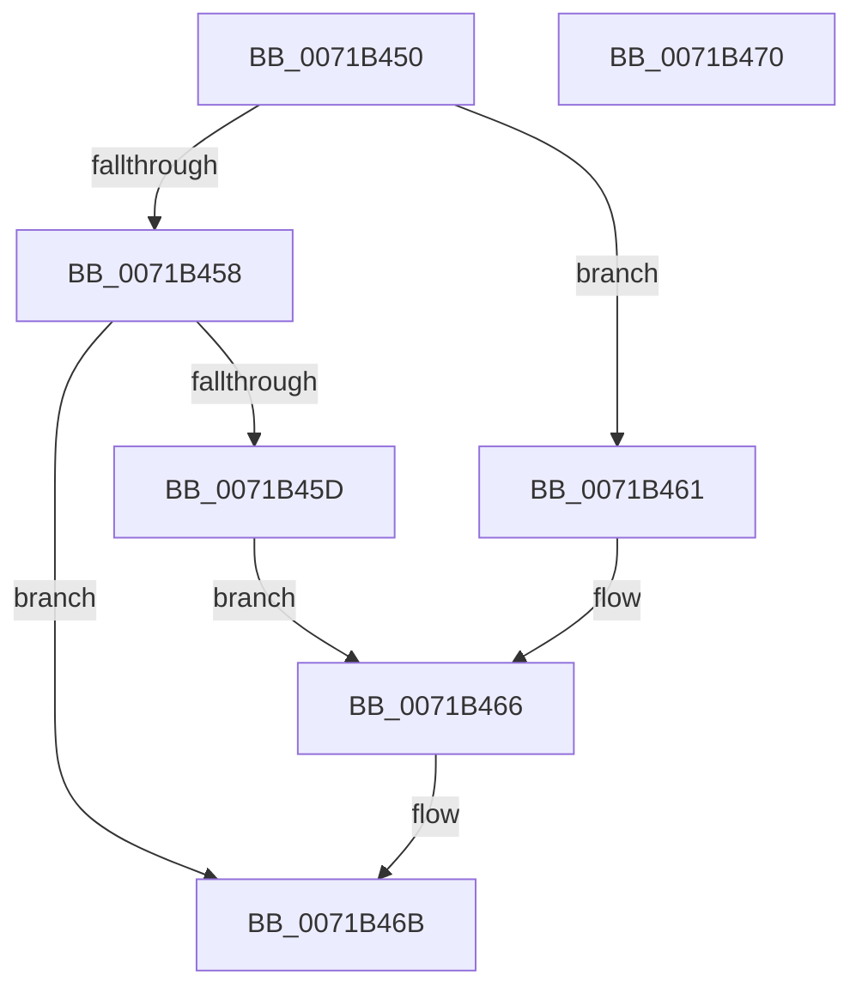

# IopEtwEnableCallback

- RVA: `0x0071B450`–`0x0071B471` (길이 `33` bytes)
- VA: `0x000000014071B450`
- 실행 섹션: `PAGE`
- PDB 이름 있음: `예`; PDB Function 태그: `아니요`
- unwind 정보 RVA: `0x0005C788`
- 디코드: `13`개 명령, `33/33` bytes 표시
- 미해석 바이트: `0` (있으면 어셈블리에 `.byte`로 보존)

> 이 문서는 커널 이미지의 기계어와 PDB 기호를 분석해 생성했습니다. 4번과 5번은 함수 원형과 자료형을 바이너리 사용 방식에서 추정한 C 해석이며 원본 소스 복구 결과는 아닙니다.

## 1. Dependencies

- 직접 호출 지점: **1**; 고유 호출 대상: **1**
- 직접 호출자로 확인된 함수: **0**
- RIP 상대 이미지 참조: **0**

### Outgoing calls
- `0x0071B466` → [IopIrpExtensionControl](../../text/59/IopIrpExtensionControl_function_00597558.md) (function, `0x00597558`)

### Direct callers
- 이 함수 시작 RVA로 연결되는 직접 call은 확인되지 않았습니다. 간접 호출은 완전히 역산할 수 없습니다.

### Static image references
- 디코드된 RIP-relative 메모리 참조가 없습니다.

## 2. Other-region calls and transfers

- 다른 실행 섹션으로 향하는 call: **1**
  - `0x0071B466` → [IopIrpExtensionControl](../../text/59/IopIrpExtensionControl_function_00597558.md) (`PAGE` → `.text`)
- 별도 외부 분기/꼬리 이동을 확인하지 못했습니다.

## 3. Assembly (complete function range)

```asm
0071B450  48 83 EC 28                     sub rsp, 0x28
0071B454  85 D2                           test edx, edx
0071B456  74 09                           je 0x14071b461
0071B458  83 FA 01                        cmp edx, 1
0071B45B  75 0E                           jne 0x14071b46b
0071B45D  8B CA                           mov ecx, edx
0071B45F  EB 05                           jmp 0x14071b466
0071B461  33 D2                           xor edx, edx
0071B463  8D 4A 01                        lea ecx, [rdx + 1]
0071B466  E8 ED C0 E7 FF                  call 0x140597558
0071B46B  48 83 C4 28                     add rsp, 0x28
0071B46F  C3                              ret
0071B470  CC                              int3
```

## 4. C-style interpretation (structured pseudocode)

```c
__int64 __fastcall IopEtwEnableCallback(__int64 a1, int a2)
{
    __int64 result;
    __int64 v_rsp;

    v_rsp = (v_rsp) - (40);
    if (a2 == 0) goto loc_0071B461;
    if (a2 != 1) goto loc_0071B46B;
    goto loc_0071B466;
loc_0071B461:
    a2 = 0;
loc_0071B466:
    result = IopIrpExtensionControl(a2 + 1, a2, a3, a4);
loc_0071B46B:
    v_rsp = (v_rsp) + (40);
    return result;
}
```

## 5. (Beta) C Style

```c
int64_t IopEtwEnableCallback(int64_t Arg1, int32_t Arg2)
{
    int64_t result;
    int64_t local_rsp;

    local_rsp = (local_rsp) - (40);
    if (Arg2 == 0) goto loc_0071B461;
    if (Arg2 != 1) goto loc_0071B46B;
    goto loc_0071B466;
loc_0071B461:
    Arg2 = 0;
loc_0071B466:
    result = IopIrpExtensionControl(Arg2 + 1, Arg2, a3, a4);
loc_0071B46B:
    local_rsp = (local_rsp) + (40);
    return result;
}
```

## 6. Execution-region graph

[열기: 2D/3D 그래프와 함수 탐색 컨트롤 패널](../../../control-panel.html?section=page&rva=0x0071B450&view=graph)

- 2D 그래프는 위에서 아래로 흐르고, 3D 그래프는 빈 공간을 드래그해 회전합니다. Shift+드래그는 이동, 휠은 확대·축소, 함수 노드 선택은 대상 보고서 이동입니다.

### Static fallback


