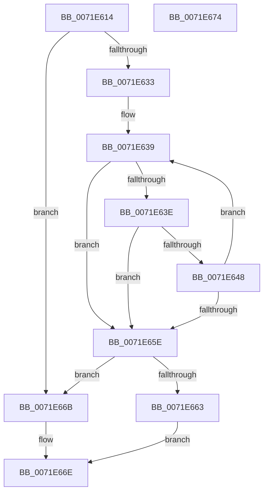

# IopFindMatchingComponentsLengthR

- RVA: `0x0071E614`–`0x0071E675` (길이 `97` bytes)
- VA: `0x000000014071E614`
- 실행 섹션: `PAGE`
- PDB 이름 있음: `예`; PDB Function 태그: `아니요`
- unwind 정보 RVA: `0x00071750`
- 디코드: `32`개 명령, `97/97` bytes 표시
- 미해석 바이트: `0` (있으면 어셈블리에 `.byte`로 보존)

> 이 문서는 커널 이미지의 기계어와 PDB 기호를 분석해 생성했습니다. 4번과 5번은 함수 원형과 자료형을 바이너리 사용 방식에서 추정한 C 해석이며 원본 소스 복구 결과는 아닙니다.

## 1. Dependencies

- 직접 호출 지점: **0**; 고유 호출 대상: **0**
- 직접 호출자로 확인된 함수: **1**
- RIP 상대 이미지 참조: **0**

### Outgoing calls
- 직접 디코드된 call 명령이 없습니다.

### Direct callers
- [IopSymlinkProcessReparse](../A3/IopSymlinkProcessReparse_function_00A330B4.md) at `0x00A33136`

### Static image references
- 디코드된 RIP-relative 메모리 참조가 없습니다.

## 2. Other-region calls and transfers

- 다른 실행 섹션으로 향하는 call: **0**
- 별도 외부 분기/꼬리 이동을 확인하지 못했습니다.

## 3. Assembly (complete function range)

```asm
0071E614  48 89 5C 24 08                  mov qword ptr [rsp + 8], rbx
0071E619  4C 8B 59 08                     mov r11, qword ptr [rcx + 8]
0071E61D  33 DB                           xor ebx, ebx
0071E61F  0F B7 01                        movzx eax, word ptr [rcx]
0071E622  8B CB                           mov ecx, ebx
0071E624  4C 8B 52 08                     mov r10, qword ptr [rdx + 8]
0071E628  49 03 C3                        add rax, r11
0071E62B  4C 8B C0                        mov r8, rax
0071E62E  49 3B C3                        cmp rax, r11
0071E631  72 38                           jb 0x14071e66b
0071E633  0F B7 12                        movzx edx, word ptr [rdx]
0071E636  49 03 D2                        add rdx, r10
0071E639  49 3B D2                        cmp rdx, r10
0071E63C  72 20                           jb 0x14071e65e
0071E63E  45 0F B7 08                     movzx r9d, word ptr [r8]
0071E642  66 44 3B 0A                     cmp r9w, word ptr [rdx]
0071E646  75 16                           jne 0x14071e65e
0071E648  66 41 83 F9 5C                  cmp r9w, 0x5c
0071E64D  49 0F 44 C8                     cmove rcx, r8
0071E651  49 83 E8 02                     sub r8, 2
0071E655  48 83 EA 02                     sub rdx, 2
0071E659  4D 3B C3                        cmp r8, r11
0071E65C  73 DB                           jae 0x14071e639
0071E65E  48 85 C9                        test rcx, rcx
0071E661  74 08                           je 0x14071e66b
0071E663  48 2B C1                        sub rax, rcx
0071E666  48 D1 F8                        sar rax, 1
0071E669  EB 03                           jmp 0x14071e66e
0071E66B  0F B7 C3                        movzx eax, bx
0071E66E  48 8B 5C 24 08                  mov rbx, qword ptr [rsp + 8]
0071E673  C3                              ret
0071E674  CC                              int3
```

## 4. C-style interpretation (structured pseudocode)

```c
__int64 __fastcall IopFindMatchingComponentsLengthR(__int64 a1, __int64 a2)
{
    __int64 result;
    __int64 v_rbx;
    unsigned __int64 v_stack_p8;

    v_stack_p8 = v_rbx;
    v_rbx = 0;
    result = (*(unsigned __int16 *)(a1)) + (*(unsigned __int64 *)(a1 + 8));
    if (result < (*(unsigned __int64 *)(a1 + 8))) goto loc_0071E66B;
    a2 = (*(unsigned __int16 *)(a2)) + (*(unsigned __int64 *)(a2 + 8));
loc_0071E639:
    if (a2 < (*(unsigned __int64 *)(a2 + 8))) goto loc_0071E65E;
    if (((unsigned __int16)(*(unsigned __int16 *)(result))) != (*(unsigned __int16 *)(a2))) goto loc_0071E65E;
    a1 = 0;
    if (((unsigned __int16)(*(unsigned __int16 *)(result))) == 92) { a1 = result; }
    a3 = (result) - (2);
    a2 = (a2) - (2);
    if (a3 >= (*(unsigned __int64 *)(a1 + 8))) goto loc_0071E639;
loc_0071E65E:
    if (a1 == 0) goto loc_0071E66B;
    result = (result) - (a1);
    result = (result) >> (1);
    goto loc_0071E66E;
loc_0071E66B:
loc_0071E66E:
    return 0;
}
```

## 5. (Beta) C Style

```c
int64_t IopFindMatchingComponentsLengthR(void *Arg1, void *Arg2)
{
    uint8_t *arg1 = (uint8_t *)Arg1;
    uint8_t *arg2 = (uint8_t *)Arg2;

    int64_t result;
    int64_t local_rbx;
    uint64_t v_stack_p8;

    v_stack_p8 = local_rbx;
    local_rbx = 0;
    result = (*(uint16_t *)(arg1)) + (*(uint64_t *)(arg1 + 0x8));
    if (result < (*(uint64_t *)(arg1 + 0x8))) goto loc_0071E66B;
    Arg2 = (*(uint16_t *)(arg2)) + (*(uint64_t *)(arg2 + 0x8));
loc_0071E639:
    if (Arg2 < (*(uint64_t *)(arg2 + 0x8))) goto loc_0071E65E;
    if (((uint16_t)(*(uint16_t *)(result))) != (*(uint16_t *)(arg2))) goto loc_0071E65E;
    Arg1 = 0;
    if (((uint16_t)(*(uint16_t *)(result))) == 92) { Arg1 = result; }
    a3 = (result) - (2);
    Arg2 = (Arg2) - (2);
    if (a3 >= (*(uint64_t *)(arg1 + 0x8))) goto loc_0071E639;
loc_0071E65E:
    if (Arg1 == NULL) goto loc_0071E66B;
    result = (result) - (Arg1);
    result = (result) >> (1);
    goto loc_0071E66E;
loc_0071E66B:
loc_0071E66E:
    return 0;
}
```

### 관측된 메모리 오프셋

구조체 형식이 확인되지 않은 접근은 인자 기준의 오프셋으로만 기록했습니다.

| 기준 인자 | 오프셋 표현 | 폭 (bit) | 접근 |
|---|---:|---:|---|
| `Arg1` | `+ 0x0` | `16` | `R` |
| `Arg1` | `+ 0x8` | `64` | `R` |
| `Arg2` | `+ 0x0` | `16` | `R` |
| `Arg2` | `+ 0x8` | `64` | `R` |

## 6. Execution-region graph

[열기: 2D/3D 그래프와 함수 탐색 컨트롤 패널](../../../control-panel.html?section=page&rva=0x0071E614&view=graph)

- 2D 그래프는 위에서 아래로 흐르고, 3D 그래프는 빈 공간을 드래그해 회전합니다. Shift+드래그는 이동, 휠은 확대·축소, 함수 노드 선택은 대상 보고서 이동입니다.

### Static fallback


