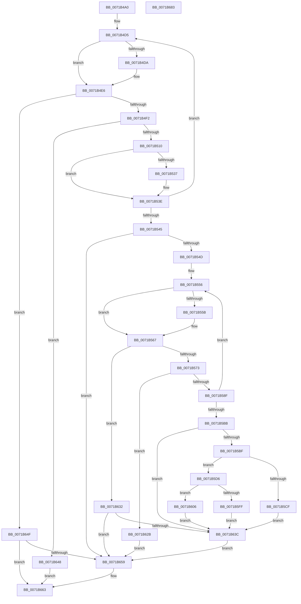

# IopGetRelatedFileName

- RVA: `0x0071B4A0`–`0x0071B684` (길이 `484` bytes)
- VA: `0x000000014071B4A0`
- 실행 섹션: `PAGE`
- PDB 이름 있음: `예`; PDB Function 태그: `아니요`
- unwind 정보 RVA: `0x000AC264`
- 디코드: `141`개 명령, `484/484` bytes 표시
- 미해석 바이트: `0` (있으면 어셈블리에 `.byte`로 보존)

> 이 문서는 커널 이미지의 기계어와 PDB 기호를 분석해 생성했습니다. 4번과 5번은 함수 원형과 자료형을 바이너리 사용 방식에서 추정한 C 해석이며 원본 소스 복구 결과는 아닙니다.

## 1. Dependencies

- 직접 호출 지점: **11**; 고유 호출 대상: **5**
- 직접 호출자로 확인된 함수: **1**
- RIP 상대 이미지 참조: **0**

### Outgoing calls
- `0x0071B4DF` → [ExFreePoolWithTag](../../poolcode/B8/ExFreePoolWithTag_function_00B82870.md) (function, `0x00B82870`)
- `0x0071B4FF` → [ExAllocatePool2](../../poolcode/B8/ExAllocatePool2_function_00B820F0.md) (function, `0x00B820F0`)
- `0x0071B524` → [ObQueryNameStringMode](../8A/ObQueryNameStringMode_function_008A7ED0.md) (function, `0x008A7ED0`)
- `0x0071B560` → [ExFreePoolWithTag](../../poolcode/B8/ExFreePoolWithTag_function_00B82870.md) (function, `0x00B82870`)
- `0x0071B57E` → [ExAllocatePool2](../../poolcode/B8/ExAllocatePool2_function_00B820F0.md) (function, `0x00B820F0`)
- `0x0071B5A8` → [IopGetFileInformation](../8A/IopGetFileInformation_function_008AD4D0.md) (function, `0x008AD4D0`)
- `0x0071B5F1` → [ExAllocatePool2](../../poolcode/B8/ExAllocatePool2_function_00B820F0.md) (function, `0x00B820F0`)
- `0x0071B611` → [memcpy](../../text/6C/memcpy_function_006C6840.md) (function, `0x006C6840`)
- `0x0071B624` → [memcpy](../../text/6C/memcpy_function_006C6840.md) (function, `0x006C6840`)
- `0x0071B641` → [ExFreePoolWithTag](../../poolcode/B8/ExFreePoolWithTag_function_00B82870.md) (function, `0x00B82870`)
- `0x0071B65E` → [ExFreePoolWithTag](../../poolcode/B8/ExFreePoolWithTag_function_00B82870.md) (function, `0x00B82870`)

### Direct callers
- [sub_00B39F44](../B3/Unknown_function_00B39F44.md) at `0x00B39F66`

### Static image references
- 디코드된 RIP-relative 메모리 참조가 없습니다.

## 2. Other-region calls and transfers

- 다른 실행 섹션으로 향하는 call: **9**
  - `0x0071B4DF` → [ExFreePoolWithTag](../../poolcode/B8/ExFreePoolWithTag_function_00B82870.md) (`PAGE` → `POOLCODE`)
  - `0x0071B4FF` → [ExAllocatePool2](../../poolcode/B8/ExAllocatePool2_function_00B820F0.md) (`PAGE` → `POOLCODE`)
  - `0x0071B560` → [ExFreePoolWithTag](../../poolcode/B8/ExFreePoolWithTag_function_00B82870.md) (`PAGE` → `POOLCODE`)
  - `0x0071B57E` → [ExAllocatePool2](../../poolcode/B8/ExAllocatePool2_function_00B820F0.md) (`PAGE` → `POOLCODE`)
  - `0x0071B5F1` → [ExAllocatePool2](../../poolcode/B8/ExAllocatePool2_function_00B820F0.md) (`PAGE` → `POOLCODE`)
  - `0x0071B611` → [memcpy](../../text/6C/memcpy_function_006C6840.md) (`PAGE` → `.text`)
  - `0x0071B624` → [memcpy](../../text/6C/memcpy_function_006C6840.md) (`PAGE` → `.text`)
  - `0x0071B641` → [ExFreePoolWithTag](../../poolcode/B8/ExFreePoolWithTag_function_00B82870.md) (`PAGE` → `POOLCODE`)
  - `0x0071B65E` → [ExFreePoolWithTag](../../poolcode/B8/ExFreePoolWithTag_function_00B82870.md) (`PAGE` → `POOLCODE`)
- 별도 외부 분기/꼬리 이동을 확인하지 못했습니다.

## 3. Assembly (complete function range)

```asm
0071B4A0  48 8B C4                        mov rax, rsp
0071B4A3  48 89 58 08                     mov qword ptr [rax + 8], rbx
0071B4A7  48 89 68 10                     mov qword ptr [rax + 0x10], rbp
0071B4AB  48 89 70 18                     mov qword ptr [rax + 0x18], rsi
0071B4AF  57                              push rdi
0071B4B0  41 54                           push r12
0071B4B2  41 55                           push r13
0071B4B4  41 56                           push r14
0071B4B6  41 57                           push r15
0071B4B8  48 83 EC 40                     sub rsp, 0x40
0071B4BC  33 F6                           xor esi, esi
0071B4BE  45 0F B7 E0                     movzx r12d, r8w
0071B4C2  33 FF                           xor edi, edi
0071B4C4  4D 8B F1                        mov r14, r9
0071B4C7  21 70 C8                        and dword ptr [rax - 0x38], esi
0071B4CA  4C 8B FA                        mov r15, rdx
0071B4CD  4C 8B E9                        mov r13, rcx
0071B4D0  BD 00 01 00 00                  mov ebp, 0x100
0071B4D5  48 85 FF                        test rdi, rdi
0071B4D8  74 0C                           je 0x14071b4e6
0071B4DA  33 D2                           xor edx, edx
0071B4DC  48 8B CF                        mov rcx, rdi
0071B4DF  E8 8C 73 46 00                  call 0x140b82870
0071B4E4  33 FF                           xor edi, edi
0071B4E6  81 FD FF FF 00 00               cmp ebp, 0xffff
0071B4EC  0F 83 5D 01 00 00               jae 0x14071b64f
0071B4F2  8B D5                           mov edx, ebp
0071B4F4  B9 00 01 00 00                  mov ecx, 0x100
0071B4F9  41 B8 49 6F 46 63               mov r8d, 0x63466f49
0071B4FF  E8 EC 6B 46 00                  call 0x140b820f0
0071B504  48 8B F8                        mov rdi, rax
0071B507  48 85 C0                        test rax, rax
0071B50A  0F 84 38 01 00 00               je 0x14071b648
0071B510  49 8B 4D 08                     mov rcx, qword ptr [r13 + 8]
0071B514  4C 8D 4C 24 30                  lea r9, [rsp + 0x30]
0071B519  44 8B C5                        mov r8d, ebp
0071B51C  40 88 74 24 20                  mov byte ptr [rsp + 0x20], sil
0071B521  48 8B D0                        mov rdx, rax
0071B524  E8 A7 C9 18 00                  call 0x1408a7ed0
0071B529  8B 6C 24 30                     mov ebp, dword ptr [rsp + 0x30]
0071B52D  8B D8                           mov ebx, eax
0071B52F  83 C5 08                        add ebp, 8
0071B532  4D 85 F6                        test r14, r14
0071B535  74 07                           je 0x14071b53e
0071B537  0F B7 0F                        movzx ecx, word ptr [rdi]
0071B53A  66 41 89 0E                     mov word ptr [r14], cx
0071B53E  3D 05 00 00 80                  cmp eax, 0x80000005
0071B543  74 90                           je 0x14071b4d5
0071B545  85 C0                           test eax, eax
0071B547  0F 88 0C 01 00 00               js 0x14071b659
0071B54D  41 BE 00 01 00 00               mov r14d, 0x100
0071B553  41 8B EE                        mov ebp, r14d
0071B556  48 85 F6                        test rsi, rsi
0071B559  74 0C                           je 0x14071b567
0071B55B  33 D2                           xor edx, edx
0071B55D  48 8B CE                        mov rcx, rsi
0071B560  E8 0B 73 46 00                  call 0x140b82870
0071B565  33 F6                           xor esi, esi
0071B567  81 FD FF FF 00 00               cmp ebp, 0xffff
0071B56D  0F 83 BF 00 00 00               jae 0x14071b632
0071B573  8B D5                           mov edx, ebp
0071B575  41 B8 49 6F 46 63               mov r8d, 0x63466f49
0071B57B  49 8B CE                        mov rcx, r14
0071B57E  E8 6D 6B 46 00                  call 0x140b820f0
0071B583  48 8B F0                        mov rsi, rax
0071B586  48 85 C0                        test rax, rax
0071B589  0F 84 9C 00 00 00               je 0x14071b62b
0071B58F  49 8B 4D 40                     mov rcx, qword ptr [r13 + 0x40]
0071B593  48 8D 44 24 30                  lea rax, [rsp + 0x30]
0071B598  4C 8B CE                        mov r9, rsi
0071B59B  48 89 44 24 20                  mov qword ptr [rsp + 0x20], rax
0071B5A0  41 B8 09 00 00 00               mov r8d, 9
0071B5A6  8B D5                           mov edx, ebp
0071B5A8  E8 23 1F 19 00                  call 0x1408ad4d0
0071B5AD  8B 16                           mov edx, dword ptr [rsi]
0071B5AF  8B D8                           mov ebx, eax
0071B5B1  8D 6A 08                        lea ebp, [rdx + 8]
0071B5B4  3D 05 00 00 80                  cmp eax, 0x80000005
0071B5B9  74 9B                           je 0x14071b556
0071B5BB  85 C0                           test eax, eax
0071B5BD  78 7D                           js 0x14071b63c
0071B5BF  0F B7 0F                        movzx ecx, word ptr [rdi]
0071B5C2  03 CA                           add ecx, edx
0071B5C4  41 03 CC                        add ecx, r12d
0071B5C7  81 F9 FF FF 00 00               cmp ecx, 0xffff
0071B5CD  72 07                           jb 0x14071b5d6
0071B5CF  BB 06 01 00 C0                  mov ebx, 0xc0000106
0071B5D4  EB 66                           jmp 0x14071b63c
0071B5D6  0F B7 C1                        movzx eax, cx
0071B5D9  66 41 89 4F 02                  mov word ptr [r15 + 2], cx
0071B5DE  66 41 2B C4                     sub ax, r12w
0071B5E2  8B D1                           mov edx, ecx
0071B5E4  41 B8 49 6F 46 63               mov r8d, 0x63466f49
0071B5EA  66 41 89 07                     mov word ptr [r15], ax
0071B5EE  49 8B CE                        mov rcx, r14
0071B5F1  E8 FA 6A 46 00                  call 0x140b820f0
0071B5F6  49 89 47 08                     mov qword ptr [r15 + 8], rax
0071B5FA  48 85 C0                        test rax, rax
0071B5FD  75 07                           jne 0x14071b606
0071B5FF  BB 9A 00 00 C0                  mov ebx, 0xc000009a
0071B604  EB 36                           jmp 0x14071b63c
0071B606  44 0F B7 07                     movzx r8d, word ptr [rdi]
0071B60A  48 8B C8                        mov rcx, rax
0071B60D  48 8B 57 08                     mov rdx, qword ptr [rdi + 8]
0071B611  E8 2A B2 FA FF                  call 0x1406c6840
0071B616  0F B7 0F                        movzx ecx, word ptr [rdi]
0071B619  48 8D 56 04                     lea rdx, [rsi + 4]
0071B61D  49 03 4F 08                     add rcx, qword ptr [r15 + 8]
0071B621  44 8B 06                        mov r8d, dword ptr [rsi]
0071B624  E8 17 B2 FA FF                  call 0x1406c6840
0071B629  EB 11                           jmp 0x14071b63c
0071B62B  BB 9A 00 00 C0                  mov ebx, 0xc000009a
0071B630  EB 27                           jmp 0x14071b659
0071B632  BB 06 01 00 C0                  mov ebx, 0xc0000106
0071B637  48 85 F6                        test rsi, rsi
0071B63A  74 1D                           je 0x14071b659
0071B63C  33 D2                           xor edx, edx
0071B63E  48 8B CE                        mov rcx, rsi
0071B641  E8 2A 72 46 00                  call 0x140b82870
0071B646  EB 11                           jmp 0x14071b659
0071B648  BB 9A 00 00 C0                  mov ebx, 0xc000009a
0071B64D  EB 14                           jmp 0x14071b663
0071B64F  BB 06 01 00 C0                  mov ebx, 0xc0000106
0071B654  48 85 FF                        test rdi, rdi
0071B657  74 0A                           je 0x14071b663
0071B659  33 D2                           xor edx, edx
0071B65B  48 8B CF                        mov rcx, rdi
0071B65E  E8 0D 72 46 00                  call 0x140b82870
0071B663  4C 8D 5C 24 40                  lea r11, [rsp + 0x40]
0071B668  8B C3                           mov eax, ebx
0071B66A  49 8B 5B 30                     mov rbx, qword ptr [r11 + 0x30]
0071B66E  49 8B 6B 38                     mov rbp, qword ptr [r11 + 0x38]
0071B672  49 8B 73 40                     mov rsi, qword ptr [r11 + 0x40]
0071B676  49 8B E3                        mov rsp, r11
0071B679  41 5F                           pop r15
0071B67B  41 5E                           pop r14
0071B67D  41 5D                           pop r13
0071B67F  41 5C                           pop r12
0071B681  5F                              pop rdi
0071B682  C3                              ret
0071B683  CC                              int3
```

## 4. C-style interpretation (structured pseudocode)

```c
__int64 __fastcall IopGetRelatedFileName(__int64 a1, __int64 a2, unsigned __int16 a3, __int64 a4)
{
    __int64 result;
    __int64 v_rbp;
    __int64 v_rdi;
    __int64 v_rsi;
    __int64 v_rsp;
    unsigned __int64 v_stack_m28;
    unsigned __int64 v_stack_m38;
    unsigned __int8 v_stack_m48;

    *(unsigned __int64 *)(v_rsp + 8) = v_rbx;
    *(unsigned __int64 *)(v_rsp + 16) = v_rbp;
    *(unsigned __int64 *)(v_rsp + 24) = v_rsi;
    v_rsp = (v_rsp) - (64);
    v_rsi = 0;
    v_rdi = 0;
loc_0071B4D5:
    result = v_rsp;
    if (0 != 0) {
        a2 = 0;
        a1 = 0;
        result = ExFreePoolWithTag(a1, a2, a3, a4);
        v_rdi = 0;
    }
    if (256 >= 0xFFFFULL) goto loc_0071B64F;
    result = ExAllocatePool2(256, 256, (unsigned int)(0x63466F49ULL), a4);
    if (result == 0) goto loc_0071B648;
    v_stack_m48 = 0;
    result = ObQueryNameStringMode(*(unsigned __int64 *)(a1 + 8), result, 256, v_stack_m38);
    v_rbp = (unsigned int)(((unsigned int)(v_stack_m38)) + (8));
    if (a4 != 0) {
        a1 = *(unsigned __int16 *)(result);
        *(unsigned __int16 *)(a4) = (unsigned __int16)(a1);
    }
    if (((unsigned int)(result)) == 0x80000005ULL) goto loc_0071B4D5;
    if (sign_flag) goto loc_0071B659;
loc_0071B556:
    if (0 != 0) {
        a2 = 0;
        a1 = 0;
        result = ExFreePoolWithTag(a1, a2, 256, v_stack_m38);
        v_rsi = 0;
    }
    if (256 >= 0xFFFFULL) goto loc_0071B632;
    result = ExAllocatePool2(256, 256, (unsigned int)(0x63466F49ULL), v_stack_m38);
    if (result == 0) goto loc_0071B62B;
    v_stack_m48 = v_stack_m38;
    result = IopGetFileInformation(*(unsigned __int64 *)(a1 + 64), 256, 9, result);
    if (((unsigned int)(result)) == 0x80000005ULL) goto loc_0071B556;
    if (sign_flag) goto loc_0071B63C;
    a1 = (unsigned int)((*(unsigned __int16 *)(result)) + ((unsigned int)((unsigned int)(*(unsigned int *)(result)))));
    a1 = (unsigned int)((a1) + (a3));
    if (((unsigned int)(a1)) < 0xFFFFULL) goto loc_0071B5D6;
    goto loc_0071B63C;
loc_0071B5D6:
    *(unsigned __int16 *)(a2 + 2) = (unsigned __int16)(a1);
    result = (unsigned __int16)(((unsigned __int16)(a1)) - (a3));
    *(unsigned __int16 *)(a2) = (unsigned __int16)(result);
    result = ExAllocatePool2(256, (unsigned int)((unsigned int)(a1)), (unsigned int)(0x63466F49ULL), result);
    *(unsigned __int64 *)(a2 + 8) = result;
    if (result != 0) goto loc_0071B606;
    goto loc_0071B63C;
loc_0071B606:
    result = memcpy(result, *(unsigned __int64 *)(result + 8), *(unsigned __int16 *)(result), result);
    a1 = (*(unsigned __int16 *)(result)) + (*(unsigned __int64 *)(a2 + 8));
    result = memcpy(a1, result + 4, (unsigned int)(*(unsigned int *)(result)), result);
    goto loc_0071B63C;
loc_0071B62B:
    goto loc_0071B659;
loc_0071B632:
    if (result == 0) goto loc_0071B659;
loc_0071B63C:
    a2 = 0;
    result = ExFreePoolWithTag(result, a2, (unsigned int)(*(unsigned int *)(result)), result);
    goto loc_0071B659;
loc_0071B648:
    goto loc_0071B663;
loc_0071B64F:
    if (result != 0) {
        a2 = 0;
        a1 = result;
        result = ExFreePoolWithTag(a1, a2, (unsigned int)(*(unsigned int *)(result)), result);
    }
    return (unsigned int)((unsigned int)((unsigned int)(0xC0000106ULL)));
}
```

## 5. (Beta) C Style

```c
int64_t IopGetRelatedFileName(void *Arg1, void *Arg2, uint16_t Arg3, int64_t Arg4)
{
    uint8_t *arg1 = (uint8_t *)Arg1;
    uint8_t *arg2 = (uint8_t *)Arg2;

    int64_t result;
    int64_t local_rbp;
    int64_t local_rdi;
    int64_t local_rsi;
    int64_t local_rsp;
    uint64_t v_stack_m28;
    uint64_t v_stack_m38;
    uint8_t v_stack_m48;

    *(uint64_t *)(local_rsp + 0x8) = local_rbx;
    *(uint64_t *)(local_rsp + 0x10) = local_rbp;
    *(uint64_t *)(local_rsp + 0x18) = local_rsi;
    local_rsp = (local_rsp) - (64);
    local_rsi = 0;
    local_rdi = 0;
loc_0071B4D5:
    result = local_rsp;
    if (0 != 0) {
        Arg2 = 0;
        Arg1 = 0;
        result = ExFreePoolWithTag(Arg1, Arg2, Arg3, Arg4);
        local_rdi = 0;
    }
    if (256 >= 0xFFFFULL) goto loc_0071B64F;
    result = ExAllocatePool2(256, 256, (uint32_t)(0x63466F49ULL), Arg4);
    if (result == 0) goto loc_0071B648;
    v_stack_m48 = 0;
    result = ObQueryNameStringMode(*(uint64_t *)(arg1 + 0x8), result, 256, v_stack_m38);
    local_rbp = (uint32_t)(((uint32_t)(v_stack_m38)) + (8));
    if (Arg4 != 0) {
        Arg1 = *(uint16_t *)(result);
        *(uint16_t *)(Arg4) = (uint16_t)(Arg1);
    }
    if (((uint32_t)(result)) == 0x80000005ULL) goto loc_0071B4D5;
    if (sign_flag) goto loc_0071B659;
loc_0071B556:
    if (0 != 0) {
        Arg2 = 0;
        Arg1 = 0;
        result = ExFreePoolWithTag(Arg1, Arg2, 256, v_stack_m38);
        local_rsi = 0;
    }
    if (256 >= 0xFFFFULL) goto loc_0071B632;
    result = ExAllocatePool2(256, 256, (uint32_t)(0x63466F49ULL), v_stack_m38);
    if (result == 0) goto loc_0071B62B;
    v_stack_m48 = v_stack_m38;
    result = IopGetFileInformation(*(uint64_t *)(arg1 + 0x40), 256, 9, result);
    if (((uint32_t)(result)) == 0x80000005ULL) goto loc_0071B556;
    if (sign_flag) goto loc_0071B63C;
    Arg1 = (uint32_t)((*(uint16_t *)(result)) + ((uint32_t)((uint32_t)(*(uint32_t *)(result)))));
    Arg1 = (uint32_t)((Arg1) + (Arg3));
    if (((uint32_t)(Arg1)) < 0xFFFFULL) goto loc_0071B5D6;
    goto loc_0071B63C;
loc_0071B5D6:
    *(uint16_t *)(arg2 + 0x2) = (uint16_t)(Arg1);
    result = (uint16_t)(((uint16_t)(Arg1)) - (Arg3));
    *(uint16_t *)(arg2) = (uint16_t)(result);
    result = ExAllocatePool2(256, (uint32_t)((uint32_t)(Arg1)), (uint32_t)(0x63466F49ULL), result);
    *(uint64_t *)(arg2 + 0x8) = result;
    if (result != 0) goto loc_0071B606;
    goto loc_0071B63C;
loc_0071B606:
    result = memcpy(result, *(uint64_t *)(result + 0x8), *(uint16_t *)(result), result);
    Arg1 = (*(uint16_t *)(result)) + (*(uint64_t *)(arg2 + 0x8));
    result = memcpy(Arg1, result + 4, (uint32_t)(*(uint32_t *)(result)), result);
    goto loc_0071B63C;
loc_0071B62B:
    goto loc_0071B659;
loc_0071B632:
    if (result == 0) goto loc_0071B659;
loc_0071B63C:
    Arg2 = 0;
    result = ExFreePoolWithTag(result, Arg2, (uint32_t)(*(uint32_t *)(result)), result);
    goto loc_0071B659;
loc_0071B648:
    goto loc_0071B663;
loc_0071B64F:
    if (result != 0) {
        Arg2 = 0;
        Arg1 = result;
        result = ExFreePoolWithTag(Arg1, Arg2, (uint32_t)(*(uint32_t *)(result)), result);
    }
    return (uint32_t)((uint32_t)((uint32_t)(0xC0000106ULL)));
}
```

### 관측된 메모리 오프셋

구조체 형식이 확인되지 않은 접근은 인자 기준의 오프셋으로만 기록했습니다.

| 기준 인자 | 오프셋 표현 | 폭 (bit) | 접근 |
|---|---:|---:|---|
| `Arg1` | `+ 0x8` | `64` | `R` |
| `Arg1` | `+ 0x40` | `64` | `R` |
| `Arg2` | `+ 0x0` | `16` | `W` |
| `Arg2` | `+ 0x2` | `16` | `W` |
| `Arg2` | `+ 0x8` | `64` | `R` |
| `Arg2` | `+ 0x8` | `64` | `W` |

## 6. Execution-region graph

[열기: 2D/3D 그래프와 함수 탐색 컨트롤 패널](../../../control-panel.html?section=page&rva=0x0071B4A0&view=graph)

- 2D 그래프는 위에서 아래로 흐르고, 3D 그래프는 빈 공간을 드래그해 회전합니다. Shift+드래그는 이동, 휠은 확대·축소, 함수 노드 선택은 대상 보고서 이동입니다.

### Static fallback


