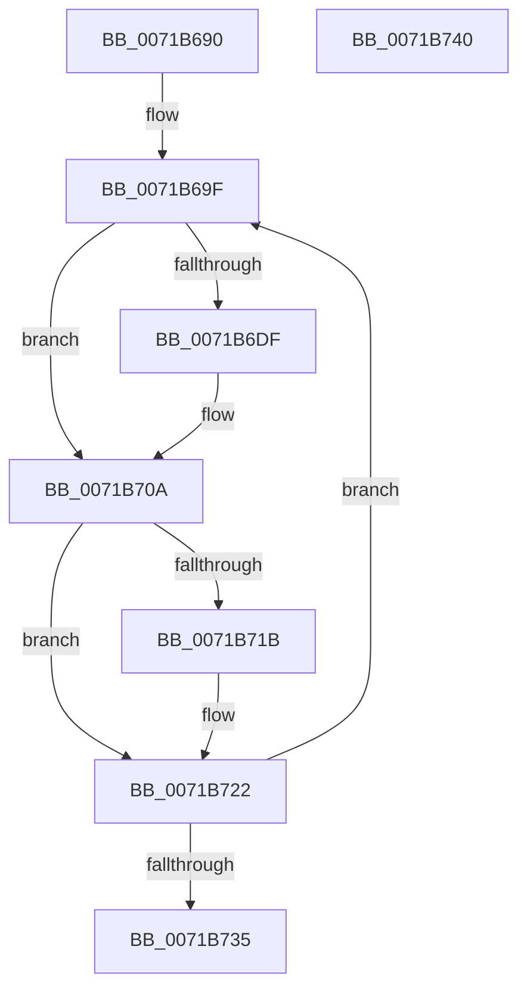

# IopHardErrorThread

- RVA: `0x0071B690`–`0x0071B741` (길이 `177` bytes)
- VA: `0x000000014071B690`
- 실행 섹션: `PAGE`
- PDB 이름 있음: `예`; PDB Function 태그: `아니요`
- unwind 정보 RVA: `0x0006E5F8`
- 디코드: `47`개 명령, `177/177` bytes 표시
- 미해석 바이트: `0` (있으면 어셈블리에 `.byte`로 보존)

> 이 문서는 커널 이미지의 기계어와 PDB 기호를 분석해 생성했습니다. 4번과 5번은 함수 원형과 자료형을 바이너리 사용 방식에서 추정한 C 해석이며 원본 소스 복구 결과는 아닙니다.

## 1. Dependencies

- 직접 호출 지점: **6**; 고유 호출 대상: **5**
- 직접 호출자로 확인된 함수: **0**
- RIP 상대 이미지 참조: **2**

### Outgoing calls
- `0x0071B6B4` → [KeWaitForSingleObject](../../text/20/KeWaitForSingleObject_function_0020E6B0.md) (function, `0x0020E6B0`)
- `0x0071B6B9` → [IopRemoveHardErrorPacket](../../text/4F/IopRemoveHardErrorPacket_function_004F70E0.md) (function, `0x004F70E0`)
- `0x0071B705` → [ExRaiseHardError](../A6/ExRaiseHardError_function_00A64520.md) (function, `0x00A64520`)
- `0x0071B70A` → [IopCheckHardErrorEmpty](../../text/59/IopCheckHardErrorEmpty_function_00596F90.md) (function, `0x00596F90`)
- `0x0071B71D` → [ExFreePoolWithTag](../../poolcode/B8/ExFreePoolWithTag_function_00B82870.md) (function, `0x00B82870`)
- `0x0071B727` → [ExFreePoolWithTag](../../poolcode/B8/ExFreePoolWithTag_function_00B82870.md) (function, `0x00B82870`)

### Direct callers
- 이 함수 시작 RVA로 연결되는 직접 call은 확인되지 않았습니다. 간접 호출은 완전히 역산할 수 없습니다.

### Static image references
- `0x0071B6A5` → RVA `0x00F8D7B8` (`.data`; read)
- `0x0071B6D6` → RVA `0x00E685D0` (`.data`; read)

## 2. Other-region calls and transfers

- 다른 실행 섹션으로 향하는 call: **5**
  - `0x0071B6B4` → [KeWaitForSingleObject](../../text/20/KeWaitForSingleObject_function_0020E6B0.md) (`PAGE` → `.text`)
  - `0x0071B6B9` → [IopRemoveHardErrorPacket](../../text/4F/IopRemoveHardErrorPacket_function_004F70E0.md) (`PAGE` → `.text`)
  - `0x0071B70A` → [IopCheckHardErrorEmpty](../../text/59/IopCheckHardErrorEmpty_function_00596F90.md) (`PAGE` → `.text`)
  - `0x0071B71D` → [ExFreePoolWithTag](../../poolcode/B8/ExFreePoolWithTag_function_00B82870.md) (`PAGE` → `POOLCODE`)
  - `0x0071B727` → [ExFreePoolWithTag](../../poolcode/B8/ExFreePoolWithTag_function_00B82870.md) (`PAGE` → `POOLCODE`)
- 별도 외부 분기/꼬리 이동을 확인하지 못했습니다.

## 3. Assembly (complete function range)

```asm
0071B690  48 89 5C 24 08                  mov qword ptr [rsp + 8], rbx
0071B695  57                              push rdi
0071B696  48 83 EC 30                     sub rsp, 0x30
0071B69A  83 64 24 48 00                  and dword ptr [rsp + 0x48], 0
0071B69F  48 83 64 24 20 00               and qword ptr [rsp + 0x20], 0
0071B6A5  48 8D 0D 0C 21 87 00            lea rcx, [rip + 0x87210c]
0071B6AC  45 33 C9                        xor r9d, r9d
0071B6AF  45 33 C0                        xor r8d, r8d
0071B6B2  33 D2                           xor edx, edx
0071B6B4  E8 F7 2F AF FF                  call 0x14020e6b0
0071B6B9  E8 22 BA DD FF                  call 0x1404f70e0
0071B6BE  33 D2                           xor edx, edx
0071B6C0  48 8B D8                        mov rbx, rax
0071B6C3  48 8D 48 18                     lea rcx, [rax + 0x18]
0071B6C7  48 8B 40 20                     mov rax, qword ptr [rax + 0x20]
0071B6CB  48 85 C0                        test rax, rax
0071B6CE  48 89 4C 24 50                  mov qword ptr [rsp + 0x50], rcx
0071B6D3  0F 95 C2                        setne dl
0071B6D6  80 3D F3 CE 74 00 00            cmp byte ptr [rip + 0x74cef3], 0
0071B6DD  74 2B                           je 0x14071b70a
0071B6DF  8B 4B 10                        mov ecx, dword ptr [rbx + 0x10]
0071B6E2  48 F7 D8                        neg rax
0071B6E5  48 8D 44 24 50                  lea rax, [rsp + 0x50]
0071B6EA  44 8B C2                        mov r8d, edx
0071B6ED  4D 1B C9                        sbb r9, r9
0071B6F0  4C 23 C8                        and r9, rax
0071B6F3  48 8D 44 24 48                  lea rax, [rsp + 0x48]
0071B6F8  48 89 44 24 28                  mov qword ptr [rsp + 0x28], rax
0071B6FD  C7 44 24 20 07 00 00 00         mov dword ptr [rsp + 0x20], 7
0071B705  E8 16 8E 34 00                  call 0x140a64520
0071B70A  E8 81 B8 E7 FF                  call 0x140596f90
0071B70F  48 8B 4B 20                     mov rcx, qword ptr [rbx + 0x20]
0071B713  40 8A F8                        mov dil, al
0071B716  48 85 C9                        test rcx, rcx
0071B719  74 07                           je 0x14071b722
0071B71B  33 D2                           xor edx, edx
0071B71D  E8 4E 71 46 00                  call 0x140b82870
0071B722  33 D2                           xor edx, edx
0071B724  48 8B CB                        mov rcx, rbx
0071B727  E8 44 71 46 00                  call 0x140b82870
0071B72C  40 84 FF                        test dil, dil
0071B72F  0F 85 6A FF FF FF               jne 0x14071b69f
0071B735  48 8B 5C 24 40                  mov rbx, qword ptr [rsp + 0x40]
0071B73A  48 83 C4 30                     add rsp, 0x30
0071B73E  5F                              pop rdi
0071B73F  C3                              ret
0071B740  CC                              int3
```

## 4. C-style interpretation (structured pseudocode)

```c
__int64 __fastcall IopHardErrorThread(__int64 a1, int a2, int a3, int a4)
{
    __int64 result;
    __int64 v_rsp;
    unsigned __int64 v_stack_m10;
    unsigned __int64 v_stack_m18;
    unsigned int v_stack_p10;
    unsigned __int64 v_stack_p18;
    unsigned __int64 v_stack_p8;

    v_stack_p8 = v_rbx;
    v_rsp = (v_rsp) - (48);
loc_0071B69F:
    a4 = 0;
    a3 = 0;
    a2 = 0;
    result = KeWaitForSingleObject(v_rip + 8855820, a2, a3, a4);
    result = IopRemoveHardErrorPacket(v_rip + 8855820, a2, a3, a4);
    a2 = 0;
    v_stack_p18 = result + 24;
    a2 = (*(unsigned __int64 *)(result + 32) != 0) ? 1 : 0;
    result = *(unsigned __int64 *)(result + 32);
    if ((*(unsigned __int8 *)(v_rip + 7655155)) != 0) {
        a1 = *(unsigned int *)(result + 16);
        result = -(*(unsigned __int64 *)(result + 32));
        result = v_stack_p18;
        a3 = a2;
        a4 = (a4) & (result);
        result = v_stack_p10;
        v_stack_m10 = result;
        v_stack_m18 = 7;
        result = ExRaiseHardError(a1, a2, a3, a4);
    }
    result = IopCheckHardErrorEmpty(a1, a2, a3, a4);
    if (*(unsigned __int64 *)(result + 32) != 0) {
        a2 = 0;
        result = ExFreePoolWithTag(*(unsigned __int64 *)(result + 32), a2, a3, a4);
    }
    a2 = 0;
    result = ExFreePoolWithTag(result, a2, a3, a4);
    if ((unsigned __int8)((unsigned __int8)(result)) != 0) goto loc_0071B69F;
    v_rsp = (v_rsp) + (48);
    return result;
}
```

## 5. (Beta) C Style

```c
int64_t IopHardErrorThread(int64_t Arg1, int32_t Arg2, int32_t Arg3, int32_t Arg4)
{
    int64_t result;
    int64_t local_rsp;
    uint64_t v_stack_m10;
    uint64_t v_stack_m18;
    uint32_t v_stack_p10;
    uint64_t v_stack_p18;
    uint64_t v_stack_p8;

    v_stack_p8 = local_rbx;
    local_rsp = (local_rsp) - (48);
loc_0071B69F:
    Arg4 = 0;
    Arg3 = 0;
    Arg2 = 0;
    result = KeWaitForSingleObject(v_rip + 8855820, Arg2, Arg3, Arg4);
    result = IopRemoveHardErrorPacket(v_rip + 8855820, Arg2, Arg3, Arg4);
    Arg2 = 0;
    v_stack_p18 = result + 24;
    Arg2 = (*(uint64_t *)(result + 0x20) != 0) ? 1 : 0;
    result = *(uint64_t *)(result + 0x20);
    if ((*(uint8_t *)(v_rip + 0x74CEF3)) != 0) {
        Arg1 = *(uint32_t *)(result + 0x10);
        result = -(*(uint64_t *)(result + 0x20));
        result = v_stack_p18;
        Arg3 = Arg2;
        Arg4 = (Arg4) & (result);
        result = v_stack_p10;
        v_stack_m10 = result;
        v_stack_m18 = 7;
        result = ExRaiseHardError(Arg1, Arg2, Arg3, Arg4);
    }
    result = IopCheckHardErrorEmpty(Arg1, Arg2, Arg3, Arg4);
    if (*(uint64_t *)(result + 0x20) != 0) {
        Arg2 = 0;
        result = ExFreePoolWithTag(*(uint64_t *)(result + 0x20), Arg2, Arg3, Arg4);
    }
    Arg2 = 0;
    result = ExFreePoolWithTag(result, Arg2, Arg3, Arg4);
    if ((uint8_t)((uint8_t)(result)) != 0) goto loc_0071B69F;
    local_rsp = (local_rsp) + (48);
    return result;
}
```

## 6. Execution-region graph

[열기: 2D/3D 그래프와 함수 탐색 컨트롤 패널](../../../control-panel.html?section=page&rva=0x0071B690&view=graph)

- 2D 그래프는 위에서 아래로 흐르고, 3D 그래프는 빈 공간을 드래그해 회전합니다. Shift+드래그는 이동, 휠은 확대·축소, 함수 노드 선택은 대상 보고서 이동입니다.

### Static fallback


