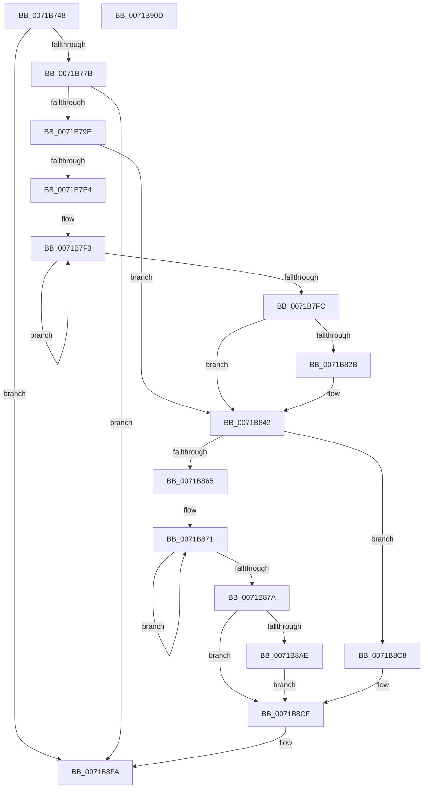

# IopInitializeBootLogging

- RVA: `0x0071B748`–`0x0071B90E` (길이 `454` bytes)
- VA: `0x000000014071B748`
- 실행 섹션: `PAGE`
- PDB 이름 있음: `예`; PDB Function 태그: `아니요`
- unwind 정보 RVA: `0x000C7528`
- 디코드: `114`개 명령, `454/454` bytes 표시
- 미해석 바이트: `0` (있으면 어셈블리에 `.byte`로 보존)

> 이 문서는 커널 이미지의 기계어와 PDB 기호를 분석해 생성했습니다. 4번과 5번은 함수 원형과 자료형을 바이너리 사용 방식에서 추정한 C 해석이며 원본 소스 복구 결과는 아닙니다.

## 1. Dependencies

- 직접 호출 지점: **10**; 고유 호출 대상: **8**
- 직접 호출자로 확인된 함수: **1**
- RIP 상대 이미지 참조: **3**

### Outgoing calls
- `0x0071B789` → [ExAllocatePool2](../../poolcode/B8/ExAllocatePool2_function_00B820F0.md) (function, `0x00B820F0`)
- `0x0071B7A2` → [ExInitializeResourceLite](../../text/41/ExInitializeResourceLite_function_0041F9A0.md) (function, `0x0041F9A0`)
- `0x0071B7B4` → [ExAcquireResourceExclusiveLite](../../text/21/ExAcquireResourceExclusiveLite_function_00214E20.md) (function, `0x00214E20`)
- `0x0071B7D7` → [RtlFindMessage](../99/RtlFindMessage_function_0099B220.md) (function, `0x0099B220`)
- `0x0071B815` → [RtlAnsiStringToUnicodeString](../90/RtlAnsiStringToUnicodeString_function_0090BEA0.md) (function, `0x0090BEA0`)
- `0x0071B85C` → [RtlFindMessage](../99/RtlFindMessage_function_0099B220.md) (function, `0x0099B220`)
- `0x0071B897` → [RtlAnsiStringToUnicodeString](../90/RtlAnsiStringToUnicodeString_function_0090BEA0.md) (function, `0x0090BEA0`)
- `0x0071B8D7` → [RtlCreateUnicodeStringFromAsciiz](../78/RtlCreateUnicodeStringFromAsciiz_function_0078B990.md) (function, `0x0078B990`)
- `0x0071B8E5` → [MmEnumerateSystemImages](../../text/4F/MmEnumerateSystemImages_function_004FC7B0.md) (function, `0x004FC7B0`)
- `0x0071B8F5` → [ExReleaseResourceLite](../../text/25/ExReleaseResourceLite_function_0025FA10.md) (function, `0x0025FA10`)

### Direct callers
- [Phase1InitializationDiscard](../../init/C1/Phase1InitializationDiscard_function_00C1C728.md) at `0x00C1D98F`

### Static image references
- `0x0071B763` → RVA `0x00FD8028` (`PAGEDATA`; read)
- `0x0071B78E` → RVA `0x00FD8028` (`PAGEDATA`; write)
- `0x0071B8DE` → RVA `0x00596F70` (`IopBootLogDriver`; read)

## 2. Other-region calls and transfers

- 다른 실행 섹션으로 향하는 call: **5**
  - `0x0071B789` → [ExAllocatePool2](../../poolcode/B8/ExAllocatePool2_function_00B820F0.md) (`PAGE` → `POOLCODE`)
  - `0x0071B7A2` → [ExInitializeResourceLite](../../text/41/ExInitializeResourceLite_function_0041F9A0.md) (`PAGE` → `.text`)
  - `0x0071B7B4` → [ExAcquireResourceExclusiveLite](../../text/21/ExAcquireResourceExclusiveLite_function_00214E20.md) (`PAGE` → `.text`)
  - `0x0071B8E5` → [MmEnumerateSystemImages](../../text/4F/MmEnumerateSystemImages_function_004FC7B0.md) (`PAGE` → `.text`)
  - `0x0071B8F5` → [ExReleaseResourceLite](../../text/25/ExReleaseResourceLite_function_0025FA10.md) (`PAGE` → `.text`)
- 별도 외부 분기/꼬리 이동을 확인하지 못했습니다.

## 3. Assembly (complete function range)

```asm
0071B748  48 89 5C 24 08                  mov qword ptr [rsp + 8], rbx
0071B74D  48 89 74 24 10                  mov qword ptr [rsp + 0x10], rsi
0071B752  55                              push rbp
0071B753  57                              push rdi
0071B754  41 56                           push r14
0071B756  48 8B EC                        mov rbp, rsp
0071B759  48 83 EC 40                     sub rsp, 0x40
0071B75D  45 33 F6                        xor r14d, r14d
0071B760  48 8B FA                        mov rdi, rdx
0071B763  4C 39 35 BE C8 8B 00            cmp qword ptr [rip + 0x8bc8be], r14
0071B76A  48 8B D9                        mov rbx, rcx
0071B76D  4C 89 75 30                     mov qword ptr [rbp + 0x30], r14
0071B771  44 89 75 F4                     mov dword ptr [rbp - 0xc], r14d
0071B775  0F 85 7F 01 00 00               jne 0x14071b8fa
0071B77B  BA B0 00 00 00                  mov edx, 0xb0
0071B780  41 B8 49 6F 20 20               mov r8d, 0x20206f49
0071B786  8D 4A 90                        lea ecx, [rdx - 0x70]
0071B789  E8 62 69 46 00                  call 0x140b820f0
0071B78E  48 89 05 93 C8 8B 00            mov qword ptr [rip + 0x8bc893], rax
0071B795  48 85 C0                        test rax, rax
0071B798  0F 84 5C 01 00 00               je 0x14071b8fa
0071B79E  48 8D 48 40                     lea rcx, [rax + 0x40]
0071B7A2  E8 F9 41 D0 FF                  call 0x14041f9a0
0071B7A7  48 8B 0D 7A C8 8B 00            mov rcx, qword ptr [rip + 0x8bc87a]
0071B7AE  B2 01                           mov dl, 1
0071B7B0  48 83 C1 40                     add rcx, 0x40
0071B7B4  E8 67 96 AF FF                  call 0x140214e20
0071B7B9  48 8B 73 10                     mov rsi, qword ptr [rbx + 0x10]
0071B7BD  48 8D 45 30                     lea rax, [rbp + 0x30]
0071B7C1  41 B9 B5 00 00 00               mov r9d, 0xb5
0071B7C7  48 89 44 24 20                  mov qword ptr [rsp + 0x20], rax
0071B7CC  45 33 C0                        xor r8d, r8d
0071B7CF  41 8D 56 0B                     lea edx, [r14 + 0xb]
0071B7D3  48 8B 4E 30                     mov rcx, qword ptr [rsi + 0x30]
0071B7D7  E8 44 FA 27 00                  call 0x14099b220
0071B7DC  48 83 CB FF                     or rbx, 0xffffffffffffffff
0071B7E0  85 C0                           test eax, eax
0071B7E2  78 5E                           js 0x14071b842
0071B7E4  48 8B 4D 30                     mov rcx, qword ptr [rbp + 0x30]
0071B7E8  48 8B C3                        mov rax, rbx
0071B7EB  48 83 C1 04                     add rcx, 4
0071B7EF  48 89 4D F8                     mov qword ptr [rbp - 8], rcx
0071B7F3  48 FF C0                        inc rax
0071B7F6  44 38 34 01                     cmp byte ptr [rcx + rax], r14b
0071B7FA  75 F7                           jne 0x14071b7f3
0071B7FC  48 8B 0D 25 C8 8B 00            mov rcx, qword ptr [rip + 0x8bc825]
0071B803  48 8D 55 F0                     lea rdx, [rbp - 0x10]
0071B807  66 89 45 F0                     mov word ptr [rbp - 0x10], ax
0071B80B  41 B0 01                        mov r8b, 1
0071B80E  66 FF C0                        inc ax
0071B811  66 89 45 F2                     mov word ptr [rbp - 0xe], ax
0071B815  E8 86 06 1F 00                  call 0x14090bea0
0071B81A  4C 8B 05 07 C8 8B 00            mov r8, qword ptr [rip + 0x8bc807]
0071B821  41 0F B7 00                     movzx eax, word ptr [r8]
0071B825  66 83 F8 04                     cmp ax, 4
0071B829  76 17                           jbe 0x14071b842
0071B82B  66 83 E8 04                     sub ax, 4
0071B82F  0F B7 C8                        movzx ecx, ax
0071B832  66 41 89 00                     mov word ptr [r8], ax
0071B836  49 8B 40 08                     mov rax, qword ptr [r8 + 8]
0071B83A  48 D1 E9                        shr rcx, 1
0071B83D  66 44 89 34 48                  mov word ptr [rax + rcx*2], r14w
0071B842  48 8B 4E 30                     mov rcx, qword ptr [rsi + 0x30]
0071B846  48 8D 45 30                     lea rax, [rbp + 0x30]
0071B84A  45 33 C0                        xor r8d, r8d
0071B84D  48 89 44 24 20                  mov qword ptr [rsp + 0x20], rax
0071B852  41 B9 B6 00 00 00               mov r9d, 0xb6
0071B858  41 8D 50 0B                     lea edx, [r8 + 0xb]
0071B85C  E8 BF F9 27 00                  call 0x14099b220
0071B861  85 C0                           test eax, eax
0071B863  78 63                           js 0x14071b8c8
0071B865  48 8B 45 30                     mov rax, qword ptr [rbp + 0x30]
0071B869  48 83 C0 04                     add rax, 4
0071B86D  48 89 45 F8                     mov qword ptr [rbp - 8], rax
0071B871  48 FF C3                        inc rbx
0071B874  44 38 34 18                     cmp byte ptr [rax + rbx], r14b
0071B878  75 F7                           jne 0x14071b871
0071B87A  48 8B 0D A7 C7 8B 00            mov rcx, qword ptr [rip + 0x8bc7a7]
0071B881  48 8D 55 F0                     lea rdx, [rbp - 0x10]
0071B885  66 89 5D F0                     mov word ptr [rbp - 0x10], bx
0071B889  48 83 C1 10                     add rcx, 0x10
0071B88D  66 FF C3                        inc bx
0071B890  41 B0 01                        mov r8b, 1
0071B893  66 89 5D F2                     mov word ptr [rbp - 0xe], bx
0071B897  E8 04 06 1F 00                  call 0x14090bea0
0071B89C  4C 8B 05 85 C7 8B 00            mov r8, qword ptr [rip + 0x8bc785]
0071B8A3  41 0F B7 40 10                  movzx eax, word ptr [r8 + 0x10]
0071B8A8  66 83 F8 04                     cmp ax, 4
0071B8AC  76 21                           jbe 0x14071b8cf
0071B8AE  66 83 E8 04                     sub ax, 4
0071B8B2  0F B7 C8                        movzx ecx, ax
0071B8B5  66 41 89 40 10                  mov word ptr [r8 + 0x10], ax
0071B8BA  49 8B 40 18                     mov rax, qword ptr [r8 + 0x18]
0071B8BE  48 D1 E9                        shr rcx, 1
0071B8C1  66 44 89 34 48                  mov word ptr [rax + rcx*2], r14w
0071B8C6  EB 07                           jmp 0x14071b8cf
0071B8C8  4C 8B 05 59 C7 8B 00            mov r8, qword ptr [rip + 0x8bc759]
0071B8CF  48 8D 57 01                     lea rdx, [rdi + 1]
0071B8D3  49 8D 48 30                     lea rcx, [r8 + 0x30]
0071B8D7  E8 B4 00 07 00                  call 0x14078b990
0071B8DC  33 D2                           xor edx, edx
0071B8DE  48 8D 0D 8B B6 E7 FF            lea rcx, [rip - 0x184975]
0071B8E5  E8 C6 0E DE FF                  call 0x1404fc7b0
0071B8EA  48 8B 0D 37 C7 8B 00            mov rcx, qword ptr [rip + 0x8bc737]
0071B8F1  48 83 C1 40                     add rcx, 0x40
0071B8F5  E8 16 41 B4 FF                  call 0x14025fa10
0071B8FA  48 8B 5C 24 60                  mov rbx, qword ptr [rsp + 0x60]
0071B8FF  48 8B 74 24 68                  mov rsi, qword ptr [rsp + 0x68]
0071B904  48 83 C4 40                     add rsp, 0x40
0071B908  41 5E                           pop r14
0071B90A  5F                              pop rdi
0071B90B  5D                              pop rbp
0071B90C  C3                              ret
0071B90D  CC                              int3
```

## 4. C-style interpretation (structured pseudocode)

```c
__int64 __fastcall IopInitializeBootLogging(__int64 a1, __int64 a2)
{
    __int64 result;
    __int64 v_r14;
    __int64 v_rbx;
    __int64 v_rsp;
    unsigned __int64 v_stack_m20;
    unsigned int v_stack_m24;
    unsigned __int16 v_stack_m26;
    unsigned __int64 v_stack_m28;
    unsigned __int64 v_stack_m38;
    unsigned __int64 v_stack_p10;
    unsigned __int64 v_stack_p18;
    unsigned __int64 v_stack_p8;

    v_stack_p8 = v_rbx;
    v_stack_p10 = v_rsi;
    v_rsp = (v_rsp) - (64);
    v_r14 = 0;
    v_stack_p18 = 0;
    v_stack_m24 = 0;
    if ((*(unsigned __int64 *)(v_rip + 9160894)) != 0) goto loc_0071B8FA;
    result = ExAllocatePool2(176 - 112, 176, (unsigned int)(0x20206F49ULL), a4);
    *(unsigned __int64 *)(v_rip + 9160851) = result;
    if (result == 0) goto loc_0071B8FA;
    result = ExInitializeResourceLite(result + 64, 176, (unsigned int)(0x20206F49ULL), a4);
    a1 = (*(unsigned __int64 *)(v_rip + 9160826)) + (64);
    result = ExAcquireResourceExclusiveLite(a1, 1, (unsigned int)(0x20206F49ULL), a4);
    v_stack_m38 = v_stack_p18;
    a3 = 0;
    result = RtlFindMessage(*(unsigned __int64 *)(*(unsigned __int64 *)(a1 + 16) + 48), v_r14 + 11, a3, 181);
    v_rbx = (a1) | (-1);
    if (sign_flag) goto loc_0071B842;
    a1 = (v_stack_p18) + (4);
    v_stack_m20 = a1;
loc_0071B7F3:
    result = (v_rbx) + 1;
    if ((*(unsigned __int8 *)(a1 + result * 1)) != 0) goto loc_0071B7F3;
    v_stack_m28 = (unsigned __int16)(result);
    result = (unsigned __int16)((result) + 1);
    v_stack_m26 = (unsigned __int16)(result);
    result = RtlAnsiStringToUnicodeString(*(unsigned __int64 *)(v_rip + 9160741), v_stack_m28, 1, 181);
    result = *(unsigned __int16 *)(*(unsigned __int64 *)(v_rip + 9160711));
    if (((unsigned __int16)(*(unsigned __int16 *)(*(unsigned __int64 *)(v_rip + 9160711)))) >= = 4) {
        result = (unsigned __int16)((*(unsigned __int16 *)(*(unsigned __int64 *)(v_rip + 9160711))) - (4));
        a1 = (unsigned __int16)(result);
        *(unsigned __int16 *)(*(unsigned __int64 *)(v_rip + 9160711)) = (unsigned __int16)(result);
        result = *(unsigned __int64 *)(*(unsigned __int64 *)(v_rip + 9160711) + 8);
        a1 = (a1) >> (1);
        *(unsigned __int16 *)(result + a1 * 2) = 0;
    }
    a3 = 0;
    v_stack_m38 = v_stack_p18;
    result = RtlFindMessage(*(unsigned __int64 *)(*(unsigned __int64 *)(a1 + 16) + 48), a3 + 11, a3, 182);
    if (sign_flag) goto loc_0071B8C8;
    result = (v_stack_p18) + (4);
    v_stack_m20 = result;
loc_0071B871:
    v_rbx = (v_rbx) + 1;
    if ((*(unsigned __int8 *)(result + v_rbx * 1)) != 0) goto loc_0071B871;
    v_stack_m28 = (unsigned __int16)(v_rbx);
    a1 = (*(unsigned __int64 *)(v_rip + 9160615)) + (16);
    v_rbx = (unsigned __int16)((v_rbx) + 1);
    v_stack_m26 = (unsigned __int16)(v_rbx);
    result = RtlAnsiStringToUnicodeString(a1, v_stack_m28, 1, 182);
    if (((unsigned __int16)(*(unsigned __int16 *)(*(unsigned __int64 *)(v_rip + 9160581) + 16))) <= 4) goto loc_0071B8CF;
    result = (unsigned __int16)((*(unsigned __int16 *)(*(unsigned __int64 *)(v_rip + 9160581) + 16)) - (4));
    *(unsigned __int16 *)(*(unsigned __int64 *)(v_rip + 9160581) + 16) = (unsigned __int16)(result);
    a1 = ((unsigned __int16)(result)) >> (1);
    *(unsigned __int16 *)(*(unsigned __int64 *)(*(unsigned __int64 *)(v_rip + 9160581) + 24) + a1 * 2) = 0;
    goto loc_0071B8CF;
loc_0071B8C8:
loc_0071B8CF:
    result = RtlCreateUnicodeStringFromAsciiz(*(unsigned __int64 *)(v_rip + 9160537) + 48, a2 + 1, *(unsigned __int64 *)(v_rip + 9160537), 182);
    a2 = 0;
    result = MmEnumerateSystemImages(v_rip - 1591669, a2, *(unsigned __int64 *)(v_rip + 9160537), 182);
    a1 = (*(unsigned __int64 *)(v_rip + 9160503)) + (64);
    result = ExReleaseResourceLite(a1, a2, *(unsigned __int64 *)(v_rip + 9160537), 182);
loc_0071B8FA:
    v_rsp = (v_rsp) + (64);
    return result;
}
```

## 5. (Beta) C Style

```c
int64_t IopInitializeBootLogging(void *Arg1, void *Arg2)
{
    uint8_t *arg1 = (uint8_t *)Arg1;
    uint8_t *arg2 = (uint8_t *)Arg2;

    int64_t result;
    int64_t local_r14;
    int64_t local_rbx;
    int64_t local_rsp;
    uint64_t v_stack_m20;
    uint32_t v_stack_m24;
    uint16_t v_stack_m26;
    uint64_t v_stack_m28;
    uint64_t v_stack_m38;
    uint64_t v_stack_p10;
    uint64_t v_stack_p18;
    uint64_t v_stack_p8;

    v_stack_p8 = local_rbx;
    v_stack_p10 = local_rsi;
    local_rsp = (local_rsp) - (64);
    local_r14 = 0;
    v_stack_p18 = 0;
    v_stack_m24 = 0;
    if ((*(uint64_t *)(v_rip + 0x8BC8BE)) != 0) goto loc_0071B8FA;
    result = ExAllocatePool2(176 - 112, 176, (uint32_t)(0x20206F49ULL), a4);
    *(uint64_t *)(v_rip + 0x8BC893) = result;
    if (result == 0) goto loc_0071B8FA;
    result = ExInitializeResourceLite(result + 64, 176, (uint32_t)(0x20206F49ULL), a4);
    Arg1 = (*(uint64_t *)(v_rip + 0x8BC87A)) + (64);
    result = ExAcquireResourceExclusiveLite(Arg1, 1, (uint32_t)(0x20206F49ULL), a4);
    v_stack_m38 = v_stack_p18;
    a3 = 0;
    result = RtlFindMessage(*(uint64_t *)(*(uint64_t *)(arg1 + 0x10) + 0x30), local_r14 + 11, a3, 181);
    local_rbx = (Arg1) | (-1);
    if (sign_flag) goto loc_0071B842;
    Arg1 = (v_stack_p18) + (4);
    v_stack_m20 = Arg1;
loc_0071B7F3:
    result = (local_rbx) + 1;
    if ((*(uint8_t *)(arg1 + result * 1)) != 0) goto loc_0071B7F3;
    v_stack_m28 = (uint16_t)(result);
    result = (uint16_t)((result) + 1);
    v_stack_m26 = (uint16_t)(result);
    result = RtlAnsiStringToUnicodeString(*(uint64_t *)(v_rip + 0x8BC825), v_stack_m28, 1, 181);
    result = *(uint16_t *)(*(uint64_t *)(v_rip + 0x8BC807));
    if (((uint16_t)(*(uint16_t *)(*(uint64_t *)(v_rip + 0x8BC807)))) >= = 4) {
        result = (uint16_t)((*(uint16_t *)(*(uint64_t *)(v_rip + 0x8BC807))) - (4));
        Arg1 = (uint16_t)(result);
        *(uint16_t *)(*(uint64_t *)(v_rip + 0x8BC807)) = (uint16_t)(result);
        result = *(uint64_t *)(*(uint64_t *)(v_rip + 0x8BC807) + 0x8);
        Arg1 = (Arg1) >> (1);
        *(uint16_t *)(result + arg1 * 2) = 0;
    }
    a3 = 0;
    v_stack_m38 = v_stack_p18;
    result = RtlFindMessage(*(uint64_t *)(*(uint64_t *)(arg1 + 0x10) + 0x30), a3 + 11, a3, 182);
    if (sign_flag) goto loc_0071B8C8;
    result = (v_stack_p18) + (4);
    v_stack_m20 = result;
loc_0071B871:
    local_rbx = (local_rbx) + 1;
    if ((*(uint8_t *)(result + local_rbx * 1)) != 0) goto loc_0071B871;
    v_stack_m28 = (uint16_t)(local_rbx);
    Arg1 = (*(uint64_t *)(v_rip + 0x8BC7A7)) + (16);
    local_rbx = (uint16_t)((local_rbx) + 1);
    v_stack_m26 = (uint16_t)(local_rbx);
    result = RtlAnsiStringToUnicodeString(Arg1, v_stack_m28, 1, 182);
    if (((uint16_t)(*(uint16_t *)(*(uint64_t *)(v_rip + 0x8BC785) + 0x10))) <= 4) goto loc_0071B8CF;
    result = (uint16_t)((*(uint16_t *)(*(uint64_t *)(v_rip + 0x8BC785) + 0x10)) - (4));
    *(uint16_t *)(*(uint64_t *)(v_rip + 0x8BC785) + 0x10) = (uint16_t)(result);
    Arg1 = ((uint16_t)(result)) >> (1);
    *(uint16_t *)(*(uint64_t *)(*(uint64_t *)(v_rip + 0x8BC785) + 0x18) + arg1 * 2) = 0;
    goto loc_0071B8CF;
loc_0071B8C8:
loc_0071B8CF:
    result = RtlCreateUnicodeStringFromAsciiz(*(uint64_t *)(v_rip + 0x8BC759) + 48, Arg2 + 1, *(uint64_t *)(v_rip + 0x8BC759), 182);
    Arg2 = 0;
    result = MmEnumerateSystemImages(v_rip - 1591669, Arg2, *(uint64_t *)(v_rip + 0x8BC759), 182);
    Arg1 = (*(uint64_t *)(v_rip + 0x8BC737)) + (64);
    result = ExReleaseResourceLite(Arg1, Arg2, *(uint64_t *)(v_rip + 0x8BC759), 182);
loc_0071B8FA:
    local_rsp = (local_rsp) + (64);
    return result;
}
```

### 관측된 메모리 오프셋

구조체 형식이 확인되지 않은 접근은 인자 기준의 오프셋으로만 기록했습니다.

| 기준 인자 | 오프셋 표현 | 폭 (bit) | 접근 |
|---|---:|---:|---|
| `Arg1` | `+ 0x10` | `64` | `R` |
| `Arg2` | `+ 0x1` | `64` | `R` |

## 6. Execution-region graph

[열기: 2D/3D 그래프와 함수 탐색 컨트롤 패널](../../../control-panel.html?section=page&rva=0x0071B748&view=graph)

- 2D 그래프는 위에서 아래로 흐르고, 3D 그래프는 빈 공간을 드래그해 회전합니다. Shift+드래그는 이동, 휠은 확대·축소, 함수 노드 선택은 대상 보고서 이동입니다.

### Static fallback


