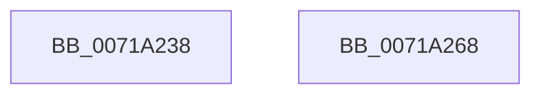

# IopInitializeBugCheckDriverData

- RVA: `0x0071A238`–`0x0071A269` (길이 `49` bytes)
- VA: `0x000000014071A238`
- 실행 섹션: `PAGE`
- PDB 이름 있음: `예`; PDB Function 태그: `아니요`
- unwind 정보 RVA: `0x0005C788`
- 디코드: `10`개 명령, `49/49` bytes 표시
- 미해석 바이트: `0` (있으면 어셈블리에 `.byte`로 보존)

> 이 문서는 커널 이미지의 기계어와 PDB 기호를 분석해 생성했습니다. 4번과 5번은 함수 원형과 자료형을 바이너리 사용 방식에서 추정한 C 해석이며 원본 소스 복구 결과는 아닙니다.

## 1. Dependencies

- 직접 호출 지점: **1**; 고유 호출 대상: **1**
- 직접 호출자로 확인된 함수: **1**
- RIP 상대 이미지 참조: **4**

### Outgoing calls
- `0x0071A25E` → [KeRegisterBugCheckReasonCallback](../../text/47/KeRegisterBugCheckReasonCallback_function_004720A0.md) (function, `0x004720A0`)

### Direct callers
- [IoInitSystemPreDrivers](../../init/C2/IoInitSystemPreDrivers_function_00C2AC3C.md) at `0x00C2BC8A`

### Static image references
- `0x0071A23C` → RVA `0x00AFC230` (` ?? ::NNGAKEGL::`string'`; read)
- `0x0071A243` → RVA `0x00E65FCC` (`.data`; write)
- `0x0071A250` → RVA `0x00591A40` (`IoBugCheckDriverDataCallback`; read)
- `0x0071A257` → RVA `0x00E65FA0` (`.data`; read)

## 2. Other-region calls and transfers

- 다른 실행 섹션으로 향하는 call: **1**
  - `0x0071A25E` → [KeRegisterBugCheckReasonCallback](../../text/47/KeRegisterBugCheckReasonCallback_function_004720A0.md) (`PAGE` → `.text`)
- 별도 외부 분기/꼬리 이동을 확인하지 못했습니다.

## 3. Assembly (complete function range)

```asm
0071A238  48 83 EC 28                     sub rsp, 0x28
0071A23C  4C 8D 0D ED 1F 3E 00            lea r9, [rip + 0x3e1fed]
0071A243  C6 05 82 BD 74 00 00            mov byte ptr [rip + 0x74bd82], 0
0071A24A  41 B8 02 00 00 00               mov r8d, 2
0071A250  48 8D 15 E9 77 E7 FF            lea rdx, [rip - 0x188817]
0071A257  48 8D 0D 42 BD 74 00            lea rcx, [rip + 0x74bd42]
0071A25E  E8 3D 7E D5 FF                  call 0x1404720a0
0071A263  48 83 C4 28                     add rsp, 0x28
0071A267  C3                              ret
0071A268  CC                              int3
```

## 4. C-style interpretation (structured pseudocode)

```c
__int64 __fastcall IopInitializeBugCheckDriverData(void)
{
    __int64 result;
    __int64 v_rsp;

    v_rsp = (v_rsp) - (40);
    *(unsigned __int8 *)(v_rip + 7650690) = 0;
    result = KeRegisterBugCheckReasonCallback(v_rip + 7650626, v_rip - 1607703, 2, v_rip + 4071405);
    v_rsp = (v_rsp) + (40);
    return result;
}
```

## 5. (Beta) C Style

```c
void IopInitializeBugCheckDriverData(void)
{
    int64_t result;
    int64_t local_rsp;

    local_rsp = (local_rsp) - (40);
    *(uint8_t *)(v_rip + 0x74BD82) = 0;
    result = KeRegisterBugCheckReasonCallback(v_rip + 7650626, v_rip - 1607703, 2, v_rip + 4071405);
    local_rsp = (local_rsp) + (40);
    return result;
}
```

## 6. Execution-region graph

[열기: 2D/3D 그래프와 함수 탐색 컨트롤 패널](../../../control-panel.html?section=page&rva=0x0071A238&view=graph)

- 2D 그래프는 위에서 아래로 흐르고, 3D 그래프는 빈 공간을 드래그해 회전합니다. Shift+드래그는 이동, 휠은 확대·축소, 함수 노드 선택은 대상 보고서 이동입니다.

### Static fallback


