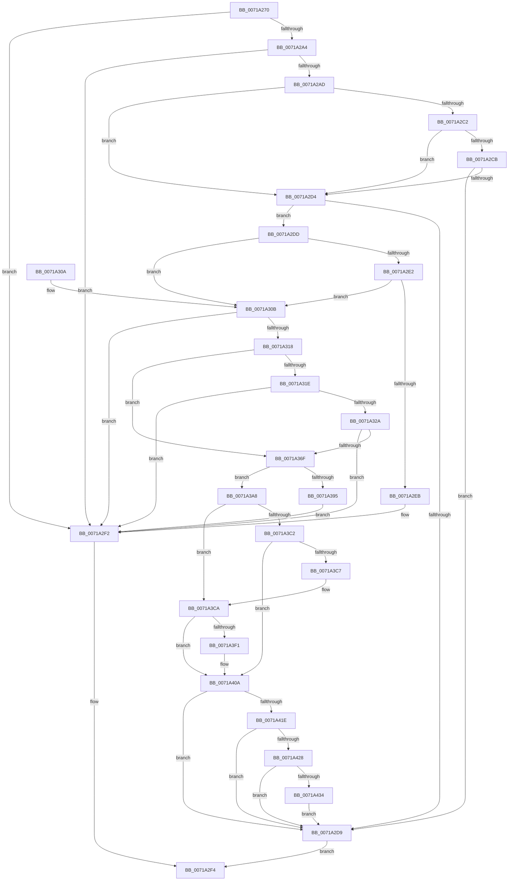

# IopInitializeCrashDump

- RVA: `0x0071A270`–`0x0071A43E` (길이 `462` bytes)
- VA: `0x000000014071A270`
- 실행 섹션: `PAGE`
- PDB 이름 있음: `예`; PDB Function 태그: `아니요`
- unwind 정보 RVA: `0x000C6FD8`
- 디코드: `117`개 명령, `462/462` bytes 표시
- 미해석 바이트: `0` (있으면 어셈블리에 `.byte`로 보존)

> 이 문서는 커널 이미지의 기계어와 PDB 기호를 분석해 생성했습니다. 4번과 5번은 함수 원형과 자료형을 바이너리 사용 방식에서 추정한 C 해석이며 원본 소스 복구 결과는 아닙니다.

## 1. Dependencies

- 직접 호출 지점: **11**; 고유 호출 대상: **10**
- 직접 호출자로 확인된 함수: **3**
- RIP 상대 이미지 참조: **14**

### Outgoing calls
- `0x0071A2B1` → [IopReadDumpRegistry](../../text/59/IopReadDumpRegistry_function_00595CE0.md) (function, `0x00595CE0`)
- `0x0071A2E2` → [IopLoadCrashdumpDriver](../../text/4E/IopLoadCrashdumpDriver_function_004E2F70.md) (function, `0x004E2F70`)
- `0x0071A2ED` → [IopDumpTraceLoadCrashDumpDriverFailure](../../text/4E/IopDumpTraceLoadCrashDumpDriverFailure_function_004E2C18.md) (function, `0x004E2C18`)
- `0x0071A30F` → [SecureDump_GetSecureDumpSettings](../../text/4F/SecureDump_GetSecureDumpSettings_function_004F8128.md) (function, `0x004F8128`)
- `0x0071A366` → [guard_dispatch_icall](../../text/6B/guard_dispatch_icall_function_006BAAD0.md) (function, `0x006BAAD0`)
- `0x0071A38C` → [guard_dispatch_icall](../../text/6B/guard_dispatch_icall_function_006BAAD0.md) (function, `0x006BAAD0`)
- `0x0071A39E` → [IopDumpTraceInitializeCrashDumpFailure](../../text/59/IopDumpTraceInitializeCrashDumpFailure_function_00595098.md) (function, `0x00595098`)
- `0x0071A3E8` → [ObReferenceObjectByHandle](../86/ObReferenceObjectByHandle_function_00868DB0.md) (function, `0x00868DB0`)
- `0x0071A3FC` → [FsRtlIssueFileNotificationFsctl](FsRtlIssueFileNotificationFsctl_function_007161D8.md) (function, `0x007161D8`)
- `0x0071A405` → [ObfDereferenceObject](../../text/2F/ObfDereferenceObject_function_002F9350.md) (function, `0x002F9350`)
- `0x0071A434` → [IopInitializeRemovePagesArray](../../text/5A/IopInitializeRemovePagesArray_function_005A1C4C.md) (function, `0x005A1C4C`)

### Direct callers
- [IoConfigureCrashDump](../../text/59/IoConfigureCrashDump_function_00591CB4.md) at `0x00591DF0`
- [IoInitializeCrashDump](IoInitializeCrashDump_function_00719D88.md) at `0x00719DDF`
- [IopInitCrashDumpRegCallback](../../init/C2/IopInitCrashDumpRegCallback_function_00C2CC80.md) at `0x00C2CD92`

### Static image references
- `0x0071A28B` → RVA `0x00E660BC` (`.data`; read)
- `0x0071A2A4` → RVA `0x00E0A9BA` (`.data`; read)
- `0x0071A2B6` → RVA `0x00E66058` (`.data`; read)
- `0x0071A2C2` → RVA `0x00E66050` (`.data`; read)
- `0x0071A2CB` → RVA `0x00E66068` (`.data`; read)
- `0x0071A31E` → RVA `0x00E66038` (`.data`; read)
- `0x0071A33C` → RVA `0x005A2B60` (`SecureDump_Get_SecureDumpHeader`; read)
- `0x0071A347` → RVA `0x005A2A10` (`SecureDump_Encrypt_DmpData`; read)
- `0x0071A376` → RVA `0x00E65FD8` (`.data`; read)
- `0x0071A397` → RVA `0x00E66050` (`.data`; write)
- `0x0071A3AF` → RVA `0x00E66068` (`.data`; write)
- `0x0071A3CA` → RVA `0x00FC6AE0` (`ALMOSTRO`; read)
- `0x0071A3F5` → RVA `0x0002AF30` (`.rdata`; read)
- `0x0071A428` → RVA `0x00E0A9D8` (`.data`; read)

## 2. Other-region calls and transfers

- 다른 실행 섹션으로 향하는 call: **9**
  - `0x0071A2B1` → [IopReadDumpRegistry](../../text/59/IopReadDumpRegistry_function_00595CE0.md) (`PAGE` → `.text`)
  - `0x0071A2E2` → [IopLoadCrashdumpDriver](../../text/4E/IopLoadCrashdumpDriver_function_004E2F70.md) (`PAGE` → `.text`)
  - `0x0071A2ED` → [IopDumpTraceLoadCrashDumpDriverFailure](../../text/4E/IopDumpTraceLoadCrashDumpDriverFailure_function_004E2C18.md) (`PAGE` → `.text`)
  - `0x0071A30F` → [SecureDump_GetSecureDumpSettings](../../text/4F/SecureDump_GetSecureDumpSettings_function_004F8128.md) (`PAGE` → `.text`)
  - `0x0071A366` → [guard_dispatch_icall](../../text/6B/guard_dispatch_icall_function_006BAAD0.md) (`PAGE` → `.text`)
  - `0x0071A38C` → [guard_dispatch_icall](../../text/6B/guard_dispatch_icall_function_006BAAD0.md) (`PAGE` → `.text`)
  - `0x0071A39E` → [IopDumpTraceInitializeCrashDumpFailure](../../text/59/IopDumpTraceInitializeCrashDumpFailure_function_00595098.md) (`PAGE` → `.text`)
  - `0x0071A405` → [ObfDereferenceObject](../../text/2F/ObfDereferenceObject_function_002F9350.md) (`PAGE` → `.text`)
  - `0x0071A434` → [IopInitializeRemovePagesArray](../../text/5A/IopInitializeRemovePagesArray_function_005A1C4C.md) (`PAGE` → `.text`)
- 별도 외부 분기/꼬리 이동을 확인하지 못했습니다.

## 3. Assembly (complete function range)

```asm
0071A270  48 89 5C 24 08                  mov qword ptr [rsp + 8], rbx
0071A275  48 89 74 24 10                  mov qword ptr [rsp + 0x10], rsi
0071A27A  48 89 7C 24 20                  mov qword ptr [rsp + 0x20], rdi
0071A27F  55                              push rbp
0071A280  48 8B EC                        mov rbp, rsp
0071A283  48 83 EC 70                     sub rsp, 0x70
0071A287  33 C0                           xor eax, eax
0071A289  33 F6                           xor esi, esi
0071A28B  40 38 35 2A BE 74 00            cmp byte ptr [rip + 0x74be2a], sil
0071A292  48 8B FA                        mov rdi, rdx
0071A295  48 8B D9                        mov rbx, rcx
0071A298  89 75 20                        mov dword ptr [rbp + 0x20], esi
0071A29B  48 89 45 C0                     mov qword ptr [rbp - 0x40], rax
0071A29F  89 45 C8                        mov dword ptr [rbp - 0x38], eax
0071A2A2  75 4E                           jne 0x14071a2f2
0071A2A4  40 38 35 0F 07 6F 00            cmp byte ptr [rip + 0x6f070f], sil
0071A2AB  74 45                           je 0x14071a2f2
0071A2AD  48 8D 55 20                     lea rdx, [rbp + 0x20]
0071A2B1  E8 2A BA E7 FF                  call 0x140595ce0
0071A2B6  48 8B 05 9B BD 74 00            mov rax, qword ptr [rip + 0x74bd9b]
0071A2BD  48 85 C0                        test rax, rax
0071A2C0  74 12                           je 0x14071a2d4
0071A2C2  48 39 35 87 BD 74 00            cmp qword ptr [rip + 0x74bd87], rsi
0071A2C9  74 09                           je 0x14071a2d4
0071A2CB  40 38 35 96 BD 74 00            cmp byte ptr [rip + 0x74bd96], sil
0071A2D2  75 05                           jne 0x14071a2d9
0071A2D4  39 75 20                        cmp dword ptr [rbp + 0x20], esi
0071A2D7  75 04                           jne 0x14071a2dd
0071A2D9  B0 01                           mov al, 1
0071A2DB  EB 17                           jmp 0x14071a2f4
0071A2DD  48 85 C0                        test rax, rax
0071A2E0  75 29                           jne 0x14071a30b
0071A2E2  E8 89 8C DC FF                  call 0x1404e2f70
0071A2E7  85 C0                           test eax, eax
0071A2E9  79 20                           jns 0x14071a30b
0071A2EB  8B C8                           mov ecx, eax
0071A2ED  E8 26 89 DC FF                  call 0x1404e2c18
0071A2F2  32 C0                           xor al, al
0071A2F4  4C 8D 5C 24 70                  lea r11, [rsp + 0x70]
0071A2F9  49 8B 5B 10                     mov rbx, qword ptr [r11 + 0x10]
0071A2FD  49 8B 73 18                     mov rsi, qword ptr [r11 + 0x18]
0071A301  49 8B 7B 28                     mov rdi, qword ptr [r11 + 0x28]
0071A305  49 8B E3                        mov rsp, r11
0071A308  5D                              pop rbp
0071A309  C3                              ret
0071A30A  CC                              int3
0071A30B  48 8D 4D C0                     lea rcx, [rbp - 0x40]
0071A30F  E8 14 DE DD FF                  call 0x1404f8128
0071A314  85 C0                           test eax, eax
0071A316  78 DA                           js 0x14071a2f2
0071A318  40 38 75 C0                     cmp byte ptr [rbp - 0x40], sil
0071A31C  74 51                           je 0x14071a36f
0071A31E  48 8B 05 13 BD 74 00            mov rax, qword ptr [rip + 0x74bd13]
0071A325  48 85 C0                        test rax, rax
0071A328  74 C8                           je 0x14071a2f2
0071A32A  8B 4D C4                        mov ecx, dword ptr [rbp - 0x3c]
0071A32D  89 4D E8                        mov dword ptr [rbp - 0x18], ecx
0071A330  8B 4D C8                        mov ecx, dword ptr [rbp - 0x38]
0071A333  89 4D EC                        mov dword ptr [rbp - 0x14], ecx
0071A336  8A 4D C1                        mov cl, byte ptr [rbp - 0x3f]
0071A339  88 4D F0                        mov byte ptr [rbp - 0x10], cl
0071A33C  48 8D 0D 1D 88 E8 FF            lea rcx, [rip - 0x1777e3]
0071A343  48 89 4D D8                     mov qword ptr [rbp - 0x28], rcx
0071A347  48 8D 0D C2 86 E8 FF            lea rcx, [rip - 0x17793e]
0071A34E  48 89 4D E0                     mov qword ptr [rbp - 0x20], rcx
0071A352  48 8D 4D D0                     lea rcx, [rbp - 0x30]
0071A356  48 C7 45 D0 28 00 00 00         mov qword ptr [rbp - 0x30], 0x28
0071A35E  66 89 75 F1                     mov word ptr [rbp - 0xf], si
0071A362  40 88 75 F3                     mov byte ptr [rbp - 0xd], sil
0071A366  E8 65 07 FA FF                  call 0x1406baad0
0071A36B  85 C0                           test eax, eax
0071A36D  78 83                           js 0x14071a2f2
0071A36F  0F 28 07                        movaps xmm0, xmmword ptr [rdi]
0071A372  4C 8D 45 C0                     lea r8, [rbp - 0x40]
0071A376  48 8B 05 5B BC 74 00            mov rax, qword ptr [rip + 0x74bc5b]
0071A37D  48 8D 15 CC BC 74 00            lea rdx, [rip + 0x74bccc]
0071A384  48 8B CB                        mov rcx, rbx
0071A387  66 0F 7F 45 C0                  movdqa xmmword ptr [rbp - 0x40], xmm0
0071A38C  E8 3F 07 FA FF                  call 0x1406baad0
0071A391  85 C0                           test eax, eax
0071A393  79 13                           jns 0x14071a3a8
0071A395  8B C8                           mov ecx, eax
0071A397  48 89 35 B2 BC 74 00            mov qword ptr [rip + 0x74bcb2], rsi
0071A39E  E8 F5 AC E7 FF                  call 0x140595098
0071A3A3  E9 4A FF FF FF                  jmp 0x14071a2f2
0071A3A8  48 8B 05 A1 BC 74 00            mov rax, qword ptr [rip + 0x74bca1]
0071A3AF  C6 05 B2 BC 74 00 01            mov byte ptr [rip + 0x74bcb2], 1
0071A3B6  48 8B 88 48 05 00 00            mov rcx, qword ptr [rax + 0x548]
0071A3BD  48 85 C9                        test rcx, rcx
0071A3C0  75 08                           jne 0x14071a3ca
0071A3C2  48 85 DB                        test rbx, rbx
0071A3C5  74 43                           je 0x14071a40a
0071A3C7  48 8B CB                        mov rcx, rbx
0071A3CA  4C 8B 05 0F C7 8A 00            mov r8, qword ptr [rip + 0x8ac70f]
0071A3D1  48 8D 45 20                     lea rax, [rbp + 0x20]
0071A3D5  48 89 74 24 28                  mov qword ptr [rsp + 0x28], rsi
0071A3DA  45 33 C9                        xor r9d, r9d
0071A3DD  33 D2                           xor edx, edx
0071A3DF  48 89 44 24 20                  mov qword ptr [rsp + 0x20], rax
0071A3E4  48 89 75 20                     mov qword ptr [rbp + 0x20], rsi
0071A3E8  E8 C3 E9 14 00                  call 0x140868db0
0071A3ED  85 C0                           test eax, eax
0071A3EF  78 19                           js 0x14071a40a
0071A3F1  48 8B 4D 20                     mov rcx, qword ptr [rbp + 0x20]
0071A3F5  4C 8D 05 34 0B 91 FF            lea r8, [rip - 0x6ef4cc]
0071A3FC  E8 D7 BD FF FF                  call 0x1407161d8
0071A401  48 8B 4D 20                     mov rcx, qword ptr [rbp + 0x20]
0071A405  E8 46 EF BD FF                  call 0x1402f9350
0071A40A  48 8B 05 3F BC 74 00            mov rax, qword ptr [rip + 0x74bc3f]
0071A411  83 B8 38 05 00 00 06            cmp dword ptr [rax + 0x538], 6
0071A418  0F 85 BB FE FF FF               jne 0x14071a2d9
0071A41E  48 39 70 08                     cmp qword ptr [rax + 8], rsi
0071A422  0F 84 B1 FE FF FF               je 0x14071a2d9
0071A428  39 35 AA 05 6F 00               cmp dword ptr [rip + 0x6f05aa], esi
0071A42E  0F 84 A5 FE FF FF               je 0x14071a2d9
0071A434  E8 13 78 E8 FF                  call 0x1405a1c4c
0071A439  E9 9B FE FF FF                  jmp 0x14071a2d9
```

## 4. C-style interpretation (structured pseudocode)

```c
__int64 __fastcall IopInitializeCrashDump(__int64 a1, __int64 a2, __int64 a3, int a4)
{
    __int64 result;
    __int64 v_rsi;
    __int64 v_rsp;
    unsigned __int8 v_stack_m15;
    unsigned __int16 v_stack_m17;
    unsigned __int8 v_stack_m18;
    unsigned int v_stack_m1C;
    unsigned int v_stack_m20;
    unsigned __int64 v_stack_m28;
    unsigned __int64 v_stack_m30;
    unsigned __int64 v_stack_m38;
    unsigned int v_stack_m40;
    unsigned int v_stack_m44;
    unsigned __int8 v_stack_m47;
    unsigned __int64 v_stack_m48;
    unsigned __int64 v_stack_m50;
    unsigned __int64 v_stack_m8;
    unsigned __int64 v_stack_p10;
    unsigned int v_stack_p18;
    unsigned __int64 v_stack_p20;
    unsigned __int64 v_stack_p8;

    v_stack_p8 = v_rbx;
    v_stack_p10 = v_rsi;
    v_stack_p20 = v_rdi;
    v_rsp = (v_rsp) - (112);
    result = 0;
    v_rsi = 0;
    v_stack_p18 = 0;
    v_stack_m48 = 0;
    v_stack_m40 = 0;
    if ((*(unsigned __int8 *)(v_rip + 7650858)) != 0) goto loc_0071A2F2;
    if ((*(unsigned __int8 *)(v_rip + 7276303)) == 0) goto loc_0071A2F2;
    result = IopReadDumpRegistry(a1, v_stack_p18, a3, a4);
    if (*(unsigned __int64 *)(v_rip + 7650715) == 0) goto loc_0071A2D4;
    if ((*(unsigned __int64 *)(v_rip + 7650695)) == 0) goto loc_0071A2D4;
    if ((*(unsigned __int8 *)(v_rip + 7650710)) != 0) goto loc_0071A2D9;
loc_0071A2D4:
    if (v_stack_p18 != 0) goto loc_0071A2DD;
loc_0071A2D9:
    goto loc_0071A2F4;
loc_0071A2DD:
    if (1 != 0) goto loc_0071A30B;
    result = IopLoadCrashdumpDriver(a1, v_stack_p18, a3, a4);
    if (!sign_flag) goto loc_0071A30B;
    result = IopDumpTraceLoadCrashDumpDriverFailure((unsigned int)((unsigned int)(result)), v_stack_p18, a3, a4);
loc_0071A2F2:
    result = 0;
loc_0071A2F4:
    return result;
loc_0071A30B:
    result = SecureDump_GetSecureDumpSettings(v_stack_m48, v_stack_p18, a3, a4);
    if (sign_flag) goto loc_0071A2F2;
    if (v_stack_m48 == ((unsigned __int8)(*(unsigned __int64 *)(v_stack_m8 + 24)))) goto loc_0071A36F;
    if (*(unsigned __int64 *)(v_rip + 7650579) == 0) goto loc_0071A2F2;
    v_stack_m20 = (unsigned int)((unsigned int)(v_stack_m44));
    v_stack_m1C = (unsigned int)((unsigned int)(v_stack_m40));
    v_stack_m18 = (unsigned __int8)(v_stack_m47);
    v_stack_m30 = v_rip - 1538019;
    v_stack_m28 = v_rip - 1538366;
    v_stack_m38 = 40;
    v_stack_m17 = (unsigned __int16)(*(unsigned __int64 *)(v_stack_m8 + 24));
    v_stack_m15 = (unsigned __int8)(*(unsigned __int64 *)(v_stack_m8 + 24));
    result = guard_dispatch_icall(v_stack_m38, v_stack_p18, a3, a4);
    if (sign_flag) goto loc_0071A2F2;
loc_0071A36F:
    v_stack_m48 = v_xmm0;
    result = guard_dispatch_icall(*(unsigned __int64 *)(v_stack_m8 + 16), v_rip + 7650508, v_stack_m48, a4);
    if (!sign_flag) goto loc_0071A3A8;
    *(unsigned __int64 *)(v_rip + 7650482) = *(unsigned __int64 *)(v_stack_m8 + 24);
    result = IopDumpTraceInitializeCrashDumpFailure((unsigned int)((unsigned int)(result)), v_rip + 7650508, v_stack_m48, a4);
    goto loc_0071A2F2;
loc_0071A3A8:
    *(unsigned __int8 *)(v_rip + 7650482) = 1;
    if (*(unsigned __int64 *)(*(unsigned __int64 *)(v_rip + 7650465) + 1352) != 0) goto loc_0071A3CA;
    if (*(unsigned __int64 *)(v_stack_m8 + 16) == 0) goto loc_0071A40A;
loc_0071A3CA:
    v_stack_m48 = *(unsigned __int64 *)(v_stack_m8 + 24);
    a4 = 0;
    a2 = 0;
    v_stack_m50 = v_stack_p18;
    v_stack_p18 = *(unsigned __int64 *)(v_stack_m8 + 24);
    result = ObReferenceObjectByHandle(*(unsigned __int64 *)(v_stack_m8 + 16), a2, *(unsigned __int64 *)(v_rip + 9094927), a4);
    if (!(sign_flag)) {
        a1 = v_stack_p18;
        a3 = v_rip - 7271628;
        result = FsRtlIssueFileNotificationFsctl(a1, a2, a3, a4);
        a1 = v_stack_p18;
        result = ObfDereferenceObject(a1, a2, a3, a4);
    }
    if ((*(unsigned int *)(*(unsigned __int64 *)(v_rip + 7650367) + 1336)) != 6) goto loc_0071A2D9;
    if ((*(unsigned __int64 *)(*(unsigned __int64 *)(v_rip + 7650367) + 8)) == (*(unsigned __int64 *)(v_stack_m8 + 24))) goto loc_0071A2D9;
    if ((*(unsigned int *)(v_rip + 7275946)) == ((unsigned int)(*(unsigned __int64 *)(v_stack_m8 + 24)))) goto loc_0071A2D9;
    result = IopInitializeRemovePagesArray(a1, a2, a3, a4);
    goto loc_0071A2D9;
}
```

## 5. (Beta) C Style

```c
int64_t IopInitializeCrashDump(int64_t Arg1, void *Arg2, int64_t Arg3, int32_t Arg4)
{
    uint8_t *arg2 = (uint8_t *)Arg2;

    int64_t result;
    int64_t local_rsi;
    int64_t local_rsp;
    uint8_t v_stack_m15;
    uint16_t v_stack_m17;
    uint8_t v_stack_m18;
    uint32_t v_stack_m1C;
    uint32_t v_stack_m20;
    uint64_t v_stack_m28;
    uint64_t v_stack_m30;
    uint64_t v_stack_m38;
    uint32_t v_stack_m40;
    uint32_t v_stack_m44;
    uint8_t v_stack_m47;
    uint64_t v_stack_m48;
    uint64_t v_stack_m50;
    uint64_t v_stack_m8;
    uint64_t v_stack_p10;
    uint32_t v_stack_p18;
    uint64_t v_stack_p20;
    uint64_t v_stack_p8;

    v_stack_p8 = local_rbx;
    v_stack_p10 = local_rsi;
    v_stack_p20 = local_rdi;
    local_rsp = (local_rsp) - (112);
    result = 0;
    local_rsi = 0;
    v_stack_p18 = 0;
    v_stack_m48 = 0;
    v_stack_m40 = 0;
    if ((*(uint8_t *)(v_rip + 0x74BE2A)) != 0) goto loc_0071A2F2;
    if ((*(uint8_t *)(v_rip + 0x6F070F)) == 0) goto loc_0071A2F2;
    result = IopReadDumpRegistry(Arg1, v_stack_p18, Arg3, Arg4);
    if (*(uint64_t *)(v_rip + 0x74BD9B) == 0) goto loc_0071A2D4;
    if ((*(uint64_t *)(v_rip + 0x74BD87)) == 0) goto loc_0071A2D4;
    if ((*(uint8_t *)(v_rip + 0x74BD96)) != 0) goto loc_0071A2D9;
loc_0071A2D4:
    if (v_stack_p18 != 0) goto loc_0071A2DD;
loc_0071A2D9:
    goto loc_0071A2F4;
loc_0071A2DD:
    if (1 != 0) goto loc_0071A30B;
    result = IopLoadCrashdumpDriver(Arg1, v_stack_p18, Arg3, Arg4);
    if (!sign_flag) goto loc_0071A30B;
    result = IopDumpTraceLoadCrashDumpDriverFailure((uint32_t)((uint32_t)(result)), v_stack_p18, Arg3, Arg4);
loc_0071A2F2:
    result = 0;
loc_0071A2F4:
    return result;
loc_0071A30B:
    result = SecureDump_GetSecureDumpSettings(v_stack_m48, v_stack_p18, Arg3, Arg4);
    if (sign_flag) goto loc_0071A2F2;
    if (v_stack_m48 == ((uint8_t)(*(uint64_t *)(v_stack_m8 + 0x18)))) goto loc_0071A36F;
    if (*(uint64_t *)(v_rip + 0x74BD13) == 0) goto loc_0071A2F2;
    v_stack_m20 = (uint32_t)((uint32_t)(v_stack_m44));
    v_stack_m1C = (uint32_t)((uint32_t)(v_stack_m40));
    v_stack_m18 = (uint8_t)(v_stack_m47);
    v_stack_m30 = v_rip - 1538019;
    v_stack_m28 = v_rip - 1538366;
    v_stack_m38 = 40;
    v_stack_m17 = (uint16_t)(*(uint64_t *)(v_stack_m8 + 0x18));
    v_stack_m15 = (uint8_t)(*(uint64_t *)(v_stack_m8 + 0x18));
    result = guard_dispatch_icall(v_stack_m38, v_stack_p18, Arg3, Arg4);
    if (sign_flag) goto loc_0071A2F2;
loc_0071A36F:
    v_stack_m48 = v_xmm0;
    result = guard_dispatch_icall(*(uint64_t *)(v_stack_m8 + 0x10), v_rip + 7650508, v_stack_m48, Arg4);
    if (!sign_flag) goto loc_0071A3A8;
    *(uint64_t *)(v_rip + 0x74BCB2) = *(uint64_t *)(v_stack_m8 + 0x18);
    result = IopDumpTraceInitializeCrashDumpFailure((uint32_t)((uint32_t)(result)), v_rip + 7650508, v_stack_m48, Arg4);
    goto loc_0071A2F2;
loc_0071A3A8:
    *(uint8_t *)(v_rip + 0x74BCB2) = 1;
    if (*(uint64_t *)(*(uint64_t *)(v_rip + 0x74BCA1) + 0x548) != 0) goto loc_0071A3CA;
    if (*(uint64_t *)(v_stack_m8 + 0x10) == 0) goto loc_0071A40A;
loc_0071A3CA:
    v_stack_m48 = *(uint64_t *)(v_stack_m8 + 0x18);
    Arg4 = 0;
    Arg2 = 0;
    v_stack_m50 = v_stack_p18;
    v_stack_p18 = *(uint64_t *)(v_stack_m8 + 0x18);
    result = ObReferenceObjectByHandle(*(uint64_t *)(v_stack_m8 + 0x10), Arg2, *(uint64_t *)(v_rip + 0x8AC70F), Arg4);
    if (!(sign_flag)) {
        Arg1 = v_stack_p18;
        Arg3 = v_rip - 7271628;
        result = FsRtlIssueFileNotificationFsctl(Arg1, Arg2, Arg3, Arg4);
        Arg1 = v_stack_p18;
        result = ObfDereferenceObject(Arg1, Arg2, Arg3, Arg4);
    }
    if ((*(uint32_t *)(*(uint64_t *)(v_rip + 0x74BC3F) + 0x538)) != 6) goto loc_0071A2D9;
    if ((*(uint64_t *)(*(uint64_t *)(v_rip + 0x74BC3F) + 0x8)) == (*(uint64_t *)(v_stack_m8 + 0x18))) goto loc_0071A2D9;
    if ((*(uint32_t *)(v_rip + 0x6F05AA)) == ((uint32_t)(*(uint64_t *)(v_stack_m8 + 0x18)))) goto loc_0071A2D9;
    result = IopInitializeRemovePagesArray(Arg1, Arg2, Arg3, Arg4);
    goto loc_0071A2D9;
}
```

### 관측된 메모리 오프셋

구조체 형식이 확인되지 않은 접근은 인자 기준의 오프셋으로만 기록했습니다.

| 기준 인자 | 오프셋 표현 | 폭 (bit) | 접근 |
|---|---:|---:|---|
| `Arg2` | `+ 0x0` | `128` | `R` |

## 6. Execution-region graph

[열기: 2D/3D 그래프와 함수 탐색 컨트롤 패널](../../../control-panel.html?section=page&rva=0x0071A270&view=graph)

- 2D 그래프는 위에서 아래로 흐르고, 3D 그래프는 빈 공간을 드래그해 회전합니다. Shift+드래그는 이동, 휠은 확대·축소, 함수 노드 선택은 대상 보고서 이동입니다.

### Static fallback


