# IopInitializeDumpPolicySettings

- RVA: `0x0071A444`–`0x0071A73A` (길이 `758` bytes)
- VA: `0x000000014071A444`
- 실행 섹션: `PAGE`
- PDB 이름 있음: `예`; PDB Function 태그: `아니요`
- unwind 정보 RVA: `0x000C6F34`
- 디코드: `190`개 명령, `758/758` bytes 표시
- 미해석 바이트: `0` (있으면 어셈블리에 `.byte`로 보존)

> 이 문서는 커널 이미지의 기계어와 PDB 기호를 분석해 생성했습니다. 4번과 5번은 함수 원형과 자료형을 바이너리 사용 방식에서 추정한 C 해석이며 원본 소스 복구 결과는 아닙니다.

## 1. Dependencies

- 직접 호출 지점: **23**; 고유 호출 대상: **13**
- 직접 호출자로 확인된 함수: **3**
- RIP 상대 이미지 참조: **18**

### Outgoing calls
- `0x0071A496` → [CmIsStateSeparationEnabled](../../text/4A/CmIsStateSeparationEnabled_function_004A4754.md) (function, `0x004A4754`)
- `0x0071A4AA` → [RtlInitUnicodeString](../../text/42/RtlInitUnicodeString_function_0042A780.md) (function, `0x0042A780`)
- `0x0071A4C6` → [IopOpenRegistryKey](../A8/IopOpenRegistryKey_function_00A8F200.md) (function, `0x00A8F200`)
- `0x0071A4F5` → [RtlInitUnicodeString](../../text/42/RtlInitUnicodeString_function_0042A780.md) (function, `0x0042A780`)
- `0x0071A50B` → [IopOpenRegistryKey](../A8/IopOpenRegistryKey_function_00A8F200.md) (function, `0x00A8F200`)
- `0x0071A529` → [IopGetRegistryValue](../99/IopGetRegistryValue_function_009990EC.md) (function, `0x009990EC`)
- `0x0071A552` → [ExFreePoolWithTag](../../poolcode/B8/ExFreePoolWithTag_function_00B82870.md) (function, `0x00B82870`)
- `0x0071A55D` → [ObCloseHandle](../8A/ObCloseHandle_function_008A1870.md) (function, `0x008A1870`)
- `0x0071A562` → [CmIsStateSeparationEnabled](../../text/4A/CmIsStateSeparationEnabled_function_004A4754.md) (function, `0x004A4754`)
- `0x0071A576` → [RtlInitUnicodeString](../../text/42/RtlInitUnicodeString_function_0042A780.md) (function, `0x0042A780`)
- `0x0071A58D` → [IopOpenRegistryKey](../A8/IopOpenRegistryKey_function_00A8F200.md) (function, `0x00A8F200`)
- `0x0071A5BB` → [RtlInitUnicodeString](../../text/42/RtlInitUnicodeString_function_0042A780.md) (function, `0x0042A780`)
- `0x0071A5D1` → [IopOpenRegistryKey](../A8/IopOpenRegistryKey_function_00A8F200.md) (function, `0x00A8F200`)
- `0x0071A5EF` → [IopGetRegistryValue](../99/IopGetRegistryValue_function_009990EC.md) (function, `0x009990EC`)
- `0x0071A618` → [ExFreePoolWithTag](../../poolcode/B8/ExFreePoolWithTag_function_00B82870.md) (function, `0x00B82870`)
- `0x0071A623` → [ObCloseHandle](../8A/ObCloseHandle_function_008A1870.md) (function, `0x008A1870`)
- `0x0071A657` → [ExSubscribeWnfStateChange](../9D/ExSubscribeWnfStateChange_function_009D4BC0.md) (function, `0x009D4BC0`)
- `0x0071A664` → [IopDumpIsTracingEnabled](../../text/4F/IopDumpIsTracingEnabled_function_004FC5D0.md) (function, `0x004FC5D0`)
- `0x0071A69D` → [EtwWrite](../../text/41/EtwWrite_function_0041C720.md) (function, `0x0041C720`)
- `0x0071A6BC` → [tlgKeywordOn](../../text/42/tlgKeywordOn_function_0042EAA0.md) (function, `0x0042EAA0`)
- `0x0071A702` → [tlgWriteTransfer_EtwWriteTransfer](../../text/42/tlgWriteTransfer_EtwWriteTransfer_function_004260E0.md) (function, `0x004260E0`)
- `0x0071A707` → [IopLiveDumpRegisterWnfNotificationCallback](../../text/59/IopLiveDumpRegisterWnfNotificationCallback_function_0059DE08.md) (function, `0x0059DE08`)
- `0x0071A713` → [_security_check_cookie](../../text/6A/_security_check_cookie_function_006AC640.md) (function, `0x006AC640`)

### Direct callers
- [IopLiveDumpPolicyChangeWnfCallback](../../text/59/IopLiveDumpPolicyChangeWnfCallback_function_0059D6E0.md) at `0x0059D747`
- [IopCrashDumpPolicyChangeWnfCallback](IopCrashDumpPolicyChangeWnfCallback_function_00719E40.md) at `0x00719EA4`
- [IoInitSystemPreDrivers](../../init/C2/IoInitSystemPreDrivers_function_00C2AC3C.md) at `0x00C2B6D0`

### Static image references
- `0x0071A467` → RVA `0x00E0A740` (`.data`; read)
- `0x0071A49F` → RVA `0x00AFC430` (` ?? ::NNGAKEGL::`string'`; read)
- `0x0071A4CF` → RVA `0x00AFC270` (` ?? ::NNGAKEGL::`string'`; read)
- `0x0071A4DD` → RVA `0x00AFC3B0` (` ?? ::NNGAKEGL::`string'`; read)
- `0x0071A522` → RVA `0x00AFC250` (` ?? ::NNGAKEGL::`string'`; read)
- `0x0071A549` → RVA `0x00E0A9BA` (`.data`; write)
- `0x0071A56B` → RVA `0x00AFC320` (` ?? ::NNGAKEGL::`string'`; read)
- `0x0071A59A` → RVA `0x00AFC5A0` (` ?? ::NNGAKEGL::`string'`; read)
- `0x0071A5A7` → RVA `0x00AFC520` (` ?? ::NNGAKEGL::`string'`; read)
- `0x0071A5E8` → RVA `0x00AFC500` (` ?? ::NNGAKEGL::`string'`; read)
- `0x0071A60F` → RVA `0x00E0A9B8` (`.data`; write)
- `0x0071A639` → RVA `0x00719E40` (`IopCrashDumpPolicyChangeWnfCallback`; read)
- `0x0071A640` → RVA `0x00020A38` (`.rdata`; read)
- `0x0071A66D` → RVA `0x00E65EF0` (`.data`; read)
- `0x0071A674` → RVA `0x00AFC4C0` (` ?? ::NNGAKEGL::`string'`; read)
- `0x0071A67F` → RVA `0x000229D8` (`.rdata`; read)
- `0x0071A6A2` → RVA `0x00E06DE8` (`.data`; read)
- `0x0071A6D5` → RVA `0x00045A84` (`.rdata`; read)

## 2. Other-region calls and transfers

- 다른 실행 섹션으로 향하는 call: **14**
  - `0x0071A496` → [CmIsStateSeparationEnabled](../../text/4A/CmIsStateSeparationEnabled_function_004A4754.md) (`PAGE` → `.text`)
  - `0x0071A4AA` → [RtlInitUnicodeString](../../text/42/RtlInitUnicodeString_function_0042A780.md) (`PAGE` → `.text`)
  - `0x0071A4F5` → [RtlInitUnicodeString](../../text/42/RtlInitUnicodeString_function_0042A780.md) (`PAGE` → `.text`)
  - `0x0071A552` → [ExFreePoolWithTag](../../poolcode/B8/ExFreePoolWithTag_function_00B82870.md) (`PAGE` → `POOLCODE`)
  - `0x0071A562` → [CmIsStateSeparationEnabled](../../text/4A/CmIsStateSeparationEnabled_function_004A4754.md) (`PAGE` → `.text`)
  - `0x0071A576` → [RtlInitUnicodeString](../../text/42/RtlInitUnicodeString_function_0042A780.md) (`PAGE` → `.text`)
  - `0x0071A5BB` → [RtlInitUnicodeString](../../text/42/RtlInitUnicodeString_function_0042A780.md) (`PAGE` → `.text`)
  - `0x0071A618` → [ExFreePoolWithTag](../../poolcode/B8/ExFreePoolWithTag_function_00B82870.md) (`PAGE` → `POOLCODE`)
  - `0x0071A664` → [IopDumpIsTracingEnabled](../../text/4F/IopDumpIsTracingEnabled_function_004FC5D0.md) (`PAGE` → `.text`)
  - `0x0071A69D` → [EtwWrite](../../text/41/EtwWrite_function_0041C720.md) (`PAGE` → `.text`)
  - `0x0071A6BC` → [tlgKeywordOn](../../text/42/tlgKeywordOn_function_0042EAA0.md) (`PAGE` → `.text`)
  - `0x0071A702` → [tlgWriteTransfer_EtwWriteTransfer](../../text/42/tlgWriteTransfer_EtwWriteTransfer_function_004260E0.md) (`PAGE` → `.text`)
  - `0x0071A707` → [IopLiveDumpRegisterWnfNotificationCallback](../../text/59/IopLiveDumpRegisterWnfNotificationCallback_function_0059DE08.md) (`PAGE` → `.text`)
  - `0x0071A713` → [_security_check_cookie](../../text/6A/_security_check_cookie_function_006AC640.md) (`PAGE` → `.text`)
- 별도 외부 분기/꼬리 이동을 확인하지 못했습니다.

## 3. Assembly (complete function range)

```asm
0071A444  48 8B C4                        mov rax, rsp
0071A447  48 89 58 08                     mov qword ptr [rax + 8], rbx
0071A44B  48 89 70 10                     mov qword ptr [rax + 0x10], rsi
0071A44F  48 89 78 18                     mov qword ptr [rax + 0x18], rdi
0071A453  55                              push rbp
0071A454  41 54                           push r12
0071A456  41 55                           push r13
0071A458  41 56                           push r14
0071A45A  41 57                           push r15
0071A45C  48 8D 68 A1                     lea rbp, [rax - 0x5f]
0071A460  48 81 EC B0 00 00 00            sub rsp, 0xb0
0071A467  48 8B 05 D2 02 6F 00            mov rax, qword ptr [rip + 0x6f02d2]
0071A46E  48 33 C4                        xor rax, rsp
0071A471  48 89 45 27                     mov qword ptr [rbp + 0x27], rax
0071A475  45 33 E4                        xor r12d, r12d
0071A478  33 C0                           xor eax, eax
0071A47A  0F 57 C0                        xorps xmm0, xmm0
0071A47D  4C 89 65 B7                     mov qword ptr [rbp - 0x49], r12
0071A481  0F 57 C9                        xorps xmm1, xmm1
0071A484  4C 89 65 BF                     mov qword ptr [rbp - 0x41], r12
0071A488  0F 11 45 C7                     movups xmmword ptr [rbp - 0x39], xmm0
0071A48C  89 45 EB                        mov dword ptr [rbp - 0x15], eax
0071A48F  44 8A E9                        mov r13b, cl
0071A492  0F 11 4D D7                     movups xmmword ptr [rbp - 0x29], xmm1
0071A496  E8 B9 A2 D8 FF                  call 0x1404a4754
0071A49B  84 C0                           test al, al
0071A49D  74 39                           je 0x14071a4d8
0071A49F  48 8D 15 8A 1F 3E 00            lea rdx, [rip + 0x3e1f8a]
0071A4A6  48 8D 4D C7                     lea rcx, [rbp - 0x39]
0071A4AA  E8 D1 02 D1 FF                  call 0x14042a780
0071A4AF  BB 19 00 02 00                  mov ebx, 0x20019
0071A4B4  44 88 64 24 20                  mov byte ptr [rsp + 0x20], r12b
0071A4B9  44 8B CB                        mov r9d, ebx
0071A4BC  4C 8D 45 C7                     lea r8, [rbp - 0x39]
0071A4C0  33 D2                           xor edx, edx
0071A4C2  48 8D 4D B7                     lea rcx, [rbp - 0x49]
0071A4C6  E8 35 4D 37 00                  call 0x140a8f200
0071A4CB  85 C0                           test eax, eax
0071A4CD  79 45                           jns 0x14071a514
0071A4CF  48 8D 15 9A 1D 3E 00            lea rdx, [rip + 0x3e1d9a]
0071A4D6  EB 0C                           jmp 0x14071a4e4
0071A4D8  BB 19 00 02 00                  mov ebx, 0x20019
0071A4DD  48 8D 15 CC 1E 3E 00            lea rdx, [rip + 0x3e1ecc]
0071A4E4  48 8D 7D C7                     lea rdi, [rbp - 0x39]
0071A4E8  44 8B FB                        mov r15d, ebx
0071A4EB  48 8B CF                        mov rcx, rdi
0071A4EE  48 8D 75 B7                     lea rsi, [rbp - 0x49]
0071A4F2  4D 8B F4                        mov r14, r12
0071A4F5  E8 86 02 D1 FF                  call 0x14042a780
0071A4FA  44 8B CB                        mov r9d, ebx
0071A4FD  44 88 64 24 20                  mov byte ptr [rsp + 0x20], r12b
0071A502  4C 8B C7                        mov r8, rdi
0071A505  49 8B D4                        mov rdx, r12
0071A508  48 8B CE                        mov rcx, rsi
0071A50B  E8 F0 4C 37 00                  call 0x140a8f200
0071A510  85 C0                           test eax, eax
0071A512  78 4E                           js 0x14071a562
0071A514  48 8B 4D B7                     mov rcx, qword ptr [rbp - 0x49]
0071A518  4C 8D 4D BF                     lea r9, [rbp - 0x41]
0071A51C  41 B8 04 00 00 00               mov r8d, 4
0071A522  48 8D 15 27 1D 3E 00            lea rdx, [rip + 0x3e1d27]
0071A529  E8 BE EB 27 00                  call 0x1409990ec
0071A52E  85 C0                           test eax, eax
0071A530  78 25                           js 0x14071a557
0071A532  48 8B 4D BF                     mov rcx, qword ptr [rbp - 0x41]
0071A536  83 79 04 04                     cmp dword ptr [rcx + 4], 4
0071A53A  75 14                           jne 0x14071a550
0071A53C  83 79 0C 04                     cmp dword ptr [rcx + 0xc], 4
0071A540  75 0E                           jne 0x14071a550
0071A542  8B 41 08                        mov eax, dword ptr [rcx + 8]
0071A545  44 39 24 08                     cmp dword ptr [rax + rcx], r12d
0071A549  0F 95 05 6A 04 6F 00            setne byte ptr [rip + 0x6f046a]
0071A550  33 D2                           xor edx, edx
0071A552  E8 19 83 46 00                  call 0x140b82870
0071A557  48 8B 4D B7                     mov rcx, qword ptr [rbp - 0x49]
0071A55B  33 D2                           xor edx, edx
0071A55D  E8 0E 73 18 00                  call 0x1408a1870
0071A562  E8 ED A1 D8 FF                  call 0x1404a4754
0071A567  84 C0                           test al, al
0071A569  74 38                           je 0x14071a5a3
0071A56B  48 8D 15 AE 1D 3E 00            lea rdx, [rip + 0x3e1dae]
0071A572  48 8D 4D D7                     lea rcx, [rbp - 0x29]
0071A576  E8 05 02 D1 FF                  call 0x14042a780
0071A57B  44 8B CB                        mov r9d, ebx
0071A57E  44 88 64 24 20                  mov byte ptr [rsp + 0x20], r12b
0071A583  4C 8D 45 D7                     lea r8, [rbp - 0x29]
0071A587  33 D2                           xor edx, edx
0071A589  48 8D 4D B7                     lea rcx, [rbp - 0x49]
0071A58D  E8 6E 4C 37 00                  call 0x140a8f200
0071A592  85 C0                           test eax, eax
0071A594  79 44                           jns 0x14071a5da
0071A596  48 8D 7D D7                     lea rdi, [rbp - 0x29]
0071A59A  48 8D 15 FF 1F 3E 00            lea rdx, [rip + 0x3e1fff]
0071A5A1  EB 0B                           jmp 0x14071a5ae
0071A5A3  48 8D 7D C7                     lea rdi, [rbp - 0x39]
0071A5A7  48 8D 15 72 1F 3E 00            lea rdx, [rip + 0x3e1f72]
0071A5AE  48 8B CF                        mov rcx, rdi
0071A5B1  48 8D 75 B7                     lea rsi, [rbp - 0x49]
0071A5B5  45 8A FC                        mov r15b, r12b
0071A5B8  4D 8B F4                        mov r14, r12
0071A5BB  E8 C0 01 D1 FF                  call 0x14042a780
0071A5C0  44 8B CB                        mov r9d, ebx
0071A5C3  44 88 64 24 20                  mov byte ptr [rsp + 0x20], r12b
0071A5C8  4C 8B C7                        mov r8, rdi
0071A5CB  49 8B D4                        mov rdx, r12
0071A5CE  48 8B CE                        mov rcx, rsi
0071A5D1  E8 2A 4C 37 00                  call 0x140a8f200
0071A5D6  85 C0                           test eax, eax
0071A5D8  78 4E                           js 0x14071a628
0071A5DA  48 8B 4D B7                     mov rcx, qword ptr [rbp - 0x49]
0071A5DE  4C 8D 4D BF                     lea r9, [rbp - 0x41]
0071A5E2  41 B8 04 00 00 00               mov r8d, 4
0071A5E8  48 8D 15 11 1F 3E 00            lea rdx, [rip + 0x3e1f11]
0071A5EF  E8 F8 EA 27 00                  call 0x1409990ec
0071A5F4  85 C0                           test eax, eax
0071A5F6  78 25                           js 0x14071a61d
0071A5F8  48 8B 4D BF                     mov rcx, qword ptr [rbp - 0x41]
0071A5FC  83 79 04 04                     cmp dword ptr [rcx + 4], 4
0071A600  75 14                           jne 0x14071a616
0071A602  83 79 0C 04                     cmp dword ptr [rcx + 0xc], 4
0071A606  75 0E                           jne 0x14071a616
0071A608  8B 41 08                        mov eax, dword ptr [rcx + 8]
0071A60B  44 39 24 08                     cmp dword ptr [rax + rcx], r12d
0071A60F  0F 95 05 A2 03 6F 00            setne byte ptr [rip + 0x6f03a2]
0071A616  33 D2                           xor edx, edx
0071A618  E8 53 82 46 00                  call 0x140b82870
0071A61D  48 8B 4D B7                     mov rcx, qword ptr [rbp - 0x49]
0071A621  33 D2                           xor edx, edx
0071A623  E8 48 72 18 00                  call 0x1408a1870
0071A628  45 84 ED                        test r13b, r13b
0071A62B  0F 84 DB 00 00 00               je 0x14071a70c
0071A631  45 33 C9                        xor r9d, r9d
0071A634  4C 89 64 24 28                  mov qword ptr [rsp + 0x28], r12
0071A639  48 8D 05 00 F8 FF FF            lea rax, [rip - 0x800]
0071A640  48 8D 15 F1 63 90 FF            lea rdx, [rip - 0x6f9c0f]
0071A647  48 89 44 24 20                  mov qword ptr [rsp + 0x20], rax
0071A64C  48 8D 4D BF                     lea rcx, [rbp - 0x41]
0071A650  41 8D 59 01                     lea ebx, [r9 + 1]
0071A654  44 8B C3                        mov r8d, ebx
0071A657  E8 64 A5 2B 00                  call 0x1409d4bc0
0071A65C  85 C0                           test eax, eax
0071A65E  0F 89 A3 00 00 00               jns 0x14071a707
0071A664  E8 67 1F DE FF                  call 0x1404fc5d0
0071A669  84 C0                           test al, al
0071A66B  74 35                           je 0x14071a6a2
0071A66D  48 8B 0D 7C B8 74 00            mov rcx, qword ptr [rip + 0x74b87c]
0071A674  48 8D 05 45 1E 3E 00            lea rax, [rip + 0x3e1e45]
0071A67B  48 89 45 E7                     mov qword ptr [rbp - 0x19], rax
0071A67F  48 8D 15 52 83 90 FF            lea rdx, [rip - 0x6f7cae]
0071A686  48 8D 45 E7                     lea rax, [rbp - 0x19]
0071A68A  48 C7 45 EF 38 00 00 00         mov qword ptr [rbp - 0x11], 0x38
0071A692  44 8B CB                        mov r9d, ebx
0071A695  48 89 44 24 20                  mov qword ptr [rsp + 0x20], rax
0071A69A  45 33 C0                        xor r8d, r8d
0071A69D  E8 7E 20 D0 FF                  call 0x14041c720
0071A6A2  83 3D 3F C7 6E 00 05            cmp dword ptr [rip + 0x6ec73f], 5
0071A6A9  76 5C                           jbe 0x14071a707
0071A6AB  48 BA 00 00 00 00 00 40 00 00   movabs rdx, 0x400000000000
0071A6B5  48 8D 0D 2C C7 6E 00            lea rcx, [rip + 0x6ec72c]
0071A6BC  E8 DF 43 D1 FF                  call 0x14042eaa0
0071A6C1  84 C0                           test al, al
0071A6C3  74 42                           je 0x14071a707
0071A6C5  48 8D 45 BF                     lea rax, [rbp - 0x41]
0071A6C9  48 C7 45 BF 00 00 00 01         mov qword ptr [rbp - 0x41], 0x1000000
0071A6D1  48 89 45 17                     mov qword ptr [rbp + 0x17], rax
0071A6D5  48 8D 15 A8 B3 92 FF            lea rdx, [rip - 0x6d4c58]
0071A6DC  48 8D 45 F7                     lea rax, [rbp - 9]
0071A6E0  48 C7 45 1F 08 00 00 00         mov qword ptr [rbp + 0x1f], 8
0071A6E8  48 89 44 24 28                  mov qword ptr [rsp + 0x28], rax
0071A6ED  48 8D 0D F4 C6 6E 00            lea rcx, [rip + 0x6ec6f4]
0071A6F4  45 33 C9                        xor r9d, r9d
0071A6F7  C7 44 24 20 03 00 00 00         mov dword ptr [rsp + 0x20], 3
0071A6FF  45 33 C0                        xor r8d, r8d
0071A702  E8 D9 B9 D0 FF                  call 0x1404260e0
0071A707  E8 FC 36 E8 FF                  call 0x14059de08
0071A70C  48 8B 4D 27                     mov rcx, qword ptr [rbp + 0x27]
0071A710  48 33 CC                        xor rcx, rsp
0071A713  E8 28 1F F9 FF                  call 0x1406ac640
0071A718  4C 8D 9C 24 B0 00 00 00         lea r11, [rsp + 0xb0]
0071A720  49 8B 5B 30                     mov rbx, qword ptr [r11 + 0x30]
0071A724  49 8B 73 38                     mov rsi, qword ptr [r11 + 0x38]
0071A728  49 8B 7B 40                     mov rdi, qword ptr [r11 + 0x40]
0071A72C  49 8B E3                        mov rsp, r11
0071A72F  41 5F                           pop r15
0071A731  41 5E                           pop r14
0071A733  41 5D                           pop r13
0071A735  41 5C                           pop r12
0071A737  5D                              pop rbp
0071A738  C3                              ret
0071A739  CC                              int3
```

## 4. C-style interpretation (structured pseudocode)

```c
__int64 __fastcall IopInitializeDumpPolicySettings(unsigned __int8 a1)
{
    __int64 result;
    __int64 v_r12;
    __int64 v_rsp;
    unsigned __int64 v_stack_m28;
    unsigned __int64 v_stack_mB0;
    unsigned __int8 v_stack_mB8;

    *(unsigned __int64 *)(v_rsp + 8) = v_rbx;
    *(unsigned __int64 *)(v_rsp + 16) = v_rsi;
    *(unsigned __int64 *)(v_rsp + 24) = v_rdi;
    v_rsp = (v_rsp) - (176);
    result = (*(unsigned __int64 *)(v_rip + 7275218)) ^ (v_rsp);
    *(unsigned __int64 *)(v_rsp - 95 + 39) = result;
    v_r12 = 0;
    result = 0;
    *(unsigned __int64 *)(v_rsp - 95 - 73) = 0;
    *(unsigned __int64 *)(v_rsp - 95 - 65) = 0;
    *(unsigned __int64 *)(v_rsp - 95 - 57) = v_xmm0;
    *(unsigned int *)(v_rsp - 95 - 21) = 0;
    *(unsigned __int64 *)(v_rsp - 95 - 41) = v_xmm1;
    result = CmIsStateSeparationEnabled(a1, a2, a3, a4);
    if ((unsigned __int8)(result) == 0) goto loc_0071A4D8;
    result = RtlInitUnicodeString(v_rsp - 95 - 57, v_rip + 4071306, a3, a4);
    v_stack_mB8 = 0;
    a2 = 0;
    result = IopOpenRegistryKey(v_rsp - 95 - 73, a2, v_rsp - 95 - 57, (unsigned int)((unsigned int)((unsigned int)(0x20019ULL))));
    if (!sign_flag) goto loc_0071A514;
    goto loc_0071A4E4;
loc_0071A4D8:
loc_0071A4E4:
    result = RtlInitUnicodeString(v_rsp - 95 - 57, v_rip + 4071116, v_rsp - 95 - 57, (unsigned int)((unsigned int)((unsigned int)(0x20019ULL))));
    v_stack_mB8 = 0;
    result = IopOpenRegistryKey(v_rsp - 95 - 73, 0, v_rsp - 95 - 57, (unsigned int)((unsigned int)((unsigned int)(0x20019ULL))));
    if (sign_flag) goto loc_0071A562;
loc_0071A514:
    result = IopGetRegistryValue(*(unsigned __int64 *)(v_rsp - 95 - 73), v_rip + 4070695, 4, v_rsp - 95 - 65);
    if (sign_flag) goto loc_0071A557;
    if ((*(unsigned int *)(*(unsigned __int64 *)(v_rsp - 95 - 65) + 4)) != 4) goto loc_0071A550;
    if ((*(unsigned int *)(*(unsigned __int64 *)(v_rsp - 95 - 65) + 12)) == 4) {
        result = *(unsigned int *)(*(unsigned __int64 *)(v_rsp - 95 - 65) + 8);
    }
    a2 = 0;
    result = ExFreePoolWithTag(*(unsigned __int64 *)(v_rsp - 95 - 65), a2, 4, v_rsp - 95 - 65);
loc_0071A557:
    a2 = 0;
    result = ObCloseHandle(*(unsigned __int64 *)(v_rsp - 95 - 73), a2, 4, v_rsp - 95 - 65);
loc_0071A562:
    result = CmIsStateSeparationEnabled(*(unsigned __int64 *)(v_rsp - 95 - 73), a2, 4, v_rsp - 95 - 65);
    if ((unsigned __int8)(result) == 0) goto loc_0071A5A3;
    result = RtlInitUnicodeString(v_rsp - 95 - 41, v_rip + 4070830, 4, v_rsp - 95 - 65);
    v_stack_mB8 = 0;
    a2 = 0;
    result = IopOpenRegistryKey(v_rsp - 95 - 73, a2, v_rsp - 95 - 41, (unsigned int)((unsigned int)((unsigned int)(0x20019ULL))));
    if (!sign_flag) goto loc_0071A5DA;
    goto loc_0071A5AE;
loc_0071A5A3:
loc_0071A5AE:
    result = RtlInitUnicodeString(v_rsp - 95 - 57, v_rip + 4071282, v_rsp - 95 - 41, (unsigned int)((unsigned int)((unsigned int)(0x20019ULL))));
    v_stack_mB8 = 0;
    result = IopOpenRegistryKey(v_rsp - 95 - 73, 0, v_rsp - 95 - 57, (unsigned int)((unsigned int)((unsigned int)(0x20019ULL))));
    if (sign_flag) goto loc_0071A628;
loc_0071A5DA:
    result = IopGetRegistryValue(*(unsigned __int64 *)(v_rsp - 95 - 73), v_rip + 4071185, 4, v_rsp - 95 - 65);
    if (sign_flag) goto loc_0071A61D;
    if ((*(unsigned int *)(*(unsigned __int64 *)(v_rsp - 95 - 65) + 4)) != 4) goto loc_0071A616;
    if ((*(unsigned int *)(*(unsigned __int64 *)(v_rsp - 95 - 65) + 12)) == 4) {
        result = *(unsigned int *)(*(unsigned __int64 *)(v_rsp - 95 - 65) + 8);
    }
    a2 = 0;
    result = ExFreePoolWithTag(*(unsigned __int64 *)(v_rsp - 95 - 65), a2, 4, v_rsp - 95 - 65);
loc_0071A61D:
    a2 = 0;
    result = ObCloseHandle(*(unsigned __int64 *)(v_rsp - 95 - 73), a2, 4, v_rsp - 95 - 65);
loc_0071A628:
    if (a1 == 0) goto loc_0071A70C;
    a4 = 0;
    v_stack_mB0 = 0;
    v_stack_mB8 = v_rip - 2048;
    result = ExSubscribeWnfStateChange(v_rsp - 95 - 65, v_rip - 7314447, (unsigned int)((unsigned int)(a4 + 1)), a4);
    if (!sign_flag) goto loc_0071A707;
    result = IopDumpIsTracingEnabled(v_rsp - 95 - 65, v_rip - 7314447, (unsigned int)((unsigned int)(a4 + 1)), a4);
    if ((unsigned __int8)(result) != 0) {
        a1 = *(unsigned __int64 *)(v_rip + 7649404);
        result = v_rip + 4070981;
        *(unsigned __int64 *)(v_rsp - 95 - 25) = result;
        a2 = v_rip - 7306414;
        result = v_rsp - 95 - 25;
        *(unsigned __int64 *)(v_rsp - 95 - 17) = 56;
        a4 = (unsigned int)(a4 + 1);
        v_stack_mB8 = result;
        a3 = 0;
        result = EtwWrite(a1, a2, a3, a4);
    }
    if ((*(unsigned int *)(v_rip + 7259967)) <= 5) goto loc_0071A707;
    result = tlgKeywordOn(v_rip + 7259948, a2, a3, a4);
    if ((unsigned __int8)(result) != 0) {
        result = v_rsp - 95 - 65;
        *(unsigned __int64 *)(v_rsp - 95 - 65) = 0x1000000ULL;
        *(unsigned __int64 *)(v_rsp - 95 + 23) = result;
        a2 = v_rip - 7162968;
        result = v_rsp - 95 - 9;
        *(unsigned __int64 *)(v_rsp - 95 + 31) = 8;
        v_stack_mB0 = result;
        a1 = v_rip + 7259892;
        a4 = 0;
        v_stack_mB8 = 3;
        a3 = 0;
        result = tlgWriteTransfer_EtwWriteTransfer(a1, a2, a3, a4);
    }
    result = IopLiveDumpRegisterWnfNotificationCallback(a1, a2, a3, a4);
loc_0071A70C:
    a1 = (*(unsigned __int64 *)(v_rsp - 95 + 39)) ^ (v_rsp);
    result = _security_check_cookie(a1, a2, a3, a4);
    return result;
}
```

## 5. (Beta) C Style

```c
int64_t IopInitializeDumpPolicySettings(uint8_t Arg1)
{
    int64_t result;
    int64_t local_r12;
    int64_t local_rsp;
    uint64_t v_stack_m28;
    uint64_t v_stack_mB0;
    uint8_t v_stack_mB8;

    *(uint64_t *)(local_rsp + 0x8) = local_rbx;
    *(uint64_t *)(local_rsp + 0x10) = local_rsi;
    *(uint64_t *)(local_rsp + 0x18) = local_rdi;
    local_rsp = (local_rsp) - (176);
    result = (*(uint64_t *)(v_rip + 0x6F02D2)) ^ (local_rsp);
    *(uint64_t *)(local_rsp - 0x5F + 0x27) = result;
    local_r12 = 0;
    result = 0;
    *(uint64_t *)(local_rsp - 0x5F - 0x49) = 0;
    *(uint64_t *)(local_rsp - 0x5F - 0x41) = 0;
    *(uint64_t *)(local_rsp - 0x5F - 0x39) = v_xmm0;
    *(uint32_t *)(local_rsp - 0x5F - 0x15) = 0;
    *(uint64_t *)(local_rsp - 0x5F - 0x29) = v_xmm1;
    result = CmIsStateSeparationEnabled(Arg1, a2, a3, a4);
    if ((uint8_t)(result) == 0) goto loc_0071A4D8;
    result = RtlInitUnicodeString(local_rsp - 95 - 57, v_rip + 4071306, a3, a4);
    v_stack_mB8 = 0;
    a2 = 0;
    result = IopOpenRegistryKey(local_rsp - 95 - 73, a2, local_rsp - 95 - 57, (uint32_t)((uint32_t)((uint32_t)(0x20019ULL))));
    if (!sign_flag) goto loc_0071A514;
    goto loc_0071A4E4;
loc_0071A4D8:
loc_0071A4E4:
    result = RtlInitUnicodeString(local_rsp - 95 - 57, v_rip + 4071116, local_rsp - 95 - 57, (uint32_t)((uint32_t)((uint32_t)(0x20019ULL))));
    v_stack_mB8 = 0;
    result = IopOpenRegistryKey(local_rsp - 95 - 73, 0, local_rsp - 95 - 57, (uint32_t)((uint32_t)((uint32_t)(0x20019ULL))));
    if (sign_flag) goto loc_0071A562;
loc_0071A514:
    result = IopGetRegistryValue(*(uint64_t *)(local_rsp - 0x5F - 0x49), v_rip + 4070695, 4, local_rsp - 95 - 65);
    if (sign_flag) goto loc_0071A557;
    if ((*(uint32_t *)(*(uint64_t *)(local_rsp - 0x5F - 0x41) + 0x4)) != 4) goto loc_0071A550;
    if ((*(uint32_t *)(*(uint64_t *)(local_rsp - 0x5F - 0x41) + 0xC)) == 4) {
        result = *(uint32_t *)(*(uint64_t *)(local_rsp - 0x5F - 0x41) + 0x8);
    }
    a2 = 0;
    result = ExFreePoolWithTag(*(uint64_t *)(local_rsp - 0x5F - 0x41), a2, 4, local_rsp - 95 - 65);
loc_0071A557:
    a2 = 0;
    result = ObCloseHandle(*(uint64_t *)(local_rsp - 0x5F - 0x49), a2, 4, local_rsp - 95 - 65);
loc_0071A562:
    result = CmIsStateSeparationEnabled(*(uint64_t *)(local_rsp - 0x5F - 0x49), a2, 4, local_rsp - 95 - 65);
    if ((uint8_t)(result) == 0) goto loc_0071A5A3;
    result = RtlInitUnicodeString(local_rsp - 95 - 41, v_rip + 4070830, 4, local_rsp - 95 - 65);
    v_stack_mB8 = 0;
    a2 = 0;
    result = IopOpenRegistryKey(local_rsp - 95 - 73, a2, local_rsp - 95 - 41, (uint32_t)((uint32_t)((uint32_t)(0x20019ULL))));
    if (!sign_flag) goto loc_0071A5DA;
    goto loc_0071A5AE;
loc_0071A5A3:
loc_0071A5AE:
    result = RtlInitUnicodeString(local_rsp - 95 - 57, v_rip + 4071282, local_rsp - 95 - 41, (uint32_t)((uint32_t)((uint32_t)(0x20019ULL))));
    v_stack_mB8 = 0;
    result = IopOpenRegistryKey(local_rsp - 95 - 73, 0, local_rsp - 95 - 57, (uint32_t)((uint32_t)((uint32_t)(0x20019ULL))));
    if (sign_flag) goto loc_0071A628;
loc_0071A5DA:
    result = IopGetRegistryValue(*(uint64_t *)(local_rsp - 0x5F - 0x49), v_rip + 4071185, 4, local_rsp - 95 - 65);
    if (sign_flag) goto loc_0071A61D;
    if ((*(uint32_t *)(*(uint64_t *)(local_rsp - 0x5F - 0x41) + 0x4)) != 4) goto loc_0071A616;
    if ((*(uint32_t *)(*(uint64_t *)(local_rsp - 0x5F - 0x41) + 0xC)) == 4) {
        result = *(uint32_t *)(*(uint64_t *)(local_rsp - 0x5F - 0x41) + 0x8);
    }
    a2 = 0;
    result = ExFreePoolWithTag(*(uint64_t *)(local_rsp - 0x5F - 0x41), a2, 4, local_rsp - 95 - 65);
loc_0071A61D:
    a2 = 0;
    result = ObCloseHandle(*(uint64_t *)(local_rsp - 0x5F - 0x49), a2, 4, local_rsp - 95 - 65);
loc_0071A628:
    if (Arg1 == 0) goto loc_0071A70C;
    a4 = 0;
    v_stack_mB0 = 0;
    v_stack_mB8 = v_rip - 2048;
    result = ExSubscribeWnfStateChange(local_rsp - 95 - 65, v_rip - 7314447, (uint32_t)((uint32_t)(a4 + 1)), a4);
    if (!sign_flag) goto loc_0071A707;
    result = IopDumpIsTracingEnabled(local_rsp - 95 - 65, v_rip - 7314447, (uint32_t)((uint32_t)(a4 + 1)), a4);
    if ((uint8_t)(result) != 0) {
        Arg1 = *(uint64_t *)(v_rip + 0x74B87C);
        result = v_rip + 4070981;
        *(uint64_t *)(local_rsp - 0x5F - 0x19) = result;
        a2 = v_rip - 7306414;
        result = local_rsp - 95 - 25;
        *(uint64_t *)(local_rsp - 0x5F - 0x11) = 56;
        a4 = (uint32_t)(a4 + 1);
        v_stack_mB8 = result;
        a3 = 0;
        result = EtwWrite(Arg1, a2, a3, a4);
    }
    if ((*(uint32_t *)(v_rip + 0x6EC73F)) <= 5) goto loc_0071A707;
    result = tlgKeywordOn(v_rip + 7259948, a2, a3, a4);
    if ((uint8_t)(result) != 0) {
        result = local_rsp - 95 - 65;
        *(uint64_t *)(local_rsp - 0x5F - 0x41) = 0x1000000ULL;
        *(uint64_t *)(local_rsp - 0x5F + 0x17) = result;
        a2 = v_rip - 7162968;
        result = local_rsp - 95 - 9;
        *(uint64_t *)(local_rsp - 0x5F + 0x1F) = 8;
        v_stack_mB0 = result;
        Arg1 = v_rip + 7259892;
        a4 = 0;
        v_stack_mB8 = 3;
        a3 = 0;
        result = tlgWriteTransfer_EtwWriteTransfer(Arg1, a2, a3, a4);
    }
    result = IopLiveDumpRegisterWnfNotificationCallback(Arg1, a2, a3, a4);
loc_0071A70C:
    Arg1 = (*(uint64_t *)(local_rsp - 0x5F + 0x27)) ^ (local_rsp);
    result = _security_check_cookie(Arg1, a2, a3, a4);
    return result;
}
```

## 6. Execution-region graph

[열기: 2D/3D 그래프와 함수 탐색 컨트롤 패널](../../../control-panel.html?section=page&rva=0x0071A444&view=graph)

- 2D 그래프는 위에서 아래로 흐르고, 3D 그래프는 빈 공간을 드래그해 회전합니다. Shift+드래그는 이동, 휠은 확대·축소, 함수 노드 선택은 대상 보고서 이동입니다.

### Static fallback

```mermaid
flowchart TD
  bb_0071A444[BB_0071A444]
  bb_0071A49F[BB_0071A49F]
  bb_0071A4CF[BB_0071A4CF]
  bb_0071A4D8[BB_0071A4D8]
  bb_0071A4E4[BB_0071A4E4]
  bb_0071A514[BB_0071A514]
  bb_0071A532[BB_0071A532]
  bb_0071A53C[BB_0071A53C]
  bb_0071A542[BB_0071A542]
  bb_0071A550[BB_0071A550]
  bb_0071A557[BB_0071A557]
  bb_0071A562[BB_0071A562]
  bb_0071A56B[BB_0071A56B]
  bb_0071A596[BB_0071A596]
  bb_0071A5A3[BB_0071A5A3]
  bb_0071A5AE[BB_0071A5AE]
  bb_0071A5DA[BB_0071A5DA]
  bb_0071A5F8[BB_0071A5F8]
  bb_0071A602[BB_0071A602]
  bb_0071A608[BB_0071A608]
  bb_0071A616[BB_0071A616]
  bb_0071A61D[BB_0071A61D]
  bb_0071A628[BB_0071A628]
  bb_0071A631[BB_0071A631]
  bb_0071A664[BB_0071A664]
  bb_0071A66D[BB_0071A66D]
  bb_0071A6A2[BB_0071A6A2]
  bb_0071A6AB[BB_0071A6AB]
  bb_0071A6C5[BB_0071A6C5]
  bb_0071A707[BB_0071A707]
  bb_0071A70C[BB_0071A70C]
  bb_0071A739[BB_0071A739]
  bb_0071A444 -->|branch| bb_0071A4D8
  bb_0071A444 -->|fallthrough| bb_0071A49F
  bb_0071A49F -->|branch| bb_0071A514
  bb_0071A49F -->|fallthrough| bb_0071A4CF
  bb_0071A4CF -->|branch| bb_0071A4E4
  bb_0071A4D8 -->|flow| bb_0071A4E4
  bb_0071A4E4 -->|branch| bb_0071A562
  bb_0071A4E4 -->|fallthrough| bb_0071A514
  bb_0071A514 -->|branch| bb_0071A557
  bb_0071A514 -->|fallthrough| bb_0071A532
  bb_0071A532 -->|branch| bb_0071A550
  bb_0071A532 -->|fallthrough| bb_0071A53C
  bb_0071A53C -->|branch| bb_0071A550
  bb_0071A53C -->|fallthrough| bb_0071A542
  bb_0071A542 -->|flow| bb_0071A550
  bb_0071A550 -->|flow| bb_0071A557
  bb_0071A557 -->|flow| bb_0071A562
  bb_0071A562 -->|branch| bb_0071A5A3
  bb_0071A562 -->|fallthrough| bb_0071A56B
  bb_0071A56B -->|branch| bb_0071A5DA
  bb_0071A56B -->|fallthrough| bb_0071A596
  bb_0071A596 -->|branch| bb_0071A5AE
  bb_0071A5A3 -->|flow| bb_0071A5AE
  bb_0071A5AE -->|branch| bb_0071A628
  bb_0071A5AE -->|fallthrough| bb_0071A5DA
  bb_0071A5DA -->|branch| bb_0071A61D
  bb_0071A5DA -->|fallthrough| bb_0071A5F8
  bb_0071A5F8 -->|branch| bb_0071A616
  bb_0071A5F8 -->|fallthrough| bb_0071A602
  bb_0071A602 -->|branch| bb_0071A616
  bb_0071A602 -->|fallthrough| bb_0071A608
  bb_0071A608 -->|flow| bb_0071A616
  bb_0071A616 -->|flow| bb_0071A61D
  bb_0071A61D -->|flow| bb_0071A628
  bb_0071A628 -->|branch| bb_0071A70C
  bb_0071A628 -->|fallthrough| bb_0071A631
  bb_0071A631 -->|branch| bb_0071A707
  bb_0071A631 -->|fallthrough| bb_0071A664
  bb_0071A664 -->|branch| bb_0071A6A2
  bb_0071A664 -->|fallthrough| bb_0071A66D
  bb_0071A66D -->|flow| bb_0071A6A2
  bb_0071A6A2 -->|branch| bb_0071A707
  bb_0071A6A2 -->|fallthrough| bb_0071A6AB
  bb_0071A6AB -->|branch| bb_0071A707
  bb_0071A6AB -->|fallthrough| bb_0071A6C5
  bb_0071A6C5 -->|flow| bb_0071A707
  bb_0071A707 -->|flow| bb_0071A70C
```


