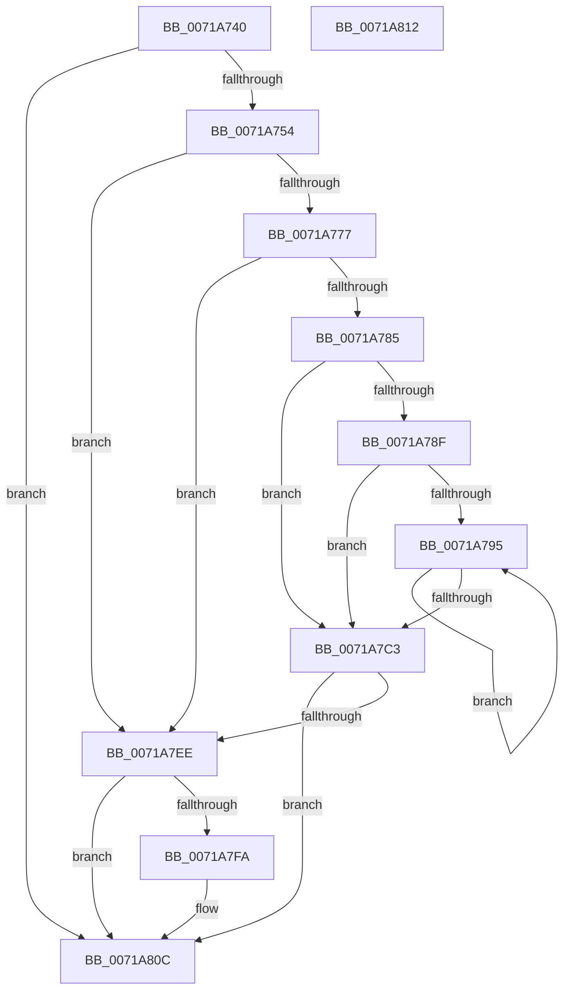

# IopInitializeTriageDumpData

- RVA: `0x0071A740`–`0x0071A813` (길이 `211` bytes)
- VA: `0x000000014071A740`
- 실행 섹션: `PAGE`
- PDB 이름 있음: `예`; PDB Function 태그: `아니요`
- unwind 정보 RVA: `0x0005CF00`
- 디코드: `52`개 명령, `211/211` bytes 표시
- 미해석 바이트: `0` (있으면 어셈블리에 `.byte`로 보존)

> 이 문서는 커널 이미지의 기계어와 PDB 기호를 분석해 생성했습니다. 4번과 5번은 함수 원형과 자료형을 바이너리 사용 방식에서 추정한 C 해석이며 원본 소스 복구 결과는 아닙니다.

## 1. Dependencies

- 직접 호출 지점: **5**; 고유 호출 대상: **5**
- 직접 호출자로 확인된 함수: **1**
- RIP 상대 이미지 참조: **9**

### Outgoing calls
- `0x0071A766` → [ExAllocatePool2](../../poolcode/B8/ExAllocatePool2_function_00B820F0.md) (function, `0x00B820F0`)
- `0x0071A77C` → [KeInitializeTriageDumpDataArray](../../text/4B/KeInitializeTriageDumpDataArray_function_004BA020.md) (function, `0x004BA020`)
- `0x0071A7B4` → [KeAddTriageDumpDataBlock](../../text/5B/KeAddTriageDumpDataBlock_function_005B26B0.md) (function, `0x005B26B0`)
- `0x0071A7E5` → [KeRegisterBugCheckReasonCallback](../../text/47/KeRegisterBugCheckReasonCallback_function_004720A0.md) (function, `0x004720A0`)
- `0x0071A7FF` → [ExFreePoolWithTag](../../poolcode/B8/ExFreePoolWithTag_function_00B82870.md) (function, `0x00B82870`)

### Direct callers
- [IoInitSystemPreDrivers](../../init/C2/IoInitSystemPreDrivers_function_00C2AC3C.md) at `0x00C2BC8F`

### Static image references
- `0x0071A746` → RVA `0x00E65F68` (`.data`; read)
- `0x0071A76B` → RVA `0x00E65F68` (`.data`; write)
- `0x0071A785` → RVA `0x00F8E8E0` (`.data`; read)
- `0x0071A795` → RVA `0x00F8D8E0` (`.data`; read)
- `0x0071A7C3` → RVA `0x00AFC210` (` ?? ::NNGAKEGL::`string'`; read)
- `0x0071A7CA` → RVA `0x00E65F9C` (`.data`; write)
- `0x0071A7D7` → RVA `0x00591AA0` (`IoBugCheckTriageDumpDataCallback`; read)
- `0x0071A7DE` → RVA `0x00E65F70` (`.data`; read)
- `0x0071A804` → RVA `0x00E65F68` (`.data`; read/write)

## 2. Other-region calls and transfers

- 다른 실행 섹션으로 향하는 call: **5**
  - `0x0071A766` → [ExAllocatePool2](../../poolcode/B8/ExAllocatePool2_function_00B820F0.md) (`PAGE` → `POOLCODE`)
  - `0x0071A77C` → [KeInitializeTriageDumpDataArray](../../text/4B/KeInitializeTriageDumpDataArray_function_004BA020.md) (`PAGE` → `.text`)
  - `0x0071A7B4` → [KeAddTriageDumpDataBlock](../../text/5B/KeAddTriageDumpDataBlock_function_005B26B0.md) (`PAGE` → `.text`)
  - `0x0071A7E5` → [KeRegisterBugCheckReasonCallback](../../text/47/KeRegisterBugCheckReasonCallback_function_004720A0.md) (`PAGE` → `.text`)
  - `0x0071A7FF` → [ExFreePoolWithTag](../../poolcode/B8/ExFreePoolWithTag_function_00B82870.md) (`PAGE` → `POOLCODE`)
- 별도 외부 분기/꼬리 이동을 확인하지 못했습니다.

## 3. Assembly (complete function range)

```asm
0071A740  40 53                           push rbx
0071A742  48 83 EC 20                     sub rsp, 0x20
0071A746  48 83 3D 1A B8 74 00 00         cmp qword ptr [rip + 0x74b81a], 0
0071A74E  0F 85 B8 00 00 00               jne 0x14071a80c
0071A754  BB 30 40 00 00                  mov ebx, 0x4030
0071A759  41 B8 49 6F 54 72               mov r8d, 0x72546f49
0071A75F  8B D3                           mov edx, ebx
0071A761  B9 40 00 00 00                  mov ecx, 0x40
0071A766  E8 85 79 46 00                  call 0x140b820f0
0071A76B  48 89 05 F6 B7 74 00            mov qword ptr [rip + 0x74b7f6], rax
0071A772  48 85 C0                        test rax, rax
0071A775  74 77                           je 0x14071a7ee
0071A777  8B D3                           mov edx, ebx
0071A779  48 8B C8                        mov rcx, rax
0071A77C  E8 9F F8 D9 FF                  call 0x1404ba020
0071A781  85 C0                           test eax, eax
0071A783  78 69                           js 0x14071a7ee
0071A785  8B 05 55 41 87 00               mov eax, dword ptr [rip + 0x874155]
0071A78B  85 C0                           test eax, eax
0071A78D  74 34                           je 0x14071a7c3
0071A78F  33 DB                           xor ebx, ebx
0071A791  85 C0                           test eax, eax
0071A793  74 2E                           je 0x14071a7c3
0071A795  48 8D 0D 44 31 87 00            lea rcx, [rip + 0x873144]
0071A79C  8B C3                           mov eax, ebx
0071A79E  48 03 C0                        add rax, rax
0071A7A1  4C 8B 44 C1 08                  mov r8, qword ptr [rcx + rax*8 + 8]
0071A7A6  48 8B 14 C1                     mov rdx, qword ptr [rcx + rax*8]
0071A7AA  48 8B 0D B7 B7 74 00            mov rcx, qword ptr [rip + 0x74b7b7]
0071A7B1  4C 2B C2                        sub r8, rdx
0071A7B4  E8 F7 7E E9 FF                  call 0x1405b26b0
0071A7B9  FF C3                           inc ebx
0071A7BB  3B 1D 1F 41 87 00               cmp ebx, dword ptr [rip + 0x87411f]
0071A7C1  72 D2                           jb 0x14071a795
0071A7C3  4C 8D 0D 46 1A 3E 00            lea r9, [rip + 0x3e1a46]
0071A7CA  C6 05 CB B7 74 00 00            mov byte ptr [rip + 0x74b7cb], 0
0071A7D1  41 B8 07 00 00 00               mov r8d, 7
0071A7D7  48 8D 15 C2 72 E7 FF            lea rdx, [rip - 0x188d3e]
0071A7DE  48 8D 0D 8B B7 74 00            lea rcx, [rip + 0x74b78b]
0071A7E5  E8 B6 78 D5 FF                  call 0x1404720a0
0071A7EA  84 C0                           test al, al
0071A7EC  75 1E                           jne 0x14071a80c
0071A7EE  48 8B 0D 73 B7 74 00            mov rcx, qword ptr [rip + 0x74b773]
0071A7F5  48 85 C9                        test rcx, rcx
0071A7F8  74 12                           je 0x14071a80c
0071A7FA  BA 49 6F 54 72                  mov edx, 0x72546f49
0071A7FF  E8 6C 80 46 00                  call 0x140b82870
0071A804  48 83 25 5C B7 74 00 00         and qword ptr [rip + 0x74b75c], 0
0071A80C  48 83 C4 20                     add rsp, 0x20
0071A810  5B                              pop rbx
0071A811  C3                              ret
0071A812  CC                              int3
```

## 4. C-style interpretation (structured pseudocode)

```c
__int64 __fastcall IopInitializeTriageDumpData(void)
{
    __int64 result;
    __int64 v_rbx;
    __int64 v_rsp;

    v_rsp = (v_rsp) - (32);
    if ((*(unsigned __int64 *)(v_rip + 7649306)) != 0) goto loc_0071A80C;
    result = ExAllocatePool2(64, (unsigned int)((unsigned int)((unsigned int)(0x4030ULL))), (unsigned int)(0x72546F49ULL), a4);
    *(unsigned __int64 *)(v_rip + 7649270) = result;
    if (result == 0) goto loc_0071A7EE;
    result = KeInitializeTriageDumpDataArray(result, (unsigned int)((unsigned int)((unsigned int)(0x4030ULL))), (unsigned int)(0x72546F49ULL), a4);
    if (sign_flag) goto loc_0071A7EE;
    if ((unsigned int)((unsigned int)(*(unsigned int *)(v_rip + 8864085))) == 0) goto loc_0071A7C3;
    v_rbx = 0;
    if ((unsigned int)((unsigned int)(*(unsigned int *)(v_rip + 8864085))) == 0) goto loc_0071A7C3;
loc_0071A795:
    result = (0) + (0);
    a3 = (*(unsigned __int64 *)(v_rip + 8859972 + result * 8 + 8)) - (*(unsigned __int64 *)(v_rip + 8859972 + result * 8));
    result = KeAddTriageDumpDataBlock(*(unsigned __int64 *)(v_rip + 7649207), *(unsigned __int64 *)(v_rip + 8859972 + result * 8), a3, a4);
    v_rbx = (unsigned int)((v_rbx) + 1);
    if (((unsigned int)(v_rbx)) < (*(unsigned int *)(v_rip + 8864031))) goto loc_0071A795;
loc_0071A7C3:
    *(unsigned __int8 *)(v_rip + 7649227) = 0;
    result = KeRegisterBugCheckReasonCallback(v_rip + 7649163, v_rip - 1609022, 7, v_rip + 4069958);
    if ((unsigned __int8)(result) != 0) goto loc_0071A80C;
loc_0071A7EE:
    if (*(unsigned __int64 *)(v_rip + 7649139) != 0) {
        a2 = 0x72546F49ULL;
        result = ExFreePoolWithTag(*(unsigned __int64 *)(v_rip + 7649139), a2, 7, v_rip + 4069958);
    }
    v_rsp = (v_rsp) + (32);
    return result;
}
```

## 5. (Beta) C Style

```c
void IopInitializeTriageDumpData(void)
{
    int64_t result;
    int64_t local_rbx;
    int64_t local_rsp;

    local_rsp = (local_rsp) - (32);
    if ((*(uint64_t *)(v_rip + 0x74B81A)) != 0) goto loc_0071A80C;
    result = ExAllocatePool2(64, (uint32_t)((uint32_t)((uint32_t)(0x4030ULL))), (uint32_t)(0x72546F49ULL), a4);
    *(uint64_t *)(v_rip + 0x74B7F6) = result;
    if (result == 0) goto loc_0071A7EE;
    result = KeInitializeTriageDumpDataArray(result, (uint32_t)((uint32_t)((uint32_t)(0x4030ULL))), (uint32_t)(0x72546F49ULL), a4);
    if (sign_flag) goto loc_0071A7EE;
    if ((uint32_t)((uint32_t)(*(uint32_t *)(v_rip + 0x874155))) == 0) goto loc_0071A7C3;
    local_rbx = 0;
    if ((uint32_t)((uint32_t)(*(uint32_t *)(v_rip + 0x874155))) == 0) goto loc_0071A7C3;
loc_0071A795:
    result = (0) + (0);
    a3 = (*(uint64_t *)(v_rip + 0x873144 + result * 8 + 0x8)) - (*(uint64_t *)(v_rip + 0x873144 + result * 8));
    result = KeAddTriageDumpDataBlock(*(uint64_t *)(v_rip + 0x74B7B7), *(uint64_t *)(v_rip + 0x873144 + result * 8), a3, a4);
    local_rbx = (uint32_t)((local_rbx) + 1);
    if (((uint32_t)(local_rbx)) < (*(uint32_t *)(v_rip + 0x87411F))) goto loc_0071A795;
loc_0071A7C3:
    *(uint8_t *)(v_rip + 0x74B7CB) = 0;
    result = KeRegisterBugCheckReasonCallback(v_rip + 7649163, v_rip - 1609022, 7, v_rip + 4069958);
    if ((uint8_t)(result) != 0) goto loc_0071A80C;
loc_0071A7EE:
    if (*(uint64_t *)(v_rip + 0x74B773) != 0) {
        a2 = 0x72546F49ULL;
        result = ExFreePoolWithTag(*(uint64_t *)(v_rip + 0x74B773), a2, 7, v_rip + 4069958);
    }
    local_rsp = (local_rsp) + (32);
    return result;
}
```

## 6. Execution-region graph

[열기: 2D/3D 그래프와 함수 탐색 컨트롤 패널](../../../control-panel.html?section=page&rva=0x0071A740&view=graph)

- 2D 그래프는 위에서 아래로 흐르고, 3D 그래프는 빈 공간을 드래그해 회전합니다. Shift+드래그는 이동, 휠은 확대·축소, 함수 노드 선택은 대상 보고서 이동입니다.

### Static fallback


