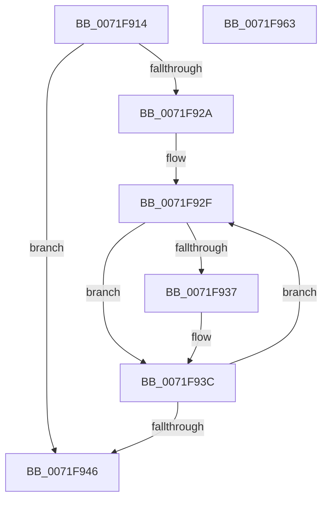

# IopIoRingCleanupRegBufferArray

- RVA: `0x0071F914`–`0x0071F964` (길이 `80` bytes)
- VA: `0x000000014071F914`
- 실행 섹션: `PAGE`
- PDB 이름 있음: `예`; PDB Function 태그: `아니요`
- unwind 정보 RVA: `0x00060BC4`
- 디코드: `25`개 명령, `80/80` bytes 표시
- 미해석 바이트: `0` (있으면 어셈블리에 `.byte`로 보존)

> 이 문서는 커널 이미지의 기계어와 PDB 기호를 분석해 생성했습니다. 4번과 5번은 함수 원형과 자료형을 바이너리 사용 방식에서 추정한 C 해석이며 원본 소스 복구 결과는 아닙니다.

## 1. Dependencies

- 직접 호출 지점: **2**; 고유 호출 대상: **2**
- 직접 호출자로 확인된 함수: **2**
- RIP 상대 이미지 참조: **0**

### Outgoing calls
- `0x0071F937` → [IopMcWaitAndCleanupBufferEntry](../../text/5A/IopMcWaitAndCleanupBufferEntry_function_005A3F44.md) (function, `0x005A3F44`)
- `0x0071F94E` → [ExFreePoolWithTag](../../poolcode/B8/ExFreePoolWithTag_function_00B82870.md) (function, `0x00B82870`)

### Direct callers
- [IopDeleteIoRing](IopDeleteIoRing_function_0071F8A0.md) at `0x0071F8BB`
- [IopIoRingDispatchRegisterBuffers](IopIoRingDispatchRegisterBuffers_function_0071FC18.md) at `0x0071FF82`
- [IopIoRingDispatchRegisterBuffers](IopIoRingDispatchRegisterBuffers_function_0071FC18.md) at `0x0071FF93`

### Static image references
- 디코드된 RIP-relative 메모리 참조가 없습니다.

## 2. Other-region calls and transfers

- 다른 실행 섹션으로 향하는 call: **2**
  - `0x0071F937` → [IopMcWaitAndCleanupBufferEntry](../../text/5A/IopMcWaitAndCleanupBufferEntry_function_005A3F44.md) (`PAGE` → `.text`)
  - `0x0071F94E` → [ExFreePoolWithTag](../../poolcode/B8/ExFreePoolWithTag_function_00B82870.md) (`PAGE` → `POOLCODE`)
- 별도 외부 분기/꼬리 이동을 확인하지 못했습니다.

## 3. Assembly (complete function range)

```asm
0071F914  48 89 5C 24 08                  mov qword ptr [rsp + 8], rbx
0071F919  48 89 74 24 10                  mov qword ptr [rsp + 0x10], rsi
0071F91E  57                              push rdi
0071F91F  48 83 EC 20                     sub rsp, 0x20
0071F923  48 8B F2                        mov rsi, rdx
0071F926  85 C9                           test ecx, ecx
0071F928  74 1C                           je 0x14071f946
0071F92A  48 8B DA                        mov rbx, rdx
0071F92D  8B F9                           mov edi, ecx
0071F92F  48 8B 0B                        mov rcx, qword ptr [rbx]
0071F932  48 85 C9                        test rcx, rcx
0071F935  74 05                           je 0x14071f93c
0071F937  E8 08 46 E8 FF                  call 0x1405a3f44
0071F93C  48 83 C3 08                     add rbx, 8
0071F940  48 83 EF 01                     sub rdi, 1
0071F944  75 E9                           jne 0x14071f92f
0071F946  BA 49 72 52 42                  mov edx, 0x42527249
0071F94B  48 8B CE                        mov rcx, rsi
0071F94E  E8 1D 2F 46 00                  call 0x140b82870
0071F953  48 8B 5C 24 30                  mov rbx, qword ptr [rsp + 0x30]
0071F958  48 8B 74 24 38                  mov rsi, qword ptr [rsp + 0x38]
0071F95D  48 83 C4 20                     add rsp, 0x20
0071F961  5F                              pop rdi
0071F962  C3                              ret
0071F963  CC                              int3
```

## 4. C-style interpretation (structured pseudocode)

```c
__int64 __fastcall IopIoRingCleanupRegBufferArray(int a1, __int64 a2)
{
    __int64 result;
    __int64 v_rbx;
    __int64 v_rdi;
    __int64 v_rsp;
    unsigned __int64 v_stack_p10;
    unsigned __int64 v_stack_p8;

    v_stack_p8 = v_rbx;
    v_stack_p10 = v_rsi;
    v_rsp = (v_rsp) - (32);
    if (a1 == 0) goto loc_0071F946;
loc_0071F92F:
    if (*(unsigned __int64 *)(a2) != 0) {
        result = IopMcWaitAndCleanupBufferEntry(*(unsigned __int64 *)(a2), a2, a3, a4);
    }
    v_rbx = (a2) + (8);
    v_rdi = ((unsigned int)(a1)) - (1);
    if (condition_is_not_equal) goto loc_0071F92F;
loc_0071F946:
    result = ExFreePoolWithTag(a2, (unsigned int)(0x42527249ULL), a3, a4);
    v_rsp = (v_rsp) + (32);
    return result;
}
```

## 5. (Beta) C Style

```c
int64_t IopIoRingCleanupRegBufferArray(int32_t Arg1, void *Arg2)
{
    uint8_t *arg2 = (uint8_t *)Arg2;

    int64_t result;
    int64_t local_rbx;
    int64_t local_rdi;
    int64_t local_rsp;
    uint64_t v_stack_p10;
    uint64_t v_stack_p8;

    v_stack_p8 = local_rbx;
    v_stack_p10 = local_rsi;
    local_rsp = (local_rsp) - (32);
    if (Arg1 == 0) goto loc_0071F946;
loc_0071F92F:
    if (*(uint64_t *)(arg2) != 0) {
        result = IopMcWaitAndCleanupBufferEntry(*(uint64_t *)(arg2), Arg2, a3, a4);
    }
    local_rbx = (Arg2) + (8);
    local_rdi = ((uint32_t)(Arg1)) - (1);
    if (condition_is_not_equal) goto loc_0071F92F;
loc_0071F946:
    result = ExFreePoolWithTag(Arg2, (uint32_t)(0x42527249ULL), a3, a4);
    local_rsp = (local_rsp) + (32);
    return result;
}
```

### 관측된 메모리 오프셋

구조체 형식이 확인되지 않은 접근은 인자 기준의 오프셋으로만 기록했습니다.

| 기준 인자 | 오프셋 표현 | 폭 (bit) | 접근 |
|---|---:|---:|---|
| `Arg2` | `+ 0x0` | `64` | `R` |

## 6. Execution-region graph

[열기: 2D/3D 그래프와 함수 탐색 컨트롤 패널](../../../control-panel.html?section=page&rva=0x0071F914&view=graph)

- 2D 그래프는 위에서 아래로 흐르고, 3D 그래프는 빈 공간을 드래그해 회전합니다. Shift+드래그는 이동, 휠은 확대·축소, 함수 노드 선택은 대상 보고서 이동입니다.

### Static fallback


