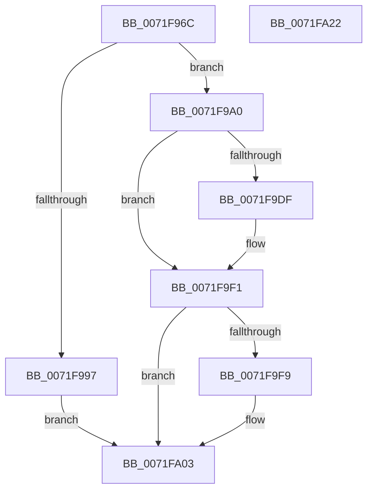

# IopIoRingDispatchCancel

- RVA: `0x0071F96C`–`0x0071FA23` (길이 `183` bytes)
- VA: `0x000000014071F96C`
- 실행 섹션: `PAGE`
- PDB 이름 있음: `예`; PDB Function 태그: `아니요`
- unwind 정보 RVA: `0x000C773C`
- 디코드: `45`개 명령, `183/183` bytes 표시
- 미해석 바이트: `0` (있으면 어셈블리에 `.byte`로 보존)

> 이 문서는 커널 이미지의 기계어와 PDB 기호를 분석해 생성했습니다. 4번과 5번은 함수 원형과 자료형을 바이너리 사용 방식에서 추정한 C 해석이며 원본 소스 복구 결과는 아닙니다.

## 1. Dependencies

- 직접 호출 지점: **4**; 고유 호출 대상: **4**
- 직접 호출자로 확인된 함수: **1**
- RIP 상대 이미지 참조: **0**

### Outgoing calls
- `0x0071F9D2` → [IopIoRingReferenceFileObject](../AD/IopIoRingReferenceFileObject_function_00AD3A8C.md) (function, `0x00AD3A8C`)
- `0x0071F9E8` → [IopCancelIoFile](../A4/IopCancelIoFile_function_00A4481C.md) (function, `0x00A4481C`)
- `0x0071F9FE` → [ObfDereferenceObject](../../text/2F/ObfDereferenceObject_function_002F9350.md) (function, `0x002F9350`)
- `0x0071FA12` → [IopCompleteIoRingEntry](../../text/3E/IopCompleteIoRingEntry_function_003ED2C0.md) (function, `0x003ED2C0`)

### Direct callers
- [IopProcessIoRingEntry](../70/IopProcessIoRingEntry_function_00700A38.md) at `0x00700B17`

### Static image references
- 디코드된 RIP-relative 메모리 참조가 없습니다.

## 2. Other-region calls and transfers

- 다른 실행 섹션으로 향하는 call: **2**
  - `0x0071F9FE` → [ObfDereferenceObject](../../text/2F/ObfDereferenceObject_function_002F9350.md) (`PAGE` → `.text`)
  - `0x0071FA12` → [IopCompleteIoRingEntry](../../text/3E/IopCompleteIoRingEntry_function_003ED2C0.md) (`PAGE` → `.text`)
- 별도 외부 분기/꼬리 이동을 확인하지 못했습니다.

## 3. Assembly (complete function range)

```asm
0071F96C  48 8B C4                        mov rax, rsp
0071F96F  48 89 58 08                     mov qword ptr [rax + 8], rbx
0071F973  56                              push rsi
0071F974  48 83 EC 50                     sub rsp, 0x50
0071F978  48 83 60 10 00                  and qword ptr [rax + 0x10], 0
0071F97D  0F 57 C0                        xorps xmm0, xmm0
0071F980  44 8B 42 10                     mov r8d, dword ptr [rdx + 0x10]
0071F984  48 8B DA                        mov rbx, rdx
0071F987  48 8B F1                        mov rsi, rcx
0071F98A  0F 11 40 E8                     movups xmmword ptr [rax - 0x18], xmm0
0071F98E  41 F7 C0 FE FF FF FF            test r8d, 0xfffffffe
0071F995  74 09                           je 0x14071f9a0
0071F997  C7 40 E8 01 00 46 C0            mov dword ptr [rax - 0x18], 0xc0460001
0071F99E  EB 63                           jmp 0x14071fa03
0071F9A0  65 4C 8B 0C 25 88 01 00 00      mov r9, qword ptr gs:[0x188]
0071F9A9  48 8D 44 24 68                  lea rax, [rsp + 0x68]
0071F9AE  48 83 64 24 38 00               and qword ptr [rsp + 0x38], 0
0071F9B4  41 80 E0 01                     and r8b, 1
0071F9B8  48 8B 52 18                     mov rdx, qword ptr [rdx + 0x18]
0071F9BC  48 89 44 24 30                  mov qword ptr [rsp + 0x30], rax
0071F9C1  45 8A 89 32 02 00 00            mov r9b, byte ptr [r9 + 0x232]
0071F9C8  83 64 24 28 00                  and dword ptr [rsp + 0x28], 0
0071F9CD  C6 44 24 20 00                  mov byte ptr [rsp + 0x20], 0
0071F9D2  E8 B5 40 3B 00                  call 0x140ad3a8c
0071F9D7  89 44 24 40                     mov dword ptr [rsp + 0x40], eax
0071F9DB  85 C0                           test eax, eax
0071F9DD  78 12                           js 0x14071f9f1
0071F9DF  48 8B 53 20                     mov rdx, qword ptr [rbx + 0x20]
0071F9E3  48 8B 4C 24 68                  mov rcx, qword ptr [rsp + 0x68]
0071F9E8  E8 2F 4E 32 00                  call 0x140a4481c
0071F9ED  89 44 24 40                     mov dword ptr [rsp + 0x40], eax
0071F9F1  48 83 7C 24 68 00               cmp qword ptr [rsp + 0x68], 0
0071F9F7  74 0A                           je 0x14071fa03
0071F9F9  48 8B 4C 24 68                  mov rcx, qword ptr [rsp + 0x68]
0071F9FE  E8 4D 99 BD FF                  call 0x1402f9350
0071FA03  48 8B 53 08                     mov rdx, qword ptr [rbx + 8]
0071FA07  4C 8D 44 24 40                  lea r8, [rsp + 0x40]
0071FA0C  45 33 C9                        xor r9d, r9d
0071FA0F  48 8B CE                        mov rcx, rsi
0071FA12  E8 A9 D8 CC FF                  call 0x1403ed2c0
0071FA17  48 8B 5C 24 60                  mov rbx, qword ptr [rsp + 0x60]
0071FA1C  48 83 C4 50                     add rsp, 0x50
0071FA20  5E                              pop rsi
0071FA21  C3                              ret
0071FA22  CC                              int3
```

## 4. C-style interpretation (structured pseudocode)

```c
__int64 __fastcall IopIoRingDispatchCancel(__int64 a1, __int64 a2)
{
    __int64 result;
    __int64 v_rsp;
    unsigned int v_stack_m18;
    unsigned __int64 v_stack_m20;
    unsigned __int64 v_stack_m28;
    unsigned int v_stack_m30;
    unsigned __int8 v_stack_m38;
    unsigned __int64 v_stack_p10;
    unsigned __int64 v_stack_p8;

    *(unsigned __int64 *)(v_rsp + 8) = v_rbx;
    v_rsp = (v_rsp) - (80);
    *(unsigned __int64 *)(v_rsp - 24) = v_xmm0;
    if ((((unsigned int)((unsigned int)(*(unsigned int *)(a2 + 16)))) & (0xFFFFFFFEULL)) == 0) goto loc_0071F9A0;
    *(unsigned int *)(v_rsp - 24) = 0xC0460001ULL;
    goto loc_0071FA03;
loc_0071F9A0:
    a3 = (unsigned __int8)(((unsigned int)(*(unsigned int *)(a2 + 16))) & (1));
    v_stack_m28 = v_stack_p10;
    v_stack_m38 = 0;
    result = IopIoRingReferenceFileObject(a1, *(unsigned __int64 *)(a2 + 24), a3, *(unsigned __int8 *)(*(unsigned __int64 *)(gs_base + (0 + 392)) + 562));
    v_stack_m18 = (unsigned int)(result);
    if (!(sign_flag)) {
        a2 = *(unsigned __int64 *)(a2 + 32);
        a1 = v_stack_p10;
        result = IopCancelIoFile(a1, a2, a3, *(unsigned __int8 *)(*(unsigned __int64 *)(gs_base + (0 + 392)) + 562));
        v_stack_m18 = (unsigned int)(result);
    }
    if (v_stack_p10 != 0) {
        a1 = v_stack_p10;
        result = ObfDereferenceObject(a1, a2, a3, *(unsigned __int8 *)(*(unsigned __int64 *)(gs_base + (0 + 392)) + 562));
    }
    a4 = 0;
    result = IopCompleteIoRingEntry(a1, *(unsigned __int64 *)(a2 + 8), v_stack_m18, a4);
    v_rsp = (v_rsp) + (80);
    return result;
}
```

## 5. (Beta) C Style

```c
int64_t IopIoRingDispatchCancel(int64_t Arg1, void *Arg2)
{
    uint8_t *arg2 = (uint8_t *)Arg2;

    int64_t result;
    int64_t local_rsp;
    uint32_t v_stack_m18;
    uint64_t v_stack_m20;
    uint64_t v_stack_m28;
    uint32_t v_stack_m30;
    uint8_t v_stack_m38;
    uint64_t v_stack_p10;
    uint64_t v_stack_p8;

    *(uint64_t *)(local_rsp + 0x8) = local_rbx;
    local_rsp = (local_rsp) - (80);
    *(uint64_t *)(local_rsp - 0x18) = v_xmm0;
    if ((((uint32_t)((uint32_t)(*(uint32_t *)(arg2 + 0x10)))) & (0xFFFFFFFEULL)) == 0) goto loc_0071F9A0;
    *(uint32_t *)(local_rsp - 0x18) = 0xC0460001ULL;
    goto loc_0071FA03;
loc_0071F9A0:
    a3 = (uint8_t)(((uint32_t)(*(uint32_t *)(arg2 + 0x10))) & (1));
    v_stack_m28 = v_stack_p10;
    v_stack_m38 = 0;
    result = IopIoRingReferenceFileObject(Arg1, *(uint64_t *)(arg2 + 0x18), a3, *(uint8_t *)(*(uint64_t *)(gs_base + (0 + 0x188)) + 0x232));
    v_stack_m18 = (uint32_t)(result);
    if (!(sign_flag)) {
        Arg2 = *(uint64_t *)(arg2 + 0x20);
        Arg1 = v_stack_p10;
        result = IopCancelIoFile(Arg1, Arg2, a3, *(uint8_t *)(*(uint64_t *)(gs_base + (0 + 0x188)) + 0x232));
        v_stack_m18 = (uint32_t)(result);
    }
    if (v_stack_p10 != 0) {
        Arg1 = v_stack_p10;
        result = ObfDereferenceObject(Arg1, Arg2, a3, *(uint8_t *)(*(uint64_t *)(gs_base + (0 + 0x188)) + 0x232));
    }
    a4 = 0;
    result = IopCompleteIoRingEntry(Arg1, *(uint64_t *)(arg2 + 0x8), v_stack_m18, a4);
    local_rsp = (local_rsp) + (80);
    return result;
}
```

### 관측된 메모리 오프셋

구조체 형식이 확인되지 않은 접근은 인자 기준의 오프셋으로만 기록했습니다.

| 기준 인자 | 오프셋 표현 | 폭 (bit) | 접근 |
|---|---:|---:|---|
| `Arg2` | `+ 0x8` | `64` | `R` |
| `Arg2` | `+ 0x10` | `32` | `R` |
| `Arg2` | `+ 0x18` | `64` | `R` |
| `Arg2` | `+ 0x20` | `64` | `R` |

## 6. Execution-region graph

[열기: 2D/3D 그래프와 함수 탐색 컨트롤 패널](../../../control-panel.html?section=page&rva=0x0071F96C&view=graph)

- 2D 그래프는 위에서 아래로 흐르고, 3D 그래프는 빈 공간을 드래그해 회전합니다. Shift+드래그는 이동, 휠은 확대·축소, 함수 노드 선택은 대상 보고서 이동입니다.

### Static fallback


