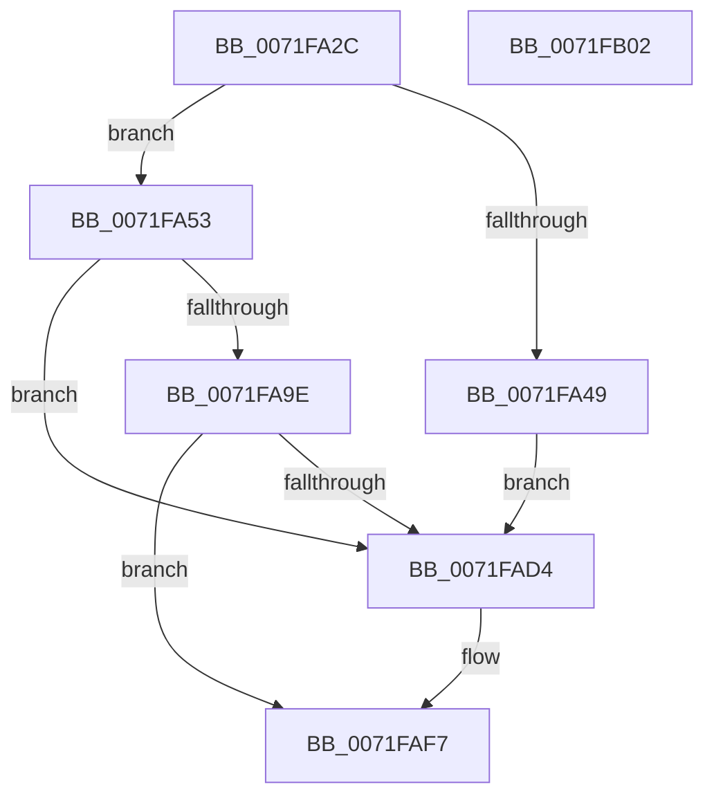

# IopIoRingDispatchFlush

- RVA: `0x0071FA2C`–`0x0071FB03` (길이 `215` bytes)
- VA: `0x000000014071FA2C`
- 실행 섹션: `PAGE`
- PDB 이름 있음: `예`; PDB Function 태그: `아니요`
- unwind 정보 RVA: `0x0008A2AC`
- 디코드: `51`개 명령, `215/215` bytes 표시
- 미해석 바이트: `0` (있으면 어셈블리에 `.byte`로 보존)

> 이 문서는 커널 이미지의 기계어와 PDB 기호를 분석해 생성했습니다. 4번과 5번은 함수 원형과 자료형을 바이너리 사용 방식에서 추정한 C 해석이며 원본 소스 복구 결과는 아닙니다.

## 1. Dependencies

- 직접 호출 지점: **3**; 고유 호출 대상: **3**
- 직접 호출자로 확인된 함수: **1**
- RIP 상대 이미지 참조: **0**

### Outgoing calls
- `0x0071FA95` → [IopIoRingReferenceFileObject](../AD/IopIoRingReferenceFileObject_function_00AD3A8C.md) (function, `0x00AD3A8C`)
- `0x0071FAC8` → [IopFlushBuffersFile](../8A/IopFlushBuffersFile_function_008ACFA4.md) (function, `0x008ACFA4`)
- `0x0071FAF2` → [IopCompleteIoRingEntry](../../text/3E/IopCompleteIoRingEntry_function_003ED2C0.md) (function, `0x003ED2C0`)

### Direct callers
- [IopProcessIoRingEntry](../70/IopProcessIoRingEntry_function_00700A38.md) at `0x00700B03`

### Static image references
- 디코드된 RIP-relative 메모리 참조가 없습니다.

## 2. Other-region calls and transfers

- 다른 실행 섹션으로 향하는 call: **1**
  - `0x0071FAF2` → [IopCompleteIoRingEntry](../../text/3E/IopCompleteIoRingEntry_function_003ED2C0.md) (`PAGE` → `.text`)
- 별도 외부 분기/꼬리 이동을 확인하지 못했습니다.

## 3. Assembly (complete function range)

```asm
0071FA2C  48 89 5C 24 08                  mov qword ptr [rsp + 8], rbx
0071FA31  57                              push rdi
0071FA32  48 83 EC 50                     sub rsp, 0x50
0071FA36  44 8B 42 10                     mov r8d, dword ptr [rdx + 0x10]
0071FA3A  48 8B DA                        mov rbx, rdx
0071FA3D  48 8B F9                        mov rdi, rcx
0071FA40  41 F7 C0 FC FF FF FF            test r8d, 0xfffffffc
0071FA47  74 0A                           je 0x14071fa53
0071FA49  B8 01 00 46 C0                  mov eax, 0xc0460001
0071FA4E  E9 81 00 00 00                  jmp 0x14071fad4
0071FA53  65 48 8B 04 25 88 01 00 00      mov rax, qword ptr gs:[0x188]
0071FA5C  41 80 E0 01                     and r8b, 1
0071FA60  48 8B 52 18                     mov rdx, qword ptr [rdx + 0x18]
0071FA64  48 83 64 24 70 00               and qword ptr [rsp + 0x70], 0
0071FA6A  48 83 64 24 68 00               and qword ptr [rsp + 0x68], 0
0071FA70  44 8A 88 32 02 00 00            mov r9b, byte ptr [rax + 0x232]
0071FA77  48 8D 44 24 68                  lea rax, [rsp + 0x68]
0071FA7C  48 89 44 24 38                  mov qword ptr [rsp + 0x38], rax
0071FA81  48 8D 44 24 70                  lea rax, [rsp + 0x70]
0071FA86  48 89 44 24 30                  mov qword ptr [rsp + 0x30], rax
0071FA8B  83 64 24 28 00                  and dword ptr [rsp + 0x28], 0
0071FA90  C6 44 24 20 00                  mov byte ptr [rsp + 0x20], 0
0071FA95  E8 F2 3F 3B 00                  call 0x140ad3a8c
0071FA9A  85 C0                           test eax, eax
0071FA9C  78 36                           js 0x14071fad4
0071FA9E  48 83 64 24 38 00               and qword ptr [rsp + 0x38], 0
0071FAA4  45 33 C9                        xor r9d, r9d
0071FAA7  48 8B 43 08                     mov rax, qword ptr [rbx + 8]
0071FAAB  45 33 C0                        xor r8d, r8d
0071FAAE  8B 53 14                        mov edx, dword ptr [rbx + 0x14]
0071FAB1  48 8B 4C 24 70                  mov rcx, qword ptr [rsp + 0x70]
0071FAB6  48 89 44 24 30                  mov qword ptr [rsp + 0x30], rax
0071FABB  8B 44 24 6C                     mov eax, dword ptr [rsp + 0x6c]
0071FABF  48 89 7C 24 28                  mov qword ptr [rsp + 0x28], rdi
0071FAC4  89 44 24 20                     mov dword ptr [rsp + 0x20], eax
0071FAC8  E8 D7 D4 18 00                  call 0x1408acfa4
0071FACD  3D 03 01 00 00                  cmp eax, 0x103
0071FAD2  74 23                           je 0x14071faf7
0071FAD4  83 64 24 44 00                  and dword ptr [rsp + 0x44], 0
0071FAD9  4C 8D 44 24 40                  lea r8, [rsp + 0x40]
0071FADE  48 83 64 24 48 00               and qword ptr [rsp + 0x48], 0
0071FAE4  45 33 C9                        xor r9d, r9d
0071FAE7  48 8B 53 08                     mov rdx, qword ptr [rbx + 8]
0071FAEB  48 8B CF                        mov rcx, rdi
0071FAEE  89 44 24 40                     mov dword ptr [rsp + 0x40], eax
0071FAF2  E8 C9 D7 CC FF                  call 0x1403ed2c0
0071FAF7  48 8B 5C 24 60                  mov rbx, qword ptr [rsp + 0x60]
0071FAFC  48 83 C4 50                     add rsp, 0x50
0071FB00  5F                              pop rdi
0071FB01  C3                              ret
0071FB02  CC                              int3
```

## 4. C-style interpretation (structured pseudocode)

```c
__int64 __fastcall IopIoRingDispatchFlush(__int64 a1, __int64 a2)
{
    __int64 result;
    __int64 v_rsp;
    unsigned __int64 v_stack_m10;
    unsigned int v_stack_m14;
    unsigned __int64 v_stack_m18;
    unsigned __int64 v_stack_m20;
    unsigned __int64 v_stack_m28;
    unsigned int v_stack_m30;
    unsigned __int8 v_stack_m38;
    unsigned __int64 v_stack_p10;
    unsigned int v_stack_p14;
    unsigned __int64 v_stack_p18;
    unsigned __int64 v_stack_p8;

    v_stack_p8 = v_rbx;
    v_rsp = (v_rsp) - (80);
    if ((((unsigned int)((unsigned int)(*(unsigned int *)(a2 + 16)))) & (0xFFFFFFFCULL)) == 0) goto loc_0071FA53;
    goto loc_0071FAD4;
loc_0071FA53:
    a3 = (unsigned __int8)(((unsigned int)(*(unsigned int *)(a2 + 16))) & (1));
    v_stack_m20 = v_stack_p10;
    v_stack_m28 = v_stack_p18;
    v_stack_m38 = 0;
    result = IopIoRingReferenceFileObject(a1, *(unsigned __int64 *)(a2 + 24), a3, *(unsigned __int8 *)(*(unsigned __int64 *)(gs_base + (0 + 392)) + 562));
    if (sign_flag) goto loc_0071FAD4;
    a4 = 0;
    a3 = 0;
    v_stack_m28 = *(unsigned __int64 *)(a2 + 8);
    v_stack_m30 = a1;
    v_stack_m38 = (unsigned int)((unsigned int)(v_stack_p14));
    result = IopFlushBuffersFile(v_stack_p18, (unsigned int)(*(unsigned int *)(a2 + 20)), a3, a4);
    if (((unsigned int)(result)) != 259) {
        a3 = v_stack_m18;
        a4 = 0;
        a2 = *(unsigned __int64 *)(a2 + 8);
        a1 = a1;
        v_stack_m18 = (unsigned int)(result);
        result = IopCompleteIoRingEntry(a1, a2, a3, a4);
    }
    v_rsp = (v_rsp) + (80);
    return result;
}
```

## 5. (Beta) C Style

```c
int64_t IopIoRingDispatchFlush(int64_t Arg1, void *Arg2)
{
    uint8_t *arg2 = (uint8_t *)Arg2;

    int64_t result;
    int64_t local_rsp;
    uint64_t v_stack_m10;
    uint32_t v_stack_m14;
    uint64_t v_stack_m18;
    uint64_t v_stack_m20;
    uint64_t v_stack_m28;
    uint32_t v_stack_m30;
    uint8_t v_stack_m38;
    uint64_t v_stack_p10;
    uint32_t v_stack_p14;
    uint64_t v_stack_p18;
    uint64_t v_stack_p8;

    v_stack_p8 = local_rbx;
    local_rsp = (local_rsp) - (80);
    if ((((uint32_t)((uint32_t)(*(uint32_t *)(arg2 + 0x10)))) & (0xFFFFFFFCULL)) == 0) goto loc_0071FA53;
    goto loc_0071FAD4;
loc_0071FA53:
    a3 = (uint8_t)(((uint32_t)(*(uint32_t *)(arg2 + 0x10))) & (1));
    v_stack_m20 = v_stack_p10;
    v_stack_m28 = v_stack_p18;
    v_stack_m38 = 0;
    result = IopIoRingReferenceFileObject(Arg1, *(uint64_t *)(arg2 + 0x18), a3, *(uint8_t *)(*(uint64_t *)(gs_base + (0 + 0x188)) + 0x232));
    if (sign_flag) goto loc_0071FAD4;
    a4 = 0;
    a3 = 0;
    v_stack_m28 = *(uint64_t *)(arg2 + 0x8);
    v_stack_m30 = Arg1;
    v_stack_m38 = (uint32_t)((uint32_t)(v_stack_p14));
    result = IopFlushBuffersFile(v_stack_p18, (uint32_t)(*(uint32_t *)(arg2 + 0x14)), a3, a4);
    if (((uint32_t)(result)) != 259) {
        a3 = v_stack_m18;
        a4 = 0;
        Arg2 = *(uint64_t *)(arg2 + 0x8);
        Arg1 = Arg1;
        v_stack_m18 = (uint32_t)(result);
        result = IopCompleteIoRingEntry(Arg1, Arg2, a3, a4);
    }
    local_rsp = (local_rsp) + (80);
    return result;
}
```

### 관측된 메모리 오프셋

구조체 형식이 확인되지 않은 접근은 인자 기준의 오프셋으로만 기록했습니다.

| 기준 인자 | 오프셋 표현 | 폭 (bit) | 접근 |
|---|---:|---:|---|
| `Arg2` | `+ 0x8` | `64` | `R` |
| `Arg2` | `+ 0x10` | `32` | `R` |
| `Arg2` | `+ 0x14` | `32` | `R` |
| `Arg2` | `+ 0x18` | `64` | `R` |

## 6. Execution-region graph

[열기: 2D/3D 그래프와 함수 탐색 컨트롤 패널](../../../control-panel.html?section=page&rva=0x0071FA2C&view=graph)

- 2D 그래프는 위에서 아래로 흐르고, 3D 그래프는 빈 공간을 드래그해 회전합니다. Shift+드래그는 이동, 휠은 확대·축소, 함수 노드 선택은 대상 보고서 이동입니다.

### Static fallback


