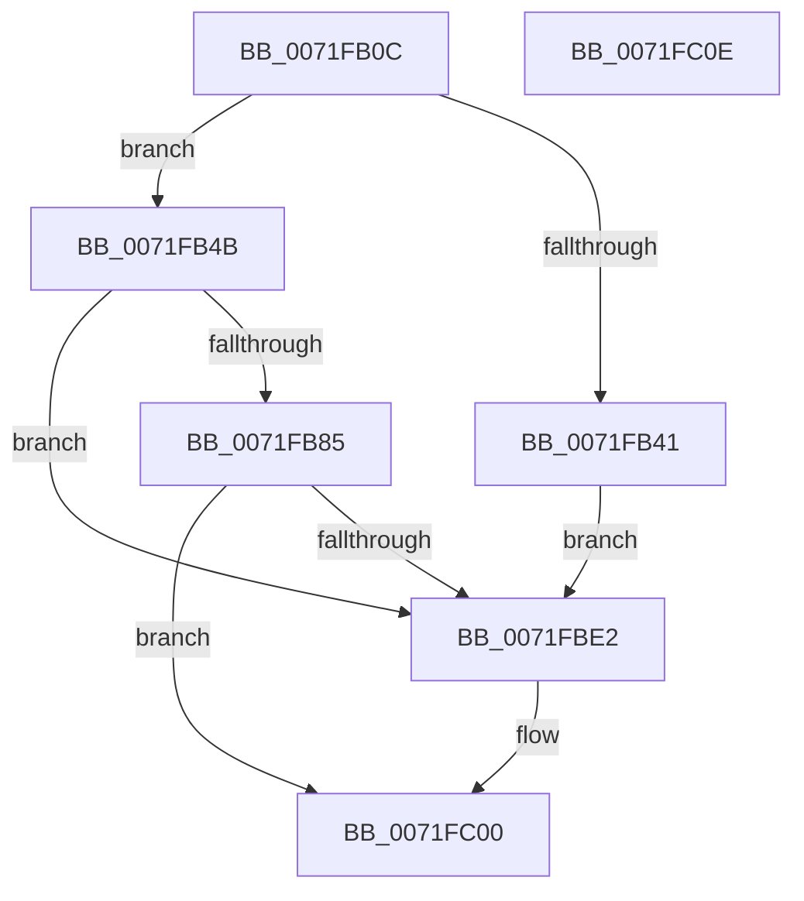

# IopIoRingDispatchReadScatter

- RVA: `0x0071FB0C`–`0x0071FC0F` (길이 `259` bytes)
- VA: `0x000000014071FB0C`
- 실행 섹션: `PAGE`
- PDB 이름 있음: `예`; PDB Function 태그: `아니요`
- unwind 정보 RVA: `0x000BA0F0`
- 디코드: `59`개 명령, `259/259` bytes 표시
- 미해석 바이트: `0` (있으면 어셈블리에 `.byte`로 보존)

> 이 문서는 커널 이미지의 기계어와 PDB 기호를 분석해 생성했습니다. 4번과 5번은 함수 원형과 자료형을 바이너리 사용 방식에서 추정한 C 해석이며 원본 소스 복구 결과는 아닙니다.

## 1. Dependencies

- 직접 호출 지점: **3**; 고유 호출 대상: **3**
- 직접 호출자로 확인된 함수: **1**
- RIP 상대 이미지 참조: **0**

### Outgoing calls
- `0x0071FB7C` → [IopIoRingReferenceFileObject](../AD/IopIoRingReferenceFileObject_function_00AD3A8C.md) (function, `0x00AD3A8C`)
- `0x0071FBD6` → [IopReadFileScatter](../AA/IopReadFileScatter_function_00AA5D78.md) (function, `0x00AA5D78`)
- `0x0071FBFB` → [IopCompleteIoRingEntry](../../text/3E/IopCompleteIoRingEntry_function_003ED2C0.md) (function, `0x003ED2C0`)

### Direct callers
- [IopProcessIoRingEntry](../70/IopProcessIoRingEntry_function_00700A38.md) at `0x00700AF9`

### Static image references
- 디코드된 RIP-relative 메모리 참조가 없습니다.

## 2. Other-region calls and transfers

- 다른 실행 섹션으로 향하는 call: **1**
  - `0x0071FBFB` → [IopCompleteIoRingEntry](../../text/3E/IopCompleteIoRingEntry_function_003ED2C0.md) (`PAGE` → `.text`)
- 별도 외부 분기/꼬리 이동을 확인하지 못했습니다.

## 3. Assembly (complete function range)

```asm
0071FB0C  48 89 5C 24 08                  mov qword ptr [rsp + 8], rbx
0071FB11  57                              push rdi
0071FB12  48 83 EC 70                     sub rsp, 0x70
0071FB16  65 48 8B 04 25 88 01 00 00      mov rax, qword ptr gs:[0x188]
0071FB1F  0F 57 C0                        xorps xmm0, xmm0
0071FB22  44 8B 42 10                     mov r8d, dword ptr [rdx + 0x10]
0071FB26  48 8B DA                        mov rbx, rdx
0071FB29  48 8B F9                        mov rdi, rcx
0071FB2C  44 8A 88 32 02 00 00            mov r9b, byte ptr [rax + 0x232]
0071FB33  0F 11 44 24 60                  movups xmmword ptr [rsp + 0x60], xmm0
0071FB38  41 F7 C0 FE FF FF FF            test r8d, 0xfffffffe
0071FB3F  74 0A                           je 0x14071fb4b
0071FB41  B8 01 00 46 C0                  mov eax, 0xc0460001
0071FB46  E9 97 00 00 00                  jmp 0x14071fbe2
0071FB4B  48 83 64 24 38 00               and qword ptr [rsp + 0x38], 0
0071FB51  48 8D 84 24 88 00 00 00         lea rax, [rsp + 0x88]
0071FB59  48 8B 52 18                     mov rdx, qword ptr [rdx + 0x18]
0071FB5D  41 80 E0 01                     and r8b, 1
0071FB61  48 83 A4 24 88 00 00 00 00      and qword ptr [rsp + 0x88], 0
0071FB6A  48 89 44 24 30                  mov qword ptr [rsp + 0x30], rax
0071FB6F  C7 44 24 28 01 00 00 00         mov dword ptr [rsp + 0x28], 1
0071FB77  C6 44 24 20 00                  mov byte ptr [rsp + 0x20], 0
0071FB7C  E8 0B 3F 3B 00                  call 0x140ad3a8c
0071FB81  85 C0                           test eax, eax
0071FB83  78 5D                           js 0x14071fbe2
0071FB85  48 8B 43 08                     mov rax, qword ptr [rbx + 8]
0071FB89  48 8D 4B 3C                     lea rcx, [rbx + 0x3c]
0071FB8D  48 89 44 24 58                  mov qword ptr [rsp + 0x58], rax
0071FB92  48 8D 53 30                     lea rdx, [rbx + 0x30]
0071FB96  8B 43 38                        mov eax, dword ptr [rbx + 0x38]
0071FB99  45 33 C9                        xor r9d, r9d
0071FB9C  48 89 7C 24 50                  mov qword ptr [rsp + 0x50], rdi
0071FBA1  45 33 C0                        xor r8d, r8d
0071FBA4  48 89 4C 24 48                  mov qword ptr [rsp + 0x48], rcx
0071FBA9  48 8B 8C 24 88 00 00 00         mov rcx, qword ptr [rsp + 0x88]
0071FBB1  48 89 54 24 40                  mov qword ptr [rsp + 0x40], rdx
0071FBB6  33 D2                           xor edx, edx
0071FBB8  89 44 24 38                     mov dword ptr [rsp + 0x38], eax
0071FBBC  48 8B 43 28                     mov rax, qword ptr [rbx + 0x28]
0071FBC0  48 89 44 24 30                  mov qword ptr [rsp + 0x30], rax
0071FBC5  8B 43 20                        mov eax, dword ptr [rbx + 0x20]
0071FBC8  89 44 24 28                     mov dword ptr [rsp + 0x28], eax
0071FBCC  48 8D 44 24 60                  lea rax, [rsp + 0x60]
0071FBD1  48 89 44 24 20                  mov qword ptr [rsp + 0x20], rax
0071FBD6  E8 9D 61 38 00                  call 0x140aa5d78
0071FBDB  3D 03 01 00 00                  cmp eax, 0x103
0071FBE0  74 1E                           je 0x14071fc00
0071FBE2  48 83 64 24 68 00               and qword ptr [rsp + 0x68], 0
0071FBE8  4C 8D 44 24 60                  lea r8, [rsp + 0x60]
0071FBED  48 8B 53 08                     mov rdx, qword ptr [rbx + 8]
0071FBF1  45 33 C9                        xor r9d, r9d
0071FBF4  48 8B CF                        mov rcx, rdi
0071FBF7  89 44 24 60                     mov dword ptr [rsp + 0x60], eax
0071FBFB  E8 C0 D6 CC FF                  call 0x1403ed2c0
0071FC00  48 8B 9C 24 80 00 00 00         mov rbx, qword ptr [rsp + 0x80]
0071FC08  48 83 C4 70                     add rsp, 0x70
0071FC0C  5F                              pop rdi
0071FC0D  C3                              ret
0071FC0E  CC                              int3
```

## 4. C-style interpretation (structured pseudocode)

```c
__int64 __fastcall IopIoRingDispatchReadScatter(__int64 a1, __int64 a2)
{
    __int64 result;
    __int64 v_rsp;
    unsigned __int64 v_stack_m10;
    unsigned __int64 v_stack_m18;
    unsigned __int64 v_stack_m20;
    unsigned __int64 v_stack_m28;
    unsigned __int64 v_stack_m30;
    unsigned __int64 v_stack_m38;
    unsigned __int64 v_stack_m40;
    unsigned __int64 v_stack_m48;
    unsigned int v_stack_m50;
    unsigned __int8 v_stack_m58;
    unsigned __int64 v_stack_p10;
    unsigned __int64 v_stack_p8;

    v_stack_p8 = v_rbx;
    v_rsp = (v_rsp) - (112);
    v_stack_m18 = v_xmm0;
    if ((((unsigned int)((unsigned int)(*(unsigned int *)(a2 + 16)))) & (0xFFFFFFFEULL)) == 0) goto loc_0071FB4B;
    goto loc_0071FBE2;
loc_0071FB4B:
    a3 = (unsigned __int8)(((unsigned int)(*(unsigned int *)(a2 + 16))) & (1));
    v_stack_m48 = v_stack_p10;
    v_stack_m50 = 1;
    v_stack_m58 = 0;
    result = IopIoRingReferenceFileObject(a1, *(unsigned __int64 *)(a2 + 24), a3, *(unsigned __int8 *)(*(unsigned __int64 *)(gs_base + (0 + 392)) + 562));
    if (sign_flag) goto loc_0071FBE2;
    v_stack_m20 = *(unsigned __int64 *)(a2 + 8);
    a4 = 0;
    v_stack_m28 = a1;
    a3 = 0;
    v_stack_m30 = a2 + 60;
    v_stack_m38 = a2 + 48;
    a2 = 0;
    v_stack_m40 = (unsigned int)((unsigned int)(*(unsigned int *)(a2 + 56)));
    v_stack_m48 = *(unsigned __int64 *)(a2 + 40);
    v_stack_m50 = (unsigned int)((unsigned int)(*(unsigned int *)(a2 + 32)));
    v_stack_m58 = v_stack_m18;
    result = IopReadFileScatter(v_stack_p10, a2, a3, a4);
    if (((unsigned int)(result)) != 259) {
        a3 = v_stack_m18;
        a2 = *(unsigned __int64 *)(a2 + 8);
        a4 = 0;
        a1 = a1;
        v_stack_m18 = (unsigned int)(result);
        result = IopCompleteIoRingEntry(a1, a2, a3, a4);
    }
    v_rsp = (v_rsp) + (112);
    return result;
}
```

## 5. (Beta) C Style

```c
int64_t IopIoRingDispatchReadScatter(int64_t Arg1, void *Arg2)
{
    uint8_t *arg2 = (uint8_t *)Arg2;

    int64_t result;
    int64_t local_rsp;
    uint64_t v_stack_m10;
    uint64_t v_stack_m18;
    uint64_t v_stack_m20;
    uint64_t v_stack_m28;
    uint64_t v_stack_m30;
    uint64_t v_stack_m38;
    uint64_t v_stack_m40;
    uint64_t v_stack_m48;
    uint32_t v_stack_m50;
    uint8_t v_stack_m58;
    uint64_t v_stack_p10;
    uint64_t v_stack_p8;

    v_stack_p8 = local_rbx;
    local_rsp = (local_rsp) - (112);
    v_stack_m18 = v_xmm0;
    if ((((uint32_t)((uint32_t)(*(uint32_t *)(arg2 + 0x10)))) & (0xFFFFFFFEULL)) == 0) goto loc_0071FB4B;
    goto loc_0071FBE2;
loc_0071FB4B:
    a3 = (uint8_t)(((uint32_t)(*(uint32_t *)(arg2 + 0x10))) & (1));
    v_stack_m48 = v_stack_p10;
    v_stack_m50 = 1;
    v_stack_m58 = 0;
    result = IopIoRingReferenceFileObject(Arg1, *(uint64_t *)(arg2 + 0x18), a3, *(uint8_t *)(*(uint64_t *)(gs_base + (0 + 0x188)) + 0x232));
    if (sign_flag) goto loc_0071FBE2;
    v_stack_m20 = *(uint64_t *)(arg2 + 0x8);
    a4 = 0;
    v_stack_m28 = Arg1;
    a3 = 0;
    v_stack_m30 = Arg2 + 60;
    v_stack_m38 = Arg2 + 48;
    Arg2 = 0;
    v_stack_m40 = (uint32_t)((uint32_t)(*(uint32_t *)(arg2 + 0x38)));
    v_stack_m48 = *(uint64_t *)(arg2 + 0x28);
    v_stack_m50 = (uint32_t)((uint32_t)(*(uint32_t *)(arg2 + 0x20)));
    v_stack_m58 = v_stack_m18;
    result = IopReadFileScatter(v_stack_p10, Arg2, a3, a4);
    if (((uint32_t)(result)) != 259) {
        a3 = v_stack_m18;
        Arg2 = *(uint64_t *)(arg2 + 0x8);
        a4 = 0;
        Arg1 = Arg1;
        v_stack_m18 = (uint32_t)(result);
        result = IopCompleteIoRingEntry(Arg1, Arg2, a3, a4);
    }
    local_rsp = (local_rsp) + (112);
    return result;
}
```

### 관측된 메모리 오프셋

구조체 형식이 확인되지 않은 접근은 인자 기준의 오프셋으로만 기록했습니다.

| 기준 인자 | 오프셋 표현 | 폭 (bit) | 접근 |
|---|---:|---:|---|
| `Arg2` | `+ 0x8` | `64` | `R` |
| `Arg2` | `+ 0x10` | `32` | `R` |
| `Arg2` | `+ 0x18` | `64` | `R` |
| `Arg2` | `+ 0x20` | `32` | `R` |
| `Arg2` | `+ 0x28` | `64` | `R` |
| `Arg2` | `+ 0x30` | `64` | `R` |
| `Arg2` | `+ 0x38` | `32` | `R` |
| `Arg2` | `+ 0x3C` | `64` | `R` |

## 6. Execution-region graph

[열기: 2D/3D 그래프와 함수 탐색 컨트롤 패널](../../../control-panel.html?section=page&rva=0x0071FB0C&view=graph)

- 2D 그래프는 위에서 아래로 흐르고, 3D 그래프는 빈 공간을 드래그해 회전합니다. Shift+드래그는 이동, 휠은 확대·축소, 함수 노드 선택은 대상 보고서 이동입니다.

### Static fallback


