# IopIoRingDispatchRegisterBuffers

- RVA: `0x0071FC18`–`0x0071FFD2` (길이 `954` bytes)
- VA: `0x000000014071FC18`
- 실행 섹션: `PAGE`
- PDB 이름 있음: `예`; PDB Function 태그: `아니요`
- unwind 정보 RVA: `0x000C774C`
- 디코드: `243`개 명령, `954/954` bytes 표시
- 미해석 바이트: `0` (있으면 어셈블리에 `.byte`로 보존)

> 이 문서는 커널 이미지의 기계어와 PDB 기호를 분석해 생성했습니다. 4번과 5번은 함수 원형과 자료형을 바이너리 사용 방식에서 추정한 C 해석이며 원본 소스 복구 결과는 아닙니다.

## 1. Dependencies

- 직접 호출 지점: **9**; 고유 호출 대상: **8**
- 직접 호출자로 확인된 함수: **1**
- RIP 상대 이미지 참조: **0**

### Outgoing calls
- `0x0071FDC9` → [ExAllocatePool2](../../poolcode/B8/ExAllocatePool2_function_00B820F0.md) (function, `0x00B820F0`)
- `0x0071FDFD` → [memcpy](../../text/6C/memcpy_function_006C6840.md) (function, `0x006C6840`)
- `0x0071FE0A` → [memset](../../text/6C/memset_function_006C6C40.md) (function, `0x006C6C40`)
- `0x0071FE9B` → [ProbeForWrite](../8E/ProbeForWrite_function_008E91C0.md) (function, `0x008E91C0`)
- `0x0071FEE0` → [IopMcWaitAndCleanupBufferEntry](../../text/5A/IopMcWaitAndCleanupBufferEntry_function_005A3F44.md) (function, `0x005A3F44`)
- `0x0071FF04` → [IopMcCreateBufferEntry](../../text/5A/IopMcCreateBufferEntry_function_005A3AEC.md) (function, `0x005A3AEC`)
- `0x0071FF82` → [IopIoRingCleanupRegBufferArray](IopIoRingCleanupRegBufferArray_function_0071F914.md) (function, `0x0071F914`)
- `0x0071FF93` → [IopIoRingCleanupRegBufferArray](IopIoRingCleanupRegBufferArray_function_0071F914.md) (function, `0x0071F914`)
- `0x0071FFBD` → [IopCompleteIoRingEntry](../../text/3E/IopCompleteIoRingEntry_function_003ED2C0.md) (function, `0x003ED2C0`)

### Direct callers
- [IopProcessIoRingEntry](../70/IopProcessIoRingEntry_function_00700A38.md) at `0x00700B21`

### Static image references
- 디코드된 RIP-relative 메모리 참조가 없습니다.

## 2. Other-region calls and transfers

- 다른 실행 섹션으로 향하는 call: **6**
  - `0x0071FDC9` → [ExAllocatePool2](../../poolcode/B8/ExAllocatePool2_function_00B820F0.md) (`PAGE` → `POOLCODE`)
  - `0x0071FDFD` → [memcpy](../../text/6C/memcpy_function_006C6840.md) (`PAGE` → `.text`)
  - `0x0071FE0A` → [memset](../../text/6C/memset_function_006C6C40.md) (`PAGE` → `.text`)
  - `0x0071FEE0` → [IopMcWaitAndCleanupBufferEntry](../../text/5A/IopMcWaitAndCleanupBufferEntry_function_005A3F44.md) (`PAGE` → `.text`)
  - `0x0071FF04` → [IopMcCreateBufferEntry](../../text/5A/IopMcCreateBufferEntry_function_005A3AEC.md) (`PAGE` → `.text`)
  - `0x0071FFBD` → [IopCompleteIoRingEntry](../../text/3E/IopCompleteIoRingEntry_function_003ED2C0.md) (`PAGE` → `.text`)
- 별도 외부 분기/꼬리 이동을 확인하지 못했습니다.

## 3. Assembly (complete function range)

```asm
0071FC18  48 89 54 24 10                  mov qword ptr [rsp + 0x10], rdx
0071FC1D  48 89 4C 24 08                  mov qword ptr [rsp + 8], rcx
0071FC22  53                              push rbx
0071FC23  56                              push rsi
0071FC24  41 54                           push r12
0071FC26  41 55                           push r13
0071FC28  41 56                           push r14
0071FC2A  41 57                           push r15
0071FC2C  48 83 EC 78                     sub rsp, 0x78
0071FC30  4C 8B EA                        mov r13, rdx
0071FC33  83 64 24 20 00                  and dword ptr [rsp + 0x20], 0
0071FC38  65 48 8B 04 25 88 01 00 00      mov rax, qword ptr gs:[0x188]
0071FC41  44 8A 90 32 02 00 00            mov r10b, byte ptr [rax + 0x232]
0071FC48  44 88 94 24 C0 00 00 00         mov byte ptr [rsp + 0xc0], r10b
0071FC50  45 33 F6                        xor r14d, r14d
0071FC53  44 89 74 24 28                  mov dword ptr [rsp + 0x28], r14d
0071FC58  45 33 FF                        xor r15d, r15d
0071FC5B  33 F6                           xor esi, esi
0071FC5D  8B 91 B0 00 00 00               mov edx, dword ptr [rcx + 0xb0]
0071FC63  89 54 24 24                     mov dword ptr [rsp + 0x24], edx
0071FC67  89 54 24 34                     mov dword ptr [rsp + 0x34], edx
0071FC6B  4C 8B A1 B8 00 00 00            mov r12, qword ptr [rcx + 0xb8]
0071FC72  4C 89 64 24 48                  mov qword ptr [rsp + 0x48], r12
0071FC77  21 B1 B0 00 00 00               and dword ptr [rcx + 0xb0], esi
0071FC7D  48 21 B1 B8 00 00 00            and qword ptr [rcx + 0xb8], rsi
0071FC84  41 F7 45 04 FE FF FF FF         test dword ptr [r13 + 4], 0xfffffffe
0071FC8C  0F 85 E0 02 00 00               jne 0x14071ff72
0071FC92  41 39 75 10                     cmp dword ptr [r13 + 0x10], esi
0071FC96  0F 85 D6 02 00 00               jne 0x14071ff72
0071FC9C  41 39 75 14                     cmp dword ptr [r13 + 0x14], esi
0071FCA0  0F 85 CC 02 00 00               jne 0x14071ff72
0071FCA6  45 8B 7D 1C                     mov r15d, dword ptr [r13 + 0x1c]
0071FCAA  44 89 7C 24 30                  mov dword ptr [rsp + 0x30], r15d
0071FCAF  4D 8B 45 20                     mov r8, qword ptr [r13 + 0x20]
0071FCB3  4C 89 44 24 58                  mov qword ptr [rsp + 0x58], r8
0071FCB8  45 85 FF                        test r15d, r15d
0071FCBB  75 10                           jne 0x14071fccd
0071FCBD  49 F7 D8                        neg r8
0071FCC0  1B DB                           sbb ebx, ebx
0071FCC2  81 E3 0D 00 00 C0               and ebx, 0xc000000d
0071FCC8  E9 AA 02 00 00                  jmp 0x14071ff77
0071FCCD  65 48 8B 04 25 88 01 00 00      mov rax, qword ptr gs:[0x188]
0071FCD6  48 8B 88 B8 00 00 00            mov rcx, qword ptr [rax + 0xb8]
0071FCDD  48 39 B1 10 03 00 00            cmp qword ptr [rcx + 0x310], rsi
0071FCE4  74 29                           je 0x14071fd0f
0071FCE6  0F B7 81 EC 06 00 00            movzx eax, word ptr [rcx + 0x6ec]
0071FCED  B9 4C 01 00 00                  mov ecx, 0x14c
0071FCF2  66 3B C1                        cmp ax, cx
0071FCF5  74 0E                           je 0x14071fd05
0071FCF7  B9 C4 01 00 00                  mov ecx, 0x1c4
0071FCFC  66 3B C1                        cmp ax, cx
0071FCFF  74 04                           je 0x14071fd05
0071FD01  32 C0                           xor al, al
0071FD03  EB 02                           jmp 0x14071fd07
0071FD05  B0 01                           mov al, 1
0071FD07  84 C0                           test al, al
0071FD09  74 04                           je 0x14071fd0f
0071FD0B  B1 01                           mov cl, 1
0071FD0D  EB 02                           jmp 0x14071fd11
0071FD0F  32 C9                           xor cl, cl
0071FD11  88 8C 24 C8 00 00 00            mov byte ptr [rsp + 0xc8], cl
0071FD18  45 84 D2                        test r10b, r10b
0071FD1B  74 7F                           je 0x14071fd9c
0071FD1D  49 8B C7                        mov rax, r15
0071FD20  BA FF FF FF FF                  mov edx, 0xffffffff
0071FD25  84 C9                           test cl, cl
0071FD27  8B CA                           mov ecx, edx
0071FD29  74 06                           je 0x14071fd31
0071FD2B  48 C1 E0 03                     shl rax, 3
0071FD2F  EB 04                           jmp 0x14071fd35
0071FD31  48 C1 E0 04                     shl rax, 4
0071FD35  48 3B C2                        cmp rax, rdx
0071FD38  0F 46 C8                        cmovbe ecx, eax
0071FD3B  48 3B D0                        cmp rdx, rax
0071FD3E  1B DB                           sbb ebx, ebx
0071FD40  81 E3 95 00 00 C0               and ebx, 0xc0000095
0071FD46  89 5C 24 20                     mov dword ptr [rsp + 0x20], ebx
0071FD4A  85 DB                           test ebx, ebx
0071FD4C  0F 88 25 02 00 00               js 0x14071ff77
0071FD52  85 C9                           test ecx, ecx
0071FD54  74 19                           je 0x14071fd6f
0071FD56  49 03 C8                        add rcx, r8
0071FD59  48 B8 00 00 FF FF FF 7F 00 00   movabs rax, 0x7fffffff0000
0071FD63  48 3B C8                        cmp rcx, rax
0071FD66  77 05                           ja 0x14071fd6d
0071FD68  49 3B C8                        cmp rcx, r8
0071FD6B  73 02                           jae 0x14071fd6f
0071FD6D  8A 00                           mov al, byte ptr [rax]
0071FD6F  EB 2B                           jmp 0x14071fd9c
0071FD71  4C 8B AC 24 B8 00 00 00         mov r13, qword ptr [rsp + 0xb8]
0071FD79  8B 5C 24 20                     mov ebx, dword ptr [rsp + 0x20]
0071FD7D  44 8B 74 24 28                  mov r14d, dword ptr [rsp + 0x28]
0071FD82  44 8B 7C 24 30                  mov r15d, dword ptr [rsp + 0x30]
0071FD87  41 8B F6                        mov esi, r14d
0071FD8A  8B 4C 24 34                     mov ecx, dword ptr [rsp + 0x34]
0071FD8E  89 4C 24 24                     mov dword ptr [rsp + 0x24], ecx
0071FD92  4C 8B 64 24 48                  mov r12, qword ptr [rsp + 0x48]
0071FD97  E9 DB 01 00 00                  jmp 0x14071ff77
0071FD9C  8B 4C 24 24                     mov ecx, dword ptr [rsp + 0x24]
0071FDA0  44 3B F9                        cmp r15d, ecx
0071FDA3  75 12                           jne 0x14071fdb7
0071FDA5  49 8B F4                        mov rsi, r12
0071FDA8  4C 89 64 24 40                  mov qword ptr [rsp + 0x40], r12
0071FDAD  45 33 E4                        xor r12d, r12d
0071FDB0  4C 89 64 24 48                  mov qword ptr [rsp + 0x48], r12
0071FDB5  EB 69                           jmp 0x14071fe20
0071FDB7  49 8B D7                        mov rdx, r15
0071FDBA  48 C1 E2 03                     shl rdx, 3
0071FDBE  B9 01 01 00 00                  mov ecx, 0x101
0071FDC3  41 B8 49 72 52 42               mov r8d, 0x42527249
0071FDC9  E8 22 23 46 00                  call 0x140b820f0
0071FDCE  48 8B F0                        mov rsi, rax
0071FDD1  48 89 44 24 40                  mov qword ptr [rsp + 0x40], rax
0071FDD6  48 85 C0                        test rax, rax
0071FDD9  75 0A                           jne 0x14071fde5
0071FDDB  BB 9A 00 00 C0                  mov ebx, 0xc000009a
0071FDE0  E9 92 01 00 00                  jmp 0x14071ff77
0071FDE5  8B 5C 24 24                     mov ebx, dword ptr [rsp + 0x24]
0071FDE9  44 3B FB                        cmp r15d, ebx
0071FDEC  41 0F 42 DF                     cmovb ebx, r15d
0071FDF0  48 C1 E3 03                     shl rbx, 3
0071FDF4  4C 8B C3                        mov r8, rbx
0071FDF7  49 8B D4                        mov rdx, r12
0071FDFA  48 8B C8                        mov rcx, rax
0071FDFD  E8 3E 6A FA FF                  call 0x1406c6840
0071FE02  4C 8B C3                        mov r8, rbx
0071FE05  33 D2                           xor edx, edx
0071FE07  49 8B CC                        mov rcx, r12
0071FE0A  E8 31 6E FA FF                  call 0x1406c6c40
0071FE0F  8B 4C 24 24                     mov ecx, dword ptr [rsp + 0x24]
0071FE13  4C 8B 44 24 58                  mov r8, qword ptr [rsp + 0x58]
0071FE18  44 8A 94 24 C0 00 00 00         mov r10b, byte ptr [rsp + 0xc0]
0071FE20  45 33 F6                        xor r14d, r14d
0071FE23  44 89 74 24 28                  mov dword ptr [rsp + 0x28], r14d
0071FE28  45 3B F7                        cmp r14d, r15d
0071FE2B  0F 83 25 01 00 00               jae 0x14071ff56
0071FE31  48 83 64 24 50 00               and qword ptr [rsp + 0x50], 0
0071FE37  83 64 24 38 00                  and dword ptr [rsp + 0x38], 0
0071FE3C  41 8B C6                        mov eax, r14d
0071FE3F  80 BC 24 C8 00 00 00 00         cmp byte ptr [rsp + 0xc8], 0
0071FE47  74 10                           je 0x14071fe59
0071FE49  47 8B 0C F0                     mov r9d, dword ptr [r8 + r14*8]
0071FE4D  4C 89 4C 24 50                  mov qword ptr [rsp + 0x50], r9
0071FE52  43 8B 5C F0 04                  mov ebx, dword ptr [r8 + r14*8 + 4]
0071FE57  EB 11                           jmp 0x14071fe6a
0071FE59  48 03 C0                        add rax, rax
0071FE5C  4D 8B 0C C0                     mov r9, qword ptr [r8 + rax*8]
0071FE60  4C 89 4C 24 50                  mov qword ptr [rsp + 0x50], r9
0071FE65  41 8B 5C C0 08                  mov ebx, dword ptr [r8 + rax*8 + 8]
0071FE6A  89 5C 24 38                     mov dword ptr [rsp + 0x38], ebx
0071FE6E  44 3B F1                        cmp r14d, ecx
0071FE71  73 18                           jae 0x14071fe8b
0071FE73  4A 8B 0C F6                     mov rcx, qword ptr [rsi + r14*8]
0071FE77  48 85 C9                        test rcx, rcx
0071FE7A  74 0F                           je 0x14071fe8b
0071FE7C  4C 39 49 20                     cmp qword ptr [rcx + 0x20], r9
0071FE80  75 09                           jne 0x14071fe8b
0071FE82  39 59 28                        cmp dword ptr [rcx + 0x28], ebx
0071FE85  0F 84 8D 00 00 00               je 0x14071ff18
0071FE8B  45 84 D2                        test r10b, r10b
0071FE8E  74 3F                           je 0x14071fecf
0071FE90  8B D3                           mov edx, ebx
0071FE92  41 B8 01 00 00 00               mov r8d, 1
0071FE98  49 8B C9                        mov rcx, r9
0071FE9B  E8 20 93 1C 00                  call 0x1408e91c0
0071FEA0  EB 2D                           jmp 0x14071fecf
0071FEA2  4C 8B AC 24 B8 00 00 00         mov r13, qword ptr [rsp + 0xb8]
0071FEAA  8B 5C 24 20                     mov ebx, dword ptr [rsp + 0x20]
0071FEAE  44 8B 74 24 28                  mov r14d, dword ptr [rsp + 0x28]
0071FEB3  44 8B 7C 24 30                  mov r15d, dword ptr [rsp + 0x30]
0071FEB8  48 8B 74 24 40                  mov rsi, qword ptr [rsp + 0x40]
0071FEBD  8B 44 24 34                     mov eax, dword ptr [rsp + 0x34]
0071FEC1  89 44 24 24                     mov dword ptr [rsp + 0x24], eax
0071FEC5  4C 8B 64 24 48                  mov r12, qword ptr [rsp + 0x48]
0071FECA  E9 A8 00 00 00                  jmp 0x14071ff77
0071FECF  4A 8D 04 F6                     lea rax, [rsi + r14*8]
0071FED3  48 89 44 24 28                  mov qword ptr [rsp + 0x28], rax
0071FED8  48 8B 08                        mov rcx, qword ptr [rax]
0071FEDB  48 85 C9                        test rcx, rcx
0071FEDE  74 0E                           je 0x14071feee
0071FEE0  E8 5F 40 E8 FF                  call 0x1405a3f44
0071FEE5  48 8B 44 24 28                  mov rax, qword ptr [rsp + 0x28]
0071FEEA  48 83 20 00                     and qword ptr [rax], 0
0071FEEE  85 DB                           test ebx, ebx
0071FEF0  74 21                           je 0x14071ff13
0071FEF2  4C 8B C8                        mov r9, rax
0071FEF5  44 8A 84 24 C0 00 00 00         mov r8b, byte ptr [rsp + 0xc0]
0071FEFD  8B D3                           mov edx, ebx
0071FEFF  48 8B 4C 24 50                  mov rcx, qword ptr [rsp + 0x50]
0071FF04  E8 E3 3B E8 FF                  call 0x1405a3aec
0071FF09  8B D8                           mov ebx, eax
0071FF0B  89 44 24 20                     mov dword ptr [rsp + 0x20], eax
0071FF0F  85 C0                           test eax, eax
0071FF11  78 64                           js 0x14071ff77
0071FF13  4C 8B 44 24 58                  mov r8, qword ptr [rsp + 0x58]
0071FF18  41 FF C6                        inc r14d
0071FF1B  8B 4C 24 24                     mov ecx, dword ptr [rsp + 0x24]
0071FF1F  44 8A 94 24 C0 00 00 00         mov r10b, byte ptr [rsp + 0xc0]
0071FF27  E9 F7 FE FF FF                  jmp 0x14071fe23
0071FF2C  4C 8B AC 24 B8 00 00 00         mov r13, qword ptr [rsp + 0xb8]
0071FF34  8B 5C 24 20                     mov ebx, dword ptr [rsp + 0x20]
0071FF38  44 8B 74 24 28                  mov r14d, dword ptr [rsp + 0x28]
0071FF3D  44 8B 7C 24 30                  mov r15d, dword ptr [rsp + 0x30]
0071FF42  48 8B 74 24 40                  mov rsi, qword ptr [rsp + 0x40]
0071FF47  8B 44 24 34                     mov eax, dword ptr [rsp + 0x34]
0071FF4B  89 44 24 24                     mov dword ptr [rsp + 0x24], eax
0071FF4F  4C 8B 64 24 48                  mov r12, qword ptr [rsp + 0x48]
0071FF54  EB 21                           jmp 0x14071ff77
0071FF56  48 8B 84 24 B0 00 00 00         mov rax, qword ptr [rsp + 0xb0]
0071FF5E  44 89 B0 B0 00 00 00            mov dword ptr [rax + 0xb0], r14d
0071FF65  48 89 B0 B8 00 00 00            mov qword ptr [rax + 0xb8], rsi
0071FF6C  33 F6                           xor esi, esi
0071FF6E  33 DB                           xor ebx, ebx
0071FF70  EB 05                           jmp 0x14071ff77
0071FF72  BB 01 00 46 C0                  mov ebx, 0xc0460001
0071FF77  48 85 F6                        test rsi, rsi
0071FF7A  74 0B                           je 0x14071ff87
0071FF7C  48 8B D6                        mov rdx, rsi
0071FF7F  41 8B CF                        mov ecx, r15d
0071FF82  E8 8D F9 FF FF                  call 0x14071f914
0071FF87  4D 85 E4                        test r12, r12
0071FF8A  74 0C                           je 0x14071ff98
0071FF8C  49 8B D4                        mov rdx, r12
0071FF8F  8B 4C 24 24                     mov ecx, dword ptr [rsp + 0x24]
0071FF93  E8 7C F9 FF FF                  call 0x14071f914
0071FF98  83 64 24 64 00                  and dword ptr [rsp + 0x64], 0
0071FF9D  41 8B C6                        mov eax, r14d
0071FFA0  48 89 44 24 68                  mov qword ptr [rsp + 0x68], rax
0071FFA5  89 5C 24 60                     mov dword ptr [rsp + 0x60], ebx
0071FFA9  45 33 C9                        xor r9d, r9d
0071FFAC  4C 8D 44 24 60                  lea r8, [rsp + 0x60]
0071FFB1  49 8B 55 08                     mov rdx, qword ptr [r13 + 8]
0071FFB5  48 8B 8C 24 B0 00 00 00         mov rcx, qword ptr [rsp + 0xb0]
0071FFBD  E8 FE D2 CC FF                  call 0x1403ed2c0
0071FFC2  48 83 C4 78                     add rsp, 0x78
0071FFC6  41 5F                           pop r15
0071FFC8  41 5E                           pop r14
0071FFCA  41 5D                           pop r13
0071FFCC  41 5C                           pop r12
0071FFCE  5E                              pop rsi
0071FFCF  5B                              pop rbx
0071FFD0  C3                              ret
0071FFD1  CC                              int3
```

## 4. C-style interpretation (structured pseudocode)

```c
__int64 __fastcall IopIoRingDispatchRegisterBuffers(__int64 a1, __int64 a2)
{
    __int64 result;
    __int64 v_r12;
    __int64 v_r14;
    __int64 v_r15;
    __int64 v_rbx;
    __int64 v_rsi;
    __int64 v_rsp;
    unsigned __int64 v_stack_m40;
    unsigned int v_stack_m44;
    unsigned int v_stack_m48;
    unsigned __int64 v_stack_m50;
    unsigned __int64 v_stack_m58;
    unsigned __int64 v_stack_m60;
    unsigned __int64 v_stack_m68;
    unsigned int v_stack_m70;
    unsigned int v_stack_m74;
    unsigned int v_stack_m78;
    unsigned int v_stack_m80;
    unsigned int v_stack_m84;
    unsigned int v_stack_m88;
    unsigned __int64 v_stack_p10;
    unsigned __int8 v_stack_p18;
    unsigned __int8 v_stack_p20;
    unsigned __int64 v_stack_p8;

    v_stack_p10 = a2;
    v_stack_p8 = a1;
    v_rsp = (v_rsp) - (120);
    v_stack_p18 = (unsigned __int8)(*(unsigned __int8 *)(*(unsigned __int64 *)(gs_base + (0 + 392)) + 562));
    v_r14 = 0;
    v_stack_m80 = 0;
    v_r15 = 0;
    v_rsi = 0;
    v_stack_m84 = (unsigned int)((unsigned int)(*(unsigned int *)(a1 + 176)));
    v_stack_m74 = (unsigned int)((unsigned int)(*(unsigned int *)(a1 + 176)));
    v_stack_m60 = *(unsigned __int64 *)(a1 + 184);
    if (((*(unsigned int *)(a2 + 4)) & (0xFFFFFFFEULL)) != 0) goto loc_0071FF72;
    if ((*(unsigned int *)(a2 + 16)) != 0) goto loc_0071FF72;
    if ((*(unsigned int *)(a2 + 20)) != 0) goto loc_0071FF72;
    v_stack_m78 = (unsigned int)((unsigned int)(*(unsigned int *)(a2 + 28)));
    v_stack_m50 = *(unsigned __int64 *)(a2 + 32);
    if ((unsigned int)((unsigned int)(*(unsigned int *)(a2 + 28))) != 0) goto loc_0071FCCD;
    a3 = -(*(unsigned __int64 *)(a2 + 32));
    v_rbx = (unsigned int)((v_rbx) & (0xC000000DULL));
    goto loc_0071FF77;
loc_0071FCCD:
    if ((*(unsigned __int64 *)(*(unsigned __int64 *)(*(unsigned __int64 *)(gs_base + (0 + 392)) + 184) + 784)) == 0) goto loc_0071FD0F;
    if (((unsigned __int16)(*(unsigned __int16 *)(*(unsigned __int64 *)(*(unsigned __int64 *)(gs_base + (0 + 392)) + 184) + 1772))) == 332) goto loc_0071FD05;
    if (((unsigned __int16)(*(unsigned __int16 *)(*(unsigned __int64 *)(*(unsigned __int64 *)(gs_base + (0 + 392)) + 184) + 1772))) == 452) goto loc_0071FD05;
    result = 0;
    goto loc_0071FD07;
loc_0071FD05:
loc_0071FD07:
    if (1 == 0) goto loc_0071FD0F;
    goto loc_0071FD11;
loc_0071FD0F:
    a1 = 0;
loc_0071FD11:
    v_stack_p20 = 0;
    if ((unsigned __int8)(*(unsigned __int8 *)(*(unsigned __int64 *)(gs_base + (0 + 392)) + 562)) == 0) goto loc_0071FD9C;
    if (0 == 0) goto loc_0071FD31;
    result = ((unsigned int)(*(unsigned int *)(a2 + 28))) << (3);
    goto loc_0071FD35;
loc_0071FD31:
    result = (result) << (4);
loc_0071FD35:
    a1 = (unsigned int)((unsigned int)((unsigned int)(0xFFFFFFFFULL)));
    if (result <= ((unsigned int)(0xFFFFFFFFULL))) { a1 = (unsigned int)(result); }
    v_rbx = (unsigned int)((v_rbx) & (0xC0000095ULL));
    v_stack_m88 = (unsigned int)(v_rbx);
    if (sign_flag) goto loc_0071FF77;
    if ((unsigned int)(a1) == 0) goto loc_0071FD6F;
    a1 = (a1) + (a3);
    if (a1 > result) goto loc_0071FD6D;
    if (a1 < a3) {
        result = *(unsigned __int8 *)(result);
    }
    goto loc_0071FD9C;
loc_0071FD9C:
    if (((unsigned int)((unsigned int)(*(unsigned int *)(a2 + 28)))) != ((unsigned int)((unsigned int)(v_stack_m84)))) goto loc_0071FDB7;
    v_stack_m68 = *(unsigned __int64 *)(a1 + 184);
    v_r12 = 0;
    v_stack_m60 = 0;
    goto loc_0071FE20;
loc_0071FDB7:
    a2 = ((unsigned int)(*(unsigned int *)(a2 + 28))) << (3);
    result = ExAllocatePool2(257, a2, (unsigned int)(0x42527249ULL), a4);
    v_stack_m68 = result;
    if (result != 0) goto loc_0071FDE5;
    goto loc_0071FF77;
loc_0071FDE5:
    v_rbx = (unsigned int)(v_stack_m84);
    if (((unsigned int)((unsigned int)(*(unsigned int *)(a2 + 28)))) < ((unsigned int)((unsigned int)(v_stack_m84)))) { v_rbx = (unsigned int)((unsigned int)(*(unsigned int *)(a2 + 28))); }
    v_rbx = (v_rbx) << (3);
    result = memcpy(result, 0, v_rbx, a4);
    a2 = 0;
    result = memset(0, a2, v_rbx, a4);
loc_0071FE20:
    v_r14 = 0;
loc_0071FE23:
    v_stack_m80 = 0;
    if (0 >= ((unsigned int)((unsigned int)(*(unsigned int *)(a2 + 28))))) goto loc_0071FF56;
    if (v_stack_p20 == 0) goto loc_0071FE59;
    v_stack_m58 = (unsigned int)(*(unsigned int *)(v_stack_m50 + v_r14 * 8));
    goto loc_0071FE6A;
loc_0071FE59:
    result = (0) + (0);
    v_stack_m58 = *(unsigned __int64 *)(v_stack_m50 + result * 8);
loc_0071FE6A:
    v_stack_m70 = (unsigned int)((unsigned int)(*(unsigned int *)(v_stack_m50 + result * 8 + 8)));
    if (0 >= ((unsigned int)((unsigned int)(v_stack_m84)))) goto loc_0071FE8B;
    if (*(unsigned __int64 *)(result + v_r14 * 8) == 0) goto loc_0071FE8B;
    if ((*(unsigned __int64 *)(*(unsigned __int64 *)(result + v_r14 * 8) + 32)) != (*(unsigned __int64 *)(v_stack_m50 + result * 8))) goto loc_0071FE8B;
    if ((*(unsigned int *)(*(unsigned __int64 *)(result + v_r14 * 8) + 40)) == ((unsigned int)((unsigned int)(*(unsigned int *)(v_stack_m50 + result * 8 + 8))))) goto loc_0071FF18;
loc_0071FE8B:
    if ((unsigned __int8)(v_stack_p18) == 0) goto loc_0071FECF;
    result = ProbeForWrite(*(unsigned __int64 *)(v_stack_m50 + result * 8), (unsigned int)((unsigned int)((unsigned int)(*(unsigned int *)(v_stack_m50 + result * 8 + 8)))), 1, *(unsigned __int64 *)(v_stack_m50 + result * 8));
    goto loc_0071FECF;
loc_0071FECF:
    v_stack_m80 = result + v_r14 * 8;
    result = result + v_r14 * 8;
    if (*(unsigned __int64 *)(result + v_r14 * 8) != 0) {
        result = IopMcWaitAndCleanupBufferEntry(*(unsigned __int64 *)(result + v_r14 * 8), (unsigned int)((unsigned int)((unsigned int)(*(unsigned int *)(v_stack_m50 + result * 8 + 8)))), 1, *(unsigned __int64 *)(v_stack_m50 + result * 8));
        result = v_stack_m80;
    }
    if ((unsigned int)((unsigned int)(*(unsigned int *)(v_stack_m50 + result * 8 + 8))) == 0) goto loc_0071FF13;
    result = IopMcCreateBufferEntry(v_stack_m58, (unsigned int)((unsigned int)((unsigned int)(*(unsigned int *)(v_stack_m50 + result * 8 + 8)))), v_stack_p18, result);
    v_stack_m88 = (unsigned int)(result);
    if (sign_flag) goto loc_0071FF77;
loc_0071FF13:
loc_0071FF18:
    v_r14 = (unsigned int)((v_r14) + 1);
    goto loc_0071FE23;
loc_0071FF56:
    *(unsigned int *)(v_stack_p8 + 176) = (unsigned int)(v_r14);
    *(unsigned __int64 *)(v_stack_p8 + 184) = result;
    v_rsi = 0;
    v_rbx = 0;
    goto loc_0071FF77;
loc_0071FF72:
loc_0071FF77:
    result = v_stack_p8;
    if (0 != 0) {
        a2 = 0;
        a1 = (unsigned int)((unsigned int)(*(unsigned int *)(a2 + 28)));
        result = IopIoRingCleanupRegBufferArray(a1, a2, v_stack_m50, result);
    }
    if (0 != 0) {
        a2 = 0;
        a1 = v_stack_m84;
        result = IopIoRingCleanupRegBufferArray(a1, a2, v_stack_m50, result);
    }
    v_stack_m40 = (unsigned int)((unsigned int)(v_r14));
    v_stack_m48 = (unsigned int)((unsigned int)(0xC0460001ULL));
    a4 = 0;
    result = IopCompleteIoRingEntry(v_stack_p8, *(unsigned __int64 *)(a2 + 8), v_stack_m48, a4);
    v_rsp = (v_rsp) + (120);
    return result;
}
```

## 5. (Beta) C Style

```c
int64_t IopIoRingDispatchRegisterBuffers(void *Arg1, void *Arg2)
{
    uint8_t *arg1 = (uint8_t *)Arg1;
    uint8_t *arg2 = (uint8_t *)Arg2;

    int64_t result;
    int64_t local_r12;
    int64_t local_r14;
    int64_t local_r15;
    int64_t local_rbx;
    int64_t local_rsi;
    int64_t local_rsp;
    uint64_t v_stack_m40;
    uint32_t v_stack_m44;
    uint32_t v_stack_m48;
    uint64_t v_stack_m50;
    uint64_t v_stack_m58;
    uint64_t v_stack_m60;
    uint64_t v_stack_m68;
    uint32_t v_stack_m70;
    uint32_t v_stack_m74;
    uint32_t v_stack_m78;
    uint32_t v_stack_m80;
    uint32_t v_stack_m84;
    uint32_t v_stack_m88;
    uint64_t v_stack_p10;
    uint8_t v_stack_p18;
    uint8_t v_stack_p20;
    uint64_t v_stack_p8;

    v_stack_p10 = Arg2;
    v_stack_p8 = Arg1;
    local_rsp = (local_rsp) - (120);
    v_stack_p18 = (uint8_t)(*(uint8_t *)(*(uint64_t *)(gs_base + (0 + 0x188)) + 0x232));
    local_r14 = 0;
    v_stack_m80 = 0;
    local_r15 = 0;
    local_rsi = 0;
    v_stack_m84 = (uint32_t)((uint32_t)(*(uint32_t *)(arg1 + 0xB0)));
    v_stack_m74 = (uint32_t)((uint32_t)(*(uint32_t *)(arg1 + 0xB0)));
    v_stack_m60 = *(uint64_t *)(arg1 + 0xB8);
    if (((*(uint32_t *)(arg2 + 0x4)) & (0xFFFFFFFEULL)) != 0) goto loc_0071FF72;
    if ((*(uint32_t *)(arg2 + 0x10)) != 0) goto loc_0071FF72;
    if ((*(uint32_t *)(arg2 + 0x14)) != 0) goto loc_0071FF72;
    v_stack_m78 = (uint32_t)((uint32_t)(*(uint32_t *)(arg2 + 0x1C)));
    v_stack_m50 = *(uint64_t *)(arg2 + 0x20);
    if ((uint32_t)((uint32_t)(*(uint32_t *)(arg2 + 0x1C))) != 0) goto loc_0071FCCD;
    a3 = -(*(uint64_t *)(arg2 + 0x20));
    local_rbx = (uint32_t)((local_rbx) & (0xC000000DULL));
    goto loc_0071FF77;
loc_0071FCCD:
    if ((*(uint64_t *)(*(uint64_t *)(*(uint64_t *)(gs_base + (0 + 0x188)) + 0xB8) + 0x310)) == 0) goto loc_0071FD0F;
    if (((uint16_t)(*(uint16_t *)(*(uint64_t *)(*(uint64_t *)(gs_base + (0 + 0x188)) + 0xB8) + 0x6EC))) == 332) goto loc_0071FD05;
    if (((uint16_t)(*(uint16_t *)(*(uint64_t *)(*(uint64_t *)(gs_base + (0 + 0x188)) + 0xB8) + 0x6EC))) == 452) goto loc_0071FD05;
    result = 0;
    goto loc_0071FD07;
loc_0071FD05:
loc_0071FD07:
    if (1 == 0) goto loc_0071FD0F;
    goto loc_0071FD11;
loc_0071FD0F:
    Arg1 = 0;
loc_0071FD11:
    v_stack_p20 = 0;
    if ((uint8_t)(*(uint8_t *)(*(uint64_t *)(gs_base + (0 + 0x188)) + 0x232)) == 0) goto loc_0071FD9C;
    if (0 == 0) goto loc_0071FD31;
    result = ((uint32_t)(*(uint32_t *)(arg2 + 0x1C))) << (3);
    goto loc_0071FD35;
loc_0071FD31:
    result = (result) << (4);
loc_0071FD35:
    Arg1 = (uint32_t)((uint32_t)((uint32_t)(0xFFFFFFFFULL)));
    if (result <= ((uint32_t)(0xFFFFFFFFULL))) { Arg1 = (uint32_t)(result); }
    local_rbx = (uint32_t)((local_rbx) & (0xC0000095ULL));
    v_stack_m88 = (uint32_t)(local_rbx);
    if (sign_flag) goto loc_0071FF77;
    if ((uint32_t)(Arg1) == 0) goto loc_0071FD6F;
    Arg1 = (Arg1) + (a3);
    if (Arg1 > result) goto loc_0071FD6D;
    if (Arg1 < a3) {
        result = *(uint8_t *)(result);
    }
    goto loc_0071FD9C;
loc_0071FD9C:
    if (((uint32_t)((uint32_t)(*(uint32_t *)(arg2 + 0x1C)))) != ((uint32_t)((uint32_t)(v_stack_m84)))) goto loc_0071FDB7;
    v_stack_m68 = *(uint64_t *)(arg1 + 0xB8);
    local_r12 = 0;
    v_stack_m60 = 0;
    goto loc_0071FE20;
loc_0071FDB7:
    Arg2 = ((uint32_t)(*(uint32_t *)(arg2 + 0x1C))) << (3);
    result = ExAllocatePool2(257, Arg2, (uint32_t)(0x42527249ULL), a4);
    v_stack_m68 = result;
    if (result != 0) goto loc_0071FDE5;
    goto loc_0071FF77;
loc_0071FDE5:
    local_rbx = (uint32_t)(v_stack_m84);
    if (((uint32_t)((uint32_t)(*(uint32_t *)(arg2 + 0x1C)))) < ((uint32_t)((uint32_t)(v_stack_m84)))) { local_rbx = (uint32_t)((uint32_t)(*(uint32_t *)(arg2 + 0x1C))); }
    local_rbx = (local_rbx) << (3);
    result = memcpy(result, 0, local_rbx, a4);
    Arg2 = 0;
    result = memset(0, Arg2, local_rbx, a4);
loc_0071FE20:
    local_r14 = 0;
loc_0071FE23:
    v_stack_m80 = 0;
    if (0 >= ((uint32_t)((uint32_t)(*(uint32_t *)(arg2 + 0x1C))))) goto loc_0071FF56;
    if (v_stack_p20 == 0) goto loc_0071FE59;
    v_stack_m58 = (uint32_t)(*(uint32_t *)(v_stack_m50 + local_r14 * 8));
    goto loc_0071FE6A;
loc_0071FE59:
    result = (0) + (0);
    v_stack_m58 = *(uint64_t *)(v_stack_m50 + result * 8);
loc_0071FE6A:
    v_stack_m70 = (uint32_t)((uint32_t)(*(uint32_t *)(v_stack_m50 + result * 8 + 0x8)));
    if (0 >= ((uint32_t)((uint32_t)(v_stack_m84)))) goto loc_0071FE8B;
    if (*(uint64_t *)(result + local_r14 * 8) == 0) goto loc_0071FE8B;
    if ((*(uint64_t *)(*(uint64_t *)(result + local_r14 * 8) + 0x20)) != (*(uint64_t *)(v_stack_m50 + result * 8))) goto loc_0071FE8B;
    if ((*(uint32_t *)(*(uint64_t *)(result + local_r14 * 8) + 0x28)) == ((uint32_t)((uint32_t)(*(uint32_t *)(v_stack_m50 + result * 8 + 0x8))))) goto loc_0071FF18;
loc_0071FE8B:
    if ((uint8_t)(v_stack_p18) == 0) goto loc_0071FECF;
    result = ProbeForWrite(*(uint64_t *)(v_stack_m50 + result * 8), (uint32_t)((uint32_t)((uint32_t)(*(uint32_t *)(v_stack_m50 + result * 8 + 0x8)))), 1, *(uint64_t *)(v_stack_m50 + result * 8));
    goto loc_0071FECF;
loc_0071FECF:
    v_stack_m80 = result + local_r14 * 8;
    result = result + local_r14 * 8;
    if (*(uint64_t *)(result + local_r14 * 8) != 0) {
        result = IopMcWaitAndCleanupBufferEntry(*(uint64_t *)(result + local_r14 * 8), (uint32_t)((uint32_t)((uint32_t)(*(uint32_t *)(v_stack_m50 + result * 8 + 0x8)))), 1, *(uint64_t *)(v_stack_m50 + result * 8));
        result = v_stack_m80;
    }
    if ((uint32_t)((uint32_t)(*(uint32_t *)(v_stack_m50 + result * 8 + 0x8))) == 0) goto loc_0071FF13;
    result = IopMcCreateBufferEntry(v_stack_m58, (uint32_t)((uint32_t)((uint32_t)(*(uint32_t *)(v_stack_m50 + result * 8 + 0x8)))), v_stack_p18, result);
    v_stack_m88 = (uint32_t)(result);
    if (sign_flag) goto loc_0071FF77;
loc_0071FF13:
loc_0071FF18:
    local_r14 = (uint32_t)((local_r14) + 1);
    goto loc_0071FE23;
loc_0071FF56:
    *(uint32_t *)(v_stack_p8 + 0xB0) = (uint32_t)(local_r14);
    *(uint64_t *)(v_stack_p8 + 0xB8) = result;
    local_rsi = 0;
    local_rbx = 0;
    goto loc_0071FF77;
loc_0071FF72:
loc_0071FF77:
    result = v_stack_p8;
    if (0 != 0) {
        Arg2 = 0;
        Arg1 = (uint32_t)((uint32_t)(*(uint32_t *)(arg2 + 0x1C)));
        result = IopIoRingCleanupRegBufferArray(Arg1, Arg2, v_stack_m50, result);
    }
    if (0 != 0) {
        Arg2 = 0;
        Arg1 = v_stack_m84;
        result = IopIoRingCleanupRegBufferArray(Arg1, Arg2, v_stack_m50, result);
    }
    v_stack_m40 = (uint32_t)((uint32_t)(local_r14));
    v_stack_m48 = (uint32_t)((uint32_t)(0xC0460001ULL));
    a4 = 0;
    result = IopCompleteIoRingEntry(v_stack_p8, *(uint64_t *)(arg2 + 0x8), v_stack_m48, a4);
    local_rsp = (local_rsp) + (120);
    return result;
}
```

### 관측된 메모리 오프셋

구조체 형식이 확인되지 않은 접근은 인자 기준의 오프셋으로만 기록했습니다.

| 기준 인자 | 오프셋 표현 | 폭 (bit) | 접근 |
|---|---:|---:|---|
| `Arg1` | `+ 0xB0` | `32` | `R` |
| `Arg1` | `+ 0xB0` | `32` | `R/W` |
| `Arg1` | `+ 0xB8` | `64` | `R` |
| `Arg1` | `+ 0xB8` | `64` | `R/W` |
| `Arg2` | `+ 0x4` | `32` | `R` |
| `Arg2` | `+ 0x8` | `64` | `R` |
| `Arg2` | `+ 0x10` | `32` | `R` |
| `Arg2` | `+ 0x14` | `32` | `R` |
| `Arg2` | `+ 0x1C` | `32` | `R` |
| `Arg2` | `+ 0x20` | `64` | `R` |

## 6. Execution-region graph

[열기: 2D/3D 그래프와 함수 탐색 컨트롤 패널](../../../control-panel.html?section=page&rva=0x0071FC18&view=graph)

- 2D 그래프는 위에서 아래로 흐르고, 3D 그래프는 빈 공간을 드래그해 회전합니다. Shift+드래그는 이동, 휠은 확대·축소, 함수 노드 선택은 대상 보고서 이동입니다.

### Static fallback

```mermaid
flowchart TD
  bb_0071FC18[BB_0071FC18]
  bb_0071FC92[BB_0071FC92]
  bb_0071FC9C[BB_0071FC9C]
  bb_0071FCA6[BB_0071FCA6]
  bb_0071FCBD[BB_0071FCBD]
  bb_0071FCCD[BB_0071FCCD]
  bb_0071FCE6[BB_0071FCE6]
  bb_0071FCF7[BB_0071FCF7]
  bb_0071FD01[BB_0071FD01]
  bb_0071FD05[BB_0071FD05]
  bb_0071FD07[BB_0071FD07]
  bb_0071FD0B[BB_0071FD0B]
  bb_0071FD0F[BB_0071FD0F]
  bb_0071FD11[BB_0071FD11]
  bb_0071FD1D[BB_0071FD1D]
  bb_0071FD2B[BB_0071FD2B]
  bb_0071FD31[BB_0071FD31]
  bb_0071FD35[BB_0071FD35]
  bb_0071FD52[BB_0071FD52]
  bb_0071FD56[BB_0071FD56]
  bb_0071FD68[BB_0071FD68]
  bb_0071FD6D[BB_0071FD6D]
  bb_0071FD6F[BB_0071FD6F]
  bb_0071FD71[BB_0071FD71]
  bb_0071FD9C[BB_0071FD9C]
  bb_0071FDA5[BB_0071FDA5]
  bb_0071FDB7[BB_0071FDB7]
  bb_0071FDDB[BB_0071FDDB]
  bb_0071FDE5[BB_0071FDE5]
  bb_0071FE20[BB_0071FE20]
  bb_0071FE23[BB_0071FE23]
  bb_0071FE31[BB_0071FE31]
  bb_0071FE49[BB_0071FE49]
  bb_0071FE59[BB_0071FE59]
  bb_0071FE6A[BB_0071FE6A]
  bb_0071FE73[BB_0071FE73]
  bb_0071FE7C[BB_0071FE7C]
  bb_0071FE82[BB_0071FE82]
  bb_0071FE8B[BB_0071FE8B]
  bb_0071FE90[BB_0071FE90]
  bb_0071FEA2[BB_0071FEA2]
  bb_0071FECF[BB_0071FECF]
  bb_0071FEE0[BB_0071FEE0]
  bb_0071FEEE[BB_0071FEEE]
  bb_0071FEF2[BB_0071FEF2]
  bb_0071FF13[BB_0071FF13]
  bb_0071FF18[BB_0071FF18]
  bb_0071FF2C[BB_0071FF2C]
  bb_0071FF56[BB_0071FF56]
  bb_0071FF72[BB_0071FF72]
  bb_0071FF77[BB_0071FF77]
  bb_0071FF7C[BB_0071FF7C]
  bb_0071FF87[BB_0071FF87]
  bb_0071FF8C[BB_0071FF8C]
  bb_0071FF98[BB_0071FF98]
  bb_0071FFD1[BB_0071FFD1]
  bb_0071FC18 -->|branch| bb_0071FF72
  bb_0071FC18 -->|fallthrough| bb_0071FC92
  bb_0071FC92 -->|branch| bb_0071FF72
  bb_0071FC92 -->|fallthrough| bb_0071FC9C
  bb_0071FC9C -->|branch| bb_0071FF72
  bb_0071FC9C -->|fallthrough| bb_0071FCA6
  bb_0071FCA6 -->|branch| bb_0071FCCD
  bb_0071FCA6 -->|fallthrough| bb_0071FCBD
  bb_0071FCBD -->|branch| bb_0071FF77
  bb_0071FCCD -->|branch| bb_0071FD0F
  bb_0071FCCD -->|fallthrough| bb_0071FCE6
  bb_0071FCE6 -->|branch| bb_0071FD05
  bb_0071FCE6 -->|fallthrough| bb_0071FCF7
  bb_0071FCF7 -->|branch| bb_0071FD05
  bb_0071FCF7 -->|fallthrough| bb_0071FD01
  bb_0071FD01 -->|branch| bb_0071FD07
  bb_0071FD05 -->|flow| bb_0071FD07
  bb_0071FD07 -->|branch| bb_0071FD0F
  bb_0071FD07 -->|fallthrough| bb_0071FD0B
  bb_0071FD0B -->|branch| bb_0071FD11
  bb_0071FD0F -->|flow| bb_0071FD11
  bb_0071FD11 -->|branch| bb_0071FD9C
  bb_0071FD11 -->|fallthrough| bb_0071FD1D
  bb_0071FD1D -->|branch| bb_0071FD31
  bb_0071FD1D -->|fallthrough| bb_0071FD2B
  bb_0071FD2B -->|branch| bb_0071FD35
  bb_0071FD31 -->|flow| bb_0071FD35
  bb_0071FD35 -->|branch| bb_0071FF77
  bb_0071FD35 -->|fallthrough| bb_0071FD52
  bb_0071FD52 -->|branch| bb_0071FD6F
  bb_0071FD52 -->|fallthrough| bb_0071FD56
  bb_0071FD56 -->|branch| bb_0071FD6D
  bb_0071FD56 -->|fallthrough| bb_0071FD68
  bb_0071FD68 -->|branch| bb_0071FD6F
  bb_0071FD68 -->|fallthrough| bb_0071FD6D
  bb_0071FD6D -->|flow| bb_0071FD6F
  bb_0071FD6F -->|branch| bb_0071FD9C
  bb_0071FD71 -->|branch| bb_0071FF77
  bb_0071FD9C -->|branch| bb_0071FDB7
  bb_0071FD9C -->|fallthrough| bb_0071FDA5
  bb_0071FDA5 -->|branch| bb_0071FE20
  bb_0071FDB7 -->|branch| bb_0071FDE5
  bb_0071FDB7 -->|fallthrough| bb_0071FDDB
  bb_0071FDDB -->|branch| bb_0071FF77
  bb_0071FDE5 -->|flow| bb_0071FE20
  bb_0071FE20 -->|flow| bb_0071FE23
  bb_0071FE23 -->|branch| bb_0071FF56
  bb_0071FE23 -->|fallthrough| bb_0071FE31
  bb_0071FE31 -->|branch| bb_0071FE59
  bb_0071FE31 -->|fallthrough| bb_0071FE49
  bb_0071FE49 -->|branch| bb_0071FE6A
  bb_0071FE59 -->|flow| bb_0071FE6A
  bb_0071FE6A -->|branch| bb_0071FE8B
  bb_0071FE6A -->|fallthrough| bb_0071FE73
  bb_0071FE73 -->|branch| bb_0071FE8B
  bb_0071FE73 -->|fallthrough| bb_0071FE7C
  bb_0071FE7C -->|branch| bb_0071FE8B
  bb_0071FE7C -->|fallthrough| bb_0071FE82
  bb_0071FE82 -->|branch| bb_0071FF18
  bb_0071FE82 -->|fallthrough| bb_0071FE8B
  bb_0071FE8B -->|branch| bb_0071FECF
  bb_0071FE8B -->|fallthrough| bb_0071FE90
  bb_0071FE90 -->|branch| bb_0071FECF
  bb_0071FEA2 -->|branch| bb_0071FF77
  bb_0071FECF -->|branch| bb_0071FEEE
  bb_0071FECF -->|fallthrough| bb_0071FEE0
  bb_0071FEE0 -->|flow| bb_0071FEEE
  bb_0071FEEE -->|branch| bb_0071FF13
  bb_0071FEEE -->|fallthrough| bb_0071FEF2
  bb_0071FEF2 -->|branch| bb_0071FF77
  bb_0071FEF2 -->|fallthrough| bb_0071FF13
  bb_0071FF13 -->|flow| bb_0071FF18
  bb_0071FF18 -->|branch| bb_0071FE23
  bb_0071FF2C -->|branch| bb_0071FF77
  bb_0071FF56 -->|branch| bb_0071FF77
  bb_0071FF72 -->|flow| bb_0071FF77
  bb_0071FF77 -->|branch| bb_0071FF87
  bb_0071FF77 -->|fallthrough| bb_0071FF7C
  bb_0071FF7C -->|flow| bb_0071FF87
  bb_0071FF87 -->|branch| bb_0071FF98
  bb_0071FF87 -->|fallthrough| bb_0071FF8C
  bb_0071FF8C -->|flow| bb_0071FF98
```


