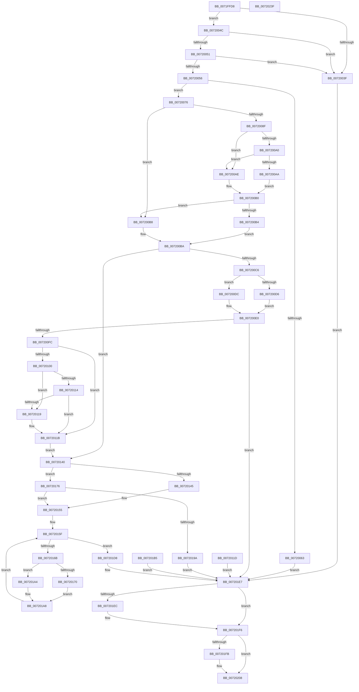

# IopIoRingDispatchRegisterFiles

- RVA: `0x0071FFD8`–`0x00720240` (길이 `616` bytes)
- VA: `0x000000014071FFD8`
- 실행 섹션: `PAGE`
- PDB 이름 있음: `예`; PDB Function 태그: `아니요`
- unwind 정보 RVA: `0x000C779C`
- 디코드: `162`개 명령, `616/616` bytes 표시
- 미해석 바이트: `0` (있으면 어셈블리에 `.byte`로 보존)

> 이 문서는 커널 이미지의 기계어와 PDB 기호를 분석해 생성했습니다. 4번과 5번은 함수 원형과 자료형을 바이너리 사용 방식에서 추정한 C 해석이며 원본 소스 복구 결과는 아닙니다.

## 1. Dependencies

- 직접 호출 지점: **4**; 고유 호출 대상: **3**
- 직접 호출자로 확인된 함수: **1**
- RIP 상대 이미지 참조: **0**

### Outgoing calls
- `0x00720188` → [ExAllocatePool2](../../poolcode/B8/ExAllocatePool2_function_00B820F0.md) (function, `0x00B820F0`)
- `0x007201F1` → [ExFreePoolWithTag](../../poolcode/B8/ExFreePoolWithTag_function_00B82870.md) (function, `0x00B82870`)
- `0x00720203` → [ExFreePoolWithTag](../../poolcode/B8/ExFreePoolWithTag_function_00B82870.md) (function, `0x00B82870`)
- `0x0072022B` → [IopCompleteIoRingEntry](../../text/3E/IopCompleteIoRingEntry_function_003ED2C0.md) (function, `0x003ED2C0`)

### Direct callers
- [IopProcessIoRingEntry](../70/IopProcessIoRingEntry_function_00700A38.md) at `0x00700B2B`

### Static image references
- 디코드된 RIP-relative 메모리 참조가 없습니다.

## 2. Other-region calls and transfers

- 다른 실행 섹션으로 향하는 call: **4**
  - `0x00720188` → [ExAllocatePool2](../../poolcode/B8/ExAllocatePool2_function_00B820F0.md) (`PAGE` → `POOLCODE`)
  - `0x007201F1` → [ExFreePoolWithTag](../../poolcode/B8/ExFreePoolWithTag_function_00B82870.md) (`PAGE` → `POOLCODE`)
  - `0x00720203` → [ExFreePoolWithTag](../../poolcode/B8/ExFreePoolWithTag_function_00B82870.md) (`PAGE` → `POOLCODE`)
  - `0x0072022B` → [IopCompleteIoRingEntry](../../text/3E/IopCompleteIoRingEntry_function_003ED2C0.md) (`PAGE` → `.text`)
- 별도 외부 분기/꼬리 이동을 확인하지 못했습니다.

## 3. Assembly (complete function range)

```asm
0071FFD8  48 89 54 24 10                  mov qword ptr [rsp + 0x10], rdx
0071FFDD  48 89 4C 24 08                  mov qword ptr [rsp + 8], rcx
0071FFE2  56                              push rsi
0071FFE3  57                              push rdi
0071FFE4  41 54                           push r12
0071FFE6  41 55                           push r13
0071FFE8  41 56                           push r14
0071FFEA  41 57                           push r15
0071FFEC  48 83 EC 58                     sub rsp, 0x58
0071FFF0  4C 8B F2                        mov r14, rdx
0071FFF3  48 8B F1                        mov rsi, rcx
0071FFF6  83 64 24 20 00                  and dword ptr [rsp + 0x20], 0
0071FFFB  65 48 8B 04 25 88 01 00 00      mov rax, qword ptr gs:[0x188]
00720004  44 8A 80 32 02 00 00            mov r8b, byte ptr [rax + 0x232]
0072000B  33 FF                           xor edi, edi
0072000D  89 BC 24 A8 00 00 00            mov dword ptr [rsp + 0xa8], edi
00720014  33 C9                           xor ecx, ecx
00720016  44 8B 8E C0 00 00 00            mov r9d, dword ptr [rsi + 0xc0]
0072001D  4C 8B BE C8 00 00 00            mov r15, qword ptr [rsi + 0xc8]
00720024  4C 89 7C 24 30                  mov qword ptr [rsp + 0x30], r15
00720029  21 8E C0 00 00 00               and dword ptr [rsi + 0xc0], ecx
0072002F  48 21 8E C8 00 00 00            and qword ptr [rsi + 0xc8], rcx
00720036  F7 42 04 FE FF FF FF            test dword ptr [rdx + 4], 0xfffffffe
0072003D  74 0D                           je 0x14072004c
0072003F  C7 44 24 20 01 00 46 C0         mov dword ptr [rsp + 0x20], 0xc0460001
00720047  E9 9B 01 00 00                  jmp 0x1407201e7
0072004C  39 4A 10                        cmp dword ptr [rdx + 0x10], ecx
0072004F  75 EE                           jne 0x14072003f
00720051  39 4A 14                        cmp dword ptr [rdx + 0x14], ecx
00720054  75 E9                           jne 0x14072003f
00720056  44 8B 6A 1C                     mov r13d, dword ptr [rdx + 0x1c]
0072005A  4C 8B 62 20                     mov r12, qword ptr [rdx + 0x20]
0072005E  45 85 ED                        test r13d, r13d
00720061  75 13                           jne 0x140720076
00720063  49 F7 DC                        neg r12
00720066  1B C0                           sbb eax, eax
00720068  25 0D 00 00 C0                  and eax, 0xc000000d
0072006D  89 44 24 20                     mov dword ptr [rsp + 0x20], eax
00720071  E9 71 01 00 00                  jmp 0x1407201e7
00720076  65 48 8B 04 25 88 01 00 00      mov rax, qword ptr gs:[0x188]
0072007F  48 8B 90 B8 00 00 00            mov rdx, qword ptr [rax + 0xb8]
00720086  48 39 8A 10 03 00 00            cmp qword ptr [rdx + 0x310], rcx
0072008D  74 29                           je 0x1407200b8
0072008F  0F B7 82 EC 06 00 00            movzx eax, word ptr [rdx + 0x6ec]
00720096  BA 4C 01 00 00                  mov edx, 0x14c
0072009B  66 3B C2                        cmp ax, dx
0072009E  74 0E                           je 0x1407200ae
007200A0  BA C4 01 00 00                  mov edx, 0x1c4
007200A5  66 3B C2                        cmp ax, dx
007200A8  74 04                           je 0x1407200ae
007200AA  32 C0                           xor al, al
007200AC  EB 02                           jmp 0x1407200b0
007200AE  B0 01                           mov al, 1
007200B0  84 C0                           test al, al
007200B2  74 04                           je 0x1407200b8
007200B4  B2 01                           mov dl, 1
007200B6  EB 02                           jmp 0x1407200ba
007200B8  32 D2                           xor dl, dl
007200BA  88 94 24 A0 00 00 00            mov byte ptr [rsp + 0xa0], dl
007200C1  45 84 C0                        test r8b, r8b
007200C4  74 7A                           je 0x140720140
007200C6  49 8B C5                        mov rax, r13
007200C9  41 B8 FF FF FF FF               mov r8d, 0xffffffff
007200CF  84 D2                           test dl, dl
007200D1  41 8B D0                        mov edx, r8d
007200D4  74 06                           je 0x1407200dc
007200D6  48 C1 E0 02                     shl rax, 2
007200DA  EB 04                           jmp 0x1407200e0
007200DC  48 C1 E0 03                     shl rax, 3
007200E0  49 3B C0                        cmp rax, r8
007200E3  0F 46 D0                        cmovbe edx, eax
007200E6  4C 3B C0                        cmp r8, rax
007200E9  1B C0                           sbb eax, eax
007200EB  25 95 00 00 C0                  and eax, 0xc0000095
007200F0  89 44 24 20                     mov dword ptr [rsp + 0x20], eax
007200F4  85 C0                           test eax, eax
007200F6  0F 88 EB 00 00 00               js 0x1407201e7
007200FC  85 D2                           test edx, edx
007200FE  74 1B                           je 0x14072011b
00720100  8B CA                           mov ecx, edx
00720102  49 03 CC                        add rcx, r12
00720105  48 B8 00 00 FF FF FF 7F 00 00   movabs rax, 0x7fffffff0000
0072010F  48 3B C8                        cmp rcx, rax
00720112  77 05                           ja 0x140720119
00720114  49 3B CC                        cmp rcx, r12
00720117  73 02                           jae 0x14072011b
00720119  8A 00                           mov al, byte ptr [rax]
0072011B  EB 23                           jmp 0x140720140
0072011D  4C 8B B4 24 98 00 00 00         mov r14, qword ptr [rsp + 0x98]
00720125  48 8B B4 24 90 00 00 00         mov rsi, qword ptr [rsp + 0x90]
0072012D  8B BC 24 A8 00 00 00            mov edi, dword ptr [rsp + 0xa8]
00720134  8B CF                           mov ecx, edi
00720136  4C 8B 7C 24 30                  mov r15, qword ptr [rsp + 0x30]
0072013B  E9 A7 00 00 00                  jmp 0x1407201e7
00720140  45 3B E9                        cmp r13d, r9d
00720143  75 31                           jne 0x140720176
00720145  49 8B CF                        mov rcx, r15
00720148  48 89 4C 24 28                  mov qword ptr [rsp + 0x28], rcx
0072014D  45 33 FF                        xor r15d, r15d
00720150  4C 89 7C 24 30                  mov qword ptr [rsp + 0x30], r15
00720155  33 FF                           xor edi, edi
00720157  44 8A 84 24 A0 00 00 00         mov r8b, byte ptr [rsp + 0xa0]
0072015F  89 BC 24 A8 00 00 00            mov dword ptr [rsp + 0xa8], edi
00720166  41 3B FD                        cmp edi, r13d
00720169  73 6D                           jae 0x1407201d8
0072016B  45 84 C0                        test r8b, r8b
0072016E  74 34                           je 0x1407201a4
00720170  49 63 14 BC                     movsxd rdx, dword ptr [r12 + rdi*4]
00720174  EB 32                           jmp 0x1407201a8
00720176  49 8B D5                        mov rdx, r13
00720179  48 C1 E2 03                     shl rdx, 3
0072017D  B9 03 01 00 00                  mov ecx, 0x103
00720182  41 B8 49 72 52 46               mov r8d, 0x46527249
00720188  E8 63 1F 46 00                  call 0x140b820f0
0072018D  48 8B C8                        mov rcx, rax
00720190  48 89 44 24 28                  mov qword ptr [rsp + 0x28], rax
00720195  48 85 C0                        test rax, rax
00720198  75 BB                           jne 0x140720155
0072019A  C7 44 24 20 9A 00 00 C0         mov dword ptr [rsp + 0x20], 0xc000009a
007201A2  EB 43                           jmp 0x1407201e7
007201A4  49 8B 14 FC                     mov rdx, qword ptr [r12 + rdi*8]
007201A8  48 89 54 24 38                  mov qword ptr [rsp + 0x38], rdx
007201AD  48 89 14 F9                     mov qword ptr [rcx + rdi*8], rdx
007201B1  FF C7                           inc edi
007201B3  EB AA                           jmp 0x14072015f
007201B5  4C 8B B4 24 98 00 00 00         mov r14, qword ptr [rsp + 0x98]
007201BD  48 8B B4 24 90 00 00 00         mov rsi, qword ptr [rsp + 0x90]
007201C5  8B BC 24 A8 00 00 00            mov edi, dword ptr [rsp + 0xa8]
007201CC  48 8B 4C 24 28                  mov rcx, qword ptr [rsp + 0x28]
007201D1  4C 8B 7C 24 30                  mov r15, qword ptr [rsp + 0x30]
007201D6  EB 0F                           jmp 0x1407201e7
007201D8  89 BE C0 00 00 00               mov dword ptr [rsi + 0xc0], edi
007201DE  48 89 8E C8 00 00 00            mov qword ptr [rsi + 0xc8], rcx
007201E5  33 C9                           xor ecx, ecx
007201E7  48 85 C9                        test rcx, rcx
007201EA  74 0A                           je 0x1407201f6
007201EC  BA 49 72 52 46                  mov edx, 0x46527249
007201F1  E8 7A 26 46 00                  call 0x140b82870
007201F6  4D 85 FF                        test r15, r15
007201F9  74 0D                           je 0x140720208
007201FB  BA 49 72 52 46                  mov edx, 0x46527249
00720200  49 8B CF                        mov rcx, r15
00720203  E8 68 26 46 00                  call 0x140b82870
00720208  83 64 24 44 00                  and dword ptr [rsp + 0x44], 0
0072020D  8B C7                           mov eax, edi
0072020F  48 89 44 24 48                  mov qword ptr [rsp + 0x48], rax
00720214  8B 44 24 20                     mov eax, dword ptr [rsp + 0x20]
00720218  89 44 24 40                     mov dword ptr [rsp + 0x40], eax
0072021C  45 33 C9                        xor r9d, r9d
0072021F  4C 8D 44 24 40                  lea r8, [rsp + 0x40]
00720224  49 8B 56 08                     mov rdx, qword ptr [r14 + 8]
00720228  48 8B CE                        mov rcx, rsi
0072022B  E8 90 D0 CC FF                  call 0x1403ed2c0
00720230  48 83 C4 58                     add rsp, 0x58
00720234  41 5F                           pop r15
00720236  41 5E                           pop r14
00720238  41 5D                           pop r13
0072023A  41 5C                           pop r12
0072023C  5F                              pop rdi
0072023D  5E                              pop rsi
0072023E  C3                              ret
0072023F  CC                              int3
```

## 4. C-style interpretation (structured pseudocode)

```c
__int64 __fastcall IopIoRingDispatchRegisterFiles(__int64 a1, __int64 a2)
{
    __int64 result;
    __int64 v_r12;
    __int64 v_r15;
    __int64 v_rdi;
    __int64 v_rsp;
    unsigned __int64 v_stack_m40;
    unsigned int v_stack_m44;
    unsigned int v_stack_m48;
    unsigned __int64 v_stack_m50;
    unsigned __int64 v_stack_m58;
    unsigned __int64 v_stack_m60;
    unsigned int v_stack_m68;
    unsigned __int64 v_stack_p10;
    unsigned __int8 v_stack_p18;
    unsigned int v_stack_p20;
    unsigned __int64 v_stack_p8;

    v_stack_p10 = a2;
    v_stack_p8 = a1;
    v_rsp = (v_rsp) - (88);
    v_rdi = 0;
    v_stack_p20 = 0;
    a1 = 0;
    v_stack_m58 = *(unsigned __int64 *)(a1 + 200);
    if (((*(unsigned int *)(a2 + 4)) & (0xFFFFFFFEULL)) == 0) goto loc_0072004C;
loc_0072003F:
    v_stack_m68 = 0xC0460001ULL;
    goto loc_007201E7;
loc_0072004C:
    if ((*(unsigned int *)(a2 + 16)) != 0) goto loc_0072003F;
    if ((*(unsigned int *)(a2 + 20)) != 0) goto loc_0072003F;
    if ((unsigned int)((unsigned int)(*(unsigned int *)(a2 + 28))) != 0) goto loc_00720076;
    v_r12 = -(*(unsigned __int64 *)(a2 + 32));
    result = (unsigned int)((*(unsigned __int64 *)(gs_base + (0 + 392))) & (0xC000000DULL));
    v_stack_m68 = (unsigned int)(result);
    goto loc_007201E7;
loc_00720076:
    if ((*(unsigned __int64 *)(*(unsigned __int64 *)(*(unsigned __int64 *)(gs_base + (0 + 392)) + 184) + 784)) == 0) goto loc_007200B8;
    if (((unsigned __int16)(*(unsigned __int16 *)(*(unsigned __int64 *)(*(unsigned __int64 *)(gs_base + (0 + 392)) + 184) + 1772))) == 332) goto loc_007200AE;
    if (((unsigned __int16)(*(unsigned __int16 *)(*(unsigned __int64 *)(*(unsigned __int64 *)(gs_base + (0 + 392)) + 184) + 1772))) == 452) goto loc_007200AE;
    result = 0;
    goto loc_007200B0;
loc_007200AE:
loc_007200B0:
    if (1 == 0) goto loc_007200B8;
    goto loc_007200BA;
loc_007200B8:
    a2 = 0;
loc_007200BA:
    v_stack_p18 = 0;
    if ((unsigned __int8)(*(unsigned __int8 *)(*(unsigned __int64 *)(gs_base + (0 + 392)) + 562)) == 0) goto loc_00720140;
    if (0 == 0) goto loc_007200DC;
    result = ((unsigned int)(*(unsigned int *)(a2 + 28))) << (2);
    goto loc_007200E0;
loc_007200DC:
    result = (result) << (3);
loc_007200E0:
    a2 = (unsigned int)((unsigned int)((unsigned int)(0xFFFFFFFFULL)));
    if (result <= ((unsigned int)(0xFFFFFFFFULL))) { a2 = (unsigned int)(result); }
    result = (unsigned int)((result) & (0xC0000095ULL));
    v_stack_m68 = (unsigned int)(result);
    if (sign_flag) goto loc_007201E7;
    if ((unsigned int)(a2) == 0) goto loc_0072011B;
    a1 = ((unsigned int)((unsigned int)(a2))) + (v_r12);
    if (a1 > result) goto loc_00720119;
    if (a1 < v_r12) {
        result = *(unsigned __int8 *)(result);
    }
    goto loc_00720140;
loc_00720140:
    if (((unsigned int)((unsigned int)(*(unsigned int *)(a2 + 28)))) != ((unsigned int)((unsigned int)(*(unsigned int *)(a1 + 192))))) goto loc_00720176;
    v_stack_m60 = *(unsigned __int64 *)(a1 + 200);
    v_r15 = 0;
    v_stack_m58 = 0;
loc_00720155:
    v_rdi = 0;
loc_0072015F:
    v_stack_p20 = 0;
    if (0 >= ((unsigned int)((unsigned int)(*(unsigned int *)(a2 + 28))))) goto loc_007201D8;
    if ((unsigned __int8)(v_stack_p18) == 0) goto loc_007201A4;
    goto loc_007201A8;
loc_00720176:
    a2 = ((unsigned int)(*(unsigned int *)(a2 + 28))) << (3);
    result = ExAllocatePool2(259, a2, (unsigned int)(0x46527249ULL), (unsigned int)(*(unsigned int *)(a1 + 192)));
    v_stack_m60 = result;
    if (result != 0) goto loc_00720155;
    v_stack_m68 = 0xC000009AULL;
    goto loc_007201E7;
loc_007201A4:
loc_007201A8:
    v_stack_m50 = *(unsigned __int64 *)(v_r12 + v_rdi * 8);
    *(unsigned __int64 *)(result + v_rdi * 8) = *(unsigned __int64 *)(v_r12 + v_rdi * 8);
    v_rdi = (unsigned int)((v_rdi) + 1);
    goto loc_0072015F;
loc_007201D8:
    *(unsigned int *)(a1 + 192) = (unsigned int)(v_rdi);
    *(unsigned __int64 *)(a1 + 200) = result;
    a1 = 0;
loc_007201E7:
    if (0 != 0) {
        a2 = 0x46527249ULL;
        result = ExFreePoolWithTag(a1, a2, (unsigned int)(0x46527249ULL), (unsigned int)(*(unsigned int *)(a1 + 192)));
    }
    if (0 != 0) {
        a2 = 0x46527249ULL;
        a1 = 0;
        result = ExFreePoolWithTag(a1, a2, (unsigned int)(0x46527249ULL), (unsigned int)(*(unsigned int *)(a1 + 192)));
    }
    v_stack_m40 = (unsigned int)((unsigned int)(v_rdi));
    v_stack_m48 = (unsigned int)((unsigned int)(v_stack_m68));
    a4 = 0;
    result = IopCompleteIoRingEntry(a1, *(unsigned __int64 *)(a2 + 8), v_stack_m48, a4);
    v_rsp = (v_rsp) + (88);
    return result;
}
```

## 5. (Beta) C Style

```c
int64_t IopIoRingDispatchRegisterFiles(void *Arg1, void *Arg2)
{
    uint8_t *arg1 = (uint8_t *)Arg1;
    uint8_t *arg2 = (uint8_t *)Arg2;

    int64_t result;
    int64_t local_r12;
    int64_t local_r15;
    int64_t local_rdi;
    int64_t local_rsp;
    uint64_t v_stack_m40;
    uint32_t v_stack_m44;
    uint32_t v_stack_m48;
    uint64_t v_stack_m50;
    uint64_t v_stack_m58;
    uint64_t v_stack_m60;
    uint32_t v_stack_m68;
    uint64_t v_stack_p10;
    uint8_t v_stack_p18;
    uint32_t v_stack_p20;
    uint64_t v_stack_p8;

    v_stack_p10 = Arg2;
    v_stack_p8 = Arg1;
    local_rsp = (local_rsp) - (88);
    local_rdi = 0;
    v_stack_p20 = 0;
    Arg1 = 0;
    v_stack_m58 = *(uint64_t *)(arg1 + 0xC8);
    if (((*(uint32_t *)(arg2 + 0x4)) & (0xFFFFFFFEULL)) == 0) goto loc_0072004C;
loc_0072003F:
    v_stack_m68 = 0xC0460001ULL;
    goto loc_007201E7;
loc_0072004C:
    if ((*(uint32_t *)(arg2 + 0x10)) != 0) goto loc_0072003F;
    if ((*(uint32_t *)(arg2 + 0x14)) != 0) goto loc_0072003F;
    if ((uint32_t)((uint32_t)(*(uint32_t *)(arg2 + 0x1C))) != 0) goto loc_00720076;
    local_r12 = -(*(uint64_t *)(arg2 + 0x20));
    result = (uint32_t)((*(uint64_t *)(gs_base + (0 + 0x188))) & (0xC000000DULL));
    v_stack_m68 = (uint32_t)(result);
    goto loc_007201E7;
loc_00720076:
    if ((*(uint64_t *)(*(uint64_t *)(*(uint64_t *)(gs_base + (0 + 0x188)) + 0xB8) + 0x310)) == 0) goto loc_007200B8;
    if (((uint16_t)(*(uint16_t *)(*(uint64_t *)(*(uint64_t *)(gs_base + (0 + 0x188)) + 0xB8) + 0x6EC))) == 332) goto loc_007200AE;
    if (((uint16_t)(*(uint16_t *)(*(uint64_t *)(*(uint64_t *)(gs_base + (0 + 0x188)) + 0xB8) + 0x6EC))) == 452) goto loc_007200AE;
    result = 0;
    goto loc_007200B0;
loc_007200AE:
loc_007200B0:
    if (1 == 0) goto loc_007200B8;
    goto loc_007200BA;
loc_007200B8:
    Arg2 = 0;
loc_007200BA:
    v_stack_p18 = 0;
    if ((uint8_t)(*(uint8_t *)(*(uint64_t *)(gs_base + (0 + 0x188)) + 0x232)) == 0) goto loc_00720140;
    if (0 == 0) goto loc_007200DC;
    result = ((uint32_t)(*(uint32_t *)(arg2 + 0x1C))) << (2);
    goto loc_007200E0;
loc_007200DC:
    result = (result) << (3);
loc_007200E0:
    Arg2 = (uint32_t)((uint32_t)((uint32_t)(0xFFFFFFFFULL)));
    if (result <= ((uint32_t)(0xFFFFFFFFULL))) { Arg2 = (uint32_t)(result); }
    result = (uint32_t)((result) & (0xC0000095ULL));
    v_stack_m68 = (uint32_t)(result);
    if (sign_flag) goto loc_007201E7;
    if ((uint32_t)(Arg2) == 0) goto loc_0072011B;
    Arg1 = ((uint32_t)((uint32_t)(Arg2))) + (local_r12);
    if (Arg1 > result) goto loc_00720119;
    if (Arg1 < local_r12) {
        result = *(uint8_t *)(result);
    }
    goto loc_00720140;
loc_00720140:
    if (((uint32_t)((uint32_t)(*(uint32_t *)(arg2 + 0x1C)))) != ((uint32_t)((uint32_t)(*(uint32_t *)(arg1 + 0xC0))))) goto loc_00720176;
    v_stack_m60 = *(uint64_t *)(arg1 + 0xC8);
    local_r15 = 0;
    v_stack_m58 = 0;
loc_00720155:
    local_rdi = 0;
loc_0072015F:
    v_stack_p20 = 0;
    if (0 >= ((uint32_t)((uint32_t)(*(uint32_t *)(arg2 + 0x1C))))) goto loc_007201D8;
    if ((uint8_t)(v_stack_p18) == 0) goto loc_007201A4;
    goto loc_007201A8;
loc_00720176:
    Arg2 = ((uint32_t)(*(uint32_t *)(arg2 + 0x1C))) << (3);
    result = ExAllocatePool2(259, Arg2, (uint32_t)(0x46527249ULL), (uint32_t)(*(uint32_t *)(arg1 + 0xC0)));
    v_stack_m60 = result;
    if (result != 0) goto loc_00720155;
    v_stack_m68 = 0xC000009AULL;
    goto loc_007201E7;
loc_007201A4:
loc_007201A8:
    v_stack_m50 = *(uint64_t *)(local_r12 + local_rdi * 8);
    *(uint64_t *)(result + local_rdi * 8) = *(uint64_t *)(local_r12 + local_rdi * 8);
    local_rdi = (uint32_t)((local_rdi) + 1);
    goto loc_0072015F;
loc_007201D8:
    *(uint32_t *)(arg1 + 0xC0) = (uint32_t)(local_rdi);
    *(uint64_t *)(arg1 + 0xC8) = result;
    Arg1 = 0;
loc_007201E7:
    if (0 != 0) {
        Arg2 = 0x46527249ULL;
        result = ExFreePoolWithTag(Arg1, Arg2, (uint32_t)(0x46527249ULL), (uint32_t)(*(uint32_t *)(arg1 + 0xC0)));
    }
    if (0 != 0) {
        Arg2 = 0x46527249ULL;
        Arg1 = 0;
        result = ExFreePoolWithTag(Arg1, Arg2, (uint32_t)(0x46527249ULL), (uint32_t)(*(uint32_t *)(arg1 + 0xC0)));
    }
    v_stack_m40 = (uint32_t)((uint32_t)(local_rdi));
    v_stack_m48 = (uint32_t)((uint32_t)(v_stack_m68));
    a4 = 0;
    result = IopCompleteIoRingEntry(Arg1, *(uint64_t *)(arg2 + 0x8), v_stack_m48, a4);
    local_rsp = (local_rsp) + (88);
    return result;
}
```

### 관측된 메모리 오프셋

구조체 형식이 확인되지 않은 접근은 인자 기준의 오프셋으로만 기록했습니다.

| 기준 인자 | 오프셋 표현 | 폭 (bit) | 접근 |
|---|---:|---:|---|
| `Arg1` | `+ 0xC0` | `32` | `R` |
| `Arg1` | `+ 0xC0` | `32` | `R/W` |
| `Arg1` | `+ 0xC0` | `32` | `W` |
| `Arg1` | `+ 0xC8` | `64` | `R` |
| `Arg1` | `+ 0xC8` | `64` | `R/W` |
| `Arg1` | `+ 0xC8` | `64` | `W` |
| `Arg2` | `+ 0x4` | `32` | `R` |
| `Arg2` | `+ 0x8` | `64` | `R` |
| `Arg2` | `+ 0x10` | `32` | `R` |
| `Arg2` | `+ 0x14` | `32` | `R` |
| `Arg2` | `+ 0x1C` | `32` | `R` |
| `Arg2` | `+ 0x20` | `64` | `R` |

## 6. Execution-region graph

[열기: 2D/3D 그래프와 함수 탐색 컨트롤 패널](../../../control-panel.html?section=page&rva=0x0071FFD8&view=graph)

- 2D 그래프는 위에서 아래로 흐르고, 3D 그래프는 빈 공간을 드래그해 회전합니다. Shift+드래그는 이동, 휠은 확대·축소, 함수 노드 선택은 대상 보고서 이동입니다.

### Static fallback


