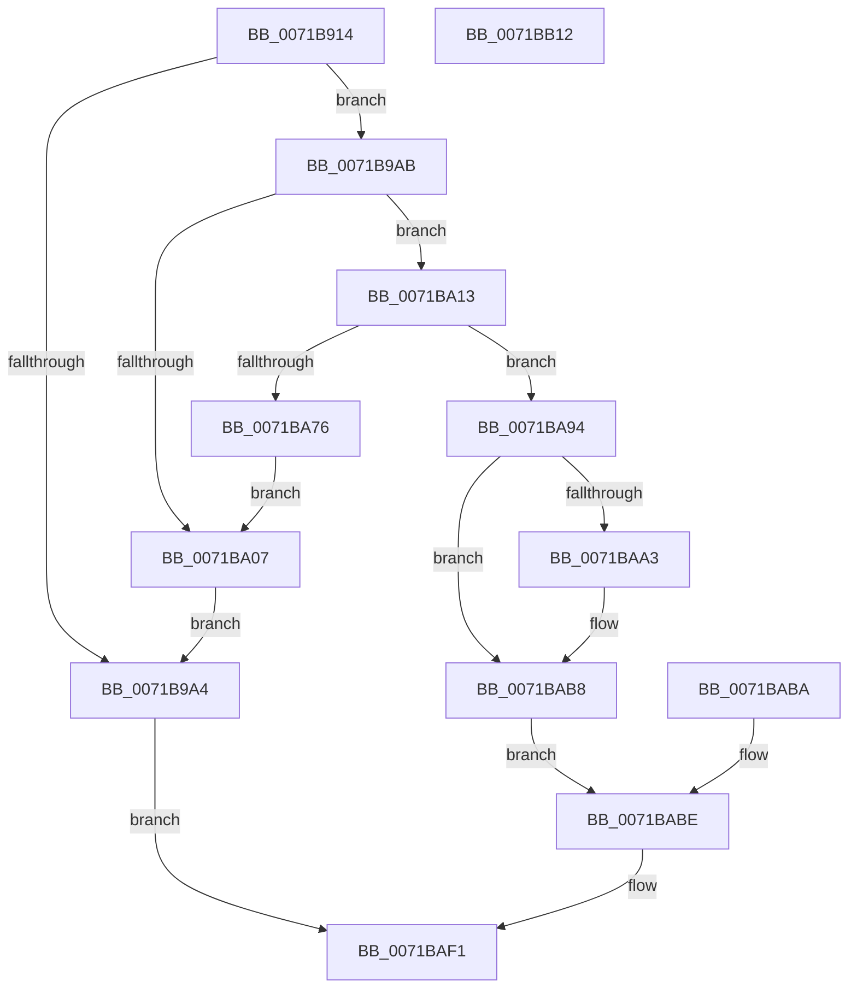

# IopIsNotNativeDriverImage

- RVA: `0x0071B914`–`0x0071BB13` (길이 `511` bytes)
- VA: `0x000000014071B914`
- 실행 섹션: `PAGE`
- PDB 이름 있음: `예`; PDB Function 태그: `아니요`
- unwind 정보 RVA: `0x000C74BC`
- 디코드: `111`개 명령, `511/511` bytes 표시
- 미해석 바이트: `0` (있으면 어셈블리에 `.byte`로 보존)

> 이 문서는 커널 이미지의 기계어와 PDB 기호를 분석해 생성했습니다. 4번과 5번은 함수 원형과 자료형을 바이너리 사용 방식에서 추정한 C 해석이며 원본 소스 복구 결과는 아닙니다.

## 1. Dependencies

- 직접 호출 지점: **13**; 고유 호출 대상: **9**
- 직접 호출자로 확인된 함수: **1**
- RIP 상대 이미지 참조: **2**

### Outgoing calls
- `0x0071B99B` → [ZwOpenFile](../../text/6A/ZwOpenFile_function_006AD730.md) (function, `0x006AD730`)
- `0x0071B9FE` → [ZwCreateSection](../../text/6A/ZwCreateSection_function_006ADA10.md) (function, `0x006ADA10`)
- `0x0071BA0C` → [ZwClose](../../text/6A/ZwClose_function_006AD2B0.md) (function, `0x006AD2B0`)
- `0x0071BA2F` → [KeStackAttachProcess](../../text/21/KeStackAttachProcess_function_00216800.md) (function, `0x00216800`)
- `0x0071BA6D` → [ZwMapViewOfSection](../../text/6A/ZwMapViewOfSection_function_006AD5D0.md) (function, `0x006AD5D0`)
- `0x0071BA80` → [KiUnstackDetachProcess](../../text/21/KiUnstackDetachProcess_function_00217D30.md) (function, `0x00217D30`)
- `0x0071BA8A` → [ZwClose](../../text/6A/ZwClose_function_006AD2B0.md) (function, `0x006AD2B0`)
- `0x0071BA99` → [RtlImageNtHeader](../../text/44/RtlImageNtHeader_function_00443B60.md) (function, `0x00443B60`)
- `0x0071BAC7` → [ZwUnmapViewOfSection](../../text/6A/ZwUnmapViewOfSection_function_006AD610.md) (function, `0x006AD610`)
- `0x0071BAD6` → [KiUnstackDetachProcess](../../text/21/KiUnstackDetachProcess_function_00217D30.md) (function, `0x00217D30`)
- `0x0071BAE0` → [ZwClose](../../text/6A/ZwClose_function_006AD2B0.md) (function, `0x006AD2B0`)
- `0x0071BAEA` → [ZwClose](../../text/6A/ZwClose_function_006AD2B0.md) (function, `0x006AD2B0`)
- `0x0071BAFC` → [_security_check_cookie](../../text/6A/_security_check_cookie_function_006AC640.md) (function, `0x006AC640`)

### Direct callers
- [IopCheckIfNotNativeDriver](IopCheckIfNotNativeDriver_function_0071AFB4.md) at `0x0071B030`

### Static image references
- `0x0071B923` → RVA `0x00E0A740` (`.data`; read)
- `0x0071BA28` → RVA `0x00FC6AB0` (`ALMOSTRO`; read)

## 2. Other-region calls and transfers

- 다른 실행 섹션으로 향하는 call: **13**
  - `0x0071B99B` → [ZwOpenFile](../../text/6A/ZwOpenFile_function_006AD730.md) (`PAGE` → `.text`)
  - `0x0071B9FE` → [ZwCreateSection](../../text/6A/ZwCreateSection_function_006ADA10.md) (`PAGE` → `.text`)
  - `0x0071BA0C` → [ZwClose](../../text/6A/ZwClose_function_006AD2B0.md) (`PAGE` → `.text`)
  - `0x0071BA2F` → [KeStackAttachProcess](../../text/21/KeStackAttachProcess_function_00216800.md) (`PAGE` → `.text`)
  - `0x0071BA6D` → [ZwMapViewOfSection](../../text/6A/ZwMapViewOfSection_function_006AD5D0.md) (`PAGE` → `.text`)
  - `0x0071BA80` → [KiUnstackDetachProcess](../../text/21/KiUnstackDetachProcess_function_00217D30.md) (`PAGE` → `.text`)
  - `0x0071BA8A` → [ZwClose](../../text/6A/ZwClose_function_006AD2B0.md) (`PAGE` → `.text`)
  - `0x0071BA99` → [RtlImageNtHeader](../../text/44/RtlImageNtHeader_function_00443B60.md) (`PAGE` → `.text`)
  - `0x0071BAC7` → [ZwUnmapViewOfSection](../../text/6A/ZwUnmapViewOfSection_function_006AD610.md) (`PAGE` → `.text`)
  - `0x0071BAD6` → [KiUnstackDetachProcess](../../text/21/KiUnstackDetachProcess_function_00217D30.md) (`PAGE` → `.text`)
  - `0x0071BAE0` → [ZwClose](../../text/6A/ZwClose_function_006AD2B0.md) (`PAGE` → `.text`)
  - `0x0071BAEA` → [ZwClose](../../text/6A/ZwClose_function_006AD2B0.md) (`PAGE` → `.text`)
  - `0x0071BAFC` → [_security_check_cookie](../../text/6A/_security_check_cookie_function_006AC640.md) (`PAGE` → `.text`)
- 별도 외부 분기/꼬리 이동을 확인하지 못했습니다.

## 3. Assembly (complete function range)

```asm
0071B914  4C 8B DC                        mov r11, rsp
0071B917  49 89 5B 10                     mov qword ptr [r11 + 0x10], rbx
0071B91B  57                              push rdi
0071B91C  48 81 EC F0 00 00 00            sub rsp, 0xf0
0071B923  48 8B 05 16 EE 6E 00            mov rax, qword ptr [rip + 0x6eee16]
0071B92A  48 33 C4                        xor rax, rsp
0071B92D  48 89 84 24 E8 00 00 00         mov qword ptr [rsp + 0xe8], rax
0071B935  33 DB                           xor ebx, ebx
0071B937  48 89 5C 24 58                  mov qword ptr [rsp + 0x58], rbx
0071B93C  0F 57 C0                        xorps xmm0, xmm0
0071B93F  41 0F 11 43 B0                  movups xmmword ptr [r11 - 0x50], xmm0
0071B944  48 C7 44 24 70 30 00 00 00      mov qword ptr [rsp + 0x70], 0x30
0071B94D  49 C7 43 90 40 02 00 00         mov qword ptr [r11 - 0x70], 0x240
0071B955  48 89 5C 24 60                  mov qword ptr [rsp + 0x60], rbx
0071B95A  41 0F 11 43 C0                  movups xmmword ptr [r11 - 0x40], xmm0
0071B95F  41 0F 11 43 D0                  movups xmmword ptr [r11 - 0x30], xmm0
0071B964  41 0F 11 43 E0                  movups xmmword ptr [r11 - 0x20], xmm0
0071B969  88 5C 24 50                     mov byte ptr [rsp + 0x50], bl
0071B96D  8D 7B 30                        lea edi, [rbx + 0x30]
0071B970  49 89 5B 80                     mov qword ptr [r11 - 0x80], rbx
0071B974  49 89 4B 88                     mov qword ptr [r11 - 0x78], rcx
0071B978  F3 41 0F 7F 43 98               movdqu xmmword ptr [r11 - 0x68], xmm0
0071B97E  89 5C 24 28                     mov dword ptr [rsp + 0x28], ebx
0071B982  C7 44 24 20 05 00 00 00         mov dword ptr [rsp + 0x20], 5
0071B98A  4D 8D 4B B0                     lea r9, [r11 - 0x50]
0071B98E  4C 8D 44 24 70                  lea r8, [rsp + 0x70]
0071B993  8D 53 20                        lea edx, [rbx + 0x20]
0071B996  48 8D 4C 24 58                  lea rcx, [rsp + 0x58]
0071B99B  E8 90 1D F9 FF                  call 0x1406ad730
0071B9A0  85 C0                           test eax, eax
0071B9A2  79 07                           jns 0x14071b9ab
0071B9A4  32 C0                           xor al, al
0071B9A6  E9 46 01 00 00                  jmp 0x14071baf1
0071B9AB  89 7C 24 70                     mov dword ptr [rsp + 0x70], edi
0071B9AF  48 89 5C 24 78                  mov qword ptr [rsp + 0x78], rbx
0071B9B4  C7 84 24 88 00 00 00 40 02 00 00  mov dword ptr [rsp + 0x88], 0x240
0071B9BF  48 89 9C 24 80 00 00 00         mov qword ptr [rsp + 0x80], rbx
0071B9C7  0F 57 C0                        xorps xmm0, xmm0
0071B9CA  F3 0F 7F 84 24 90 00 00 00      movdqu xmmword ptr [rsp + 0x90], xmm0
0071B9D3  48 8B 44 24 58                  mov rax, qword ptr [rsp + 0x58]
0071B9D8  48 89 44 24 30                  mov qword ptr [rsp + 0x30], rax
0071B9DD  C7 44 24 28 00 00 00 08         mov dword ptr [rsp + 0x28], 0x8000000
0071B9E5  BF 02 00 00 00                  mov edi, 2
0071B9EA  89 7C 24 20                     mov dword ptr [rsp + 0x20], edi
0071B9EE  45 33 C9                        xor r9d, r9d
0071B9F1  4C 8D 44 24 70                  lea r8, [rsp + 0x70]
0071B9F6  8D 57 06                        lea edx, [rdi + 6]
0071B9F9  48 8D 4C 24 60                  lea rcx, [rsp + 0x60]
0071B9FE  E8 0D 20 F9 FF                  call 0x1406ada10
0071BA03  85 C0                           test eax, eax
0071BA05  79 0C                           jns 0x14071ba13
0071BA07  48 8B 4C 24 58                  mov rcx, qword ptr [rsp + 0x58]
0071BA0C  E8 9F 18 F9 FF                  call 0x1406ad2b0
0071BA11  EB 91                           jmp 0x14071b9a4
0071BA13  48 89 5C 24 68                  mov qword ptr [rsp + 0x68], rbx
0071BA18  48 89 9C 24 A0 00 00 00         mov qword ptr [rsp + 0xa0], rbx
0071BA20  48 8D 94 24 B8 00 00 00         lea rdx, [rsp + 0xb8]
0071BA28  48 8B 0D 81 B0 8A 00            mov rcx, qword ptr [rip + 0x8ab081]
0071BA2F  E8 CC AD AF FF                  call 0x140216800
0071BA34  89 7C 24 48                     mov dword ptr [rsp + 0x48], edi
0071BA38  89 5C 24 40                     mov dword ptr [rsp + 0x40], ebx
0071BA3C  BF 01 00 00 00                  mov edi, 1
0071BA41  89 7C 24 38                     mov dword ptr [rsp + 0x38], edi
0071BA45  48 8D 84 24 A0 00 00 00         lea rax, [rsp + 0xa0]
0071BA4D  48 89 44 24 30                  mov qword ptr [rsp + 0x30], rax
0071BA52  48 89 5C 24 28                  mov qword ptr [rsp + 0x28], rbx
0071BA57  48 89 5C 24 20                  mov qword ptr [rsp + 0x20], rbx
0071BA5C  45 33 C9                        xor r9d, r9d
0071BA5F  4C 8D 44 24 68                  lea r8, [rsp + 0x68]
0071BA64  48 83 CA FF                     or rdx, 0xffffffffffffffff
0071BA68  48 8B 4C 24 60                  mov rcx, qword ptr [rsp + 0x60]
0071BA6D  E8 5E 1B F9 FF                  call 0x1406ad5d0
0071BA72  85 C0                           test eax, eax
0071BA74  79 1E                           jns 0x14071ba94
0071BA76  33 D2                           xor edx, edx
0071BA78  48 8D 8C 24 B8 00 00 00         lea rcx, [rsp + 0xb8]
0071BA80  E8 AB C2 AF FF                  call 0x140217d30
0071BA85  48 8B 4C 24 60                  mov rcx, qword ptr [rsp + 0x60]
0071BA8A  E8 21 18 F9 FF                  call 0x1406ad2b0
0071BA8F  E9 73 FF FF FF                  jmp 0x14071ba07
0071BA94  48 8B 4C 24 68                  mov rcx, qword ptr [rsp + 0x68]
0071BA99  E8 C2 80 D2 FF                  call 0x140443b60
0071BA9E  48 85 C0                        test rax, rax
0071BAA1  74 15                           je 0x14071bab8
0071BAA3  0F B6 CB                        movzx ecx, bl
0071BAA6  BA 64 86 00 00                  mov edx, 0x8664
0071BAAB  66 39 50 04                     cmp word ptr [rax + 4], dx
0071BAAF  0F 45 CF                        cmovne ecx, edi
0071BAB2  8A D9                           mov bl, cl
0071BAB4  88 4C 24 50                     mov byte ptr [rsp + 0x50], cl
0071BAB8  EB 04                           jmp 0x14071babe
0071BABA  8A 5C 24 50                     mov bl, byte ptr [rsp + 0x50]
0071BABE  48 8B 54 24 68                  mov rdx, qword ptr [rsp + 0x68]
0071BAC3  48 83 C9 FF                     or rcx, 0xffffffffffffffff
0071BAC7  E8 44 1B F9 FF                  call 0x1406ad610
0071BACC  33 D2                           xor edx, edx
0071BACE  48 8D 8C 24 B8 00 00 00         lea rcx, [rsp + 0xb8]
0071BAD6  E8 55 C2 AF FF                  call 0x140217d30
0071BADB  48 8B 4C 24 60                  mov rcx, qword ptr [rsp + 0x60]
0071BAE0  E8 CB 17 F9 FF                  call 0x1406ad2b0
0071BAE5  48 8B 4C 24 58                  mov rcx, qword ptr [rsp + 0x58]
0071BAEA  E8 C1 17 F9 FF                  call 0x1406ad2b0
0071BAEF  8A C3                           mov al, bl
0071BAF1  48 8B 8C 24 E8 00 00 00         mov rcx, qword ptr [rsp + 0xe8]
0071BAF9  48 33 CC                        xor rcx, rsp
0071BAFC  E8 3F 0B F9 FF                  call 0x1406ac640
0071BB01  48 8B 9C 24 08 01 00 00         mov rbx, qword ptr [rsp + 0x108]
0071BB09  48 81 C4 F0 00 00 00            add rsp, 0xf0
0071BB10  5F                              pop rdi
0071BB11  C3                              ret
0071BB12  CC                              int3
```

## 4. C-style interpretation (structured pseudocode)

```c
__int64 __fastcall IopIsNotNativeDriverImage(__int64 a1)
{
    __int64 result;
    __int64 v_rbx;
    __int64 v_rsp;
    unsigned __int64 v_stack_m10;
    unsigned __int64 v_stack_m40;
    unsigned __int64 v_stack_m58;
    unsigned __int64 v_stack_m68;
    unsigned int v_stack_m70;
    unsigned __int64 v_stack_m78;
    unsigned __int64 v_stack_m80;
    unsigned __int64 v_stack_m88;
    unsigned __int64 v_stack_m90;
    unsigned __int64 v_stack_m98;
    unsigned __int64 v_stack_mA0;
    unsigned __int8 v_stack_mA8;
    unsigned int v_stack_mB0;
    unsigned int v_stack_mB8;
    unsigned int v_stack_mC0;
    unsigned __int64 v_stack_mC8;
    unsigned int v_stack_mD0;
    unsigned int v_stack_mD8;
    unsigned __int64 v_stack_p10;

    *(unsigned __int64 *)(v_rsp + 16) = v_rbx;
    v_rsp = (v_rsp) - (240);
    result = (*(unsigned __int64 *)(v_rip + 7269910)) ^ (v_rsp);
    v_stack_m10 = result;
    v_rbx = 0;
    v_stack_mA0 = 0;
    *(unsigned __int64 *)(v_rsp - 80) = v_xmm0;
    v_stack_m88 = 48;
    *(unsigned __int64 *)(v_rsp - 112) = 576;
    v_stack_m98 = 0;
    *(unsigned __int64 *)(v_rsp - 64) = v_xmm0;
    *(unsigned __int64 *)(v_rsp - 48) = v_xmm0;
    *(unsigned __int64 *)(v_rsp - 32) = v_xmm0;
    v_stack_mA8 = 0;
    *(unsigned __int64 *)(v_rsp - 128) = 0;
    *(unsigned __int64 *)(v_rsp - 120) = a1;
    *(unsigned __int64 *)(v_rsp - 104) = v_xmm0;
    v_stack_mD0 = 0;
    v_stack_mD8 = 5;
    result = ZwOpenFile(v_stack_mA0, v_rbx + 32, v_stack_m88, v_rsp - 80);
    if (!sign_flag) goto loc_0071B9AB;
loc_0071B9A4:
    result = 0;
    goto loc_0071BAF1;
loc_0071B9AB:
    v_stack_m88 = (unsigned int)(v_rbx + 48);
    v_stack_m80 = 0;
    v_stack_m70 = 576;
    v_stack_m78 = 0;
    v_stack_m68 = v_xmm0;
    v_stack_mC8 = v_stack_mA0;
    v_stack_mD0 = 0x8000000ULL;
    v_stack_mD8 = 2;
    a4 = 0;
    result = ZwCreateSection(v_stack_m98, 2 + 6, v_stack_m88, a4);
    if (!sign_flag) goto loc_0071BA13;
loc_0071BA07:
    result = ZwClose(v_stack_mA0, 2 + 6, v_stack_m88, a4);
    goto loc_0071B9A4;
loc_0071BA13:
    v_stack_m90 = 0;
    v_stack_m58 = 0;
    result = KeStackAttachProcess(*(unsigned __int64 *)(v_rip + 9089153), v_stack_m40, v_stack_m88, a4);
    v_stack_mB0 = 2;
    v_stack_mB8 = 0;
    v_stack_mC0 = 1;
    v_stack_mC8 = v_stack_m58;
    v_stack_mD0 = 0;
    v_stack_mD8 = 0;
    a4 = 0;
    a2 = (v_stack_m40) | (-1);
    result = ZwMapViewOfSection(v_stack_m98, a2, v_stack_m90, a4);
    if (!sign_flag) goto loc_0071BA94;
    a2 = 0;
    result = KiUnstackDetachProcess(v_stack_m40, a2, v_stack_m90, a4);
    result = ZwClose(v_stack_m98, a2, v_stack_m90, a4);
    goto loc_0071BA07;
loc_0071BA94:
    result = RtlImageNtHeader(v_stack_m90, a2, v_stack_m90, a4);
    if (result != 0) {
        a1 = 0;
        a2 = 0x8664ULL;
        if ((*(unsigned __int16 *)(result + 4)) != ((unsigned __int16)(a2))) { a1 = 1; }
        v_rbx = (unsigned __int8)(a1);
        v_stack_mA8 = (unsigned __int8)(a1);
    }
    goto loc_0071BABE;
loc_0071BABE:
    a1 = (a1) | (-1);
    result = ZwUnmapViewOfSection(a1, v_stack_m90, v_stack_m90, a4);
    a2 = 0;
    result = KiUnstackDetachProcess(v_stack_m40, a2, v_stack_m90, a4);
    result = ZwClose(v_stack_m98, a2, v_stack_m90, a4);
    result = ZwClose(v_stack_mA0, a2, v_stack_m90, a4);
loc_0071BAF1:
    a1 = (v_stack_m10) ^ (v_rsp);
    result = _security_check_cookie(a1, a2, v_stack_m90, a4);
    v_rsp = (v_rsp) + (240);
    return result;
}
```

## 5. (Beta) C Style

```c
int64_t IopIsNotNativeDriverImage(int64_t Arg1)
{
    int64_t result;
    int64_t local_rbx;
    int64_t local_rsp;
    uint64_t v_stack_m10;
    uint64_t v_stack_m40;
    uint64_t v_stack_m58;
    uint64_t v_stack_m68;
    uint32_t v_stack_m70;
    uint64_t v_stack_m78;
    uint64_t v_stack_m80;
    uint64_t v_stack_m88;
    uint64_t v_stack_m90;
    uint64_t v_stack_m98;
    uint64_t v_stack_mA0;
    uint8_t v_stack_mA8;
    uint32_t v_stack_mB0;
    uint32_t v_stack_mB8;
    uint32_t v_stack_mC0;
    uint64_t v_stack_mC8;
    uint32_t v_stack_mD0;
    uint32_t v_stack_mD8;
    uint64_t v_stack_p10;

    *(uint64_t *)(local_rsp + 0x10) = local_rbx;
    local_rsp = (local_rsp) - (240);
    result = (*(uint64_t *)(v_rip + 0x6EEE16)) ^ (local_rsp);
    v_stack_m10 = result;
    local_rbx = 0;
    v_stack_mA0 = 0;
    *(uint64_t *)(local_rsp - 0x50) = v_xmm0;
    v_stack_m88 = 48;
    *(uint64_t *)(local_rsp - 0x70) = 576;
    v_stack_m98 = 0;
    *(uint64_t *)(local_rsp - 0x40) = v_xmm0;
    *(uint64_t *)(local_rsp - 0x30) = v_xmm0;
    *(uint64_t *)(local_rsp - 0x20) = v_xmm0;
    v_stack_mA8 = 0;
    *(uint64_t *)(local_rsp - 0x80) = 0;
    *(uint64_t *)(local_rsp - 0x78) = Arg1;
    *(uint64_t *)(local_rsp - 0x68) = v_xmm0;
    v_stack_mD0 = 0;
    v_stack_mD8 = 5;
    result = ZwOpenFile(v_stack_mA0, local_rbx + 32, v_stack_m88, local_rsp - 80);
    if (!sign_flag) goto loc_0071B9AB;
loc_0071B9A4:
    result = 0;
    goto loc_0071BAF1;
loc_0071B9AB:
    v_stack_m88 = (uint32_t)(local_rbx + 48);
    v_stack_m80 = 0;
    v_stack_m70 = 576;
    v_stack_m78 = 0;
    v_stack_m68 = v_xmm0;
    v_stack_mC8 = v_stack_mA0;
    v_stack_mD0 = 0x8000000ULL;
    v_stack_mD8 = 2;
    a4 = 0;
    result = ZwCreateSection(v_stack_m98, 2 + 6, v_stack_m88, a4);
    if (!sign_flag) goto loc_0071BA13;
loc_0071BA07:
    result = ZwClose(v_stack_mA0, 2 + 6, v_stack_m88, a4);
    goto loc_0071B9A4;
loc_0071BA13:
    v_stack_m90 = 0;
    v_stack_m58 = 0;
    result = KeStackAttachProcess(*(uint64_t *)(v_rip + 0x8AB081), v_stack_m40, v_stack_m88, a4);
    v_stack_mB0 = 2;
    v_stack_mB8 = 0;
    v_stack_mC0 = 1;
    v_stack_mC8 = v_stack_m58;
    v_stack_mD0 = 0;
    v_stack_mD8 = 0;
    a4 = 0;
    a2 = (v_stack_m40) | (-1);
    result = ZwMapViewOfSection(v_stack_m98, a2, v_stack_m90, a4);
    if (!sign_flag) goto loc_0071BA94;
    a2 = 0;
    result = KiUnstackDetachProcess(v_stack_m40, a2, v_stack_m90, a4);
    result = ZwClose(v_stack_m98, a2, v_stack_m90, a4);
    goto loc_0071BA07;
loc_0071BA94:
    result = RtlImageNtHeader(v_stack_m90, a2, v_stack_m90, a4);
    if (result != 0) {
        Arg1 = 0;
        a2 = 0x8664ULL;
        if ((*(uint16_t *)(result + 0x4)) != ((uint16_t)(a2))) { Arg1 = 1; }
        local_rbx = (uint8_t)(Arg1);
        v_stack_mA8 = (uint8_t)(Arg1);
    }
    goto loc_0071BABE;
loc_0071BABE:
    Arg1 = (Arg1) | (-1);
    result = ZwUnmapViewOfSection(Arg1, v_stack_m90, v_stack_m90, a4);
    a2 = 0;
    result = KiUnstackDetachProcess(v_stack_m40, a2, v_stack_m90, a4);
    result = ZwClose(v_stack_m98, a2, v_stack_m90, a4);
    result = ZwClose(v_stack_mA0, a2, v_stack_m90, a4);
loc_0071BAF1:
    Arg1 = (v_stack_m10) ^ (local_rsp);
    result = _security_check_cookie(Arg1, a2, v_stack_m90, a4);
    local_rsp = (local_rsp) + (240);
    return result;
}
```

## 6. Execution-region graph

[열기: 2D/3D 그래프와 함수 탐색 컨트롤 패널](../../../control-panel.html?section=page&rva=0x0071B914&view=graph)

- 2D 그래프는 위에서 아래로 흐르고, 3D 그래프는 빈 공간을 드래그해 회전합니다. Shift+드래그는 이동, 휠은 확대·축소, 함수 노드 선택은 대상 보고서 이동입니다.

### Static fallback


