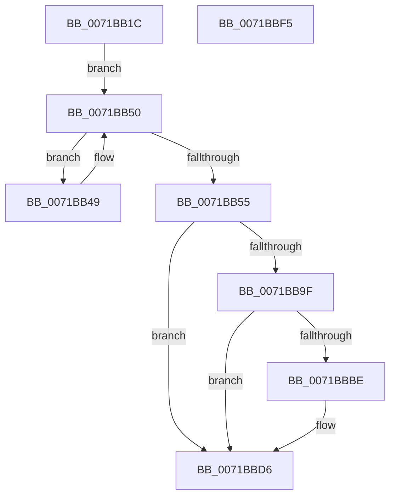

# IopLoadFileSystemDriver

- RVA: `0x0071BB1C`–`0x0071BBF6` (길이 `218` bytes)
- VA: `0x000000014071BB1C`
- 실행 섹션: `PAGE`
- PDB 이름 있음: `예`; PDB Function 태그: `아니요`
- unwind 정보 RVA: `0x000C74AC`
- 디코드: `56`개 명령, `218/218` bytes 표시
- 미해석 바이트: `0` (있으면 어셈블리에 `.byte`로 보존)

> 이 문서는 커널 이미지의 기계어와 PDB 기호를 분석해 생성했습니다. 4번과 5번은 함수 원형과 자료형을 바이너리 사용 방식에서 추정한 C 해석이며 원본 소스 복구 결과는 아닙니다.

## 1. Dependencies

- 직접 호출 지점: **5**; 고유 호출 대상: **5**
- 직접 호출자로 확인된 함수: **1**
- RIP 상대 이미지 참조: **0**

### Outgoing calls
- `0x0071BB5F` → [KeInitializeEvent](../../text/40/KeInitializeEvent_function_0040DD10.md) (function, `0x0040DD10`)
- `0x0071BB95` → [IoBuildDeviceIoControlRequest](../../text/20/IoBuildDeviceIoControlRequest_function_00204FD0.md) (function, `0x00204FD0`)
- `0x0071BBB2` → [IofCallDriver](../../text/29/IofCallDriver_function_0029B4B0.md) (function, `0x0029B4B0`)
- `0x0071BBD1` → [KeWaitForSingleObject](../../text/20/KeWaitForSingleObject_function_0020E6B0.md) (function, `0x0020E6B0`)
- `0x0071BBDF` → [IopDecrementDeviceObjectRef](../../text/27/IopDecrementDeviceObjectRef_function_00270970.md) (function, `0x00270970`)

### Direct callers
- [sub_00B39BB0](../B3/Unknown_function_00B39BB0.md) at `0x00B39BCA`

### Static image references
- 디코드된 RIP-relative 메모리 참조가 없습니다.

## 2. Other-region calls and transfers

- 다른 실행 섹션으로 향하는 call: **5**
  - `0x0071BB5F` → [KeInitializeEvent](../../text/40/KeInitializeEvent_function_0040DD10.md) (`PAGE` → `.text`)
  - `0x0071BB95` → [IoBuildDeviceIoControlRequest](../../text/20/IoBuildDeviceIoControlRequest_function_00204FD0.md) (`PAGE` → `.text`)
  - `0x0071BBB2` → [IofCallDriver](../../text/29/IofCallDriver_function_0029B4B0.md) (`PAGE` → `.text`)
  - `0x0071BBD1` → [KeWaitForSingleObject](../../text/20/KeWaitForSingleObject_function_0020E6B0.md) (`PAGE` → `.text`)
  - `0x0071BBDF` → [IopDecrementDeviceObjectRef](../../text/27/IopDecrementDeviceObjectRef_function_00270970.md) (`PAGE` → `.text`)
- 별도 외부 분기/꼬리 이동을 확인하지 못했습니다.

## 3. Assembly (complete function range)

```asm
0071BB1C  48 89 5C 24 08                  mov qword ptr [rsp + 8], rbx
0071BB21  57                              push rdi
0071BB22  48 81 EC 80 00 00 00            sub rsp, 0x80
0071BB29  0F 57 C0                        xorps xmm0, xmm0
0071BB2C  33 C0                           xor eax, eax
0071BB2E  0F 11 44 24 60                  movups xmmword ptr [rsp + 0x60], xmm0
0071BB33  48 89 44 24 70                  mov qword ptr [rsp + 0x70], rax
0071BB38  48 8B F9                        mov rdi, rcx
0071BB3B  0F 11 44 24 50                  movups xmmword ptr [rsp + 0x50], xmm0
0071BB40  48 8B 41 18                     mov rax, qword ptr [rcx + 0x18]
0071BB44  48 8B D9                        mov rbx, rcx
0071BB47  EB 07                           jmp 0x14071bb50
0071BB49  48 8B D8                        mov rbx, rax
0071BB4C  48 8B 40 18                     mov rax, qword ptr [rax + 0x18]
0071BB50  48 85 C0                        test rax, rax
0071BB53  75 F4                           jne 0x14071bb49
0071BB55  45 33 C0                        xor r8d, r8d
0071BB58  48 8D 4C 24 60                  lea rcx, [rsp + 0x60]
0071BB5D  33 D2                           xor edx, edx
0071BB5F  E8 AC 21 CF FF                  call 0x14040dd10
0071BB64  48 8D 44 24 50                  lea rax, [rsp + 0x50]
0071BB69  45 33 C9                        xor r9d, r9d
0071BB6C  48 89 44 24 40                  mov qword ptr [rsp + 0x40], rax
0071BB71  45 33 C0                        xor r8d, r8d
0071BB74  48 8D 44 24 60                  lea rax, [rsp + 0x60]
0071BB79  48 8B D3                        mov rdx, rbx
0071BB7C  48 89 44 24 38                  mov qword ptr [rsp + 0x38], rax
0071BB81  C6 44 24 30 00                  mov byte ptr [rsp + 0x30], 0
0071BB86  41 8D 49 0E                     lea ecx, [r9 + 0xe]
0071BB8A  83 64 24 28 00                  and dword ptr [rsp + 0x28], 0
0071BB8F  48 83 64 24 20 00               and qword ptr [rsp + 0x20], 0
0071BB95  E8 36 94 AE FF                  call 0x140204fd0
0071BB9A  48 85 C0                        test rax, rax
0071BB9D  74 37                           je 0x14071bbd6
0071BB9F  48 8B 90 B8 00 00 00            mov rdx, qword ptr [rax + 0xb8]
0071BBA6  48 8B CB                        mov rcx, rbx
0071BBA9  66 C7 42 B8 0D 03               mov word ptr [rdx - 0x48], 0x30d
0071BBAF  48 8B D0                        mov rdx, rax
0071BBB2  E8 F9 F8 B7 FF                  call 0x14029b4b0
0071BBB7  3D 03 01 00 00                  cmp eax, 0x103
0071BBBC  75 18                           jne 0x14071bbd6
0071BBBE  48 83 64 24 20 00               and qword ptr [rsp + 0x20], 0
0071BBC4  48 8D 4C 24 60                  lea rcx, [rsp + 0x60]
0071BBC9  45 33 C9                        xor r9d, r9d
0071BBCC  45 33 C0                        xor r8d, r8d
0071BBCF  33 D2                           xor edx, edx
0071BBD1  E8 DA 2A AF FF                  call 0x14020e6b0
0071BBD6  41 B0 01                        mov r8b, 1
0071BBD9  48 8B CF                        mov rcx, rdi
0071BBDC  41 8A D0                        mov dl, r8b
0071BBDF  E8 8C 4D B5 FF                  call 0x140270970
0071BBE4  48 8B 9C 24 90 00 00 00         mov rbx, qword ptr [rsp + 0x90]
0071BBEC  48 81 C4 80 00 00 00            add rsp, 0x80
0071BBF3  5F                              pop rdi
0071BBF4  C3                              ret
0071BBF5  CC                              int3
```

## 4. C-style interpretation (structured pseudocode)

```c
__int64 __fastcall IopLoadFileSystemDriver(__int64 a1, int a2, int a3, int a4)
{
    __int64 result;
    __int64 v_rsp;
    unsigned __int64 v_stack_m18;
    unsigned __int64 v_stack_m28;
    unsigned __int64 v_stack_m38;
    unsigned __int64 v_stack_m48;
    unsigned __int64 v_stack_m50;
    unsigned __int8 v_stack_m58;
    unsigned int v_stack_m60;
    unsigned __int64 v_stack_m68;
    unsigned __int64 v_stack_p8;

    v_stack_p8 = v_rbx;
    v_rsp = (v_rsp) - (128);
    result = 0;
    v_stack_m28 = v_xmm0;
    v_stack_m18 = 0;
    v_stack_m38 = v_xmm0;
    goto loc_0071BB50;
loc_0071BB49:
loc_0071BB50:
    if (*(unsigned __int64 *)(*(unsigned __int64 *)(a1 + 24) + 24) != 0) goto loc_0071BB49;
    a3 = 0;
    a2 = 0;
    result = KeInitializeEvent(v_stack_m28, a2, a3, a4);
    a4 = 0;
    v_stack_m48 = v_stack_m38;
    a3 = 0;
    v_stack_m50 = v_stack_m28;
    v_stack_m58 = 0;
    result = IoBuildDeviceIoControlRequest(a4 + 14, *(unsigned __int64 *)(a1 + 24), a3, a4);
    if (result == 0) goto loc_0071BBD6;
    *(unsigned __int16 *)(*(unsigned __int64 *)(result + 184) - 72) = 781;
    result = IofCallDriver(*(unsigned __int64 *)(a1 + 24), result, a3, a4);
    if (((unsigned int)(result)) == 259) {
        a1 = v_stack_m28;
        a4 = 0;
        a3 = 0;
        a2 = 0;
        result = KeWaitForSingleObject(a1, a2, a3, a4);
    }
    result = IopDecrementDeviceObjectRef(a1, 1, 1, a4);
    v_rsp = (v_rsp) + (128);
    return result;
}
```

## 5. (Beta) C Style

```c
int64_t IopLoadFileSystemDriver(void *Arg1, int32_t Arg2, int32_t Arg3, int32_t Arg4)
{
    uint8_t *arg1 = (uint8_t *)Arg1;

    int64_t result;
    int64_t local_rsp;
    uint64_t v_stack_m18;
    uint64_t v_stack_m28;
    uint64_t v_stack_m38;
    uint64_t v_stack_m48;
    uint64_t v_stack_m50;
    uint8_t v_stack_m58;
    uint32_t v_stack_m60;
    uint64_t v_stack_m68;
    uint64_t v_stack_p8;

    v_stack_p8 = local_rbx;
    local_rsp = (local_rsp) - (128);
    result = 0;
    v_stack_m28 = v_xmm0;
    v_stack_m18 = 0;
    v_stack_m38 = v_xmm0;
    goto loc_0071BB50;
loc_0071BB49:
loc_0071BB50:
    if (*(uint64_t *)(*(uint64_t *)(arg1 + 0x18) + 0x18) != 0) goto loc_0071BB49;
    Arg3 = 0;
    Arg2 = 0;
    result = KeInitializeEvent(v_stack_m28, Arg2, Arg3, Arg4);
    Arg4 = 0;
    v_stack_m48 = v_stack_m38;
    Arg3 = 0;
    v_stack_m50 = v_stack_m28;
    v_stack_m58 = 0;
    result = IoBuildDeviceIoControlRequest(Arg4 + 14, *(uint64_t *)(arg1 + 0x18), Arg3, Arg4);
    if (result == 0) goto loc_0071BBD6;
    *(uint16_t *)(*(uint64_t *)(result + 0xB8) - 0x48) = 781;
    result = IofCallDriver(*(uint64_t *)(arg1 + 0x18), result, Arg3, Arg4);
    if (((uint32_t)(result)) == 259) {
        Arg1 = v_stack_m28;
        Arg4 = 0;
        Arg3 = 0;
        Arg2 = 0;
        result = KeWaitForSingleObject(Arg1, Arg2, Arg3, Arg4);
    }
    result = IopDecrementDeviceObjectRef(Arg1, 1, 1, Arg4);
    local_rsp = (local_rsp) + (128);
    return result;
}
```

### 관측된 메모리 오프셋

구조체 형식이 확인되지 않은 접근은 인자 기준의 오프셋으로만 기록했습니다.

| 기준 인자 | 오프셋 표현 | 폭 (bit) | 접근 |
|---|---:|---:|---|
| `Arg1` | `+ 0x18` | `64` | `R` |

## 6. Execution-region graph

[열기: 2D/3D 그래프와 함수 탐색 컨트롤 패널](../../../control-panel.html?section=page&rva=0x0071BB1C&view=graph)

- 2D 그래프는 위에서 아래로 흐르고, 3D 그래프는 빈 공간을 드래그해 회전합니다. Shift+드래그는 이동, 휠은 확대·축소, 함수 노드 선택은 대상 보고서 이동입니다.

### Static fallback


