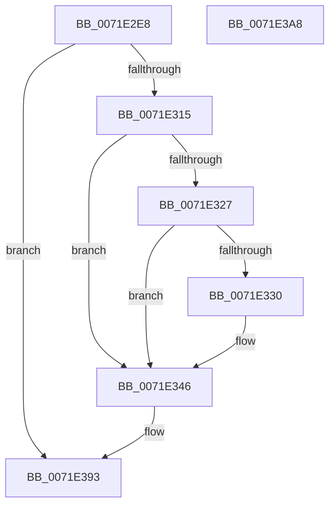

# IopLogAuditIoRegisterNotificationEvent

- RVA: `0x0071E2E8`–`0x0071E3A9` (길이 `193` bytes)
- VA: `0x000000014071E2E8`
- 실행 섹션: `PAGE`
- PDB 이름 있음: `예`; PDB Function 태그: `아니요`
- unwind 정보 RVA: `0x000C6750`
- 디코드: `46`개 명령, `193/193` bytes 표시
- 미해석 바이트: `0` (있으면 어셈블리에 `.byte`로 보존)

> 이 문서는 커널 이미지의 기계어와 PDB 기호를 분석해 생성했습니다. 4번과 5번은 함수 원형과 자료형을 바이너리 사용 방식에서 추정한 C 해석이며 원본 소스 복구 결과는 아닙니다.

## 1. Dependencies

- 직접 호출 지점: **2**; 고유 호출 대상: **2**
- 직접 호출자로 확인된 함수: **2**
- RIP 상대 이미지 참조: **2**

### Outgoing calls
- `0x0071E38E` → [EtwWrite](../../text/41/EtwWrite_function_0041C720.md) (function, `0x0041C720`)
- `0x0071E39B` → [_security_check_cookie](../../text/6A/_security_check_cookie_function_006AC640.md) (function, `0x006AC640`)

### Direct callers
- [IoRegisterLastChanceShutdownNotification](IoRegisterLastChanceShutdownNotification_function_0071DAD0.md) at `0x0071DB29`
- [IoRegisterShutdownNotification](IoRegisterShutdownNotification_function_0071DB50.md) at `0x0071DBA9`

### Static image references
- `0x0071E2EF` → RVA `0x00E0A740` (`.data`; read)
- `0x0071E2FE` → RVA `0x00EFFA38` (`.data`; read)

## 2. Other-region calls and transfers

- 다른 실행 섹션으로 향하는 call: **2**
  - `0x0071E38E` → [EtwWrite](../../text/41/EtwWrite_function_0041C720.md) (`PAGE` → `.text`)
  - `0x0071E39B` → [_security_check_cookie](../../text/6A/_security_check_cookie_function_006AC640.md) (`PAGE` → `.text`)
- 별도 외부 분기/꼬리 이동을 확인하지 못했습니다.

## 3. Assembly (complete function range)

```asm
0071E2E8  48 81 EC 88 00 00 00            sub rsp, 0x88
0071E2EF  48 8B 05 4A C4 6E 00            mov rax, qword ptr [rip + 0x6ec44a]
0071E2F6  48 33 C4                        xor rax, rsp
0071E2F9  48 89 44 24 70                  mov qword ptr [rsp + 0x70], rax
0071E2FE  4C 8B 15 33 17 7E 00            mov r10, qword ptr [rip + 0x7e1733]
0071E305  45 33 C0                        xor r8d, r8d
0071E308  44 89 44 24 38                  mov dword ptr [rsp + 0x38], r8d
0071E30D  4C 8B D9                        mov r11, rcx
0071E310  4D 85 D2                        test r10, r10
0071E313  74 7E                           je 0x14071e393
0071E315  48 8B 42 08                     mov rax, qword ptr [rdx + 8]
0071E319  45 8B C8                        mov r9d, r8d
0071E31C  66 44 89 44 24 30               mov word ptr [rsp + 0x30], r8w
0071E322  48 85 C0                        test rax, rax
0071E325  74 1F                           je 0x14071e346
0071E327  48 8B 48 40                     mov rcx, qword ptr [rax + 0x40]
0071E32B  48 85 C9                        test rcx, rcx
0071E32E  74 16                           je 0x14071e346
0071E330  0F B7 40 38                     movzx eax, word ptr [rax + 0x38]
0071E334  45 8D 48 01                     lea r9d, [r8 + 1]
0071E338  89 44 24 48                     mov dword ptr [rsp + 0x48], eax
0071E33C  48 89 4C 24 40                  mov qword ptr [rsp + 0x40], rcx
0071E341  44 89 44 24 4C                  mov dword ptr [rsp + 0x4c], r8d
0071E346  41 8B C1                        mov eax, r9d
0071E349  48 8D 4C 24 30                  lea rcx, [rsp + 0x30]
0071E34E  48 03 C0                        add rax, rax
0071E351  41 FF C1                        inc r9d
0071E354  49 8B D3                        mov rdx, r11
0071E357  48 89 4C C4 40                  mov qword ptr [rsp + rax*8 + 0x40], rcx
0071E35C  48 8D 4C 24 38                  lea rcx, [rsp + 0x38]
0071E361  48 C7 44 C4 48 02 00 00 00      mov qword ptr [rsp + rax*8 + 0x48], 2
0071E36A  41 8B C1                        mov eax, r9d
0071E36D  48 03 C0                        add rax, rax
0071E370  41 FF C1                        inc r9d
0071E373  48 89 4C C4 40                  mov qword ptr [rsp + rax*8 + 0x40], rcx
0071E378  49 8B CA                        mov rcx, r10
0071E37B  48 C7 44 C4 48 04 00 00 00      mov qword ptr [rsp + rax*8 + 0x48], 4
0071E384  48 8D 44 24 40                  lea rax, [rsp + 0x40]
0071E389  48 89 44 24 20                  mov qword ptr [rsp + 0x20], rax
0071E38E  E8 8D E3 CF FF                  call 0x14041c720
0071E393  48 8B 4C 24 70                  mov rcx, qword ptr [rsp + 0x70]
0071E398  48 33 CC                        xor rcx, rsp
0071E39B  E8 A0 E2 F8 FF                  call 0x1406ac640
0071E3A0  48 81 C4 88 00 00 00            add rsp, 0x88
0071E3A7  C3                              ret
0071E3A8  CC                              int3
```

## 4. C-style interpretation (structured pseudocode)

```c
__int64 __fastcall IopLogAuditIoRegisterNotificationEvent(__int64 a1, __int64 a2, int a3)
{
    __int64 result;
    __int64 v_rsp;
    unsigned __int64 v_stack_m18;
    unsigned int v_stack_m3C;
    unsigned int v_stack_m40;
    unsigned __int64 v_stack_m48;
    unsigned int v_stack_m50;
    unsigned __int16 v_stack_m58;
    unsigned __int64 v_stack_m68;

    v_rsp = (v_rsp) - (136);
    result = (*(unsigned __int64 *)(v_rip + 7259210)) ^ (v_rsp);
    v_stack_m18 = result;
    a3 = 0;
    v_stack_m50 = 0;
    if (*(unsigned __int64 *)(v_rip + 8263475) == 0) goto loc_0071E393;
    v_stack_m58 = 0;
    if (*(unsigned __int64 *)(a2 + 8) == 0) goto loc_0071E346;
    result = *(unsigned __int64 *)(a2 + 8);
    if (*(unsigned __int64 *)(*(unsigned __int64 *)(a2 + 8) + 64) != 0) {
        result = *(unsigned __int16 *)(*(unsigned __int64 *)(a2 + 8) + 56);
        a4 = a3 + 1;
        v_stack_m40 = (unsigned int)(result);
        v_stack_m48 = *(unsigned __int64 *)(*(unsigned __int64 *)(a2 + 8) + 64);
        v_stack_m3C = 0;
    }
    result = ((unsigned int)((unsigned int)(a4))) + ((unsigned int)((unsigned int)(a4)));
    a4 = (unsigned int)((a4) + 1);
    *(unsigned __int64 *)(v_rsp + result * 8 + 64) = v_stack_m58;
    *(unsigned __int64 *)(v_rsp + result * 8 + 72) = 2;
    result = ((unsigned int)((unsigned int)(a4))) + ((unsigned int)((unsigned int)(a4)));
    a4 = (unsigned int)((a4) + 1);
    *(unsigned __int64 *)(v_rsp + result * 8 + 64) = v_stack_m50;
    *(unsigned __int64 *)(v_rsp + result * 8 + 72) = 4;
    v_stack_m68 = v_stack_m48;
    result = EtwWrite(*(unsigned __int64 *)(v_rip + 8263475), a1, a3, a4);
loc_0071E393:
    a1 = (v_stack_m18) ^ (v_rsp);
    result = _security_check_cookie(a1, a1, a3, a4);
    v_rsp = (v_rsp) + (136);
    return result;
}
```

## 5. (Beta) C Style

```c
int64_t IopLogAuditIoRegisterNotificationEvent(int64_t Arg1, void *Arg2, int32_t Arg3)
{
    uint8_t *arg2 = (uint8_t *)Arg2;

    int64_t result;
    int64_t local_rsp;
    uint64_t v_stack_m18;
    uint32_t v_stack_m3C;
    uint32_t v_stack_m40;
    uint64_t v_stack_m48;
    uint32_t v_stack_m50;
    uint16_t v_stack_m58;
    uint64_t v_stack_m68;

    local_rsp = (local_rsp) - (136);
    result = (*(uint64_t *)(v_rip + 0x6EC44A)) ^ (local_rsp);
    v_stack_m18 = result;
    Arg3 = 0;
    v_stack_m50 = 0;
    if (*(uint64_t *)(v_rip + 0x7E1733) == 0) goto loc_0071E393;
    v_stack_m58 = 0;
    if (*(uint64_t *)(arg2 + 0x8) == 0) goto loc_0071E346;
    result = *(uint64_t *)(arg2 + 0x8);
    if (*(uint64_t *)(*(uint64_t *)(arg2 + 0x8) + 0x40) != 0) {
        result = *(uint16_t *)(*(uint64_t *)(arg2 + 0x8) + 0x38);
        a4 = Arg3 + 1;
        v_stack_m40 = (uint32_t)(result);
        v_stack_m48 = *(uint64_t *)(*(uint64_t *)(arg2 + 0x8) + 0x40);
        v_stack_m3C = 0;
    }
    result = ((uint32_t)((uint32_t)(a4))) + ((uint32_t)((uint32_t)(a4)));
    a4 = (uint32_t)((a4) + 1);
    *(uint64_t *)(local_rsp + result * 8 + 0x40) = v_stack_m58;
    *(uint64_t *)(local_rsp + result * 8 + 0x48) = 2;
    result = ((uint32_t)((uint32_t)(a4))) + ((uint32_t)((uint32_t)(a4)));
    a4 = (uint32_t)((a4) + 1);
    *(uint64_t *)(local_rsp + result * 8 + 0x40) = v_stack_m50;
    *(uint64_t *)(local_rsp + result * 8 + 0x48) = 4;
    v_stack_m68 = v_stack_m48;
    result = EtwWrite(*(uint64_t *)(v_rip + 0x7E1733), Arg1, Arg3, a4);
loc_0071E393:
    Arg1 = (v_stack_m18) ^ (local_rsp);
    result = _security_check_cookie(Arg1, Arg1, Arg3, a4);
    local_rsp = (local_rsp) + (136);
    return result;
}
```

### 관측된 메모리 오프셋

구조체 형식이 확인되지 않은 접근은 인자 기준의 오프셋으로만 기록했습니다.

| 기준 인자 | 오프셋 표현 | 폭 (bit) | 접근 |
|---|---:|---:|---|
| `Arg2` | `+ 0x8` | `64` | `R` |

## 6. Execution-region graph

[열기: 2D/3D 그래프와 함수 탐색 컨트롤 패널](../../../control-panel.html?section=page&rva=0x0071E2E8&view=graph)

- 2D 그래프는 위에서 아래로 흐르고, 3D 그래프는 빈 공간을 드래그해 회전합니다. Shift+드래그는 이동, 휠은 확대·축소, 함수 노드 선택은 대상 보고서 이동입니다.

### Static fallback


