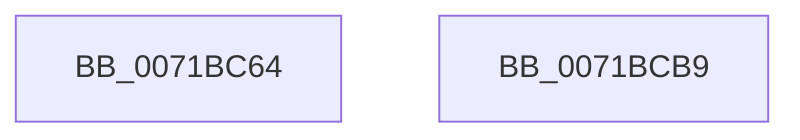

# IopMarshalIds

- RVA: `0x0071BC64`–`0x0071BCBA` (길이 `86` bytes)
- VA: `0x000000014071BC64`
- 실행 섹션: `PAGE`
- PDB 이름 있음: `예`; PDB Function 태그: `아니요`
- unwind 정보 RVA: `0x0005CAAC`
- 디코드: `26`개 명령, `86/86` bytes 표시
- 미해석 바이트: `0` (있으면 어셈블리에 `.byte`로 보존)

> 이 문서는 커널 이미지의 기계어와 PDB 기호를 분석해 생성했습니다. 4번과 5번은 함수 원형과 자료형을 바이너리 사용 방식에서 추정한 C 해석이며 원본 소스 복구 결과는 아닙니다.

## 1. Dependencies

- 직접 호출 지점: **1**; 고유 호출 대상: **1**
- 직접 호출자로 확인된 함수: **1**
- RIP 상대 이미지 참조: **0**

### Outgoing calls
- `0x0071BCA0` → [memcpy](../../text/6C/memcpy_function_006C6840.md) (function, `0x006C6840`)

### Direct callers
- [IopTrackLink](../A3/IopTrackLink_function_00A36764.md) at `0x00A36B5D`
- [IopTrackLink](../A3/IopTrackLink_function_00A36764.md) at `0x00A36E0F`
- [IopTrackLink](../A3/IopTrackLink_function_00A36764.md) at `0x00A36E80`

### Static image references
- 디코드된 RIP-relative 메모리 참조가 없습니다.

## 2. Other-region calls and transfers

- 다른 실행 섹션으로 향하는 call: **1**
  - `0x0071BCA0` → [memcpy](../../text/6C/memcpy_function_006C6840.md) (`PAGE` → `.text`)
- 별도 외부 분기/꼬리 이동을 확인하지 못했습니다.

## 3. Assembly (complete function range)

```asm
0071BC64  48 89 5C 24 08                  mov qword ptr [rsp + 8], rbx
0071BC69  57                              push rdi
0071BC6A  48 83 EC 20                     sub rsp, 0x20
0071BC6E  48 83 21 00                     and qword ptr [rcx], 0
0071BC72  33 C0                           xor eax, eax
0071BC74  89 41 0C                        mov dword ptr [rcx + 0xc], eax
0071BC77  48 8B D9                        mov rbx, rcx
0071BC7A  8B 02                           mov eax, dword ptr [rdx]
0071BC7C  49 8B F9                        mov rdi, r9
0071BC7F  89 41 0C                        mov dword ptr [rcx + 0xc], eax
0071BC82  0F 10 42 04                     movups xmm0, xmmword ptr [rdx + 4]
0071BC86  49 8D 51 0C                     lea rdx, [r9 + 0xc]
0071BC8A  F3 0F 7F 41 10                  movdqu xmmword ptr [rcx + 0x10], xmm0
0071BC8F  41 0F 10 08                     movups xmm1, xmmword ptr [r8]
0071BC93  F3 0F 7F 49 20                  movdqu xmmword ptr [rcx + 0x20], xmm1
0071BC98  45 8B 41 08                     mov r8d, dword ptr [r9 + 8]
0071BC9C  48 83 C1 30                     add rcx, 0x30
0071BCA0  E8 9B AB FA FF                  call 0x1406c6840
0071BCA5  8B 47 08                        mov eax, dword ptr [rdi + 8]
0071BCA8  83 C0 24                        add eax, 0x24
0071BCAB  89 43 08                        mov dword ptr [rbx + 8], eax
0071BCAE  48 8B 5C 24 30                  mov rbx, qword ptr [rsp + 0x30]
0071BCB3  48 83 C4 20                     add rsp, 0x20
0071BCB7  5F                              pop rdi
0071BCB8  C3                              ret
0071BCB9  CC                              int3
```

## 4. C-style interpretation (structured pseudocode)

```c
__int64 __fastcall IopMarshalIds(__int64 a1, __int64 a2, __int64 a3, __int64 a4)
{
    __int64 result;
    __int64 v_rsp;
    unsigned __int64 v_stack_p8;

    v_stack_p8 = v_rbx;
    v_rsp = (v_rsp) - (32);
    result = 0;
    *(unsigned int *)(a1 + 12) = 0;
    *(unsigned int *)(a1 + 12) = (unsigned int)((unsigned int)(*(unsigned int *)(a2)));
    *(unsigned __int64 *)(a1 + 16) = v_xmm0;
    *(unsigned __int64 *)(a1 + 32) = v_xmm1;
    a1 = (a1) + (48);
    result = memcpy(a1, a4 + 12, (unsigned int)(*(unsigned int *)(a4 + 8)), a4);
    result = (unsigned int)(((unsigned int)(*(unsigned int *)(a4 + 8))) + (36));
    *(unsigned int *)(a1 + 8) = (unsigned int)(result);
    v_rsp = (v_rsp) + (32);
    return result;
}
```

## 5. (Beta) C Style

```c
int64_t IopMarshalIds(void *Arg1, void *Arg2, void *Arg3, void *Arg4)
{
    uint8_t *arg1 = (uint8_t *)Arg1;
    uint8_t *arg2 = (uint8_t *)Arg2;
    uint8_t *arg3 = (uint8_t *)Arg3;
    uint8_t *arg4 = (uint8_t *)Arg4;

    int64_t result;
    int64_t local_rsp;
    uint64_t v_stack_p8;

    v_stack_p8 = local_rbx;
    local_rsp = (local_rsp) - (32);
    result = 0;
    *(uint32_t *)(arg1 + 0xC) = 0;
    *(uint32_t *)(arg1 + 0xC) = (uint32_t)((uint32_t)(*(uint32_t *)(arg2)));
    *(uint64_t *)(arg1 + 0x10) = v_xmm0;
    *(uint64_t *)(arg1 + 0x20) = v_xmm1;
    Arg1 = (Arg1) + (48);
    result = memcpy(Arg1, Arg4 + 12, (uint32_t)(*(uint32_t *)(arg4 + 0x8)), Arg4);
    result = (uint32_t)(((uint32_t)(*(uint32_t *)(arg4 + 0x8))) + (36));
    *(uint32_t *)(arg1 + 0x8) = (uint32_t)(result);
    local_rsp = (local_rsp) + (32);
    return result;
}
```

### 관측된 메모리 오프셋

구조체 형식이 확인되지 않은 접근은 인자 기준의 오프셋으로만 기록했습니다.

| 기준 인자 | 오프셋 표현 | 폭 (bit) | 접근 |
|---|---:|---:|---|
| `Arg1` | `+ 0x0` | `64` | `R/W` |
| `Arg1` | `+ 0x8` | `32` | `W` |
| `Arg1` | `+ 0xC` | `32` | `W` |
| `Arg1` | `+ 0x10` | `128` | `W` |
| `Arg1` | `+ 0x20` | `128` | `W` |
| `Arg2` | `+ 0x0` | `32` | `R` |
| `Arg2` | `+ 0x4` | `128` | `R` |
| `Arg3` | `+ 0x0` | `128` | `R` |
| `Arg4` | `+ 0x8` | `32` | `R` |
| `Arg4` | `+ 0xC` | `64` | `R` |

## 6. Execution-region graph

[열기: 2D/3D 그래프와 함수 탐색 컨트롤 패널](../../../control-panel.html?section=page&rva=0x0071BC64&view=graph)

- 2D 그래프는 위에서 아래로 흐르고, 3D 그래프는 빈 공간을 드래그해 회전합니다. Shift+드래그는 이동, 휠은 확대·축소, 함수 노드 선택은 대상 보고서 이동입니다.

### Static fallback


