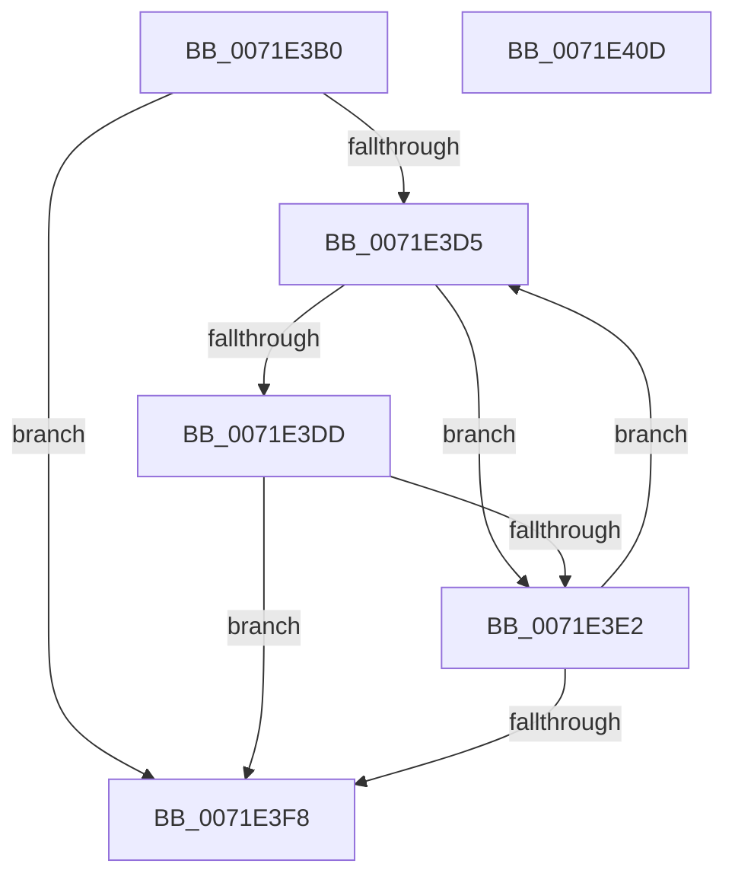

# IopNotifyAlreadyRegisteredFileSystems

- RVA: `0x0071E3B0`–`0x0071E40E` (길이 `94` bytes)
- VA: `0x000000014071E3B0`
- 실행 섹션: `PAGE`
- PDB 이름 있음: `예`; PDB Function 태그: `아니요`
- unwind 정보 RVA: `0x0005C954`
- 디코드: `30`개 명령, `94/94` bytes 표시
- 미해석 바이트: `0` (있으면 어셈블리에 `.byte`로 보존)

> 이 문서는 커널 이미지의 기계어와 PDB 기호를 분석해 생성했습니다. 4번과 5번은 함수 원형과 자료형을 바이너리 사용 방식에서 추정한 C 해석이며 원본 소스 복구 결과는 아닙니다.

## 1. Dependencies

- 직접 호출 지점: **1**; 고유 호출 대상: **1**
- 직접 호출자로 확인된 함수: **1**
- RIP 상대 이미지 참조: **0**

### Outgoing calls
- `0x0071E3EE` → [guard_dispatch_icall](../../text/6B/guard_dispatch_icall_function_006BAAD0.md) (function, `0x006BAAD0`)

### Direct callers
- [IoRegisterFsRegistrationChangeMountAware](IoRegisterFsRegistrationChangeMountAware_function_0071D890.md) at `0x0071DA55`
- [IoRegisterFsRegistrationChangeMountAware](IoRegisterFsRegistrationChangeMountAware_function_0071D890.md) at `0x0071DA67`
- [IoRegisterFsRegistrationChangeMountAware](IoRegisterFsRegistrationChangeMountAware_function_0071D890.md) at `0x0071DA79`
- [IoRegisterFsRegistrationChangeMountAware](IoRegisterFsRegistrationChangeMountAware_function_0071D890.md) at `0x0071DA8B`

### Static image references
- 디코드된 RIP-relative 메모리 참조가 없습니다.

## 2. Other-region calls and transfers

- 다른 실행 섹션으로 향하는 call: **1**
  - `0x0071E3EE` → [guard_dispatch_icall](../../text/6B/guard_dispatch_icall_function_006BAAD0.md) (`PAGE` → `.text`)
- 별도 외부 분기/꼬리 이동을 확인하지 못했습니다.

## 3. Assembly (complete function range)

```asm
0071E3B0  48 89 5C 24 08                  mov qword ptr [rsp + 8], rbx
0071E3B5  48 89 6C 24 10                  mov qword ptr [rsp + 0x10], rbp
0071E3BA  48 89 74 24 18                  mov qword ptr [rsp + 0x18], rsi
0071E3BF  57                              push rdi
0071E3C0  48 83 EC 20                     sub rsp, 0x20
0071E3C4  48 8B 39                        mov rdi, qword ptr [rcx]
0071E3C7  41 8A F0                        mov sil, r8b
0071E3CA  48 8B EA                        mov rbp, rdx
0071E3CD  48 8B D9                        mov rbx, rcx
0071E3D0  48 3B F9                        cmp rdi, rcx
0071E3D3  74 23                           je 0x14071e3f8
0071E3D5  48 8B 07                        mov rax, qword ptr [rdi]
0071E3D8  48 3B C3                        cmp rax, rbx
0071E3DB  75 05                           jne 0x14071e3e2
0071E3DD  40 84 F6                        test sil, sil
0071E3E0  75 16                           jne 0x14071e3f8
0071E3E2  48 8D 4F B0                     lea rcx, [rdi - 0x50]
0071E3E6  B2 01                           mov dl, 1
0071E3E8  48 8B F8                        mov rdi, rax
0071E3EB  48 8B C5                        mov rax, rbp
0071E3EE  E8 DD C6 F9 FF                  call 0x1406baad0
0071E3F3  48 3B FB                        cmp rdi, rbx
0071E3F6  75 DD                           jne 0x14071e3d5
0071E3F8  48 8B 5C 24 30                  mov rbx, qword ptr [rsp + 0x30]
0071E3FD  48 8B 6C 24 38                  mov rbp, qword ptr [rsp + 0x38]
0071E402  48 8B 74 24 40                  mov rsi, qword ptr [rsp + 0x40]
0071E407  48 83 C4 20                     add rsp, 0x20
0071E40B  5F                              pop rdi
0071E40C  C3                              ret
0071E40D  CC                              int3
```

## 4. C-style interpretation (structured pseudocode)

```c
__int64 __fastcall IopNotifyAlreadyRegisteredFileSystems(__int64 a1, __int64 a2, unsigned __int8 a3)
{
    __int64 result;
    __int64 v_rsp;
    unsigned __int64 v_stack_p10;
    unsigned __int64 v_stack_p18;
    unsigned __int64 v_stack_p8;

    v_stack_p8 = v_rbx;
    v_stack_p10 = v_rbp;
    v_stack_p18 = v_rsi;
    v_rsp = (v_rsp) - (32);
    if ((*(unsigned __int64 *)(a1)) == a1) goto loc_0071E3F8;
loc_0071E3D5:
    if ((*(unsigned __int64 *)(*(unsigned __int64 *)(a1))) != a1) goto loc_0071E3E2;
    if (a3 != 0) goto loc_0071E3F8;
loc_0071E3E2:
    result = guard_dispatch_icall(*(unsigned __int64 *)(a1) - 80, 1, a3, a4);
    if ((*(unsigned __int64 *)(*(unsigned __int64 *)(a1))) != a1) goto loc_0071E3D5;
loc_0071E3F8:
    v_rsp = (v_rsp) + (32);
    return result;
}
```

## 5. (Beta) C Style

```c
int64_t IopNotifyAlreadyRegisteredFileSystems(void *Arg1, int64_t Arg2, uint8_t Arg3)
{
    uint8_t *arg1 = (uint8_t *)Arg1;

    int64_t result;
    int64_t local_rsp;
    uint64_t v_stack_p10;
    uint64_t v_stack_p18;
    uint64_t v_stack_p8;

    v_stack_p8 = local_rbx;
    v_stack_p10 = local_rbp;
    v_stack_p18 = local_rsi;
    local_rsp = (local_rsp) - (32);
    if ((*(uint64_t *)(arg1)) == Arg1) goto loc_0071E3F8;
loc_0071E3D5:
    if ((*(uint64_t *)(*(uint64_t *)(arg1))) != Arg1) goto loc_0071E3E2;
    if (Arg3 != 0) goto loc_0071E3F8;
loc_0071E3E2:
    result = guard_dispatch_icall(*(uint64_t *)(arg1) - 80, 1, Arg3, a4);
    if ((*(uint64_t *)(*(uint64_t *)(arg1))) != Arg1) goto loc_0071E3D5;
loc_0071E3F8:
    local_rsp = (local_rsp) + (32);
    return result;
}
```

### 관측된 메모리 오프셋

구조체 형식이 확인되지 않은 접근은 인자 기준의 오프셋으로만 기록했습니다.

| 기준 인자 | 오프셋 표현 | 폭 (bit) | 접근 |
|---|---:|---:|---|
| `Arg1` | `+ 0x0` | `64` | `R` |

## 6. Execution-region graph

[열기: 2D/3D 그래프와 함수 탐색 컨트롤 패널](../../../control-panel.html?section=page&rva=0x0071E3B0&view=graph)

- 2D 그래프는 위에서 아래로 흐르고, 3D 그래프는 빈 공간을 드래그해 회전합니다. Shift+드래그는 이동, 휠은 확대·축소, 함수 노드 선택은 대상 보고서 이동입니다.

### Static fallback


