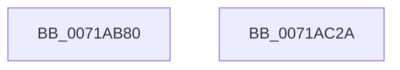

# IopQueryProcessorInitValues

- RVA: `0x0071AB80`–`0x0071AC2B` (길이 `171` bytes)
- VA: `0x000000014071AB80`
- 실행 섹션: `PAGE`
- PDB 이름 있음: `예`; PDB Function 태그: `아니요`
- unwind 정보 RVA: `0x0005CF00`
- 디코드: `45`개 명령, `171/171` bytes 표시
- 미해석 바이트: `0` (있으면 어셈블리에 `.byte`로 보존)

> 이 문서는 커널 이미지의 기계어와 PDB 기호를 분석해 생성했습니다. 4번과 5번은 함수 원형과 자료형을 바이너리 사용 방식에서 추정한 C 해석이며 원본 소스 복구 결과는 아닙니다.

## 1. Dependencies

- 직접 호출 지점: **1**; 고유 호출 대상: **1**
- 직접 호출자로 확인된 함수: **3**
- RIP 상대 이미지 참조: **2**

### Outgoing calls
- `0x0071AB89` → [MmIsThisAnNtAsSystem](../../text/4B/MmIsThisAnNtAsSystem_function_004B2860.md) (function, `0x004B2860`)

### Direct callers
- [IoInitializeProcessor](IoInitializeProcessor_function_0071A91C.md) at `0x0071A95E`
- [PspInitializeQuotaBlock](../78/PspInitializeQuotaBlock_function_00780EB0.md) at `0x00780FFC`
- [IoInitSystemPreDrivers](../../init/C2/IoInitSystemPreDrivers_function_00C2AC3C.md) at `0x00C2AEB7`

### Static image references
- `0x0071ABF7` → RVA `0x00F8D408` (`.data`; read)
- `0x0071AC0A` → RVA `0x00F8D40C` (`.data`; read)

## 2. Other-region calls and transfers

- 다른 실행 섹션으로 향하는 call: **1**
  - `0x0071AB89` → [MmIsThisAnNtAsSystem](../../text/4B/MmIsThisAnNtAsSystem_function_004B2860.md) (`PAGE` → `.text`)
- 별도 외부 분기/꼬리 이동을 확인하지 못했습니다.

## 3. Assembly (complete function range)

```asm
0071AB80  40 53                           push rbx
0071AB82  48 83 EC 20                     sub rsp, 0x20
0071AB86  48 8B D9                        mov rbx, rcx
0071AB89  E8 D2 7C D9 FF                  call 0x1404b2860
0071AB8E  8A D0                           mov dl, al
0071AB90  44 8A D0                        mov r10b, al
0071AB93  F6 DA                           neg dl
0071AB95  8A D0                           mov dl, al
0071AB97  66 45 1B C0                     sbb r8w, r8w
0071AB9B  66 41 83 E0 40                  and r8w, 0x40
0071ABA0  66 41 83 C0 20                  add r8w, 0x20
0071ABA5  66 44 89 43 06                  mov word ptr [rbx + 6], r8w
0071ABAA  F6 DA                           neg dl
0071ABAC  66 44 89 03                     mov word ptr [rbx], r8w
0071ABB0  66 45 1B C9                     sbb r9w, r9w
0071ABB4  66 41 83 E1 40                  and r9w, 0x40
0071ABB9  66 41 83 C1 40                  add r9w, 0x40
0071ABBE  F6 D8                           neg al
0071ABC0  66 44 89 4B 04                  mov word ptr [rbx + 4], r9w
0071ABC5  66 B8 80 00                     mov ax, 0x80
0071ABC9  66 1B C9                        sbb cx, cx
0071ABCC  66 23 C8                        and cx, ax
0071ABCF  66 03 C8                        add cx, ax
0071ABD2  66 89 4B 08                     mov word ptr [rbx + 8], cx
0071ABD6  41 F6 DA                        neg r10b
0071ABD9  66 44 89 4B 02                  mov word ptr [rbx + 2], r9w
0071ABDE  1B C0                           sbb eax, eax
0071ABE0  C7 43 0C 18 01 00 00            mov dword ptr [rbx + 0xc], 0x118
0071ABE7  25 00 FA 00 00                  and eax, 0xfa00
0071ABEC  05 00 06 00 00                  add eax, 0x600
0071ABF1  C1 E8 0B                        shr eax, 0xb
0071ABF4  89 43 1C                        mov dword ptr [rbx + 0x1c], eax
0071ABF7  8B 05 0B 28 87 00               mov eax, dword ptr [rip + 0x87280b]
0071ABFD  8D 0C C0                        lea ecx, [rax + rax*8]
0071AC00  8D 0C CD D0 00 00 00            lea ecx, [rcx*8 + 0xd0]
0071AC07  89 4B 10                        mov dword ptr [rbx + 0x10], ecx
0071AC0A  8B 05 FC 27 87 00               mov eax, dword ptr [rip + 0x8727fc]
0071AC10  C7 43 18 B8 00 00 00            mov dword ptr [rbx + 0x18], 0xb8
0071AC17  8D 0C C0                        lea ecx, [rax + rax*8]
0071AC1A  8D 0C CD D0 00 00 00            lea ecx, [rcx*8 + 0xd0]
0071AC21  89 4B 14                        mov dword ptr [rbx + 0x14], ecx
0071AC24  48 83 C4 20                     add rsp, 0x20
0071AC28  5B                              pop rbx
0071AC29  C3                              ret
0071AC2A  CC                              int3
```

## 4. C-style interpretation (structured pseudocode)

```c
__int64 __fastcall IopQueryProcessorInitValues(__int64 a1, __int64 a2, unsigned __int16 a3, unsigned __int16 a4)
{
    __int64 result;
    __int64 v_r10;
    __int64 v_rsp;

    v_rsp = (v_rsp) - (32);
    result = MmIsThisAnNtAsSystem(a1, a2, a3, a4);
    a2 = (unsigned __int8)(-((unsigned __int8)(result)));
    a3 = (unsigned __int16)((a3) & (64));
    a3 = (unsigned __int16)((a3) + (32));
    *(unsigned __int16 *)(a1 + 6) = a3;
    a2 = (unsigned __int8)(-((unsigned __int8)(result)));
    *(unsigned __int16 *)(a1) = a3;
    a4 = (unsigned __int16)((a4) & (64));
    a4 = (unsigned __int16)((a4) + (64));
    result = (unsigned __int8)(-(result));
    *(unsigned __int16 *)(a1 + 4) = a4;
    a1 = (unsigned __int16)((a1) & (128));
    a1 = (unsigned __int16)((a1) + (128));
    *(unsigned __int16 *)(a1 + 8) = (unsigned __int16)(a1);
    v_r10 = (unsigned __int8)(-((unsigned __int8)(result)));
    *(unsigned __int16 *)(a1 + 2) = a4;
    *(unsigned int *)(a1 + 12) = 280;
    result = (unsigned int)((128) & (0xFA00ULL));
    result = (unsigned int)((result) + (0x600ULL));
    result = (unsigned int)((result) >> (11));
    *(unsigned int *)(a1 + 28) = (unsigned int)(result);
    *(unsigned int *)(a1 + 16) = (unsigned int)((unsigned int)(*(unsigned int *)(v_rip + 8857611)) + (unsigned int)(*(unsigned int *)(v_rip + 8857611)) * 8 * 8 + 208);
    *(unsigned int *)(a1 + 24) = 184;
    *(unsigned int *)(a1 + 20) = (unsigned int)((unsigned int)(*(unsigned int *)(v_rip + 8857596)) + (unsigned int)(*(unsigned int *)(v_rip + 8857596)) * 8 * 8 + 208);
    v_rsp = (v_rsp) + (32);
    return (unsigned int)(*(unsigned int *)(v_rip + 8857596));
}
```

## 5. (Beta) C Style

```c
int64_t IopQueryProcessorInitValues(void *Arg1, int64_t Arg2, uint16_t Arg3, uint16_t Arg4)
{
    uint8_t *arg1 = (uint8_t *)Arg1;

    int64_t result;
    int64_t local_r10;
    int64_t local_rsp;

    local_rsp = (local_rsp) - (32);
    result = MmIsThisAnNtAsSystem(Arg1, Arg2, Arg3, Arg4);
    Arg2 = (uint8_t)(-((uint8_t)(result)));
    Arg3 = (uint16_t)((Arg3) & (64));
    Arg3 = (uint16_t)((Arg3) + (32));
    *(uint16_t *)(arg1 + 0x6) = Arg3;
    Arg2 = (uint8_t)(-((uint8_t)(result)));
    *(uint16_t *)(arg1) = Arg3;
    Arg4 = (uint16_t)((Arg4) & (64));
    Arg4 = (uint16_t)((Arg4) + (64));
    result = (uint8_t)(-(result));
    *(uint16_t *)(arg1 + 0x4) = Arg4;
    Arg1 = (uint16_t)((Arg1) & (128));
    Arg1 = (uint16_t)((Arg1) + (128));
    *(uint16_t *)(arg1 + 0x8) = (uint16_t)(Arg1);
    local_r10 = (uint8_t)(-((uint8_t)(result)));
    *(uint16_t *)(arg1 + 0x2) = Arg4;
    *(uint32_t *)(arg1 + 0xC) = 280;
    result = (uint32_t)((128) & (0xFA00ULL));
    result = (uint32_t)((result) + (0x600ULL));
    result = (uint32_t)((result) >> (11));
    *(uint32_t *)(arg1 + 0x1C) = (uint32_t)(result);
    *(uint32_t *)(arg1 + 0x10) = (uint32_t)((uint32_t)(*(uint32_t *)(v_rip + 0x87280B)) + (uint32_t)(*(uint32_t *)(v_rip + 0x87280B)) * 8 * 8 + 208);
    *(uint32_t *)(arg1 + 0x18) = 184;
    *(uint32_t *)(arg1 + 0x14) = (uint32_t)((uint32_t)(*(uint32_t *)(v_rip + 0x8727FC)) + (uint32_t)(*(uint32_t *)(v_rip + 0x8727FC)) * 8 * 8 + 208);
    local_rsp = (local_rsp) + (32);
    return (uint32_t)(*(uint32_t *)(v_rip + 0x8727FC));
}
```

### 관측된 메모리 오프셋

구조체 형식이 확인되지 않은 접근은 인자 기준의 오프셋으로만 기록했습니다.

| 기준 인자 | 오프셋 표현 | 폭 (bit) | 접근 |
|---|---:|---:|---|
| `Arg1` | `+ 0x0` | `16` | `W` |
| `Arg1` | `+ 0x2` | `16` | `W` |
| `Arg1` | `+ 0x4` | `16` | `W` |
| `Arg1` | `+ 0x6` | `16` | `W` |
| `Arg1` | `+ 0x8` | `16` | `W` |
| `Arg1` | `+ 0xC` | `32` | `W` |
| `Arg1` | `+ 0x10` | `32` | `W` |
| `Arg1` | `+ 0x14` | `32` | `W` |
| `Arg1` | `+ 0x18` | `32` | `W` |
| `Arg1` | `+ 0x1C` | `32` | `W` |

## 6. Execution-region graph

[열기: 2D/3D 그래프와 함수 탐색 컨트롤 패널](../../../control-panel.html?section=page&rva=0x0071AB80&view=graph)

- 2D 그래프는 위에서 아래로 흐르고, 3D 그래프는 빈 공간을 드래그해 회전합니다. Shift+드래그는 이동, 휠은 확대·축소, 함수 노드 선택은 대상 보고서 이동입니다.

### Static fallback


