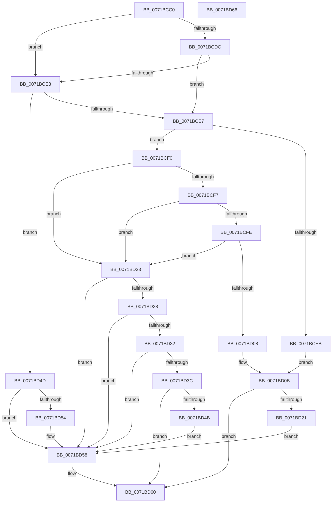

# IopQueueIrpForServiceTail

- RVA: `0x0071BCC0`–`0x0071BD67` (길이 `167` bytes)
- VA: `0x000000014071BCC0`
- 실행 섹션: `PAGE`
- PDB 이름 있음: `예`; PDB Function 태그: `아니요`
- unwind 정보 RVA: `0x0005CF00`
- 디코드: `55`개 명령, `167/167` bytes 표시
- 미해석 바이트: `0` (있으면 어셈블리에 `.byte`로 보존)

> 이 문서는 커널 이미지의 기계어와 PDB 기호를 분석해 생성했습니다. 4번과 5번은 함수 원형과 자료형을 바이너리 사용 방식에서 추정한 C 해석이며 원본 소스 복구 결과는 아닙니다.

## 1. Dependencies

- 직접 호출 지점: **3**; 고유 호출 대상: **3**
- 직접 호출자로 확인된 함수: **2**
- RIP 상대 이미지 참조: **0**

### Outgoing calls
- `0x0071BD11` → [IopQueueIrpToFileObject](../../text/40/IopQueueIrpToFileObject_function_00409864.md) (function, `0x00409864`)
- `0x0071BD42` → [IopIsIosbInLockedRange](../A2/IopIsIosbInLockedRange_function_00A2C908.md) (function, `0x00A2C908`)
- `0x0071BD5B` → [IopQueueThreadIrp](../../text/20/IopQueueThreadIrp_function_002075C0.md) (function, `0x002075C0`)

### Direct callers
- [IopQueuePairedCopyWriteIrp](../../text/59/IopQueuePairedCopyWriteIrp_function_00598A9C.md) at `0x00598AB4`
- [IopSynchronousServiceTail](../8E/IopSynchronousServiceTail_function_008EB440.md) at `0x008EB4E4`

### Static image references
- 디코드된 RIP-relative 메모리 참조가 없습니다.

## 2. Other-region calls and transfers

- 다른 실행 섹션으로 향하는 call: **2**
  - `0x0071BD11` → [IopQueueIrpToFileObject](../../text/40/IopQueueIrpToFileObject_function_00409864.md) (`PAGE` → `.text`)
  - `0x0071BD5B` → [IopQueueThreadIrp](../../text/20/IopQueueThreadIrp_function_002075C0.md) (`PAGE` → `.text`)
- 별도 외부 분기/꼬리 이동을 확인하지 못했습니다.

## 3. Assembly (complete function range)

```asm
0071BCC0  40 53                           push rbx
0071BCC2  48 83 EC 20                     sub rsp, 0x20
0071BCC6  48 8B D9                        mov rbx, rcx
0071BCC9  48 8B C2                        mov rax, rdx
0071BCCC  8B 51 10                        mov edx, dword ptr [rcx + 0x10]
0071BCCF  8B CA                           mov ecx, edx
0071BCD1  81 E1 00 00 20 00               and ecx, 0x200000
0071BCD7  45 84 C0                        test r8b, r8b
0071BCDA  75 07                           jne 0x14071bce3
0071BCDC  48 83 7B 58 00                  cmp qword ptr [rbx + 0x58], 0
0071BCE1  74 04                           je 0x14071bce7
0071BCE3  85 C9                           test ecx, ecx
0071BCE5  74 66                           je 0x14071bd4d
0071BCE7  85 C9                           test ecx, ecx
0071BCE9  74 05                           je 0x14071bcf0
0071BCEB  45 33 C0                        xor r8d, r8d
0071BCEE  EB 1B                           jmp 0x14071bd0b
0071BCF0  48 83 7B 60 00                  cmp qword ptr [rbx + 0x60], 0
0071BCF5  74 2C                           je 0x14071bd23
0071BCF7  48 83 7B 50 00                  cmp qword ptr [rbx + 0x50], 0
0071BCFC  75 25                           jne 0x14071bd23
0071BCFE  48 83 B8 B0 00 00 00 00         cmp qword ptr [rax + 0xb0], 0
0071BD06  74 1B                           je 0x14071bd23
0071BD08  41 B0 01                        mov r8b, 1
0071BD0B  48 8B D0                        mov rdx, rax
0071BD0E  48 8B CB                        mov rcx, rbx
0071BD11  E8 4E DB CE FF                  call 0x140409864
0071BD16  33 C9                           xor ecx, ecx
0071BD18  84 C0                           test al, al
0071BD1A  0F 94 C1                        sete cl
0071BD1D  85 C9                           test ecx, ecx
0071BD1F  74 3F                           je 0x14071bd60
0071BD21  EB 35                           jmp 0x14071bd58
0071BD23  F6 C2 10                        test dl, 0x10
0071BD26  75 30                           jne 0x14071bd58
0071BD28  48 83 B8 B0 00 00 00 00         cmp qword ptr [rax + 0xb0], 0
0071BD30  75 26                           jne 0x14071bd58
0071BD32  48 83 B8 D0 00 00 00 00         cmp qword ptr [rax + 0xd0], 0
0071BD3A  74 1C                           je 0x14071bd58
0071BD3C  48 8B D3                        mov rdx, rbx
0071BD3F  48 8B C8                        mov rcx, rax
0071BD42  E8 C1 0B 31 00                  call 0x140a2c908
0071BD47  84 C0                           test al, al
0071BD49  75 15                           jne 0x14071bd60
0071BD4B  EB 0B                           jmp 0x14071bd58
0071BD4D  8B 40 50                        mov eax, dword ptr [rax + 0x50]
0071BD50  A8 02                           test al, 2
0071BD52  74 04                           je 0x14071bd58
0071BD54  80 4B 47 02                     or byte ptr [rbx + 0x47], 2
0071BD58  48 8B CB                        mov rcx, rbx
0071BD5B  E8 60 B8 AE FF                  call 0x1402075c0
0071BD60  48 83 C4 20                     add rsp, 0x20
0071BD64  5B                              pop rbx
0071BD65  C3                              ret
0071BD66  CC                              int3
```

## 4. C-style interpretation (structured pseudocode)

```c
__int64 __fastcall IopQueueIrpForServiceTail(__int64 a1, __int64 a2, int a3)
{
    __int64 result;
    __int64 v_rsp;

    v_rsp = (v_rsp) - (32);
    a1 = (unsigned int)(((unsigned int)((unsigned int)((unsigned int)(*(unsigned int *)(a1 + 16))))) & (0x200000ULL));
    if ((unsigned __int8)(a3) != 0) goto loc_0071BCE3;
    if ((*(unsigned __int64 *)(a1 + 88)) == 0) goto loc_0071BCE7;
loc_0071BCE3:
    if ((unsigned int)(a1) == 0) goto loc_0071BD4D;
loc_0071BCE7:
    if ((unsigned int)(a1) == 0) goto loc_0071BCF0;
    a3 = 0;
    goto loc_0071BD0B;
loc_0071BCF0:
    if ((*(unsigned __int64 *)(a1 + 96)) == 0) goto loc_0071BD23;
    if ((*(unsigned __int64 *)(a1 + 80)) != 0) goto loc_0071BD23;
    if ((*(unsigned __int64 *)(a2 + 176)) == 0) goto loc_0071BD23;
loc_0071BD0B:
    result = IopQueueIrpToFileObject(a1, a2, 1, a4);
    a1 = 0;
    a1 = ((unsigned __int8)(result) == 0) ? 1 : 0;
    if ((unsigned int)(a1) == 0) goto loc_0071BD60;
    goto loc_0071BD58;
loc_0071BD23:
    if ((((unsigned __int8)(a2)) & (16)) != 0) goto loc_0071BD58;
    if ((*(unsigned __int64 *)(result + 176)) != 0) goto loc_0071BD58;
    if ((*(unsigned __int64 *)(result + 208)) == 0) goto loc_0071BD58;
    result = IopIsIosbInLockedRange(result, a1, 1, a4);
    if ((unsigned __int8)(result) != 0) goto loc_0071BD60;
    goto loc_0071BD58;
loc_0071BD4D:
    if ((((unsigned __int8)((unsigned int)(*(unsigned int *)(result + 80)))) & (2)) != 0) {
    }
    result = IopQueueThreadIrp(a1, a1, 1, a4);
loc_0071BD60:
    v_rsp = (v_rsp) + (32);
    return result;
}
```

## 5. (Beta) C Style

```c
int64_t IopQueueIrpForServiceTail(void *Arg1, void *Arg2, int32_t Arg3)
{
    uint8_t *arg1 = (uint8_t *)Arg1;
    uint8_t *arg2 = (uint8_t *)Arg2;

    int64_t result;
    int64_t local_rsp;

    local_rsp = (local_rsp) - (32);
    Arg1 = (uint32_t)(((uint32_t)((uint32_t)((uint32_t)(*(uint32_t *)(arg1 + 0x10))))) & (0x200000ULL));
    if ((uint8_t)(Arg3) != 0) goto loc_0071BCE3;
    if ((*(uint64_t *)(arg1 + 0x58)) == 0) goto loc_0071BCE7;
loc_0071BCE3:
    if ((uint32_t)(Arg1) == 0) goto loc_0071BD4D;
loc_0071BCE7:
    if ((uint32_t)(Arg1) == 0) goto loc_0071BCF0;
    Arg3 = 0;
    goto loc_0071BD0B;
loc_0071BCF0:
    if ((*(uint64_t *)(arg1 + 0x60)) == 0) goto loc_0071BD23;
    if ((*(uint64_t *)(arg1 + 0x50)) != 0) goto loc_0071BD23;
    if ((*(uint64_t *)(arg2 + 0xB0)) == 0) goto loc_0071BD23;
loc_0071BD0B:
    result = IopQueueIrpToFileObject(Arg1, Arg2, 1, a4);
    Arg1 = 0;
    Arg1 = ((uint8_t)(result) == 0) ? 1 : 0;
    if ((uint32_t)(Arg1) == 0) goto loc_0071BD60;
    goto loc_0071BD58;
loc_0071BD23:
    if ((((uint8_t)(Arg2)) & (16)) != 0) goto loc_0071BD58;
    if ((*(uint64_t *)(result + 0xB0)) != 0) goto loc_0071BD58;
    if ((*(uint64_t *)(result + 0xD0)) == 0) goto loc_0071BD58;
    result = IopIsIosbInLockedRange(result, Arg1, 1, a4);
    if ((uint8_t)(result) != 0) goto loc_0071BD60;
    goto loc_0071BD58;
loc_0071BD4D:
    if ((((uint8_t)((uint32_t)(*(uint32_t *)(result + 0x50)))) & (2)) != 0) {
    }
    result = IopQueueThreadIrp(Arg1, Arg1, 1, a4);
loc_0071BD60:
    local_rsp = (local_rsp) + (32);
    return result;
}
```

### 관측된 메모리 오프셋

구조체 형식이 확인되지 않은 접근은 인자 기준의 오프셋으로만 기록했습니다.

| 기준 인자 | 오프셋 표현 | 폭 (bit) | 접근 |
|---|---:|---:|---|
| `Arg1` | `+ 0x10` | `32` | `R` |
| `Arg1` | `+ 0x47` | `8` | `R/W` |
| `Arg1` | `+ 0x50` | `64` | `R` |
| `Arg1` | `+ 0x58` | `64` | `R` |
| `Arg1` | `+ 0x60` | `64` | `R` |
| `Arg2` | `+ 0x50` | `32` | `R` |
| `Arg2` | `+ 0xB0` | `64` | `R` |
| `Arg2` | `+ 0xD0` | `64` | `R` |

## 6. Execution-region graph

[열기: 2D/3D 그래프와 함수 탐색 컨트롤 패널](../../../control-panel.html?section=page&rva=0x0071BCC0&view=graph)

- 2D 그래프는 위에서 아래로 흐르고, 3D 그래프는 빈 공간을 드래그해 회전합니다. Shift+드래그는 이동, 휠은 확대·축소, 함수 노드 선택은 대상 보고서 이동입니다.

### Static fallback


