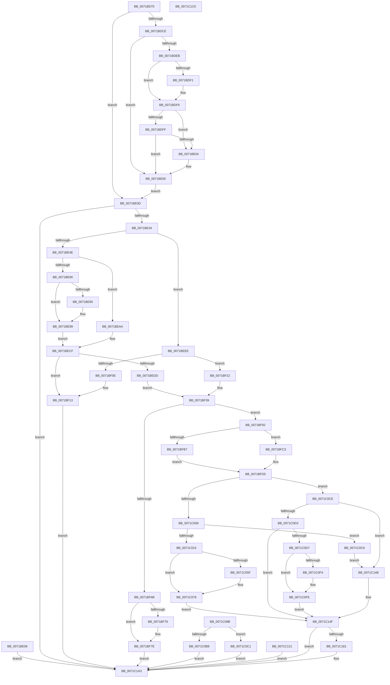

# IopSetEaOrQuotaInformationFile

- RVA: `0x0071BD70`–`0x0071C1C1` (길이 `1,105` bytes)
- VA: `0x000000014071BD70`
- 실행 섹션: `PAGE`
- PDB 이름 있음: `예`; PDB Function 태그: `아니요`
- unwind 정보 RVA: `0x000C7454`
- 디코드: `285`개 명령, `1,105/1,105` bytes 표시
- 미해석 바이트: `0` (있으면 어셈블리에 `.byte`로 보존)

> 이 문서는 커널 이미지의 기계어와 PDB 기호를 분석해 생성했습니다. 4번과 5번은 함수 원형과 자료형을 바이너리 사용 방식에서 추정한 C 해석이며 원본 소스 복구 결과는 아닙니다.

## 1. Dependencies

- 직접 호출 지점: **24**; 고유 호출 대상: **21**
- 직접 호출자로 확인된 함수: **1**
- RIP 상대 이미지 참조: **0**

### Outgoing calls
- `0x0071BDF1` → [ExRaiseDatatypeMisalignment](../89/ExRaiseDatatypeMisalignment_function_00899FD0.md) (function, `0x00899FD0`)
- `0x0071BE23` → [IopReferenceFileObject](../../text/29/IopReferenceFileObject_function_0029D530.md) (function, `0x0029D530`)
- `0x0071BE77` → [KeAbPreAcquire](../../text/21/KeAbPreAcquire_function_00210230.md) (function, `0x00210230`)
- `0x0071BEA1` → [ObfReferenceObject](../../text/20/ObfReferenceObject_function_0020FA20.md) (function, `0x0020FA20`)
- `0x0071BEC8` → [IopWaitAndAcquireFileObjectLock](../8A/IopWaitAndAcquireFileObjectLock_function_008AE6D8.md) (function, `0x008AE6D8`)
- `0x0071BEFC` → [ExAllocatePool2](../../poolcode/B8/ExAllocatePool2_function_00B820F0.md) (function, `0x00B820F0`)
- `0x0071BF16` → [ObfDereferenceObject](../../text/2F/ObfDereferenceObject_function_002F9350.md) (function, `0x002F9350`)
- `0x0071BF2C` → [KeInitializeEvent](../../text/40/KeInitializeEvent_function_0040DD10.md) (function, `0x0040DD10`)
- `0x0071BF3C` → [IopResetEvent](../../text/29/IopResetEvent_function_0029D5F0.md) (function, `0x0029D5F0`)
- `0x0071BF44` → [IoGetRelatedDeviceObject](../../text/29/IoGetRelatedDeviceObject_function_0029B120.md) (function, `0x0029B120`)
- `0x0071BF57` → [IopAllocateIrpExReturn](../../text/20/IopAllocateIrpExReturn_function_00207720.md) (function, `0x00207720`)
- `0x0071BF79` → [ExFreePoolWithTag](../../poolcode/B8/ExFreePoolWithTag_function_00B82870.md) (function, `0x00B82870`)
- `0x0071BF83` → [IopAllocateIrpCleanup](../A1/IopAllocateIrpCleanup_function_00A1E2D4.md) (function, `0x00A1E2D4`)
- `0x0071C027` → [ExAllocatePool2](../../poolcode/B8/ExAllocatePool2_function_00B820F0.md) (function, `0x00B820F0`)
- `0x0071C03C` → [memcpy](../../text/6C/memcpy_function_006C6840.md) (function, `0x006C6840`)
- `0x0071C052` → [IoCheckQuotaBufferValidity](IoCheckQuotaBufferValidity_function_0071CFD0.md) (function, `0x0071CFD0`)
- `0x0071C072` → [RtlRaiseStatus](../../text/2F/RtlRaiseStatus_function_002F6A50.md) (function, `0x002F6A50`)
- `0x0071C0AC` → [IopExceptionCleanupEx](../8A/IopExceptionCleanupEx_function_008AE5C8.md) (function, `0x008AE5C8`)
- `0x0071C0E7` → [IoAllocateMdl](../../text/29/IoAllocateMdl_function_0029EBF0.md) (function, `0x0029EBF0`)
- `0x0071C0F9` → [RtlRaiseStatus](../../text/2F/RtlRaiseStatus_function_002F6A50.md) (function, `0x002F6A50`)
- `0x0071C115` → [IopProbeAndLockPages](../../text/45/IopProbeAndLockPages_function_0045641C.md) (function, `0x0045641C`)
- `0x0071C142` → [IopExceptionCleanupEx](../8A/IopExceptionCleanupEx_function_008AE5C8.md) (function, `0x008AE5C8`)
- `0x0071C178` → [IopSynchronousServiceTail](../8E/IopSynchronousServiceTail_function_008EB440.md) (function, `0x008EB440`)
- `0x0071C19E` → [IopSynchronousApiServiceTail](../8A/IopSynchronousApiServiceTail_function_008ACE3C.md) (function, `0x008ACE3C`)

### Direct callers
- [NtSetQuotaInformationFile](../72/NtSetQuotaInformationFile_function_00721730.md) at `0x00721734`

### Static image references
- 디코드된 RIP-relative 메모리 참조가 없습니다.

## 2. Other-region calls and transfers

- 다른 실행 섹션으로 향하는 call: **16**
  - `0x0071BE23` → [IopReferenceFileObject](../../text/29/IopReferenceFileObject_function_0029D530.md) (`PAGE` → `.text`)
  - `0x0071BE77` → [KeAbPreAcquire](../../text/21/KeAbPreAcquire_function_00210230.md) (`PAGE` → `.text`)
  - `0x0071BEA1` → [ObfReferenceObject](../../text/20/ObfReferenceObject_function_0020FA20.md) (`PAGE` → `.text`)
  - `0x0071BEFC` → [ExAllocatePool2](../../poolcode/B8/ExAllocatePool2_function_00B820F0.md) (`PAGE` → `POOLCODE`)
  - `0x0071BF16` → [ObfDereferenceObject](../../text/2F/ObfDereferenceObject_function_002F9350.md) (`PAGE` → `.text`)
  - `0x0071BF2C` → [KeInitializeEvent](../../text/40/KeInitializeEvent_function_0040DD10.md) (`PAGE` → `.text`)
  - `0x0071BF3C` → [IopResetEvent](../../text/29/IopResetEvent_function_0029D5F0.md) (`PAGE` → `.text`)
  - `0x0071BF44` → [IoGetRelatedDeviceObject](../../text/29/IoGetRelatedDeviceObject_function_0029B120.md) (`PAGE` → `.text`)
  - `0x0071BF57` → [IopAllocateIrpExReturn](../../text/20/IopAllocateIrpExReturn_function_00207720.md) (`PAGE` → `.text`)
  - `0x0071BF79` → [ExFreePoolWithTag](../../poolcode/B8/ExFreePoolWithTag_function_00B82870.md) (`PAGE` → `POOLCODE`)
  - `0x0071C027` → [ExAllocatePool2](../../poolcode/B8/ExAllocatePool2_function_00B820F0.md) (`PAGE` → `POOLCODE`)
  - `0x0071C03C` → [memcpy](../../text/6C/memcpy_function_006C6840.md) (`PAGE` → `.text`)
  - `0x0071C072` → [RtlRaiseStatus](../../text/2F/RtlRaiseStatus_function_002F6A50.md) (`PAGE` → `.text`)
  - `0x0071C0E7` → [IoAllocateMdl](../../text/29/IoAllocateMdl_function_0029EBF0.md) (`PAGE` → `.text`)
  - `0x0071C0F9` → [RtlRaiseStatus](../../text/2F/RtlRaiseStatus_function_002F6A50.md) (`PAGE` → `.text`)
  - `0x0071C115` → [IopProbeAndLockPages](../../text/45/IopProbeAndLockPages_function_0045641C.md) (`PAGE` → `.text`)
- 별도 외부 분기/꼬리 이동을 확인하지 못했습니다.

## 3. Assembly (complete function range)

```asm
0071BD70  48 8B C4                        mov rax, rsp
0071BD73  48 89 58 08                     mov qword ptr [rax + 8], rbx
0071BD77  48 89 70 10                     mov qword ptr [rax + 0x10], rsi
0071BD7B  44 89 48 20                     mov dword ptr [rax + 0x20], r9d
0071BD7F  57                              push rdi
0071BD80  41 54                           push r12
0071BD82  41 55                           push r13
0071BD84  41 56                           push r14
0071BD86  41 57                           push r15
0071BD88  48 81 EC 90 00 00 00            sub rsp, 0x90
0071BD8F  41 8B D9                        mov ebx, r9d
0071BD92  4D 8B E0                        mov r12, r8
0071BD95  4C 8B EA                        mov r13, rdx
0071BD98  4C 8B D1                        mov r10, rcx
0071BD9B  48 83 60 90 00                  and qword ptr [rax - 0x70], 0
0071BDA0  45 33 FF                        xor r15d, r15d
0071BDA3  4C 89 7C 24 60                  mov qword ptr [rsp + 0x60], r15
0071BDA8  0F 57 C0                        xorps xmm0, xmm0
0071BDAB  0F 11 40 C8                     movups xmmword ptr [rax - 0x38], xmm0
0071BDAF  65 48 8B 04 25 88 01 00 00      mov rax, qword ptr gs:[0x188]
0071BDB8  48 89 44 24 78                  mov qword ptr [rsp + 0x78], rax
0071BDBD  40 8A B0 32 02 00 00            mov sil, byte ptr [rax + 0x232]
0071BDC4  40 88 74 24 40                  mov byte ptr [rsp + 0x40], sil
0071BDC9  40 84 F6                        test sil, sil
0071BDCC  74 3F                           je 0x14071be0d
0071BDCE  48 BA 00 00 FF FF FF 7F 00 00   movabs rdx, 0x7fffffff0000
0071BDD8  48 8B CA                        mov rcx, rdx
0071BDDB  4C 3B EA                        cmp r13, rdx
0071BDDE  49 0F 42 CD                     cmovb rcx, r13
0071BDE2  8B 01                           mov eax, dword ptr [rcx]
0071BDE4  89 01                           mov dword ptr [rcx], eax
0071BDE6  45 85 C9                        test r9d, r9d
0071BDE9  74 1B                           je 0x14071be06
0071BDEB  41 F6 C4 03                     test r12b, 3
0071BDEF  74 05                           je 0x14071bdf6
0071BDF1  E8 DA E1 17 00                  call 0x140899fd0
0071BDF6  49 8D 0C 18                     lea rcx, [r8 + rbx]
0071BDFA  48 3B CA                        cmp rcx, rdx
0071BDFD  77 05                           ja 0x14071be04
0071BDFF  49 3B CC                        cmp rcx, r12
0071BE02  73 02                           jae 0x14071be06
0071BE04  8A 02                           mov al, byte ptr [rdx]
0071BE06  EB 05                           jmp 0x14071be0d
0071BE08  E9 96 03 00 00                  jmp 0x14071c1a3
0071BE0D  48 83 64 24 20 00               and qword ptr [rsp + 0x20], 0
0071BE13  4C 8D 4C 24 48                  lea r9, [rsp + 0x48]
0071BE18  44 8A C6                        mov r8b, sil
0071BE1B  BA 02 00 00 00                  mov edx, 2
0071BE20  49 8B CA                        mov rcx, r10
0071BE23  E8 08 17 B8 FF                  call 0x14029d530
0071BE28  89 44 24 44                     mov dword ptr [rsp + 0x44], eax
0071BE2C  85 C0                           test eax, eax
0071BE2E  0F 88 6F 03 00 00               js 0x14071c1a3
0071BE34  4C 8B 74 24 48                  mov r14, qword ptr [rsp + 0x48]
0071BE39  49 8D 46 50                     lea rax, [r14 + 0x50]
0071BE3D  48 89 44 24 58                  mov qword ptr [rsp + 0x58], rax
0071BE42  8B 38                           mov edi, dword ptr [rax]
0071BE44  40 F6 C7 02                     test dil, 2
0071BE48  0F 84 A0 00 00 00               je 0x14071beee
0071BE4E  C1 EF 02                        shr edi, 2
0071BE51  40 80 E7 01                     and dil, 1
0071BE55  65 48 8B 04 25 88 01 00 00      mov rax, qword ptr gs:[0x188]
0071BE5E  66 FF 88 E4 01 00 00            dec word ptr [rax + 0x1e4]
0071BE65  90                              nop
0071BE66  48 8B 5C 24 48                  mov rbx, qword ptr [rsp + 0x48]
0071BE6B  48 8D 8B 80 00 00 00            lea rcx, [rbx + 0x80]
0071BE72  45 33 C0                        xor r8d, r8d
0071BE75  33 D2                           xor edx, edx
0071BE77  E8 B4 43 AF FF                  call 0x140210230
0071BE7C  C6 84 24 E0 00 00 00 00         mov byte ptr [rsp + 0xe0], 0
0071BE84  B9 01 00 00 00                  mov ecx, 1
0071BE89  87 4B 74                        xchg dword ptr [rbx + 0x74], ecx
0071BE8C  85 C9                           test ecx, ecx
0071BE8E  75 1A                           jne 0x14071beaa
0071BE90  48 85 C0                        test rax, rax
0071BE93  74 04                           je 0x14071be99
0071BE95  C6 40 0A 01                     mov byte ptr [rax + 0xa], 1
0071BE99  4C 8B 74 24 48                  mov r14, qword ptr [rsp + 0x48]
0071BE9E  49 8B CE                        mov rcx, r14
0071BEA1  E8 7A 3B AF FF                  call 0x14020fa20
0071BEA6  33 DB                           xor ebx, ebx
0071BEA8  EB 25                           jmp 0x14071becf
0071BEAA  48 8D 8C 24 E0 00 00 00         lea rcx, [rsp + 0xe0]
0071BEB2  48 89 4C 24 20                  mov qword ptr [rsp + 0x20], rcx
0071BEB7  4C 8B C8                        mov r9, rax
0071BEBA  44 8A C7                        mov r8b, dil
0071BEBD  40 8A D6                        mov dl, sil
0071BEC0  4C 8B 74 24 48                  mov r14, qword ptr [rsp + 0x48]
0071BEC5  49 8B CE                        mov rcx, r14
0071BEC8  E8 0B 28 19 00                  call 0x1408ae6d8
0071BECD  8B D8                           mov ebx, eax
0071BECF  89 5C 24 44                     mov dword ptr [rsp + 0x44], ebx
0071BED3  80 BC 24 E0 00 00 00 00         cmp byte ptr [rsp + 0xe0], 0
0071BEDB  75 36                           jne 0x14071bf13
0071BEDD  C6 84 24 E0 00 00 00 01         mov byte ptr [rsp + 0xe0], 1
0071BEE5  8B 9C 24 D8 00 00 00            mov ebx, dword ptr [rsp + 0xd8]
0071BEEC  EB 4B                           jmp 0x14071bf39
0071BEEE  BA 18 00 00 00                  mov edx, 0x18
0071BEF3  8D 4A 28                        lea ecx, [rdx + 0x28]
0071BEF6  41 B8 49 6F 45 76               mov r8d, 0x76456f49
0071BEFC  E8 EF 61 46 00                  call 0x140b820f0
0071BF01  4C 8B F8                        mov r15, rax
0071BF04  48 89 44 24 60                  mov qword ptr [rsp + 0x60], rax
0071BF09  48 85 C0                        test rax, rax
0071BF0C  75 14                           jne 0x14071bf22
0071BF0E  BB 9A 00 00 C0                  mov ebx, 0xc000009a
0071BF13  49 8B CE                        mov rcx, r14
0071BF16  E8 35 D4 BD FF                  call 0x1402f9350
0071BF1B  8B C3                           mov eax, ebx
0071BF1D  E9 81 02 00 00                  jmp 0x14071c1a3
0071BF22  45 33 C0                        xor r8d, r8d
0071BF25  41 8D 50 01                     lea edx, [r8 + 1]
0071BF29  48 8B C8                        mov rcx, rax
0071BF2C  E8 DF 1D CF FF                  call 0x14040dd10
0071BF31  C6 84 24 E0 00 00 00 00         mov byte ptr [rsp + 0xe0], 0
0071BF39  49 8B CE                        mov rcx, r14
0071BF3C  E8 AF 16 B8 FF                  call 0x14029d5f0
0071BF41  49 8B CE                        mov rcx, r14
0071BF44  E8 D7 F1 B7 FF                  call 0x14029b120
0071BF49  48 89 44 24 68                  mov qword ptr [rsp + 0x68], rax
0071BF4E  45 33 C0                        xor r8d, r8d
0071BF51  8A 50 4C                        mov dl, byte ptr [rax + 0x4c]
0071BF54  48 8B C8                        mov rcx, rax
0071BF57  E8 C4 B7 AE FF                  call 0x140207720
0071BF5C  48 8B F0                        mov rsi, rax
0071BF5F  48 89 44 24 70                  mov qword ptr [rsp + 0x70], rax
0071BF64  33 D2                           xor edx, edx
0071BF66  48 85 C0                        test rax, rax
0071BF69  75 27                           jne 0x14071bf92
0071BF6B  48 8B 44 24 58                  mov rax, qword ptr [rsp + 0x58]
0071BF70  8B 00                           mov eax, dword ptr [rax]
0071BF72  A8 02                           test al, 2
0071BF74  75 08                           jne 0x14071bf7e
0071BF76  49 8B CF                        mov rcx, r15
0071BF79  E8 F2 68 46 00                  call 0x140b82870
0071BF7E  33 D2                           xor edx, edx
0071BF80  49 8B CE                        mov rcx, r14
0071BF83  E8 4C 23 30 00                  call 0x140a1e2d4
0071BF88  B8 9A 00 00 C0                  mov eax, 0xc000009a
0071BF8D  E9 11 02 00 00                  jmp 0x14071c1a3
0071BF92  4C 89 B0 C0 00 00 00            mov qword ptr [rax + 0xc0], r14
0071BF99  48 8B 44 24 78                  mov rax, qword ptr [rsp + 0x78]
0071BF9E  48 89 86 98 00 00 00            mov qword ptr [rsi + 0x98], rax
0071BFA5  40 8A 7C 24 40                  mov dil, byte ptr [rsp + 0x40]
0071BFAA  40 88 7E 40                     mov byte ptr [rsi + 0x40], dil
0071BFAE  38 94 24 E0 00 00 00            cmp byte ptr [rsp + 0xe0], dl
0071BFB5  74 0C                           je 0x14071bfc3
0071BFB7  80 4E 47 02                     or byte ptr [rsi + 0x47], 2
0071BFBB  49 8B C5                        mov rax, r13
0071BFBE  48 8B CA                        mov rcx, rdx
0071BFC1  EB 12                           jmp 0x14071bfd5
0071BFC3  C7 46 10 04 00 00 00            mov dword ptr [rsi + 0x10], 4
0071BFCA  48 8D 84 24 80 00 00 00         lea rax, [rsp + 0x80]
0071BFD2  49 8B CF                        mov rcx, r15
0071BFD5  48 89 4E 50                     mov qword ptr [rsi + 0x50], rcx
0071BFD9  48 89 46 48                     mov qword ptr [rsi + 0x48], rax
0071BFDD  48 89 56 58                     mov qword ptr [rsi + 0x58], rdx
0071BFE1  48 8B 86 B8 00 00 00            mov rax, qword ptr [rsi + 0xb8]
0071BFE8  48 83 E8 48                     sub rax, 0x48
0071BFEC  48 89 44 24 58                  mov qword ptr [rsp + 0x58], rax
0071BFF1  C6 00 1A                        mov byte ptr [rax], 0x1a
0071BFF4  4C 89 70 30                     mov qword ptr [rax + 0x30], r14
0071BFF8  48 8B 4C 24 68                  mov rcx, qword ptr [rsp + 0x68]
0071BFFD  8B 49 30                        mov ecx, dword ptr [rcx + 0x30]
0071C000  F6 C1 04                        test cl, 4
0071C003  0F 84 C5 00 00 00               je 0x14071c0ce
0071C009  89 54 24 50                     mov dword ptr [rsp + 0x50], edx
0071C00D  85 DB                           test ebx, ebx
0071C00F  0F 84 B3 00 00 00               je 0x14071c0c8
0071C015  88 54 24 41                     mov byte ptr [rsp + 0x41], dl
0071C019  41 B8 49 6F 53 42               mov r8d, 0x42536f49
0071C01F  48 8B D3                        mov rdx, rbx
0071C022  B9 63 00 00 00                  mov ecx, 0x63
0071C027  E8 C4 60 46 00                  call 0x140b820f0
0071C02C  48 8B F8                        mov rdi, rax
0071C02F  48 89 46 18                     mov qword ptr [rsi + 0x18], rax
0071C033  4C 8B C3                        mov r8, rbx
0071C036  49 8B D4                        mov rdx, r12
0071C039  48 8B C8                        mov rcx, rax
0071C03C  E8 FF A7 FA FF                  call 0x1406c6840
0071C041  4C 8D 44 24 50                  lea r8, [rsp + 0x50]
0071C046  8B 9C 24 D8 00 00 00            mov ebx, dword ptr [rsp + 0xd8]
0071C04D  8B D3                           mov edx, ebx
0071C04F  48 8B CF                        mov rcx, rdi
0071C052  E8 79 0F 00 00                  call 0x14071cfd0
0071C057  89 44 24 44                     mov dword ptr [rsp + 0x44], eax
0071C05B  85 C0                           test eax, eax
0071C05D  79 19                           jns 0x14071c078
0071C05F  C6 44 24 41 01                  mov byte ptr [rsp + 0x41], 1
0071C064  41 89 45 00                     mov dword ptr [r13], eax
0071C068  8B 4C 24 50                     mov ecx, dword ptr [rsp + 0x50]
0071C06C  49 89 4D 08                     mov qword ptr [r13 + 8], rcx
0071C070  8B C8                           mov ecx, eax
0071C072  E8 D9 A9 BD FF                  call 0x1402f6a50
0071C077  90                              nop
0071C078  83 4E 10 30                     or dword ptr [rsi + 0x10], 0x30
0071C07C  40 8A 7C 24 40                  mov dil, byte ptr [rsp + 0x40]
0071C081  48 8B 44 24 58                  mov rax, qword ptr [rsp + 0x58]
0071C086  E9 C4 00 00 00                  jmp 0x14071c14f
0071C08B  8B D8                           mov ebx, eax
0071C08D  48 8B 4C 24 48                  mov rcx, qword ptr [rsp + 0x48]
0071C092  0F B6 51 50                     movzx edx, byte ptr [rcx + 0x50]
0071C096  D1 EA                           shr edx, 1
0071C098  83 E2 01                        and edx, 1
0071C09B  88 54 24 20                     mov byte ptr [rsp + 0x20], dl
0071C09F  4C 8B 4C 24 60                  mov r9, qword ptr [rsp + 0x60]
0071C0A4  45 33 C0                        xor r8d, r8d
0071C0A7  48 8B 54 24 70                  mov rdx, qword ptr [rsp + 0x70]
0071C0AC  E8 17 25 19 00                  call 0x1408ae5c8
0071C0B1  80 7C 24 41 00                  cmp byte ptr [rsp + 0x41], 0
0071C0B6  74 09                           je 0x14071c0c1
0071C0B8  8B 44 24 44                     mov eax, dword ptr [rsp + 0x44]
0071C0BC  E9 E2 00 00 00                  jmp 0x14071c1a3
0071C0C1  8B C3                           mov eax, ebx
0071C0C3  E9 DB 00 00 00                  jmp 0x14071c1a3
0071C0C8  48 89 56 18                     mov qword ptr [rsi + 0x18], rdx
0071C0CC  EB 7D                           jmp 0x14071c14b
0071C0CE  F6 C1 10                        test cl, 0x10
0071C0D1  74 78                           je 0x14071c14b
0071C0D3  85 DB                           test ebx, ebx
0071C0D5  74 78                           je 0x14071c14f
0071C0D7  48 89 74 24 20                  mov qword ptr [rsp + 0x20], rsi
0071C0DC  41 B1 01                        mov r9b, 1
0071C0DF  45 33 C0                        xor r8d, r8d
0071C0E2  8B D3                           mov edx, ebx
0071C0E4  49 8B CC                        mov rcx, r12
0071C0E7  E8 04 2B B8 FF                  call 0x14029ebf0
0071C0EC  48 8B C8                        mov rcx, rax
0071C0EF  48 85 C0                        test rax, rax
0071C0F2  75 0A                           jne 0x14071c0fe
0071C0F4  B9 9A 00 00 C0                  mov ecx, 0xc000009a
0071C0F9  E8 52 A9 BD FF                  call 0x1402f6a50
0071C0FE  48 8B 44 24 58                  mov rax, qword ptr [rsp + 0x58]
0071C103  0F B6 00                        movzx eax, byte ptr [rax]
0071C106  89 44 24 20                     mov dword ptr [rsp + 0x20], eax
0071C10A  4C 8B 4C 24 68                  mov r9, qword ptr [rsp + 0x68]
0071C10F  45 33 C0                        xor r8d, r8d
0071C112  40 8A D7                        mov dl, dil
0071C115  E8 02 A3 D3 FF                  call 0x14045641c
0071C11A  48 8B 44 24 58                  mov rax, qword ptr [rsp + 0x58]
0071C11F  EB 2E                           jmp 0x14071c14f
0071C121  8B D8                           mov ebx, eax
0071C123  48 8B 4C 24 48                  mov rcx, qword ptr [rsp + 0x48]
0071C128  0F B6 51 50                     movzx edx, byte ptr [rcx + 0x50]
0071C12C  D1 EA                           shr edx, 1
0071C12E  83 E2 01                        and edx, 1
0071C131  88 54 24 20                     mov byte ptr [rsp + 0x20], dl
0071C135  4C 8B 4C 24 60                  mov r9, qword ptr [rsp + 0x60]
0071C13A  45 33 C0                        xor r8d, r8d
0071C13D  48 8B 54 24 70                  mov rdx, qword ptr [rsp + 0x70]
0071C142  E8 81 24 19 00                  call 0x1408ae5c8
0071C147  8B C3                           mov eax, ebx
0071C149  EB 58                           jmp 0x14071c1a3
0071C14B  4C 89 66 70                     mov qword ptr [rsi + 0x70], r12
0071C14F  89 58 08                        mov dword ptr [rax + 8], ebx
0071C152  C7 44 24 30 02 00 00 00         mov dword ptr [rsp + 0x30], 2
0071C15A  8A 9C 24 E0 00 00 00            mov bl, byte ptr [rsp + 0xe0]
0071C161  88 5C 24 28                     mov byte ptr [rsp + 0x28], bl
0071C165  40 88 7C 24 20                  mov byte ptr [rsp + 0x20], dil
0071C16A  45 33 C9                        xor r9d, r9d
0071C16D  4D 8B C6                        mov r8, r14
0071C170  48 8B D6                        mov rdx, rsi
0071C173  48 8B 4C 24 68                  mov rcx, qword ptr [rsp + 0x68]
0071C178  E8 C3 F2 1C 00                  call 0x1408eb440
0071C17D  84 DB                           test bl, bl
0071C17F  75 22                           jne 0x14071c1a3
0071C181  4C 89 6C 24 28                  mov qword ptr [rsp + 0x28], r13
0071C186  48 8D 8C 24 80 00 00 00         lea rcx, [rsp + 0x80]
0071C18E  48 89 4C 24 20                  mov qword ptr [rsp + 0x20], rcx
0071C193  44 8A CF                        mov r9b, dil
0071C196  4C 8B C6                        mov r8, rsi
0071C199  49 8B D7                        mov rdx, r15
0071C19C  8B C8                           mov ecx, eax
0071C19E  E8 99 0C 19 00                  call 0x1408ace3c
0071C1A3  4C 8D 9C 24 90 00 00 00         lea r11, [rsp + 0x90]
0071C1AB  49 8B 5B 30                     mov rbx, qword ptr [r11 + 0x30]
0071C1AF  49 8B 73 38                     mov rsi, qword ptr [r11 + 0x38]
0071C1B3  49 8B E3                        mov rsp, r11
0071C1B6  41 5F                           pop r15
0071C1B8  41 5E                           pop r14
0071C1BA  41 5D                           pop r13
0071C1BC  41 5C                           pop r12
0071C1BE  5F                              pop rdi
0071C1BF  C3                              ret
0071C1C0  CC                              int3
```

## 4. C-style interpretation (structured pseudocode)

```c
__int64 __fastcall IopSetEaOrQuotaInformationFile(__int64 a1, __int64 a2, __int64 a3, int a4, unsigned __int8 a5)
{
    __int64 result;
    __int64 v_r15;
    __int64 v_rbx;
    __int64 v_rdi;
    __int64 v_rsp;
    unsigned __int64 v_stack_m28;
    unsigned __int64 v_stack_m38;
    unsigned __int64 v_stack_m40;
    unsigned __int64 v_stack_m48;
    unsigned __int64 v_stack_m50;
    unsigned __int64 v_stack_m58;
    unsigned __int64 v_stack_m60;
    unsigned int v_stack_m68;
    unsigned __int64 v_stack_m70;
    unsigned int v_stack_m74;
    unsigned __int8 v_stack_m77;
    unsigned __int8 v_stack_m78;
    unsigned int v_stack_m88;
    unsigned __int8 v_stack_m90;
    unsigned __int64 v_stack_m98;
    unsigned int v_stack_p20;
    unsigned __int8 v_stack_p28;

    *(unsigned __int64 *)(v_rsp + 8) = v_rbx;
    *(unsigned __int64 *)(v_rsp + 16) = v_rsi;
    *(unsigned int *)(v_rsp + 32) = a4;
    v_rsp = (v_rsp) - (144);
    v_r15 = 0;
    v_stack_m58 = 0;
    *(unsigned __int64 *)(v_rsp - 56) = v_xmm0;
    v_stack_m40 = *(unsigned __int64 *)(gs_base + (0 + 392));
    v_stack_m78 = (unsigned __int8)(*(unsigned __int8 *)(*(unsigned __int64 *)(gs_base + (0 + 392)) + 562));
    if ((unsigned __int8)(*(unsigned __int8 *)(*(unsigned __int64 *)(gs_base + (0 + 392)) + 562)) == 0) goto loc_0071BE0D;
    if (a2 < a2) { a2 = a2; }
    *(unsigned int *)(a2) = (unsigned int)((unsigned int)(*(unsigned int *)(a2)));
    if (a4 == 0) goto loc_0071BE06;
    result = (unsigned int)(*(unsigned int *)(a2));
    if ((((unsigned __int8)(a3)) & (3)) != 0) {
        result = ExRaiseDatatypeMisalignment(a2, a2, a3, a4);
    }
    if ((a3 + (unsigned int)(a4) * 1) > a2) goto loc_0071BE04;
    if ((a3 + (unsigned int)(a4) * 1) < a3) {
        result = *(unsigned __int8 *)(a2);
    }
    goto loc_0071BE0D;
loc_0071BE0D:
    result = IopReferenceFileObject(a1, 2, (unsigned __int8)(*(unsigned __int8 *)(*(unsigned __int64 *)(gs_base + (0 + 392)) + 562)), v_stack_m70);
    v_stack_m74 = (unsigned int)(result);
    if (sign_flag) goto loc_0071C1A3;
    v_stack_m60 = v_stack_m70 + 80;
    if ((((unsigned __int8)((unsigned int)(*(unsigned int *)(v_stack_m70 + 80)))) & (2)) == 0) goto loc_0071BEEE;
    v_rdi = (unsigned int)(((unsigned int)(*(unsigned int *)(v_stack_m70 + 80))) >> (2));
    v_rdi = (unsigned __int8)((v_rdi) & (1));
    a3 = 0;
    a2 = 0;
    result = KeAbPreAcquire(v_stack_m70 + 128, a2, a3, v_stack_m70);
    v_stack_p28 = 0;
    if (1 != 0) goto loc_0071BEAA;
    if (result != 0) {
        *(unsigned __int8 *)(result + 10) = 1;
    }
    result = ObfReferenceObject(v_stack_m70, a2, a3, v_stack_m70);
    v_rbx = 0;
    goto loc_0071BECF;
loc_0071BEAA:
    v_stack_m98 = a5;
    result = IopWaitAndAcquireFileObjectLock(v_stack_m70, (unsigned __int8)(*(unsigned __int8 *)(*(unsigned __int64 *)(gs_base + (0 + 392)) + 562)), (unsigned __int8)(v_rdi), result);
loc_0071BECF:
    v_stack_m74 = (unsigned int)((unsigned int)((unsigned int)(result)));
    if (a5 != 0) goto loc_0071BF13;
    v_stack_p28 = 1;
    goto loc_0071BF39;
loc_0071BEEE:
    result = ExAllocatePool2(24 + 40, 24, (unsigned int)(0x76456F49ULL), result);
    v_stack_m58 = result;
    if (result != 0) goto loc_0071BF22;
loc_0071BF13:
    result = ObfDereferenceObject(v_stack_m70, 24, (unsigned int)(0x76456F49ULL), result);
    goto loc_0071C1A3;
loc_0071BF22:
    a3 = 0;
    result = KeInitializeEvent((unsigned int)((unsigned int)((unsigned int)(0xC000009AULL))), a3 + 1, a3, result);
    v_stack_p28 = 0;
loc_0071BF39:
    result = IopResetEvent(v_stack_m70, a3 + 1, a3, result);
    result = IoGetRelatedDeviceObject(v_stack_m70, a3 + 1, a3, result);
    v_stack_m50 = result;
    a3 = 0;
    result = IopAllocateIrpExReturn(result, *(unsigned __int8 *)(result + 76), a3, result);
    v_stack_m48 = result;
    a2 = 0;
    if (result != 0) goto loc_0071BF92;
    result = (unsigned int)(*(unsigned int *)(v_stack_m60));
    if ((((unsigned __int8)((unsigned int)(*(unsigned int *)(v_stack_m60)))) & (2)) == 0) {
        a1 = result;
        result = ExFreePoolWithTag(a1, a2, a3, result);
    }
    a2 = 0;
    result = IopAllocateIrpCleanup(v_stack_m70, a2, a3, result);
    goto loc_0071C1A3;
loc_0071BF92:
    *(unsigned __int64 *)((unsigned int)(0xC000009AULL) + 192) = v_stack_m70;
    *(unsigned __int64 *)(result + 152) = v_stack_m40;
    *(unsigned __int8 *)(result + 64) = (unsigned __int8)(v_stack_m78);
    if (a5 == 0) goto loc_0071BFC3;
    goto loc_0071BFD5;
loc_0071BFC3:
    *(unsigned int *)(result + 16) = 4;
loc_0071BFD5:
    *(unsigned __int64 *)(result + 80) = result;
    *(unsigned __int64 *)(result + 72) = v_stack_m38;
    *(unsigned __int64 *)(result + 88) = 0;
    result = (*(unsigned __int64 *)(result + 184)) - (72);
    v_stack_m60 = result;
    *(unsigned __int8 *)(result) = 26;
    *(unsigned __int64 *)(result + 48) = v_stack_m70;
    if ((((unsigned __int8)((unsigned int)(*(unsigned int *)(v_stack_m50 + 48)))) & (4)) == 0) goto loc_0071C0CE;
    v_stack_m68 = 0;
    if ((unsigned int)((unsigned int)(0xC000009AULL)) == 0) goto loc_0071C0C8;
    v_stack_m77 = 0;
    result = ExAllocatePool2(99, (unsigned int)(0xC000009AULL), (unsigned int)(0x42536F49ULL), result);
    *(unsigned __int64 *)(result + 24) = result;
    result = memcpy(result, 0, (unsigned int)(0xC000009AULL), result);
    result = IoCheckQuotaBufferValidity(result, (unsigned int)((unsigned int)((unsigned int)(v_stack_p20))), v_stack_m68, result);
    v_stack_m74 = (unsigned int)(result);
    if (sign_flag) {
        v_stack_m77 = 1;
        *(unsigned int *)(a2) = (unsigned int)(result);
        a1 = v_stack_m68;
        *(unsigned __int64 *)(a2 + 8) = a1;
        a1 = (unsigned int)(result);
        result = RtlRaiseStatus(a1, (unsigned int)((unsigned int)((unsigned int)(v_stack_p20))), v_stack_m68, result);
    }
    goto loc_0071C14F;
loc_0071C0C8:
    *(unsigned __int64 *)(result + 24) = (unsigned int)((unsigned int)((unsigned int)(v_stack_p20)));
    goto loc_0071C14B;
loc_0071C0CE:
    if ((((unsigned __int8)(a1)) & (16)) == 0) goto loc_0071C14B;
    if ((unsigned int)((unsigned int)(v_stack_p20)) == 0) goto loc_0071C14F;
    v_stack_m98 = result;
    a3 = 0;
    result = IoAllocateMdl(0, (unsigned int)((unsigned int)((unsigned int)(v_stack_p20))), a3, 1);
    if (result == 0) {
        a1 = 0xC000009AULL;
        result = RtlRaiseStatus(a1, (unsigned int)((unsigned int)((unsigned int)(v_stack_p20))), a3, 1);
    }
    v_stack_m98 = (unsigned int)(*(unsigned __int8 *)(v_stack_m60));
    a3 = 0;
    result = IopProbeAndLockPages(a1, (unsigned __int8)(v_stack_m78), a3, v_stack_m50);
    goto loc_0071C14F;
loc_0071C14B:
    *(unsigned __int64 *)(result + 112) = 0;
loc_0071C14F:
    *(unsigned int *)(v_stack_m60 + 8) = (unsigned int)((unsigned int)(v_stack_p20));
    v_stack_m88 = 2;
    v_stack_m90 = a5;
    v_stack_m98 = (unsigned __int8)(v_stack_m78);
    a4 = 0;
    result = IopSynchronousServiceTail(v_stack_m50, result, v_stack_m70, a4);
    if (a5 == 0) {
        v_stack_m90 = 0;
        a1 = v_stack_m38;
        v_stack_m98 = a1;
        a4 = (unsigned __int8)(v_stack_m78);
        a3 = result;
        a2 = result;
        a1 = (unsigned int)(result);
        result = IopSynchronousApiServiceTail(a1, a2, a3, a4);
    }
    return result;
}
```

## 5. (Beta) C Style

```c
int64_t IopSetEaOrQuotaInformationFile(int64_t Arg1, int64_t Arg2, int64_t Arg3, int32_t Arg4, uint8_t Arg5)
{
    int64_t result;
    int64_t local_r15;
    int64_t local_rbx;
    int64_t local_rdi;
    int64_t local_rsp;
    uint64_t v_stack_m28;
    uint64_t v_stack_m38;
    uint64_t v_stack_m40;
    uint64_t v_stack_m48;
    uint64_t v_stack_m50;
    uint64_t v_stack_m58;
    uint64_t v_stack_m60;
    uint32_t v_stack_m68;
    uint64_t v_stack_m70;
    uint32_t v_stack_m74;
    uint8_t v_stack_m77;
    uint8_t v_stack_m78;
    uint32_t v_stack_m88;
    uint8_t v_stack_m90;
    uint64_t v_stack_m98;
    uint32_t v_stack_p20;
    uint8_t v_stack_p28;

    *(uint64_t *)(local_rsp + 0x8) = local_rbx;
    *(uint64_t *)(local_rsp + 0x10) = local_rsi;
    *(uint32_t *)(local_rsp + 0x20) = Arg4;
    local_rsp = (local_rsp) - (144);
    local_r15 = 0;
    v_stack_m58 = 0;
    *(uint64_t *)(local_rsp - 0x38) = v_xmm0;
    v_stack_m40 = *(uint64_t *)(gs_base + (0 + 0x188));
    v_stack_m78 = (uint8_t)(*(uint8_t *)(*(uint64_t *)(gs_base + (0 + 0x188)) + 0x232));
    if ((uint8_t)(*(uint8_t *)(*(uint64_t *)(gs_base + (0 + 0x188)) + 0x232)) == 0) goto loc_0071BE0D;
    if (Arg2 < Arg2) { Arg2 = Arg2; }
    *(uint32_t *)(Arg2) = (uint32_t)((uint32_t)(*(uint32_t *)(Arg2)));
    if (Arg4 == 0) goto loc_0071BE06;
    result = (uint32_t)(*(uint32_t *)(Arg2));
    if ((((uint8_t)(Arg3)) & (3)) != 0) {
        result = ExRaiseDatatypeMisalignment(Arg2, Arg2, Arg3, Arg4);
    }
    if ((Arg3 + (uint32_t)(Arg4) * 1) > Arg2) goto loc_0071BE04;
    if ((Arg3 + (uint32_t)(Arg4) * 1) < Arg3) {
        result = *(uint8_t *)(Arg2);
    }
    goto loc_0071BE0D;
loc_0071BE0D:
    result = IopReferenceFileObject(Arg1, 2, (uint8_t)(*(uint8_t *)(*(uint64_t *)(gs_base + (0 + 0x188)) + 0x232)), v_stack_m70);
    v_stack_m74 = (uint32_t)(result);
    if (sign_flag) goto loc_0071C1A3;
    v_stack_m60 = v_stack_m70 + 80;
    if ((((uint8_t)((uint32_t)(*(uint32_t *)(v_stack_m70 + 0x50)))) & (2)) == 0) goto loc_0071BEEE;
    local_rdi = (uint32_t)(((uint32_t)(*(uint32_t *)(v_stack_m70 + 0x50))) >> (2));
    local_rdi = (uint8_t)((local_rdi) & (1));
    Arg3 = 0;
    Arg2 = 0;
    result = KeAbPreAcquire(v_stack_m70 + 128, Arg2, Arg3, v_stack_m70);
    v_stack_p28 = 0;
    if (1 != 0) goto loc_0071BEAA;
    if (result != 0) {
        *(uint8_t *)(result + 0xA) = 1;
    }
    result = ObfReferenceObject(v_stack_m70, Arg2, Arg3, v_stack_m70);
    local_rbx = 0;
    goto loc_0071BECF;
loc_0071BEAA:
    v_stack_m98 = Arg5;
    result = IopWaitAndAcquireFileObjectLock(v_stack_m70, (uint8_t)(*(uint8_t *)(*(uint64_t *)(gs_base + (0 + 0x188)) + 0x232)), (uint8_t)(local_rdi), result);
loc_0071BECF:
    v_stack_m74 = (uint32_t)((uint32_t)((uint32_t)(result)));
    if (Arg5 != 0) goto loc_0071BF13;
    v_stack_p28 = 1;
    goto loc_0071BF39;
loc_0071BEEE:
    result = ExAllocatePool2(24 + 40, 24, (uint32_t)(0x76456F49ULL), result);
    v_stack_m58 = result;
    if (result != 0) goto loc_0071BF22;
loc_0071BF13:
    result = ObfDereferenceObject(v_stack_m70, 24, (uint32_t)(0x76456F49ULL), result);
    goto loc_0071C1A3;
loc_0071BF22:
    Arg3 = 0;
    result = KeInitializeEvent((uint32_t)((uint32_t)((uint32_t)(0xC000009AULL))), Arg3 + 1, Arg3, result);
    v_stack_p28 = 0;
loc_0071BF39:
    result = IopResetEvent(v_stack_m70, Arg3 + 1, Arg3, result);
    result = IoGetRelatedDeviceObject(v_stack_m70, Arg3 + 1, Arg3, result);
    v_stack_m50 = result;
    Arg3 = 0;
    result = IopAllocateIrpExReturn(result, *(uint8_t *)(result + 0x4C), Arg3, result);
    v_stack_m48 = result;
    Arg2 = 0;
    if (result != 0) goto loc_0071BF92;
    result = (uint32_t)(*(uint32_t *)(v_stack_m60));
    if ((((uint8_t)((uint32_t)(*(uint32_t *)(v_stack_m60)))) & (2)) == 0) {
        Arg1 = result;
        result = ExFreePoolWithTag(Arg1, Arg2, Arg3, result);
    }
    Arg2 = 0;
    result = IopAllocateIrpCleanup(v_stack_m70, Arg2, Arg3, result);
    goto loc_0071C1A3;
loc_0071BF92:
    *(uint64_t *)((uint32_t)(0xC000009AULL) + 0xC0) = v_stack_m70;
    *(uint64_t *)(result + 0x98) = v_stack_m40;
    *(uint8_t *)(result + 0x40) = (uint8_t)(v_stack_m78);
    if (Arg5 == 0) goto loc_0071BFC3;
    goto loc_0071BFD5;
loc_0071BFC3:
    *(uint32_t *)(result + 0x10) = 4;
loc_0071BFD5:
    *(uint64_t *)(result + 0x50) = result;
    *(uint64_t *)(result + 0x48) = v_stack_m38;
    *(uint64_t *)(result + 0x58) = 0;
    result = (*(uint64_t *)(result + 0xB8)) - (72);
    v_stack_m60 = result;
    *(uint8_t *)(result) = 26;
    *(uint64_t *)(result + 0x30) = v_stack_m70;
    if ((((uint8_t)((uint32_t)(*(uint32_t *)(v_stack_m50 + 0x30)))) & (4)) == 0) goto loc_0071C0CE;
    v_stack_m68 = 0;
    if ((uint32_t)((uint32_t)(0xC000009AULL)) == 0) goto loc_0071C0C8;
    v_stack_m77 = 0;
    result = ExAllocatePool2(99, (uint32_t)(0xC000009AULL), (uint32_t)(0x42536F49ULL), result);
    *(uint64_t *)(result + 0x18) = result;
    result = memcpy(result, 0, (uint32_t)(0xC000009AULL), result);
    result = IoCheckQuotaBufferValidity(result, (uint32_t)((uint32_t)((uint32_t)(v_stack_p20))), v_stack_m68, result);
    v_stack_m74 = (uint32_t)(result);
    if (sign_flag) {
        v_stack_m77 = 1;
        *(uint32_t *)(Arg2) = (uint32_t)(result);
        Arg1 = v_stack_m68;
        *(uint64_t *)(Arg2 + 0x8) = Arg1;
        Arg1 = (uint32_t)(result);
        result = RtlRaiseStatus(Arg1, (uint32_t)((uint32_t)((uint32_t)(v_stack_p20))), v_stack_m68, result);
    }
    goto loc_0071C14F;
loc_0071C0C8:
    *(uint64_t *)(result + 0x18) = (uint32_t)((uint32_t)((uint32_t)(v_stack_p20)));
    goto loc_0071C14B;
loc_0071C0CE:
    if ((((uint8_t)(Arg1)) & (16)) == 0) goto loc_0071C14B;
    if ((uint32_t)((uint32_t)(v_stack_p20)) == 0) goto loc_0071C14F;
    v_stack_m98 = result;
    Arg3 = 0;
    result = IoAllocateMdl(0, (uint32_t)((uint32_t)((uint32_t)(v_stack_p20))), Arg3, 1);
    if (result == 0) {
        Arg1 = 0xC000009AULL;
        result = RtlRaiseStatus(Arg1, (uint32_t)((uint32_t)((uint32_t)(v_stack_p20))), Arg3, 1);
    }
    v_stack_m98 = (uint32_t)(*(uint8_t *)(v_stack_m60));
    Arg3 = 0;
    result = IopProbeAndLockPages(Arg1, (uint8_t)(v_stack_m78), Arg3, v_stack_m50);
    goto loc_0071C14F;
loc_0071C14B:
    *(uint64_t *)(result + 0x70) = 0;
loc_0071C14F:
    *(uint32_t *)(v_stack_m60 + 0x8) = (uint32_t)((uint32_t)(v_stack_p20));
    v_stack_m88 = 2;
    v_stack_m90 = Arg5;
    v_stack_m98 = (uint8_t)(v_stack_m78);
    Arg4 = 0;
    result = IopSynchronousServiceTail(v_stack_m50, result, v_stack_m70, Arg4);
    if (Arg5 == 0) {
        v_stack_m90 = 0;
        Arg1 = v_stack_m38;
        v_stack_m98 = Arg1;
        Arg4 = (uint8_t)(v_stack_m78);
        Arg3 = result;
        Arg2 = result;
        Arg1 = (uint32_t)(result);
        result = IopSynchronousApiServiceTail(Arg1, Arg2, Arg3, Arg4);
    }
    return result;
}
```

## 6. Execution-region graph

[열기: 2D/3D 그래프와 함수 탐색 컨트롤 패널](../../../control-panel.html?section=page&rva=0x0071BD70&view=graph)

- 2D 그래프는 위에서 아래로 흐르고, 3D 그래프는 빈 공간을 드래그해 회전합니다. Shift+드래그는 이동, 휠은 확대·축소, 함수 노드 선택은 대상 보고서 이동입니다.

### Static fallback


