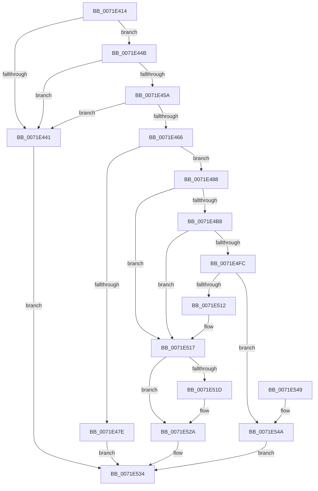

# IopSetFileMemoryPartitionInformation

- RVA: `0x0071E414`–`0x0071E54E` (길이 `314` bytes)
- VA: `0x000000014071E414`
- 실행 섹션: `PAGE`
- PDB 이름 있음: `예`; PDB Function 태그: `아니요`
- unwind 정보 RVA: `0x000C7558`
- 디코드: `89`개 명령, `314/314` bytes 표시
- 미해석 바이트: `0` (있으면 어셈블리에 `.byte`로 보존)

> 이 문서는 커널 이미지의 기계어와 PDB 기호를 분석해 생성했습니다. 4번과 5번은 함수 원형과 자료형을 바이너리 사용 방식에서 추정한 C 해석이며 원본 소스 복구 결과는 아닙니다.

## 1. Dependencies

- 직접 호출 지점: **8**; 고유 호출 대상: **8**
- 직접 호출자로 확인된 함수: **2**
- RIP 상대 이미지 참조: **0**

### Outgoing calls
- `0x0071E471` → [ExAllocatePool2](../../poolcode/B8/ExAllocatePool2_function_00B820F0.md) (function, `0x00B820F0`)
- `0x0071E4A5` → [PsReferencePartitionByHandle](../90/PsReferencePartitionByHandle_function_0090337C.md) (function, `0x0090337C`)
- `0x0071E4C0` → [ObfReferenceObjectWithTag](../../text/21/ObfReferenceObjectWithTag_function_00210710.md) (function, `0x00210710`)
- `0x0071E4CD` → [PsDereferencePartition](../../text/34/PsDereferencePartition_function_00342E70.md) (function, `0x00342E70`)
- `0x0071E4F1` → [IopAllocateFileObjectExtension](../../text/41/IopAllocateFileObjectExtension_function_00418FB0.md) (function, `0x00418FB0`)
- `0x0071E509` → [IopSetTypeSpecificFoExtension](../../text/45/IopSetTypeSpecificFoExtension_function_00452B50.md) (function, `0x00452B50`)
- `0x0071E525` → [ObfDereferenceObjectWithTag](../../text/2F/ObfDereferenceObjectWithTag_function_002F78E0.md) (function, `0x002F78E0`)
- `0x0071E52F` → [ExFreePoolWithTag](../../poolcode/B8/ExFreePoolWithTag_function_00B82870.md) (function, `0x00B82870`)

### Direct callers
- [sub_006DA8DA](../../text/6D/Unknown_function_006DA8DA.md) at `0x006DA9E4`
- [IoSetInformation](IoSetInformation_function_0071DBF0.md) at `0x0071DE71`

### Static image references
- 디코드된 RIP-relative 메모리 참조가 없습니다.

## 2. Other-region calls and transfers

- 다른 실행 섹션으로 향하는 call: **7**
  - `0x0071E471` → [ExAllocatePool2](../../poolcode/B8/ExAllocatePool2_function_00B820F0.md) (`PAGE` → `POOLCODE`)
  - `0x0071E4C0` → [ObfReferenceObjectWithTag](../../text/21/ObfReferenceObjectWithTag_function_00210710.md) (`PAGE` → `.text`)
  - `0x0071E4CD` → [PsDereferencePartition](../../text/34/PsDereferencePartition_function_00342E70.md) (`PAGE` → `.text`)
  - `0x0071E4F1` → [IopAllocateFileObjectExtension](../../text/41/IopAllocateFileObjectExtension_function_00418FB0.md) (`PAGE` → `.text`)
  - `0x0071E509` → [IopSetTypeSpecificFoExtension](../../text/45/IopSetTypeSpecificFoExtension_function_00452B50.md) (`PAGE` → `.text`)
  - `0x0071E525` → [ObfDereferenceObjectWithTag](../../text/2F/ObfDereferenceObjectWithTag_function_002F78E0.md) (`PAGE` → `.text`)
  - `0x0071E52F` → [ExFreePoolWithTag](../../poolcode/B8/ExFreePoolWithTag_function_00B82870.md) (`PAGE` → `POOLCODE`)
- 별도 외부 분기/꼬리 이동을 확인하지 못했습니다.

## 3. Assembly (complete function range)

```asm
0071E414  48 8B C4                        mov rax, rsp
0071E417  48 89 58 08                     mov qword ptr [rax + 8], rbx
0071E41B  48 89 68 10                     mov qword ptr [rax + 0x10], rbp
0071E41F  56                              push rsi
0071E420  57                              push rdi
0071E421  41 56                           push r14
0071E423  48 83 EC 50                     sub rsp, 0x50
0071E427  48 83 60 C8 00                  and qword ptr [rax - 0x38], 0
0071E42C  48 8B F2                        mov rsi, rdx
0071E42F  48 83 60 20 00                  and qword ptr [rax + 0x20], 0
0071E434  BA 10 00 00 00                  mov edx, 0x10
0071E439  4C 8B F1                        mov r14, rcx
0071E43C  44 3B C2                        cmp r8d, edx
0071E43F  73 0A                           jae 0x14071e44b
0071E441  BB 0D 00 00 C0                  mov ebx, 0xc000000d
0071E446  E9 E9 00 00 00                  jmp 0x14071e534
0071E44B  0F 10 06                        movups xmm0, xmmword ptr [rsi]
0071E44E  8B 46 08                        mov eax, dword ptr [rsi + 8]
0071E451  0F 11 44 24 38                  movups xmmword ptr [rsp + 0x38], xmm0
0071E456  3C 01                           cmp al, 1
0071E458  77 E7                           ja 0x14071e441
0071E45A  C6 44 24 40 00                  mov byte ptr [rsp + 0x40], 0
0071E45F  83 7C 24 40 00                  cmp dword ptr [rsp + 0x40], 0
0071E464  75 DB                           jne 0x14071e441
0071E466  B9 40 00 00 00                  mov ecx, 0x40
0071E46B  41 B8 49 6F 50 66               mov r8d, 0x66506f49
0071E471  E8 7A 3C 46 00                  call 0x140b820f0
0071E476  48 8B F8                        mov rdi, rax
0071E479  48 85 C0                        test rax, rax
0071E47C  75 0A                           jne 0x14071e488
0071E47E  BB 9A 00 00 C0                  mov ebx, 0xc000009a
0071E483  E9 AC 00 00 00                  jmp 0x14071e534
0071E488  48 8B 0E                        mov rcx, qword ptr [rsi]
0071E48B  48 8D 84 24 88 00 00 00         lea rax, [rsp + 0x88]
0071E493  45 33 C0                        xor r8d, r8d
0071E496  48 89 44 24 20                  mov qword ptr [rsp + 0x20], rax
0071E49B  41 B9 49 6F 50 66               mov r9d, 0x66506f49
0071E4A1  41 8D 50 02                     lea edx, [r8 + 2]
0071E4A5  E8 D2 4E 1E 00                  call 0x14090337c
0071E4AA  48 8B AC 24 88 00 00 00         mov rbp, qword ptr [rsp + 0x88]
0071E4B2  8B D8                           mov ebx, eax
0071E4B4  85 C0                           test eax, eax
0071E4B6  78 5F                           js 0x14071e517
0071E4B8  BA 49 6F 46 6F                  mov edx, 0x6f466f49
0071E4BD  48 8B CD                        mov rcx, rbp
0071E4C0  E8 4B 22 AF FF                  call 0x140210710
0071E4C5  BA 49 6F 50 66                  mov edx, 0x66506f49
0071E4CA  48 8B CD                        mov rcx, rbp
0071E4CD  E8 9E 49 C2 FF                  call 0x140342e70
0071E4D2  8B 47 08                        mov eax, dword ptr [rdi + 8]
0071E4D5  48 8D 54 24 30                  lea rdx, [rsp + 0x30]
0071E4DA  48 89 2F                        mov qword ptr [rdi], rbp
0071E4DD  45 33 C0                        xor r8d, r8d
0071E4E0  0F B6 4E 08                     movzx ecx, byte ptr [rsi + 8]
0071E4E4  33 C8                           xor ecx, eax
0071E4E6  83 E1 01                        and ecx, 1
0071E4E9  33 C8                           xor ecx, eax
0071E4EB  89 4F 08                        mov dword ptr [rdi + 8], ecx
0071E4EE  49 8B CE                        mov rcx, r14
0071E4F1  E8 BA AA CF FF                  call 0x140418fb0
0071E4F6  8B D8                           mov ebx, eax
0071E4F8  85 C0                           test eax, eax
0071E4FA  78 1B                           js 0x14071e517
0071E4FC  48 8B 4C 24 30                  mov rcx, qword ptr [rsp + 0x30]
0071E501  4C 8B C7                        mov r8, rdi
0071E504  BA 08 00 00 00                  mov edx, 8
0071E509  E8 42 46 D3 FF                  call 0x140452b50
0071E50E  85 C0                           test eax, eax
0071E510  79 38                           jns 0x14071e54a
0071E512  BB 21 00 00 C0                  mov ebx, 0xc0000021
0071E517  48 83 3F 00                     cmp qword ptr [rdi], 0
0071E51B  74 0D                           je 0x14071e52a
0071E51D  BA 49 6F 46 6F                  mov edx, 0x6f466f49
0071E522  48 8B CD                        mov rcx, rbp
0071E525  E8 B6 93 BD FF                  call 0x1402f78e0
0071E52A  33 D2                           xor edx, edx
0071E52C  48 8B CF                        mov rcx, rdi
0071E52F  E8 3C 43 46 00                  call 0x140b82870
0071E534  48 8B 6C 24 78                  mov rbp, qword ptr [rsp + 0x78]
0071E539  8B C3                           mov eax, ebx
0071E53B  48 8B 5C 24 70                  mov rbx, qword ptr [rsp + 0x70]
0071E540  48 83 C4 50                     add rsp, 0x50
0071E544  41 5E                           pop r14
0071E546  5F                              pop rdi
0071E547  5E                              pop rsi
0071E548  C3                              ret
0071E549  CC                              int3
0071E54A  33 DB                           xor ebx, ebx
0071E54C  EB E6                           jmp 0x14071e534
```

## 4. C-style interpretation (structured pseudocode)

```c
__int64 __fastcall IopSetFileMemoryPartitionInformation(__int64 a1, __int64 a2, int a3)
{
    __int64 result;
    __int64 v_rbx;
    __int64 v_rsp;
    unsigned __int8 v_stack_m28;
    unsigned __int64 v_stack_m30;
    unsigned __int64 v_stack_m38;
    unsigned __int64 v_stack_m48;
    unsigned __int64 v_stack_p10;
    unsigned __int64 v_stack_p20;
    unsigned __int64 v_stack_p8;

    *(unsigned __int64 *)(v_rsp + 8) = v_rbx;
    *(unsigned __int64 *)(v_rsp + 16) = v_rbp;
    v_rsp = (v_rsp) - (80);
    if (a3 >= 16) goto loc_0071E44B;
loc_0071E441:
    goto loc_0071E534;
loc_0071E44B:
    v_stack_m30 = v_xmm0;
    if (((unsigned __int8)((unsigned int)(*(unsigned int *)(a2 + 8)))) > 1) goto loc_0071E441;
    v_stack_m28 = 0;
    if (v_stack_m28 != 0) goto loc_0071E441;
    result = ExAllocatePool2(64, 16, (unsigned int)(0x66506F49ULL), a4);
    if (result != 0) goto loc_0071E488;
    goto loc_0071E534;
loc_0071E488:
    a3 = 0;
    v_stack_m48 = v_stack_p20;
    result = PsReferencePartitionByHandle(*(unsigned __int64 *)(a2), a3 + 2, a3, (unsigned int)(0x66506F49ULL));
    if (sign_flag) goto loc_0071E517;
    result = ObfReferenceObjectWithTag(v_stack_p20, (unsigned int)(0x6F466F49ULL), a3, (unsigned int)(0x66506F49ULL));
    result = PsDereferencePartition(v_stack_p20, (unsigned int)(0x66506F49ULL), a3, (unsigned int)(0x66506F49ULL));
    *(unsigned __int64 *)(result) = v_stack_p20;
    a3 = 0;
    a1 = (unsigned int)((*(unsigned __int8 *)(a2 + 8)) ^ ((unsigned int)((unsigned int)(*(unsigned int *)(result + 8)))));
    a1 = (unsigned int)((a1) & (1));
    a1 = (unsigned int)((a1) ^ ((unsigned int)((unsigned int)(*(unsigned int *)(result + 8)))));
    *(unsigned int *)(result + 8) = (unsigned int)(a1);
    result = IopAllocateFileObjectExtension(a1, v_stack_m38, a3, (unsigned int)(0x66506F49ULL));
    if (sign_flag) goto loc_0071E517;
    result = IopSetTypeSpecificFoExtension(v_stack_m38, 8, result, (unsigned int)(0x66506F49ULL));
    if (!sign_flag) goto loc_0071E54A;
loc_0071E517:
    if ((*(unsigned __int64 *)(result)) != 0) {
        a2 = 0x6F466F49ULL;
        a1 = v_stack_p20;
        result = ObfDereferenceObjectWithTag(a1, a2, result, (unsigned int)(0x66506F49ULL));
    }
    a2 = 0;
    result = ExFreePoolWithTag(result, a2, result, (unsigned int)(0x66506F49ULL));
loc_0071E534:
    v_rsp = (v_rsp) + (80);
    return (unsigned int)((unsigned int)((unsigned int)(0xC0000021ULL)));
loc_0071E54A:
    v_rbx = 0;
    goto loc_0071E534;
}
```

## 5. (Beta) C Style

```c
int64_t IopSetFileMemoryPartitionInformation(int64_t Arg1, void *Arg2, int32_t Arg3)
{
    uint8_t *arg2 = (uint8_t *)Arg2;

    int64_t result;
    int64_t local_rbx;
    int64_t local_rsp;
    uint8_t v_stack_m28;
    uint64_t v_stack_m30;
    uint64_t v_stack_m38;
    uint64_t v_stack_m48;
    uint64_t v_stack_p10;
    uint64_t v_stack_p20;
    uint64_t v_stack_p8;

    *(uint64_t *)(local_rsp + 0x8) = local_rbx;
    *(uint64_t *)(local_rsp + 0x10) = local_rbp;
    local_rsp = (local_rsp) - (80);
    if (Arg3 >= 16) goto loc_0071E44B;
loc_0071E441:
    goto loc_0071E534;
loc_0071E44B:
    v_stack_m30 = v_xmm0;
    if (((uint8_t)((uint32_t)(*(uint32_t *)(arg2 + 0x8)))) > 1) goto loc_0071E441;
    v_stack_m28 = 0;
    if (v_stack_m28 != 0) goto loc_0071E441;
    result = ExAllocatePool2(64, 16, (uint32_t)(0x66506F49ULL), a4);
    if (result != 0) goto loc_0071E488;
    goto loc_0071E534;
loc_0071E488:
    Arg3 = 0;
    v_stack_m48 = v_stack_p20;
    result = PsReferencePartitionByHandle(*(uint64_t *)(arg2), Arg3 + 2, Arg3, (uint32_t)(0x66506F49ULL));
    if (sign_flag) goto loc_0071E517;
    result = ObfReferenceObjectWithTag(v_stack_p20, (uint32_t)(0x6F466F49ULL), Arg3, (uint32_t)(0x66506F49ULL));
    result = PsDereferencePartition(v_stack_p20, (uint32_t)(0x66506F49ULL), Arg3, (uint32_t)(0x66506F49ULL));
    *(uint64_t *)(result) = v_stack_p20;
    Arg3 = 0;
    Arg1 = (uint32_t)((*(uint8_t *)(arg2 + 0x8)) ^ ((uint32_t)((uint32_t)(*(uint32_t *)(result + 0x8)))));
    Arg1 = (uint32_t)((Arg1) & (1));
    Arg1 = (uint32_t)((Arg1) ^ ((uint32_t)((uint32_t)(*(uint32_t *)(result + 0x8)))));
    *(uint32_t *)(result + 0x8) = (uint32_t)(Arg1);
    result = IopAllocateFileObjectExtension(Arg1, v_stack_m38, Arg3, (uint32_t)(0x66506F49ULL));
    if (sign_flag) goto loc_0071E517;
    result = IopSetTypeSpecificFoExtension(v_stack_m38, 8, result, (uint32_t)(0x66506F49ULL));
    if (!sign_flag) goto loc_0071E54A;
loc_0071E517:
    if ((*(uint64_t *)(result)) != 0) {
        Arg2 = 0x6F466F49ULL;
        Arg1 = v_stack_p20;
        result = ObfDereferenceObjectWithTag(Arg1, Arg2, result, (uint32_t)(0x66506F49ULL));
    }
    Arg2 = 0;
    result = ExFreePoolWithTag(result, Arg2, result, (uint32_t)(0x66506F49ULL));
loc_0071E534:
    local_rsp = (local_rsp) + (80);
    return (uint32_t)((uint32_t)((uint32_t)(0xC0000021ULL)));
loc_0071E54A:
    local_rbx = 0;
    goto loc_0071E534;
}
```

### 관측된 메모리 오프셋

구조체 형식이 확인되지 않은 접근은 인자 기준의 오프셋으로만 기록했습니다.

| 기준 인자 | 오프셋 표현 | 폭 (bit) | 접근 |
|---|---:|---:|---|
| `Arg2` | `+ 0x0` | `64` | `R` |
| `Arg2` | `+ 0x0` | `128` | `R` |
| `Arg2` | `+ 0x8` | `8` | `R` |
| `Arg2` | `+ 0x8` | `32` | `R` |

## 6. Execution-region graph

[열기: 2D/3D 그래프와 함수 탐색 컨트롤 패널](../../../control-panel.html?section=page&rva=0x0071E414&view=graph)

- 2D 그래프는 위에서 아래로 흐르고, 3D 그래프는 빈 공간을 드래그해 회전합니다. Shift+드래그는 이동, 휠은 확대·축소, 함수 노드 선택은 대상 보고서 이동입니다.

### Static fallback


