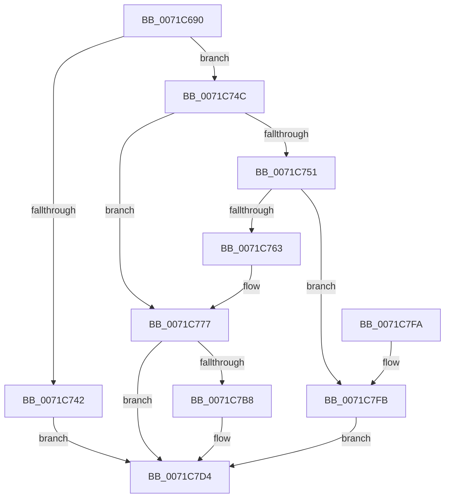

# IopSetRemoteLink

- RVA: `0x0071C690`–`0x0071C802` (길이 `370` bytes)
- VA: `0x000000014071C690`
- 실행 섹션: `PAGE`
- PDB 이름 있음: `예`; PDB Function 태그: `아니요`
- unwind 정보 RVA: `0x000C7430`
- 디코드: `95`개 명령, `370/370` bytes 표시
- 미해석 바이트: `0` (있으면 어셈블리에 `.byte`로 보존)

> 이 문서는 커널 이미지의 기계어와 PDB 기호를 분석해 생성했습니다. 4번과 5번은 함수 원형과 자료형을 바이너리 사용 방식에서 추정한 C 해석이며 원본 소스 복구 결과는 아닙니다.

## 1. Dependencies

- 직접 호출 지점: **9**; 고유 호출 대상: **9**
- 직접 호출자로 확인된 함수: **1**
- RIP 상대 이미지 참조: **1**

### Outgoing calls
- `0x0071C6CE` → [memset](../../text/6C/memset_function_006C6C40.md) (function, `0x006C6C40`)
- `0x0071C6F6` → [KeInitializeEvent](../../text/40/KeInitializeEvent_function_0040DD10.md) (function, `0x0040DD10`)
- `0x0071C6FE` → [IoGetRelatedDeviceObject](../../text/29/IoGetRelatedDeviceObject_function_0029B120.md) (function, `0x0029B120`)
- `0x0071C735` → [IoBuildDeviceIoControlRequest](../../text/20/IoBuildDeviceIoControlRequest_function_00204FD0.md) (function, `0x00204FD0`)
- `0x0071C76D` → [memcpy](../../text/6C/memcpy_function_006C6840.md) (function, `0x006C6840`)
- `0x0071C7A1` → [ObfReferenceObject](../../text/20/ObfReferenceObject_function_0020FA20.md) (function, `0x0020FA20`)
- `0x0071C7AC` → [IofCallDriver](../../text/29/IofCallDriver_function_0029B4B0.md) (function, `0x0029B4B0`)
- `0x0071C7CB` → [KeWaitForSingleObject](../../text/20/KeWaitForSingleObject_function_0020E6B0.md) (function, `0x0020E6B0`)
- `0x0071C7DE` → [_security_check_cookie](../../text/6A/_security_check_cookie_function_006AC640.md) (function, `0x006AC640`)

### Direct callers
- [IopTrackLink](../A3/IopTrackLink_function_00A36764.md) at `0x00A36F60`

### Static image references
- `0x0071C6AB` → RVA `0x00E0A740` (`.data`; read)

## 2. Other-region calls and transfers

- 다른 실행 섹션으로 향하는 call: **9**
  - `0x0071C6CE` → [memset](../../text/6C/memset_function_006C6C40.md) (`PAGE` → `.text`)
  - `0x0071C6F6` → [KeInitializeEvent](../../text/40/KeInitializeEvent_function_0040DD10.md) (`PAGE` → `.text`)
  - `0x0071C6FE` → [IoGetRelatedDeviceObject](../../text/29/IoGetRelatedDeviceObject_function_0029B120.md) (`PAGE` → `.text`)
  - `0x0071C735` → [IoBuildDeviceIoControlRequest](../../text/20/IoBuildDeviceIoControlRequest_function_00204FD0.md) (`PAGE` → `.text`)
  - `0x0071C76D` → [memcpy](../../text/6C/memcpy_function_006C6840.md) (`PAGE` → `.text`)
  - `0x0071C7A1` → [ObfReferenceObject](../../text/20/ObfReferenceObject_function_0020FA20.md) (`PAGE` → `.text`)
  - `0x0071C7AC` → [IofCallDriver](../../text/29/IofCallDriver_function_0029B4B0.md) (`PAGE` → `.text`)
  - `0x0071C7CB` → [KeWaitForSingleObject](../../text/20/KeWaitForSingleObject_function_0020E6B0.md) (`PAGE` → `.text`)
  - `0x0071C7DE` → [_security_check_cookie](../../text/6A/_security_check_cookie_function_006AC640.md) (`PAGE` → `.text`)
- 별도 외부 분기/꼬리 이동을 확인하지 못했습니다.

## 3. Assembly (complete function range)

```asm
0071C690  48 89 5C 24 10                  mov qword ptr [rsp + 0x10], rbx
0071C695  55                              push rbp
0071C696  56                              push rsi
0071C697  57                              push rdi
0071C698  41 56                           push r14
0071C69A  41 57                           push r15
0071C69C  48 8D AC 24 60 FF FF FF         lea rbp, [rsp - 0xa0]
0071C6A4  48 81 EC A0 01 00 00            sub rsp, 0x1a0
0071C6AB  48 8B 05 8E E0 6E 00            mov rax, qword ptr [rip + 0x6ee08e]
0071C6B2  48 33 C4                        xor rax, rsp
0071C6B5  48 89 85 90 00 00 00            mov qword ptr [rbp + 0x90], rax
0071C6BC  49 8B F0                        mov rsi, r8
0071C6BF  4C 8B F1                        mov r14, rcx
0071C6C2  41 B8 10 01 00 00               mov r8d, 0x110
0071C6C8  48 8D 4D 80                     lea rcx, [rbp - 0x80]
0071C6CC  33 D2                           xor edx, edx
0071C6CE  E8 6D A5 FA FF                  call 0x1406c6c40
0071C6D3  0F 57 C0                        xorps xmm0, xmm0
0071C6D6  48 8D 4C 24 50                  lea rcx, [rsp + 0x50]
0071C6DB  0F 57 C9                        xorps xmm1, xmm1
0071C6DE  33 C0                           xor eax, eax
0071C6E0  45 33 C0                        xor r8d, r8d
0071C6E3  48 89 44 24 60                  mov qword ptr [rsp + 0x60], rax
0071C6E8  33 D2                           xor edx, edx
0071C6EA  33 DB                           xor ebx, ebx
0071C6EC  0F 11 44 24 68                  movups xmmword ptr [rsp + 0x68], xmm0
0071C6F1  0F 11 4C 24 50                  movups xmmword ptr [rsp + 0x50], xmm1
0071C6F6  E8 15 16 CF FF                  call 0x14040dd10
0071C6FB  49 8B CE                        mov rcx, r14
0071C6FE  E8 1D EA B7 FF                  call 0x14029b120
0071C703  4C 8B F8                        mov r15, rax
0071C706  45 33 C9                        xor r9d, r9d
0071C709  48 8D 44 24 68                  lea rax, [rsp + 0x68]
0071C70E  45 33 C0                        xor r8d, r8d
0071C711  48 89 44 24 40                  mov qword ptr [rsp + 0x40], rax
0071C716  49 8B D7                        mov rdx, r15
0071C719  48 8D 44 24 50                  lea rax, [rsp + 0x50]
0071C71E  B9 EC 00 14 00                  mov ecx, 0x1400ec
0071C723  48 89 44 24 38                  mov qword ptr [rsp + 0x38], rax
0071C728  88 5C 24 30                     mov byte ptr [rsp + 0x30], bl
0071C72C  21 5C 24 28                     and dword ptr [rsp + 0x28], ebx
0071C730  48 21 5C 24 20                  and qword ptr [rsp + 0x20], rbx
0071C735  E8 96 88 AE FF                  call 0x140204fd0
0071C73A  48 8B F8                        mov rdi, rax
0071C73D  48 85 C0                        test rax, rax
0071C740  75 0A                           jne 0x14071c74c
0071C742  B8 9A 00 00 C0                  mov eax, 0xc000009a
0071C747  E9 88 00 00 00                  jmp 0x14071c7d4
0071C74C  48 85 F6                        test rsi, rsi
0071C74F  74 26                           je 0x14071c777
0071C751  8B 5E 08                        mov ebx, dword ptr [rsi + 8]
0071C754  83 C3 0C                        add ebx, 0xc
0071C757  81 FB 10 01 00 00               cmp ebx, 0x110
0071C75D  0F 87 98 00 00 00               ja 0x14071c7fb
0071C763  44 8B C3                        mov r8d, ebx
0071C766  48 8D 4D 80                     lea rcx, [rbp - 0x80]
0071C76A  48 8B D6                        mov rdx, rsi
0071C76D  E8 CE A0 FA FF                  call 0x1406c6840
0071C772  48 83 65 80 00                  and qword ptr [rbp - 0x80], 0
0071C777  83 4F 10 04                     or dword ptr [rdi + 0x10], 4
0071C77B  48 8D 45 80                     lea rax, [rbp - 0x80]
0071C77F  48 89 47 18                     mov qword ptr [rdi + 0x18], rax
0071C783  49 8B CE                        mov rcx, r14
0071C786  48 8B 87 B8 00 00 00            mov rax, qword ptr [rdi + 0xb8]
0071C78D  4C 89 B7 C0 00 00 00            mov qword ptr [rdi + 0xc0], r14
0071C794  4C 89 70 E8                     mov qword ptr [rax - 0x18], r14
0071C798  66 C7 40 B8 0D 04               mov word ptr [rax - 0x48], 0x40d
0071C79E  89 58 C8                        mov dword ptr [rax - 0x38], ebx
0071C7A1  E8 7A 32 AF FF                  call 0x14020fa20
0071C7A6  48 8B D7                        mov rdx, rdi
0071C7A9  49 8B CF                        mov rcx, r15
0071C7AC  E8 FF EC B7 FF                  call 0x14029b4b0
0071C7B1  3D 03 01 00 00                  cmp eax, 0x103
0071C7B6  75 1C                           jne 0x14071c7d4
0071C7B8  48 83 64 24 20 00               and qword ptr [rsp + 0x20], 0
0071C7BE  48 8D 4C 24 50                  lea rcx, [rsp + 0x50]
0071C7C3  45 33 C9                        xor r9d, r9d
0071C7C6  45 33 C0                        xor r8d, r8d
0071C7C9  33 D2                           xor edx, edx
0071C7CB  E8 E0 1E AF FF                  call 0x14020e6b0
0071C7D0  8B 44 24 68                     mov eax, dword ptr [rsp + 0x68]
0071C7D4  48 8B 8D 90 00 00 00            mov rcx, qword ptr [rbp + 0x90]
0071C7DB  48 33 CC                        xor rcx, rsp
0071C7DE  E8 5D FE F8 FF                  call 0x1406ac640
0071C7E3  48 8B 9C 24 D8 01 00 00         mov rbx, qword ptr [rsp + 0x1d8]
0071C7EB  48 81 C4 A0 01 00 00            add rsp, 0x1a0
0071C7F2  41 5F                           pop r15
0071C7F4  41 5E                           pop r14
0071C7F6  5F                              pop rdi
0071C7F7  5E                              pop rsi
0071C7F8  5D                              pop rbp
0071C7F9  C3                              ret
0071C7FA  CC                              int3
0071C7FB  B8 23 00 00 C0                  mov eax, 0xc0000023
0071C800  EB D2                           jmp 0x14071c7d4
```

## 4. C-style interpretation (structured pseudocode)

```c
__int64 __fastcall IopSetRemoteLink(__int64 a1, int a2, __int64 a3, int a4)
{
    __int64 result;
    __int64 v_rbx;
    __int64 v_rsp;
    unsigned __int64 v_stack_m148;
    unsigned __int64 v_stack_m160;
    unsigned __int64 v_stack_m168;
    unsigned __int64 v_stack_m178;
    unsigned __int64 v_stack_m188;
    unsigned __int64 v_stack_m190;
    unsigned __int8 v_stack_m198;
    unsigned int v_stack_m1A0;
    unsigned __int64 v_stack_m1A8;
    unsigned __int64 v_stack_m38;
    unsigned __int64 v_stack_mC8;
    unsigned __int64 v_stack_p10;

    v_stack_p10 = v_rbx;
    v_rsp = (v_rsp) - (416);
    result = (*(unsigned __int64 *)(v_rip + 7266446)) ^ (v_rsp);
    v_stack_m38 = result;
    a2 = 0;
    result = memset(v_stack_m148, a2, 272, a4);
    result = 0;
    a3 = 0;
    v_stack_m168 = 0;
    a2 = 0;
    v_rbx = 0;
    v_stack_m160 = v_xmm0;
    v_stack_m178 = v_xmm1;
    result = KeInitializeEvent(v_stack_m178, a2, a3, a4);
    result = IoGetRelatedDeviceObject(a1, a2, a3, a4);
    a4 = 0;
    a3 = 0;
    v_stack_m188 = v_stack_m160;
    v_stack_m190 = v_stack_m178;
    v_stack_m198 = 0;
    result = IoBuildDeviceIoControlRequest((unsigned int)(0x1400ECULL), result, a3, a4);
    if (result != 0) goto loc_0071C74C;
    goto loc_0071C7D4;
loc_0071C74C:
    if (0 == 0) goto loc_0071C777;
    v_rbx = (unsigned int)(((unsigned int)(*(unsigned int *)(a3 + 8))) + (12));
    if (((unsigned int)(v_rbx)) > 272) goto loc_0071C7FB;
    result = memcpy(v_stack_m148, 0, (unsigned int)((unsigned int)(v_rbx)), a4);
loc_0071C777:
    *(unsigned __int64 *)(result + 24) = v_stack_m148;
    *(unsigned __int64 *)(result + 192) = a1;
    *(unsigned __int64 *)(*(unsigned __int64 *)(result + 184) - 24) = a1;
    *(unsigned __int16 *)(*(unsigned __int64 *)(result + 184) - 72) = 0x40DULL;
    *(unsigned int *)(*(unsigned __int64 *)(result + 184) - 56) = (unsigned int)(v_rbx);
    result = ObfReferenceObject(a1, 0, (unsigned int)((unsigned int)(v_rbx)), a4);
    result = IofCallDriver(result, result, (unsigned int)((unsigned int)(v_rbx)), a4);
    if (((unsigned int)(result)) == 259) {
        a1 = v_stack_m178;
        a4 = 0;
        a3 = 0;
        a2 = 0;
        result = KeWaitForSingleObject(a1, a2, a3, a4);
        result = v_stack_m160;
    }
    a1 = (v_stack_m38) ^ (v_rsp);
    result = _security_check_cookie(a1, a2, a3, a4);
    v_rsp = (v_rsp) + (416);
    return result;
loc_0071C7FB:
    goto loc_0071C7D4;
}
```

## 5. (Beta) C Style

```c
int64_t IopSetRemoteLink(int64_t Arg1, int32_t Arg2, int64_t Arg3, int32_t Arg4)
{
    int64_t result;
    int64_t local_rbx;
    int64_t local_rsp;
    uint64_t v_stack_m148;
    uint64_t v_stack_m160;
    uint64_t v_stack_m168;
    uint64_t v_stack_m178;
    uint64_t v_stack_m188;
    uint64_t v_stack_m190;
    uint8_t v_stack_m198;
    uint32_t v_stack_m1A0;
    uint64_t v_stack_m1A8;
    uint64_t v_stack_m38;
    uint64_t v_stack_mC8;
    uint64_t v_stack_p10;

    v_stack_p10 = local_rbx;
    local_rsp = (local_rsp) - (416);
    result = (*(uint64_t *)(v_rip + 0x6EE08E)) ^ (local_rsp);
    v_stack_m38 = result;
    Arg2 = 0;
    result = memset(v_stack_m148, Arg2, 272, Arg4);
    result = 0;
    Arg3 = 0;
    v_stack_m168 = 0;
    Arg2 = 0;
    local_rbx = 0;
    v_stack_m160 = v_xmm0;
    v_stack_m178 = v_xmm1;
    result = KeInitializeEvent(v_stack_m178, Arg2, Arg3, Arg4);
    result = IoGetRelatedDeviceObject(Arg1, Arg2, Arg3, Arg4);
    Arg4 = 0;
    Arg3 = 0;
    v_stack_m188 = v_stack_m160;
    v_stack_m190 = v_stack_m178;
    v_stack_m198 = 0;
    result = IoBuildDeviceIoControlRequest((uint32_t)(0x1400ECULL), result, Arg3, Arg4);
    if (result != 0) goto loc_0071C74C;
    goto loc_0071C7D4;
loc_0071C74C:
    if (0 == 0) goto loc_0071C777;
    local_rbx = (uint32_t)(((uint32_t)(*(uint32_t *)(Arg3 + 0x8))) + (12));
    if (((uint32_t)(local_rbx)) > 272) goto loc_0071C7FB;
    result = memcpy(v_stack_m148, 0, (uint32_t)((uint32_t)(local_rbx)), Arg4);
loc_0071C777:
    *(uint64_t *)(result + 0x18) = v_stack_m148;
    *(uint64_t *)(result + 0xC0) = Arg1;
    *(uint64_t *)(*(uint64_t *)(result + 0xB8) - 0x18) = Arg1;
    *(uint16_t *)(*(uint64_t *)(result + 0xB8) - 0x48) = 0x40DULL;
    *(uint32_t *)(*(uint64_t *)(result + 0xB8) - 0x38) = (uint32_t)(local_rbx);
    result = ObfReferenceObject(Arg1, 0, (uint32_t)((uint32_t)(local_rbx)), Arg4);
    result = IofCallDriver(result, result, (uint32_t)((uint32_t)(local_rbx)), Arg4);
    if (((uint32_t)(result)) == 259) {
        Arg1 = v_stack_m178;
        Arg4 = 0;
        Arg3 = 0;
        Arg2 = 0;
        result = KeWaitForSingleObject(Arg1, Arg2, Arg3, Arg4);
        result = v_stack_m160;
    }
    Arg1 = (v_stack_m38) ^ (local_rsp);
    result = _security_check_cookie(Arg1, Arg2, Arg3, Arg4);
    local_rsp = (local_rsp) + (416);
    return result;
loc_0071C7FB:
    goto loc_0071C7D4;
}
```

## 6. Execution-region graph

[열기: 2D/3D 그래프와 함수 탐색 컨트롤 패널](../../../control-panel.html?section=page&rva=0x0071C690&view=graph)

- 2D 그래프는 위에서 아래로 흐르고, 3D 그래프는 빈 공간을 드래그해 회전합니다. Shift+드래그는 이동, 휠은 확대·축소, 함수 노드 선택은 대상 보고서 이동입니다.

### Static fallback


