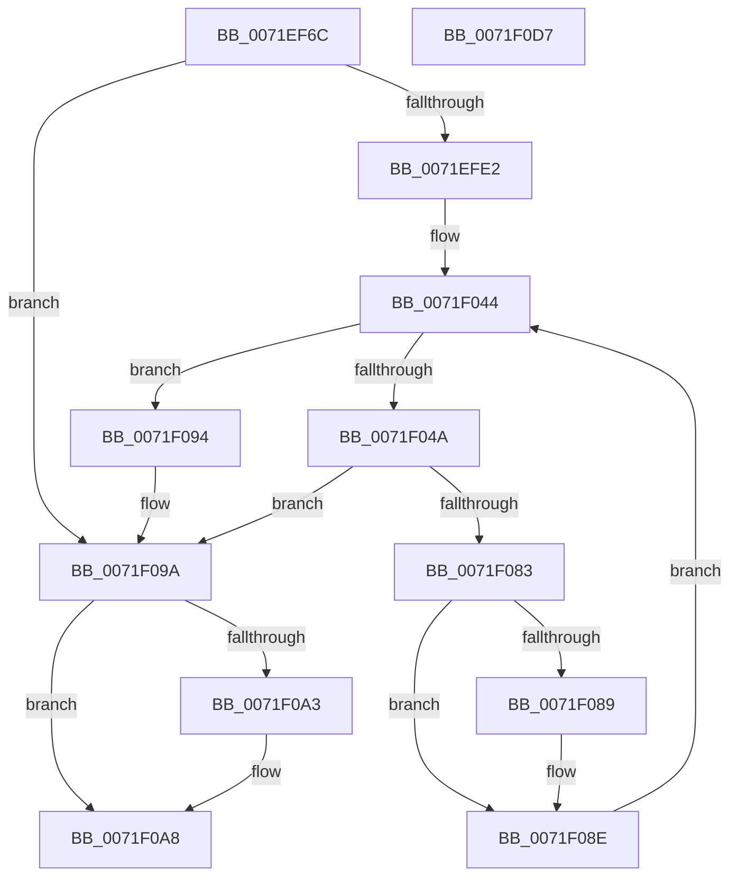

# IopSymlinkQueryEnabledClasses

- RVA: `0x0071EF6C`–`0x0071F0D8` (길이 `364` bytes)
- VA: `0x000000014071EF6C`
- 실행 섹션: `PAGE`
- PDB 이름 있음: `예`; PDB Function 태그: `아니요`
- unwind 정보 RVA: `0x000C76BC`
- 디코드: `93`개 명령, `364/364` bytes 표시
- 미해석 바이트: `0` (있으면 어셈블리에 `.byte`로 보존)

> 이 문서는 커널 이미지의 기계어와 PDB 기호를 분석해 생성했습니다. 4번과 5번은 함수 원형과 자료형을 바이너리 사용 방식에서 추정한 C 해석이며 원본 소스 복구 결과는 아닙니다.

## 1. Dependencies

- 직접 호출 지점: **9**; 고유 호출 대상: **5**
- 직접 호출자로 확인된 함수: **1**
- RIP 상대 이미지 참조: **6**

### Outgoing calls
- `0x0071EFB9` → [RtlInitUnicodeString](../../text/42/RtlInitUnicodeString_function_0042A780.md) (function, `0x0042A780`)
- `0x0071EFD3` → [IopOpenRegistryKey](../A8/IopOpenRegistryKey_function_00A8F200.md) (function, `0x00A8F200`)
- `0x0071EFED` → [RtlInitUnicodeString](../../text/42/RtlInitUnicodeString_function_0042A780.md) (function, `0x0042A780`)
- `0x0071F005` → [RtlInitUnicodeString](../../text/42/RtlInitUnicodeString_function_0042A780.md) (function, `0x0042A780`)
- `0x0071F01C` → [RtlInitUnicodeString](../../text/42/RtlInitUnicodeString_function_0042A780.md) (function, `0x0042A780`)
- `0x0071F033` → [RtlInitUnicodeString](../../text/42/RtlInitUnicodeString_function_0042A780.md) (function, `0x0042A780`)
- `0x0071F078` → [ZwQueryValueKey](../../text/6A/ZwQueryValueKey_function_006AD3B0.md) (function, `0x006AD3B0`)
- `0x0071F0A3` → [ZwClose](../../text/6A/ZwClose_function_006AD2B0.md) (function, `0x006AD2B0`)
- `0x0071F0B1` → [_security_check_cookie](../../text/6A/_security_check_cookie_function_006AC640.md) (function, `0x006AC640`)

### Direct callers
- [IopSymlinkRegistryCallback](IopSymlinkRegistryCallback_function_0071F0E0.md) at `0x0071F0EB`
- [IopSymlinkRegistryCallback](IopSymlinkRegistryCallback_function_0071F0E0.md) at `0x0071F0FB`

### Static image references
- `0x0071EF8F` → RVA `0x00E0A740` (`.data`; read)
- `0x0071EFE2` → RVA `0x00AFCDD0` (` ?? ::NNGAKEGL::`string'`; read)
- `0x0071EFF6` → RVA `0x00AFCE10` (` ?? ::NNGAKEGL::`string'`; read)
- `0x0071F00A` → RVA `0x00AFCE50` (` ?? ::NNGAKEGL::`string'`; read)
- `0x0071F021` → RVA `0x00AFCE90` (` ?? ::NNGAKEGL::`string'`; read)
- `0x0071F094` → RVA `0x00E66130` (`.data`; read/write)

## 2. Other-region calls and transfers

- 다른 실행 섹션으로 향하는 call: **8**
  - `0x0071EFB9` → [RtlInitUnicodeString](../../text/42/RtlInitUnicodeString_function_0042A780.md) (`PAGE` → `.text`)
  - `0x0071EFED` → [RtlInitUnicodeString](../../text/42/RtlInitUnicodeString_function_0042A780.md) (`PAGE` → `.text`)
  - `0x0071F005` → [RtlInitUnicodeString](../../text/42/RtlInitUnicodeString_function_0042A780.md) (`PAGE` → `.text`)
  - `0x0071F01C` → [RtlInitUnicodeString](../../text/42/RtlInitUnicodeString_function_0042A780.md) (`PAGE` → `.text`)
  - `0x0071F033` → [RtlInitUnicodeString](../../text/42/RtlInitUnicodeString_function_0042A780.md) (`PAGE` → `.text`)
  - `0x0071F078` → [ZwQueryValueKey](../../text/6A/ZwQueryValueKey_function_006AD3B0.md) (`PAGE` → `.text`)
  - `0x0071F0A3` → [ZwClose](../../text/6A/ZwClose_function_006AD2B0.md) (`PAGE` → `.text`)
  - `0x0071F0B1` → [_security_check_cookie](../../text/6A/_security_check_cookie_function_006AC640.md) (`PAGE` → `.text`)
- 별도 외부 분기/꼬리 이동을 확인하지 못했습니다.

## 3. Assembly (complete function range)

```asm
0071EF6C  48 8B C4                        mov rax, rsp
0071EF6F  48 89 58 10                     mov qword ptr [rax + 0x10], rbx
0071EF73  48 89 70 18                     mov qword ptr [rax + 0x18], rsi
0071EF77  48 89 78 20                     mov qword ptr [rax + 0x20], rdi
0071EF7B  55                              push rbp
0071EF7C  41 54                           push r12
0071EF7E  41 55                           push r13
0071EF80  41 56                           push r14
0071EF82  41 57                           push r15
0071EF84  48 8D 68 A1                     lea rbp, [rax - 0x5f]
0071EF88  48 81 EC D0 00 00 00            sub rsp, 0xd0
0071EF8F  48 8B 05 AA B7 6E 00            mov rax, qword ptr [rip + 0x6eb7aa]
0071EF96  48 33 C4                        xor rax, rsp
0071EF99  48 89 45 2F                     mov qword ptr [rbp + 0x2f], rax
0071EF9D  45 33 FF                        xor r15d, r15d
0071EFA0  0F 57 C0                        xorps xmm0, xmm0
0071EFA3  48 8B D1                        mov rdx, rcx
0071EFA6  4C 89 7D 9F                     mov qword ptr [rbp - 0x61], r15
0071EFAA  48 8D 4D A7                     lea rcx, [rbp - 0x59]
0071EFAE  44 89 7D 97                     mov dword ptr [rbp - 0x69], r15d
0071EFB2  0F 11 45 A7                     movups xmmword ptr [rbp - 0x59], xmm0
0071EFB6  41 8B DF                        mov ebx, r15d
0071EFB9  E8 C2 B7 D0 FF                  call 0x14042a780
0071EFBE  41 B9 19 00 02 00               mov r9d, 0x20019
0071EFC4  44 88 7C 24 20                  mov byte ptr [rsp + 0x20], r15b
0071EFC9  4C 8D 45 A7                     lea r8, [rbp - 0x59]
0071EFCD  33 D2                           xor edx, edx
0071EFCF  48 8D 4D 9F                     lea rcx, [rbp - 0x61]
0071EFD3  E8 28 02 37 00                  call 0x140a8f200
0071EFD8  8B F0                           mov esi, eax
0071EFDA  85 C0                           test eax, eax
0071EFDC  0F 88 B8 00 00 00               js 0x14071f09a
0071EFE2  48 8D 15 E7 DD 3D 00            lea rdx, [rip + 0x3ddde7]
0071EFE9  48 8D 4D B7                     lea rcx, [rbp - 0x49]
0071EFED  E8 8E B7 D0 FF                  call 0x14042a780
0071EFF2  45 8D 67 01                     lea r12d, [r15 + 1]
0071EFF6  48 8D 15 13 DE 3D 00            lea rdx, [rip + 0x3dde13]
0071EFFD  44 89 65 C7                     mov dword ptr [rbp - 0x39], r12d
0071F001  48 8D 4D CF                     lea rcx, [rbp - 0x31]
0071F005  E8 76 B7 D0 FF                  call 0x14042a780
0071F00A  48 8D 15 3F DE 3D 00            lea rdx, [rip + 0x3dde3f]
0071F011  C7 45 DF 02 00 00 00            mov dword ptr [rbp - 0x21], 2
0071F018  48 8D 4D E7                     lea rcx, [rbp - 0x19]
0071F01C  E8 5F B7 D0 FF                  call 0x14042a780
0071F021  48 8D 15 68 DE 3D 00            lea rdx, [rip + 0x3dde68]
0071F028  C7 45 F7 08 00 00 00            mov dword ptr [rbp - 9], 8
0071F02F  48 8D 4D FF                     lea rcx, [rbp - 1]
0071F033  E8 48 B7 D0 FF                  call 0x14042a780
0071F038  45 8D 6F 04                     lea r13d, [r15 + 4]
0071F03C  41 0F B7 FF                     movzx edi, r15w
0071F040  44 89 6D 0F                     mov dword ptr [rbp + 0xf], r13d
0071F044  66 41 3B FD                     cmp di, r13w
0071F048  73 4A                           jae 0x14071f094
0071F04A  48 8B 4D 9F                     mov rcx, qword ptr [rbp - 0x61]
0071F04E  48 8D 55 B7                     lea rdx, [rbp - 0x49]
0071F052  0F B7 C7                        movzx eax, di
0071F055  4C 8D 4D 17                     lea r9, [rbp + 0x17]
0071F059  41 B8 02 00 00 00               mov r8d, 2
0071F05F  4C 8D 34 40                     lea r14, [rax + rax*2]
0071F063  48 8D 45 97                     lea rax, [rbp - 0x69]
0071F067  48 89 44 24 28                  mov qword ptr [rsp + 0x28], rax
0071F06C  4A 8D 14 F2                     lea rdx, [rdx + r14*8]
0071F070  C7 44 24 20 14 00 00 00         mov dword ptr [rsp + 0x20], 0x14
0071F078  E8 33 E3 F8 FF                  call 0x1406ad3b0
0071F07D  8B F0                           mov esi, eax
0071F07F  85 C0                           test eax, eax
0071F081  78 17                           js 0x14071f09a
0071F083  44 39 7D 23                     cmp dword ptr [rbp + 0x23], r15d
0071F087  74 05                           je 0x14071f08e
0071F089  42 03 5C F5 C7                  add ebx, dword ptr [rbp + r14*8 - 0x39]
0071F08E  66 41 03 FC                     add di, r12w
0071F092  EB B0                           jmp 0x14071f044
0071F094  87 1D 96 70 74 00               xchg dword ptr [rip + 0x747096], ebx
0071F09A  48 8B 4D 9F                     mov rcx, qword ptr [rbp - 0x61]
0071F09E  48 85 C9                        test rcx, rcx
0071F0A1  74 05                           je 0x14071f0a8
0071F0A3  E8 08 E2 F8 FF                  call 0x1406ad2b0
0071F0A8  8B C6                           mov eax, esi
0071F0AA  48 8B 4D 2F                     mov rcx, qword ptr [rbp + 0x2f]
0071F0AE  48 33 CC                        xor rcx, rsp
0071F0B1  E8 8A D5 F8 FF                  call 0x1406ac640
0071F0B6  4C 8D 9C 24 D0 00 00 00         lea r11, [rsp + 0xd0]
0071F0BE  49 8B 5B 38                     mov rbx, qword ptr [r11 + 0x38]
0071F0C2  49 8B 73 40                     mov rsi, qword ptr [r11 + 0x40]
0071F0C6  49 8B 7B 48                     mov rdi, qword ptr [r11 + 0x48]
0071F0CA  49 8B E3                        mov rsp, r11
0071F0CD  41 5F                           pop r15
0071F0CF  41 5E                           pop r14
0071F0D1  41 5D                           pop r13
0071F0D3  41 5C                           pop r12
0071F0D5  5D                              pop rbp
0071F0D6  C3                              ret
0071F0D7  CC                              int3
```

## 4. C-style interpretation (structured pseudocode)

```c
__int64 __fastcall IopSymlinkQueryEnabledClasses(__int64 a1)
{
    __int64 result;
    __int64 v_r15;
    __int64 v_rbx;
    __int64 v_rdi;
    __int64 v_rsp;
    unsigned __int64 v_stack_m28;
    unsigned __int64 v_stack_mD0;
    unsigned __int8 v_stack_mD8;

    *(unsigned __int64 *)(v_rsp + 16) = v_rbx;
    *(unsigned __int64 *)(v_rsp + 24) = v_rsi;
    *(unsigned __int64 *)(v_rsp + 32) = v_rdi;
    v_rsp = (v_rsp) - (208);
    result = (*(unsigned __int64 *)(v_rip + 7255978)) ^ (v_rsp);
    *(unsigned __int64 *)(v_rsp - 95 + 47) = result;
    v_r15 = 0;
    *(unsigned __int64 *)(v_rsp - 95 - 97) = 0;
    *(unsigned int *)(v_rsp - 95 - 105) = 0;
    *(unsigned __int64 *)(v_rsp - 95 - 89) = v_xmm0;
    result = RtlInitUnicodeString(v_rsp - 95 - 89, a1, a3, a4);
    v_stack_mD8 = 0;
    a2 = 0;
    result = IopOpenRegistryKey(v_rsp - 95 - 97, a2, v_rsp - 95 - 89, (unsigned int)(0x20019ULL));
    if (sign_flag) goto loc_0071F09A;
    result = RtlInitUnicodeString(v_rsp - 95 - 73, v_rip + 4054503, v_rsp - 95 - 89, (unsigned int)(0x20019ULL));
    *(unsigned int *)(v_rsp - 95 - 57) = (unsigned int)(v_r15 + 1);
    result = RtlInitUnicodeString(v_rsp - 95 - 49, v_rip + 4054547, v_rsp - 95 - 89, (unsigned int)(0x20019ULL));
    *(unsigned int *)(v_rsp - 95 - 33) = 2;
    result = RtlInitUnicodeString(v_rsp - 95 - 25, v_rip + 4054591, v_rsp - 95 - 89, (unsigned int)(0x20019ULL));
    *(unsigned int *)(v_rsp - 95 - 9) = 8;
    result = RtlInitUnicodeString(v_rsp - 95 - 1, v_rip + 4054632, v_rsp - 95 - 89, (unsigned int)(0x20019ULL));
    *(unsigned int *)(v_rsp - 95 + 15) = (unsigned int)(v_r15 + 4);
loc_0071F044:
    if (0 >= ((unsigned __int16)(v_r15 + 4))) goto loc_0071F094;
    v_stack_mD0 = v_rsp - 95 - 105;
    v_stack_mD8 = 20;
    result = ZwQueryValueKey(*(unsigned __int64 *)(v_rsp - 95 - 97), v_rsp - 95 - 73 + 0 + 0 * 2 * 8, 2, v_rsp - 95 + 23);
    if (sign_flag) goto loc_0071F09A;
    v_rbx = 0;
    if ((*(unsigned int *)(v_rsp - 95 + 35)) != 0) {
        v_rbx = (unsigned int)((0) + (*(unsigned int *)(v_rsp - 95 + 0 + 0 * 2 * 8 - 57)));
    }
    v_rdi = (unsigned __int16)((0) + ((unsigned __int16)(v_r15 + 1)));
    goto loc_0071F044;
loc_0071F094:
loc_0071F09A:
    if (*(unsigned __int64 *)(v_rsp - 95 - 97) != 0) {
        result = ZwClose(*(unsigned __int64 *)(v_rsp - 95 - 97), v_rsp - 95 - 73 + 0 + 0 * 2 * 8, 2, v_rsp - 95 + 23);
    }
    a1 = (*(unsigned __int64 *)(v_rsp - 95 + 47)) ^ (v_rsp);
    result = _security_check_cookie(a1, v_rsp - 95 - 73 + 0 + 0 * 2 * 8, 2, v_rsp - 95 + 23);
    return result;
}
```

## 5. (Beta) C Style

```c
int64_t IopSymlinkQueryEnabledClasses(int64_t Arg1)
{
    int64_t result;
    int64_t local_r15;
    int64_t local_rbx;
    int64_t local_rdi;
    int64_t local_rsp;
    uint64_t v_stack_m28;
    uint64_t v_stack_mD0;
    uint8_t v_stack_mD8;

    *(uint64_t *)(local_rsp + 0x10) = local_rbx;
    *(uint64_t *)(local_rsp + 0x18) = local_rsi;
    *(uint64_t *)(local_rsp + 0x20) = local_rdi;
    local_rsp = (local_rsp) - (208);
    result = (*(uint64_t *)(v_rip + 0x6EB7AA)) ^ (local_rsp);
    *(uint64_t *)(local_rsp - 0x5F + 0x2F) = result;
    local_r15 = 0;
    *(uint64_t *)(local_rsp - 0x5F - 0x61) = 0;
    *(uint32_t *)(local_rsp - 0x5F - 0x69) = 0;
    *(uint64_t *)(local_rsp - 0x5F - 0x59) = v_xmm0;
    result = RtlInitUnicodeString(local_rsp - 95 - 89, Arg1, a3, a4);
    v_stack_mD8 = 0;
    a2 = 0;
    result = IopOpenRegistryKey(local_rsp - 95 - 97, a2, local_rsp - 95 - 89, (uint32_t)(0x20019ULL));
    if (sign_flag) goto loc_0071F09A;
    result = RtlInitUnicodeString(local_rsp - 95 - 73, v_rip + 4054503, local_rsp - 95 - 89, (uint32_t)(0x20019ULL));
    *(uint32_t *)(local_rsp - 0x5F - 0x39) = (uint32_t)(local_r15 + 1);
    result = RtlInitUnicodeString(local_rsp - 95 - 49, v_rip + 4054547, local_rsp - 95 - 89, (uint32_t)(0x20019ULL));
    *(uint32_t *)(local_rsp - 0x5F - 0x21) = 2;
    result = RtlInitUnicodeString(local_rsp - 95 - 25, v_rip + 4054591, local_rsp - 95 - 89, (uint32_t)(0x20019ULL));
    *(uint32_t *)(local_rsp - 0x5F - 0x9) = 8;
    result = RtlInitUnicodeString(local_rsp - 95 - 1, v_rip + 4054632, local_rsp - 95 - 89, (uint32_t)(0x20019ULL));
    *(uint32_t *)(local_rsp - 0x5F + 0xF) = (uint32_t)(local_r15 + 4);
loc_0071F044:
    if (0 >= ((uint16_t)(local_r15 + 4))) goto loc_0071F094;
    v_stack_mD0 = local_rsp - 95 - 105;
    v_stack_mD8 = 20;
    result = ZwQueryValueKey(*(uint64_t *)(local_rsp - 0x5F - 0x61), local_rsp - 95 - 73 + 0 + 0 * 2 * 8, 2, local_rsp - 95 + 23);
    if (sign_flag) goto loc_0071F09A;
    local_rbx = 0;
    if ((*(uint32_t *)(local_rsp - 0x5F + 0x23)) != 0) {
        local_rbx = (uint32_t)((0) + (*(uint32_t *)(local_rsp - 0x5F + 0x0 + 0x0 * 2 * 8 - 0x39)));
    }
    local_rdi = (uint16_t)((0) + ((uint16_t)(local_r15 + 1)));
    goto loc_0071F044;
loc_0071F094:
loc_0071F09A:
    if (*(uint64_t *)(local_rsp - 0x5F - 0x61) != 0) {
        result = ZwClose(*(uint64_t *)(local_rsp - 0x5F - 0x61), local_rsp - 95 - 73 + 0 + 0 * 2 * 8, 2, local_rsp - 95 + 23);
    }
    Arg1 = (*(uint64_t *)(local_rsp - 0x5F + 0x2F)) ^ (local_rsp);
    result = _security_check_cookie(Arg1, local_rsp - 95 - 73 + 0 + 0 * 2 * 8, 2, local_rsp - 95 + 23);
    return result;
}
```

## 6. Execution-region graph

[열기: 2D/3D 그래프와 함수 탐색 컨트롤 패널](../../../control-panel.html?section=page&rva=0x0071EF6C&view=graph)

- 2D 그래프는 위에서 아래로 흐르고, 3D 그래프는 빈 공간을 드래그해 회전합니다. Shift+드래그는 이동, 휠은 확대·축소, 함수 노드 선택은 대상 보고서 이동입니다.

### Static fallback


