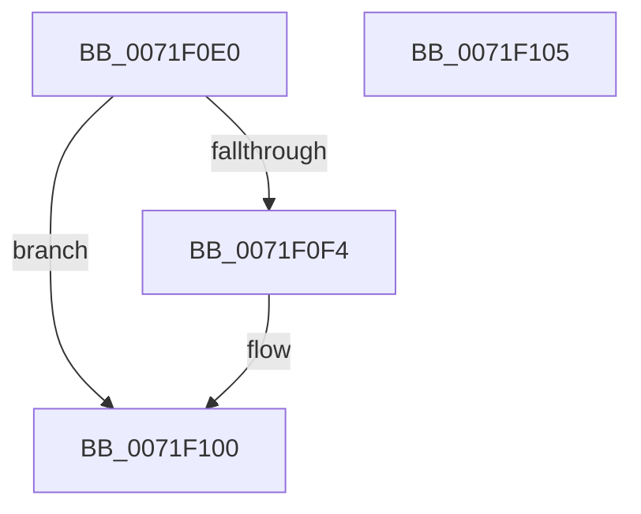

# IopSymlinkRegistryCallback

- RVA: `0x0071F0E0`–`0x0071F106` (길이 `38` bytes)
- VA: `0x000000014071F0E0`
- 실행 섹션: `PAGE`
- PDB 이름 있음: `예`; PDB Function 태그: `아니요`
- unwind 정보 RVA: `0x0005C788`
- 디코드: `10`개 명령, `38/38` bytes 표시
- 미해석 바이트: `0` (있으면 어셈블리에 `.byte`로 보존)

> 이 문서는 커널 이미지의 기계어와 PDB 기호를 분석해 생성했습니다. 4번과 5번은 함수 원형과 자료형을 바이너리 사용 방식에서 추정한 C 해석이며 원본 소스 복구 결과는 아닙니다.

## 1. Dependencies

- 직접 호출 지점: **2**; 고유 호출 대상: **1**
- 직접 호출자로 확인된 함수: **1**
- RIP 상대 이미지 참조: **2**

### Outgoing calls
- `0x0071F0EB` → [IopSymlinkQueryEnabledClasses](IopSymlinkQueryEnabledClasses_function_0071EF6C.md) (function, `0x0071EF6C`)
- `0x0071F0FB` → [IopSymlinkQueryEnabledClasses](IopSymlinkQueryEnabledClasses_function_0071EF6C.md) (function, `0x0071EF6C`)

### Direct callers
- [IopSymlinkRegistryInitCallback](../../text/59/IopSymlinkRegistryInitCallback_function_00598620.md) at `0x00598626`

### Static image references
- `0x0071F0E4` → RVA `0x00AFCED0` (` ?? ::NNGAKEGL::`string'`; read)
- `0x0071F0F4` → RVA `0x00AFBD10` (` ?? ::NNGAKEGL::`string'`; read)

## 2. Other-region calls and transfers

- 다른 실행 섹션으로 향하는 call: **0**
- 별도 외부 분기/꼬리 이동을 확인하지 못했습니다.

## 3. Assembly (complete function range)

```asm
0071F0E0  48 83 EC 28                     sub rsp, 0x28
0071F0E4  48 8D 0D E5 DD 3D 00            lea rcx, [rip + 0x3ddde5]
0071F0EB  E8 7C FE FF FF                  call 0x14071ef6c
0071F0F0  85 C0                           test eax, eax
0071F0F2  79 0C                           jns 0x14071f100
0071F0F4  48 8D 0D 15 CC 3D 00            lea rcx, [rip + 0x3dcc15]
0071F0FB  E8 6C FE FF FF                  call 0x14071ef6c
0071F100  48 83 C4 28                     add rsp, 0x28
0071F104  C3                              ret
0071F105  CC                              int3
```

## 4. C-style interpretation (structured pseudocode)

```c
__int64 __fastcall IopSymlinkRegistryCallback(void)
{
    __int64 result;
    __int64 v_rsp;

    v_rsp = (v_rsp) - (40);
    result = IopSymlinkQueryEnabledClasses(v_rip + 4054501, a2, a3, a4);
    if (sign_flag) {
        a1 = v_rip + 4049941;
        result = IopSymlinkQueryEnabledClasses(a1, a2, a3, a4);
    }
    v_rsp = (v_rsp) + (40);
    return result;
}
```

## 5. (Beta) C Style

```c
void IopSymlinkRegistryCallback(void)
{
    int64_t result;
    int64_t local_rsp;

    local_rsp = (local_rsp) - (40);
    result = IopSymlinkQueryEnabledClasses(v_rip + 4054501, a2, a3, a4);
    if (sign_flag) {
        a1 = v_rip + 4049941;
        result = IopSymlinkQueryEnabledClasses(a1, a2, a3, a4);
    }
    local_rsp = (local_rsp) + (40);
    return result;
}
```

## 6. Execution-region graph

[열기: 2D/3D 그래프와 함수 탐색 컨트롤 패널](../../../control-panel.html?section=page&rva=0x0071F0E0&view=graph)

- 2D 그래프는 위에서 아래로 흐르고, 3D 그래프는 빈 공간을 드래그해 회전합니다. Shift+드래그는 이동, 휠은 확대·축소, 함수 노드 선택은 대상 보고서 이동입니다.

### Static fallback


