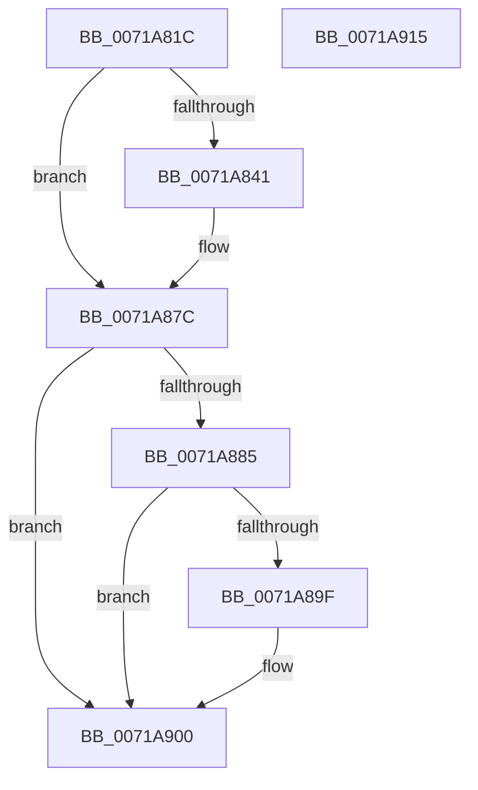

# IopTraceCrashDumpDisabledOnBoot

- RVA: `0x0071A81C`–`0x0071A916` (길이 `250` bytes)
- VA: `0x000000014071A81C`
- 실행 섹션: `PAGE`
- PDB 이름 있음: `예`; PDB Function 태그: `아니요`
- unwind 정보 RVA: `0x0009EA9C`
- 디코드: `53`개 명령, `250/250` bytes 표시
- 미해석 바이트: `0` (있으면 어셈블리에 `.byte`로 보존)

> 이 문서는 커널 이미지의 기계어와 PDB 기호를 분석해 생성했습니다. 4번과 5번은 함수 원형과 자료형을 바이너리 사용 방식에서 추정한 C 해석이며 원본 소스 복구 결과는 아닙니다.

## 1. Dependencies

- 직접 호출 지점: **5**; 고유 호출 대상: **5**
- 직접 호출자로 확인된 함수: **1**
- RIP 상대 이미지 참조: **6**

### Outgoing calls
- `0x0071A838` → [IopDumpIsTracingEnabled](../../text/4F/IopDumpIsTracingEnabled_function_004FC5D0.md) (function, `0x004FC5D0`)
- `0x0071A877` → [EtwWrite](../../text/41/EtwWrite_function_0041C720.md) (function, `0x0041C720`)
- `0x0071A896` → [tlgKeywordOn](../../text/42/tlgKeywordOn_function_0042EAA0.md) (function, `0x0042EAA0`)
- `0x0071A8FB` → [tlgWriteTransfer_EtwWriteTransfer](../../text/42/tlgWriteTransfer_EtwWriteTransfer_function_004260E0.md) (function, `0x004260E0`)
- `0x0071A907` → [_security_check_cookie](../../text/6A/_security_check_cookie_function_006AC640.md) (function, `0x006AC640`)

### Direct callers
- [IoInitSystemPreDrivers](../../init/C2/IoInitSystemPreDrivers_function_00C2AC3C.md) at `0x00C2BD0C`

### Static image references
- `0x0071A82A` → RVA `0x00E0A740` (`.data`; read)
- `0x0071A845` → RVA `0x00E0A9BA` (`.data`; read)
- `0x0071A84C` → RVA `0x00E65EF0` (`.data`; read)
- `0x0071A853` → RVA `0x000211C8` (`.rdata`; read)
- `0x0071A87C` → RVA `0x00E06DE8` (`.data`; read)
- `0x0071A8AB` → RVA `0x00045AE0` (`.rdata`; read)

## 2. Other-region calls and transfers

- 다른 실행 섹션으로 향하는 call: **5**
  - `0x0071A838` → [IopDumpIsTracingEnabled](../../text/4F/IopDumpIsTracingEnabled_function_004FC5D0.md) (`PAGE` → `.text`)
  - `0x0071A877` → [EtwWrite](../../text/41/EtwWrite_function_0041C720.md) (`PAGE` → `.text`)
  - `0x0071A896` → [tlgKeywordOn](../../text/42/tlgKeywordOn_function_0042EAA0.md) (`PAGE` → `.text`)
  - `0x0071A8FB` → [tlgWriteTransfer_EtwWriteTransfer](../../text/42/tlgWriteTransfer_EtwWriteTransfer_function_004260E0.md) (`PAGE` → `.text`)
  - `0x0071A907` → [_security_check_cookie](../../text/6A/_security_check_cookie_function_006AC640.md) (`PAGE` → `.text`)
- 별도 외부 분기/꼬리 이동을 확인하지 못했습니다.

## 3. Assembly (complete function range)

```asm
0071A81C  40 55                           push rbp
0071A81E  48 8D 6C 24 A9                  lea rbp, [rsp - 0x57]
0071A823  48 81 EC A0 00 00 00            sub rsp, 0xa0
0071A82A  48 8B 05 0F FF 6E 00            mov rax, qword ptr [rip + 0x6eff0f]
0071A831  48 33 C4                        xor rax, rsp
0071A834  48 89 45 47                     mov qword ptr [rbp + 0x47], rax
0071A838  E8 93 1D DE FF                  call 0x1404fc5d0
0071A83D  84 C0                           test al, al
0071A83F  74 3B                           je 0x14071a87c
0071A841  83 65 03 00                     and dword ptr [rbp + 3], 0
0071A845  48 8D 05 6E 01 6F 00            lea rax, [rip + 0x6f016e]
0071A84C  48 8B 0D 9D B6 74 00            mov rcx, qword ptr [rip + 0x74b69d]
0071A853  48 8D 15 6E 69 90 FF            lea rdx, [rip - 0x6f9692]
0071A85A  48 89 45 F7                     mov qword ptr [rbp - 9], rax
0071A85E  41 B9 01 00 00 00               mov r9d, 1
0071A864  48 8D 45 F7                     lea rax, [rbp - 9]
0071A868  C7 45 FF 04 00 00 00            mov dword ptr [rbp - 1], 4
0071A86F  45 33 C0                        xor r8d, r8d
0071A872  48 89 44 24 20                  mov qword ptr [rsp + 0x20], rax
0071A877  E8 A4 1E D0 FF                  call 0x14041c720
0071A87C  83 3D 65 C5 6E 00 05            cmp dword ptr [rip + 0x6ec565], 5
0071A883  76 7B                           jbe 0x14071a900
0071A885  48 BA 00 00 00 00 00 40 00 00   movabs rdx, 0x400000000000
0071A88F  48 8D 0D 52 C5 6E 00            lea rcx, [rip + 0x6ec552]
0071A896  E8 05 42 D1 FF                  call 0x14042eaa0
0071A89B  84 C0                           test al, al
0071A89D  74 61                           je 0x14071a900
0071A89F  83 65 33 00                     and dword ptr [rbp + 0x33], 0
0071A8A3  48 8D 45 EF                     lea rax, [rbp - 0x11]
0071A8A7  83 65 43 00                     and dword ptr [rbp + 0x43], 0
0071A8AB  48 8D 15 2E B2 92 FF            lea rdx, [rip - 0x6d4dd2]
0071A8B2  48 89 45 27                     mov qword ptr [rbp + 0x27], rax
0071A8B6  48 8D 0D 2B C5 6E 00            lea rcx, [rip + 0x6ec52b]
0071A8BD  8A 05 F7 00 6F 00               mov al, byte ptr [rip + 0x6f00f7]
0071A8C3  45 33 C9                        xor r9d, r9d
0071A8C6  88 45 E7                        mov byte ptr [rbp - 0x19], al
0071A8C9  45 33 C0                        xor r8d, r8d
0071A8CC  48 8D 45 E7                     lea rax, [rbp - 0x19]
0071A8D0  48 C7 45 EF 00 00 00 01         mov qword ptr [rbp - 0x11], 0x1000000
0071A8D8  48 89 45 37                     mov qword ptr [rbp + 0x37], rax
0071A8DC  48 8D 45 07                     lea rax, [rbp + 7]
0071A8E0  48 89 44 24 28                  mov qword ptr [rsp + 0x28], rax
0071A8E5  C7 44 24 20 04 00 00 00         mov dword ptr [rsp + 0x20], 4
0071A8ED  C7 45 2F 08 00 00 00            mov dword ptr [rbp + 0x2f], 8
0071A8F4  C7 45 3F 01 00 00 00            mov dword ptr [rbp + 0x3f], 1
0071A8FB  E8 E0 B7 D0 FF                  call 0x1404260e0
0071A900  48 8B 4D 47                     mov rcx, qword ptr [rbp + 0x47]
0071A904  48 33 CC                        xor rcx, rsp
0071A907  E8 34 1D F9 FF                  call 0x1406ac640
0071A90C  48 81 C4 A0 00 00 00            add rsp, 0xa0
0071A913  5D                              pop rbp
0071A914  C3                              ret
0071A915  CC                              int3
```

## 4. C-style interpretation (structured pseudocode)

```c
__int64 __fastcall IopTraceCrashDumpDisabledOnBoot(__int64 a1, __int64 a2, int a3)
{
    __int64 result;
    __int64 v_rsp;
    unsigned __int64 v_stack_m18;
    unsigned int v_stack_m1C;
    unsigned int v_stack_m20;
    unsigned __int64 v_stack_m28;
    unsigned int v_stack_m2C;
    unsigned int v_stack_m30;
    unsigned __int64 v_stack_m38;
    unsigned __int64 v_stack_m58;
    unsigned int v_stack_m5C;
    unsigned __int64 v_stack_m5F;
    unsigned int v_stack_m60;
    unsigned __int64 v_stack_m68;
    unsigned __int64 v_stack_m70;
    unsigned __int8 v_stack_m78;
    unsigned __int64 v_stack_m80;
    unsigned __int64 v_stack_m88;

    v_rsp = (v_rsp) - (160);
    result = (*(unsigned __int64 *)(v_rip + 7274255)) ^ (v_rsp);
    v_stack_m18 = result;
    result = IopDumpIsTracingEnabled(a1, a2, a3, a4);
    if ((unsigned __int8)(result) != 0) {
        result = v_rip + 7274862;
        a1 = *(unsigned __int64 *)(v_rip + 7648925);
        a2 = v_rip - 7313042;
        v_stack_m68 = result;
        a4 = 1;
        result = v_stack_m68;
        v_stack_m60 = 4;
        a3 = 0;
        v_stack_m88 = result;
        result = EtwWrite(a1, a2, a3, a4);
    }
    if ((*(unsigned int *)(v_rip + 7259493)) <= 5) goto loc_0071A900;
    result = tlgKeywordOn(v_rip + 7259474, a2, a3, a4);
    if ((unsigned __int8)(result) != 0) {
        result = v_stack_m70;
        a2 = v_rip - 7163346;
        v_stack_m38 = result;
        a1 = v_rip + 7259435;
        result = *(unsigned __int8 *)(v_rip + 7274743);
        a4 = 0;
        v_stack_m78 = (unsigned __int8)(result);
        a3 = 0;
        result = v_stack_m78;
        v_stack_m70 = 0x1000000ULL;
        v_stack_m28 = result;
        result = v_stack_m58;
        v_stack_m80 = result;
        v_stack_m88 = 4;
        v_stack_m30 = 8;
        v_stack_m20 = 1;
        result = tlgWriteTransfer_EtwWriteTransfer(a1, a2, a3, a4);
    }
    a1 = (v_stack_m18) ^ (v_rsp);
    result = _security_check_cookie(a1, a2, a3, a4);
    v_rsp = (v_rsp) + (160);
    return result;
}
```

## 5. (Beta) C Style

```c
int64_t IopTraceCrashDumpDisabledOnBoot(int64_t Arg1, int64_t Arg2, int32_t Arg3)
{
    int64_t result;
    int64_t local_rsp;
    uint64_t v_stack_m18;
    uint32_t v_stack_m1C;
    uint32_t v_stack_m20;
    uint64_t v_stack_m28;
    uint32_t v_stack_m2C;
    uint32_t v_stack_m30;
    uint64_t v_stack_m38;
    uint64_t v_stack_m58;
    uint32_t v_stack_m5C;
    uint64_t v_stack_m5F;
    uint32_t v_stack_m60;
    uint64_t v_stack_m68;
    uint64_t v_stack_m70;
    uint8_t v_stack_m78;
    uint64_t v_stack_m80;
    uint64_t v_stack_m88;

    local_rsp = (local_rsp) - (160);
    result = (*(uint64_t *)(v_rip + 0x6EFF0F)) ^ (local_rsp);
    v_stack_m18 = result;
    result = IopDumpIsTracingEnabled(Arg1, Arg2, Arg3, a4);
    if ((uint8_t)(result) != 0) {
        result = v_rip + 7274862;
        Arg1 = *(uint64_t *)(v_rip + 0x74B69D);
        Arg2 = v_rip - 7313042;
        v_stack_m68 = result;
        a4 = 1;
        result = v_stack_m68;
        v_stack_m60 = 4;
        Arg3 = 0;
        v_stack_m88 = result;
        result = EtwWrite(Arg1, Arg2, Arg3, a4);
    }
    if ((*(uint32_t *)(v_rip + 0x6EC565)) <= 5) goto loc_0071A900;
    result = tlgKeywordOn(v_rip + 7259474, Arg2, Arg3, a4);
    if ((uint8_t)(result) != 0) {
        result = v_stack_m70;
        Arg2 = v_rip - 7163346;
        v_stack_m38 = result;
        Arg1 = v_rip + 7259435;
        result = *(uint8_t *)(v_rip + 0x6F00F7);
        a4 = 0;
        v_stack_m78 = (uint8_t)(result);
        Arg3 = 0;
        result = v_stack_m78;
        v_stack_m70 = 0x1000000ULL;
        v_stack_m28 = result;
        result = v_stack_m58;
        v_stack_m80 = result;
        v_stack_m88 = 4;
        v_stack_m30 = 8;
        v_stack_m20 = 1;
        result = tlgWriteTransfer_EtwWriteTransfer(Arg1, Arg2, Arg3, a4);
    }
    Arg1 = (v_stack_m18) ^ (local_rsp);
    result = _security_check_cookie(Arg1, Arg2, Arg3, a4);
    local_rsp = (local_rsp) + (160);
    return result;
}
```

## 6. Execution-region graph

[열기: 2D/3D 그래프와 함수 탐색 컨트롤 패널](../../../control-panel.html?section=page&rva=0x0071A81C&view=graph)

- 2D 그래프는 위에서 아래로 흐르고, 3D 그래프는 빈 공간을 드래그해 회전합니다. Shift+드래그는 이동, 휠은 확대·축소, 함수 노드 선택은 대상 보고서 이동입니다.

### Static fallback


