# IopValidateJunctionTarget

- RVA: `0x0071C808`–`0x0071CE14` (길이 `1,548` bytes)
- VA: `0x000000014071C808`
- 실행 섹션: `PAGE`
- PDB 이름 있음: `예`; PDB Function 태그: `아니요`
- unwind 정보 RVA: `0x000C73FC`
- 디코드: `350`개 명령, `1,548/1,548` bytes 표시
- 미해석 바이트: `0` (있으면 어셈블리에 `.byte`로 보존)

> 이 문서는 커널 이미지의 기계어와 PDB 기호를 분석해 생성했습니다. 4번과 5번은 함수 원형과 자료형을 바이너리 사용 방식에서 추정한 C 해석이며 원본 소스 복구 결과는 아닙니다.

## 1. Dependencies

- 직접 호출 지점: **25**; 고유 호출 대상: **14**
- 직접 호출자로 확인된 함수: **1**
- RIP 상대 이미지 참조: **3**

### Outgoing calls
- `0x0071C8D5` → [RtlInitUnicodeString](../../text/42/RtlInitUnicodeString_function_0042A780.md) (function, `0x0042A780`)
- `0x0071C8FB` → [ExAllocatePool2](../../poolcode/B8/ExAllocatePool2_function_00B820F0.md) (function, `0x00B820F0`)
- `0x0071C917` → [ExAllocatePool2](../../poolcode/B8/ExAllocatePool2_function_00B820F0.md) (function, `0x00B820F0`)
- `0x0071C930` → [memcpy](../../text/6C/memcpy_function_006C6840.md) (function, `0x006C6840`)
- `0x0071C94E` → [FsRtlValidateReparsePointBuffer](../../text/44/FsRtlValidateReparsePointBuffer_function_00447D90.md) (function, `0x00447D90`)
- `0x0071C9EC` → [ZwOpenFile](../../text/6A/ZwOpenFile_function_006AD730.md) (function, `0x006AD730`)
- `0x0071CA15` → [IopReferenceFileObject](../../text/29/IopReferenceFileObject_function_0029D530.md) (function, `0x0029D530`)
- `0x0071CA57` → [RtlPrefixUnicodeString](../8F/RtlPrefixUnicodeString_function_008F4F70.md) (function, `0x008F4F70`)
- `0x0071CA73` → [RtlPrefixUnicodeString](../8F/RtlPrefixUnicodeString_function_008F4F70.md) (function, `0x008F4F70`)
- `0x0071CA85` → [IoVolumeDeviceToDosName](../8A/IoVolumeDeviceToDosName_function_008A63F0.md) (function, `0x008A63F0`)
- `0x0071CAA6` → [IoVolumeDeviceToGuidPath](../95/IoVolumeDeviceToGuidPath_function_00952B20.md) (function, `0x00952B20`)
- `0x0071CAD6` → [ExAllocatePool2](../../poolcode/B8/ExAllocatePool2_function_00B820F0.md) (function, `0x00B820F0`)
- `0x0071CB0D` → [IopQueryXxxInformation](../8A/IopQueryXxxInformation_function_008A89D0.md) (function, `0x008A89D0`)
- `0x0071CB27` → [ExFreePoolWithTag](../../poolcode/B8/ExFreePoolWithTag_function_00B82870.md) (function, `0x00B82870`)
- `0x0071CBC7` → [ExAllocatePool2](../../poolcode/B8/ExAllocatePool2_function_00B820F0.md) (function, `0x00B820F0`)
- `0x0071CC41` → [RtlAppendUnicodeStringToString](../../text/40/RtlAppendUnicodeStringToString_function_0040FA50.md) (function, `0x0040FA50`)
- `0x0071CCBE` → [RtlAppendUnicodeStringToString](../../text/40/RtlAppendUnicodeStringToString_function_0040FA50.md) (function, `0x0040FA50`)
- `0x0071CCF1` → [RtlAppendUnicodeStringToString](../../text/40/RtlAppendUnicodeStringToString_function_0040FA50.md) (function, `0x0040FA50`)
- `0x0071CD5A` → [memcpy](../../text/6C/memcpy_function_006C6840.md) (function, `0x006C6840`)
- `0x0071CDA6` → [ExFreePoolWithTag](../../poolcode/B8/ExFreePoolWithTag_function_00B82870.md) (function, `0x00B82870`)
- `0x0071CDB5` → [ExFreePoolWithTag](../../poolcode/B8/ExFreePoolWithTag_function_00B82870.md) (function, `0x00B82870`)
- `0x0071CDC4` → [ExFreePoolWithTag](../../poolcode/B8/ExFreePoolWithTag_function_00B82870.md) (function, `0x00B82870`)
- `0x0071CDD5` → [ExFreePoolWithTag](../../poolcode/B8/ExFreePoolWithTag_function_00B82870.md) (function, `0x00B82870`)
- `0x0071CDE7` → [ObfDereferenceObject](../../text/2F/ObfDereferenceObject_function_002F9350.md) (function, `0x002F9350`)
- `0x0071CDF9` → [ZwClose](../../text/6A/ZwClose_function_006AD2B0.md) (function, `0x006AD2B0`)

### Direct callers
- [IopXxxControlFile](../8E/IopXxxControlFile_function_008E9AD0.md) at `0x008EB34C`

### Static image references
- `0x0071C84B` → RVA `0x00AFCA00` (` ?? ::NNGAKEGL::`string'`; read)
- `0x0071C861` → RVA `0x00AFC9D0` (` ?? ::NNGAKEGL::`string'`; read)
- `0x0071C8A3` → RVA `0x00AFC9B0` (` ?? ::NNGAKEGL::`string'`; read)

## 2. Other-region calls and transfers

- 다른 실행 섹션으로 향하는 call: **20**
  - `0x0071C8D5` → [RtlInitUnicodeString](../../text/42/RtlInitUnicodeString_function_0042A780.md) (`PAGE` → `.text`)
  - `0x0071C8FB` → [ExAllocatePool2](../../poolcode/B8/ExAllocatePool2_function_00B820F0.md) (`PAGE` → `POOLCODE`)
  - `0x0071C917` → [ExAllocatePool2](../../poolcode/B8/ExAllocatePool2_function_00B820F0.md) (`PAGE` → `POOLCODE`)
  - `0x0071C930` → [memcpy](../../text/6C/memcpy_function_006C6840.md) (`PAGE` → `.text`)
  - `0x0071C94E` → [FsRtlValidateReparsePointBuffer](../../text/44/FsRtlValidateReparsePointBuffer_function_00447D90.md) (`PAGE` → `.text`)
  - `0x0071C9EC` → [ZwOpenFile](../../text/6A/ZwOpenFile_function_006AD730.md) (`PAGE` → `.text`)
  - `0x0071CA15` → [IopReferenceFileObject](../../text/29/IopReferenceFileObject_function_0029D530.md) (`PAGE` → `.text`)
  - `0x0071CAD6` → [ExAllocatePool2](../../poolcode/B8/ExAllocatePool2_function_00B820F0.md) (`PAGE` → `POOLCODE`)
  - `0x0071CB27` → [ExFreePoolWithTag](../../poolcode/B8/ExFreePoolWithTag_function_00B82870.md) (`PAGE` → `POOLCODE`)
  - `0x0071CBC7` → [ExAllocatePool2](../../poolcode/B8/ExAllocatePool2_function_00B820F0.md) (`PAGE` → `POOLCODE`)
  - `0x0071CC41` → [RtlAppendUnicodeStringToString](../../text/40/RtlAppendUnicodeStringToString_function_0040FA50.md) (`PAGE` → `.text`)
  - `0x0071CCBE` → [RtlAppendUnicodeStringToString](../../text/40/RtlAppendUnicodeStringToString_function_0040FA50.md) (`PAGE` → `.text`)
  - `0x0071CCF1` → [RtlAppendUnicodeStringToString](../../text/40/RtlAppendUnicodeStringToString_function_0040FA50.md) (`PAGE` → `.text`)
  - `0x0071CD5A` → [memcpy](../../text/6C/memcpy_function_006C6840.md) (`PAGE` → `.text`)
  - `0x0071CDA6` → [ExFreePoolWithTag](../../poolcode/B8/ExFreePoolWithTag_function_00B82870.md) (`PAGE` → `POOLCODE`)
  - `0x0071CDB5` → [ExFreePoolWithTag](../../poolcode/B8/ExFreePoolWithTag_function_00B82870.md) (`PAGE` → `POOLCODE`)
  - `0x0071CDC4` → [ExFreePoolWithTag](../../poolcode/B8/ExFreePoolWithTag_function_00B82870.md) (`PAGE` → `POOLCODE`)
  - `0x0071CDD5` → [ExFreePoolWithTag](../../poolcode/B8/ExFreePoolWithTag_function_00B82870.md) (`PAGE` → `POOLCODE`)
  - `0x0071CDE7` → [ObfDereferenceObject](../../text/2F/ObfDereferenceObject_function_002F9350.md) (`PAGE` → `.text`)
  - `0x0071CDF9` → [ZwClose](../../text/6A/ZwClose_function_006AD2B0.md) (`PAGE` → `.text`)
- 별도 외부 분기/꼬리 이동을 확인하지 못했습니다.

## 3. Assembly (complete function range)

```asm
0071C808  4C 8B DC                        mov r11, rsp
0071C80B  45 89 4B 20                     mov dword ptr [r11 + 0x20], r9d
0071C80F  45 89 43 18                     mov dword ptr [r11 + 0x18], r8d
0071C813  49 89 53 10                     mov qword ptr [r11 + 0x10], rdx
0071C817  89 4C 24 08                     mov dword ptr [rsp + 8], ecx
0071C81B  53                              push rbx
0071C81C  56                              push rsi
0071C81D  57                              push rdi
0071C81E  41 54                           push r12
0071C820  41 55                           push r13
0071C822  41 56                           push r14
0071C824  41 57                           push r15
0071C826  48 81 EC 30 01 00 00            sub rsp, 0x130
0071C82D  41 8B D8                        mov ebx, r8d
0071C830  4C 8B E2                        mov r12, rdx
0071C833  8B F1                           mov esi, ecx
0071C835  0F 57 C0                        xorps xmm0, xmm0
0071C838  0F 11 84 24 88 00 00 00         movups xmmword ptr [rsp + 0x88], xmm0
0071C840  49 C7 83 78 FF FF FF 16 00 18 00  mov qword ptr [r11 - 0x88], 0x180016
0071C84B  48 8D 05 AE 01 3E 00            lea rax, [rip + 0x3e01ae]
0071C852  49 89 43 80                     mov qword ptr [r11 - 0x80], rax
0071C856  49 C7 83 68 FF FF FF 22 00 24 00  mov qword ptr [r11 - 0x98], 0x240022
0071C861  48 8D 05 68 01 3E 00            lea rax, [rip + 0x3e0168]
0071C868  49 89 83 70 FF FF FF            mov qword ptr [r11 - 0x90], rax
0071C86F  41 0F 11 43 B8                  movups xmmword ptr [r11 - 0x48], xmm0
0071C874  33 C0                           xor eax, eax
0071C876  41 0F 11 43 88                  movups xmmword ptr [r11 - 0x78], xmm0
0071C87B  41 0F 11 43 98                  movups xmmword ptr [r11 - 0x68], xmm0
0071C880  49 89 43 A8                     mov qword ptr [r11 - 0x58], rax
0071C884  41 89 43 B0                     mov dword ptr [r11 - 0x50], eax
0071C888  0F 11 84 24 B0 00 00 00         movups xmmword ptr [rsp + 0xb0], xmm0
0071C890  0F 57 C9                        xorps xmm1, xmm1
0071C893  0F 11 4C 24 70                  movups xmmword ptr [rsp + 0x70], xmm1
0071C898  49 C7 83 58 FF FF FF 14 00 16 00  mov qword ptr [r11 - 0xa8], 0x160014
0071C8A3  48 8D 05 06 01 3E 00            lea rax, [rip + 0x3e0106]
0071C8AA  49 89 83 60 FF FF FF            mov qword ptr [r11 - 0xa0], rax
0071C8B1  33 FF                           xor edi, edi
0071C8B3  49 89 BB 38 FF FF FF            mov qword ptr [r11 - 0xc8], rdi
0071C8BA  44 8B EF                        mov r13d, edi
0071C8BD  49 89 BB 40 FF FF FF            mov qword ptr [r11 - 0xc0], rdi
0071C8C4  49 89 BB 18 FF FF FF            mov qword ptr [r11 - 0xe8], rdi
0071C8CB  44 8B F7                        mov r14d, edi
0071C8CE  33 D2                           xor edx, edx
0071C8D0  48 8D 4C 24 70                  lea rcx, [rsp + 0x70]
0071C8D5  E8 A6 DE D0 FF                  call 0x14042a780
0071C8DA  90                              nop
0071C8DB  41 B8 49 6F 52 65               mov r8d, 0x65526f49
0071C8E1  8D 4F 63                        lea ecx, [rdi + 0x63]
0071C8E4  81 FE 0C 04 09 00               cmp esi, 0x9040c
0071C8EA  75 1E                           jne 0x14071c90a
0071C8EC  44 8D 7B E0                     lea r15d, [rbx - 0x20]
0071C8F0  44 89 BC 24 98 00 00 00         mov dword ptr [rsp + 0x98], r15d
0071C8F8  41 8B D7                        mov edx, r15d
0071C8FB  E8 F0 57 46 00                  call 0x140b820f0
0071C900  49 8D 54 24 20                  lea rdx, [r12 + 0x20]
0071C905  45 8B C7                        mov r8d, r15d
0071C908  EB 18                           jmp 0x14071c922
0071C90A  44 8B FB                        mov r15d, ebx
0071C90D  89 9C 24 98 00 00 00            mov dword ptr [rsp + 0x98], ebx
0071C914  48 8B D3                        mov rdx, rbx
0071C917  E8 D4 57 46 00                  call 0x140b820f0
0071C91C  4C 8B C3                        mov r8, rbx
0071C91F  49 8B D4                        mov rdx, r12
0071C922  48 8B F0                        mov rsi, rax
0071C925  48 89 84 24 A0 00 00 00         mov qword ptr [rsp + 0xa0], rax
0071C92D  48 8B C8                        mov rcx, rax
0071C930  E8 0B 9F FA FF                  call 0x1406c6840
0071C935  90                              nop
0071C936  81 3E 03 00 00 A0               cmp dword ptr [rsi], 0xa0000003
0071C93C  74 0A                           je 0x14071c948
0071C93E  BB 0D 00 00 C0                  mov ebx, 0xc000000d
0071C943  E9 54 04 00 00                  jmp 0x14071cd9c
0071C948  48 8B D6                        mov rdx, rsi
0071C94B  41 8B CF                        mov ecx, r15d
0071C94E  E8 3D B4 D2 FF                  call 0x140447d90
0071C953  8B D8                           mov ebx, eax
0071C955  85 C0                           test eax, eax
0071C957  0F 88 3F 04 00 00               js 0x14071cd9c
0071C95D  48 8D 46 10                     lea rax, [rsi + 0x10]
0071C961  48 89 84 24 90 00 00 00         mov qword ptr [rsp + 0x90], rax
0071C969  0F B7 46 0A                     movzx eax, word ptr [rsi + 0xa]
0071C96D  B9 FE FF 00 00                  mov ecx, 0xfffe
0071C972  66 23 C1                        and ax, cx
0071C975  66 89 84 24 88 00 00 00         mov word ptr [rsp + 0x88], ax
0071C97D  66 89 84 24 8A 00 00 00         mov word ptr [rsp + 0x8a], ax
0071C985  C7 84 24 F0 00 00 00 30 00 00 00  mov dword ptr [rsp + 0xf0], 0x30
0071C990  48 89 BC 24 F8 00 00 00         mov qword ptr [rsp + 0xf8], rdi
0071C998  C7 84 24 08 01 00 00 00 06 00 00  mov dword ptr [rsp + 0x108], 0x600
0071C9A3  48 8D 84 24 88 00 00 00         lea rax, [rsp + 0x88]
0071C9AB  48 89 84 24 00 01 00 00         mov qword ptr [rsp + 0x100], rax
0071C9B3  0F 57 C0                        xorps xmm0, xmm0
0071C9B6  F3 0F 7F 84 24 10 01 00 00      movdqu xmmword ptr [rsp + 0x110], xmm0
0071C9BF  C7 44 24 28 01 00 00 00         mov dword ptr [rsp + 0x28], 1
0071C9C7  C7 44 24 20 07 00 00 00         mov dword ptr [rsp + 0x20], 7
0071C9CF  4C 8D 8C 24 20 01 00 00         lea r9, [rsp + 0x120]
0071C9D7  4C 8D 84 24 F0 00 00 00         lea r8, [rsp + 0xf0]
0071C9DF  BA 16 01 12 00                  mov edx, 0x120116
0071C9E4  48 8D 8C 24 A8 00 00 00         lea rcx, [rsp + 0xa8]
0071C9EC  E8 3F 0D F9 FF                  call 0x1406ad730
0071C9F1  8B D8                           mov ebx, eax
0071C9F3  85 C0                           test eax, eax
0071C9F5  0F 88 A1 03 00 00               js 0x14071cd9c
0071C9FB  48 89 7C 24 20                  mov qword ptr [rsp + 0x20], rdi
0071CA00  4C 8D 8C 24 80 00 00 00         lea r9, [rsp + 0x80]
0071CA08  45 33 C0                        xor r8d, r8d
0071CA0B  33 D2                           xor edx, edx
0071CA0D  48 8B 8C 24 A8 00 00 00         mov rcx, qword ptr [rsp + 0xa8]
0071CA15  E8 16 0B B8 FF                  call 0x14029d530
0071CA1A  8B D8                           mov ebx, eax
0071CA1C  85 C0                           test eax, eax
0071CA1E  0F 88 78 03 00 00               js 0x14071cd9c
0071CA24  4C 8B BC 24 80 00 00 00         mov r15, qword ptr [rsp + 0x80]
0071CA2C  49 8B 47 08                     mov rax, qword ptr [r15 + 8]
0071CA30  8B 48 34                        mov ecx, dword ptr [rax + 0x34]
0071CA33  F6 C1 10                        test cl, 0x10
0071CA36  0F 85 02 FF FF FF               jne 0x14071c93e
0071CA3C  44 8A E7                        mov r12b, dil
0071CA3F  40 88 7C 24 40                  mov byte ptr [rsp + 0x40], dil
0071CA44  41 B0 01                        mov r8b, 1
0071CA47  48 8D 94 24 88 00 00 00         lea rdx, [rsp + 0x88]
0071CA4F  48 8D 8C 24 C0 00 00 00         lea rcx, [rsp + 0xc0]
0071CA57  E8 14 85 1D 00                  call 0x1408f4f70
0071CA5C  84 C0                           test al, al
0071CA5E  75 30                           jne 0x14071ca90
0071CA60  41 B0 01                        mov r8b, 1
0071CA63  48 8D 94 24 88 00 00 00         lea rdx, [rsp + 0x88]
0071CA6B  48 8D 8C 24 D0 00 00 00         lea rcx, [rsp + 0xd0]
0071CA73  E8 F8 84 1D 00                  call 0x1408f4f70
0071CA78  84 C0                           test al, al
0071CA7A  75 14                           jne 0x14071ca90
0071CA7C  48 8D 54 24 70                  lea rdx, [rsp + 0x70]
0071CA81  49 8B 4F 08                     mov rcx, qword ptr [r15 + 8]
0071CA85  E8 66 99 18 00                  call 0x1408a63f0
0071CA8A  8B D8                           mov ebx, eax
0071CA8C  85 C0                           test eax, eax
0071CA8E  79 08                           jns 0x14071ca98
0071CA90  41 B4 01                        mov r12b, 1
0071CA93  44 88 64 24 40                  mov byte ptr [rsp + 0x40], r12b
0071CA98  45 84 E4                        test r12b, r12b
0071CA9B  74 10                           je 0x14071caad
0071CA9D  48 8D 54 24 70                  lea rdx, [rsp + 0x70]
0071CAA2  49 8B 4F 08                     mov rcx, qword ptr [r15 + 8]
0071CAA6  E8 75 60 23 00                  call 0x140952b20
0071CAAB  8B D8                           mov ebx, eax
0071CAAD  85 DB                           test ebx, ebx
0071CAAF  79 0A                           jns 0x14071cabb
0071CAB1  48 89 7C 24 78                  mov qword ptr [rsp + 0x78], rdi
0071CAB6  E9 E1 02 00 00                  jmp 0x14071cd9c
0071CABB  44 0F B7 BC 24 88 00 00 00      movzx r15d, word ptr [rsp + 0x88]
0071CAC4  41 83 C7 08                     add r15d, 8
0071CAC8  41 8B D7                        mov edx, r15d
0071CACB  B9 40 00 00 00                  mov ecx, 0x40
0071CAD0  41 B8 49 6F 54 65               mov r8d, 0x65546f49
0071CAD6  E8 15 56 46 00                  call 0x140b820f0
0071CADB  4C 8B F0                        mov r14, rax
0071CADE  48 85 C0                        test rax, rax
0071CAE1  0F 84 9C 02 00 00               je 0x14071cd83
0071CAE7  C6 44 24 30 01                  mov byte ptr [rsp + 0x30], 1
0071CAEC  48 8D 44 24 60                  lea rax, [rsp + 0x60]
0071CAF1  48 89 44 24 28                  mov qword ptr [rsp + 0x28], rax
0071CAF6  4C 89 74 24 20                  mov qword ptr [rsp + 0x20], r14
0071CAFB  45 33 C9                        xor r9d, r9d
0071CAFE  45 8B C7                        mov r8d, r15d
0071CB01  41 8D 51 09                     lea edx, [r9 + 9]
0071CB05  48 8B 8C 24 80 00 00 00         mov rcx, qword ptr [rsp + 0x80]
0071CB0D  E8 BE BE 18 00                  call 0x1408a89d0
0071CB12  8B D8                           mov ebx, eax
0071CB14  3D 05 00 00 80                  cmp eax, 0x80000005
0071CB19  75 14                           jne 0x14071cb2f
0071CB1B  45 8B 3E                        mov r15d, dword ptr [r14]
0071CB1E  41 83 C7 08                     add r15d, 8
0071CB22  33 D2                           xor edx, edx
0071CB24  49 8B CE                        mov rcx, r14
0071CB27  E8 44 5D 46 00                  call 0x140b82870
0071CB2C  4C 8B F7                        mov r14, rdi
0071CB2F  81 FB 05 00 00 80               cmp ebx, 0x80000005
0071CB35  74 91                           je 0x14071cac8
0071CB37  85 DB                           test ebx, ebx
0071CB39  0F 88 5D 02 00 00               js 0x14071cd9c
0071CB3F  41 8B 16                        mov edx, dword ptr [r14]
0071CB42  85 D2                           test edx, edx
0071CB44  0F 84 F4 FD FF FF               je 0x14071c93e
0071CB4A  66 41 83 7E 04 5C               cmp word ptr [r14 + 4], 0x5c
0071CB50  0F 85 E8 FD FF FF               jne 0x14071c93e
0071CB56  0F B7 44 24 70                  movzx eax, word ptr [rsp + 0x70]
0071CB5B  B9 16 00 00 00                  mov ecx, 0x16
0071CB60  03 D0                           add edx, eax
0071CB62  03 D1                           add edx, ecx
0071CB64  44 8D 42 F8                     lea r8d, [rdx - 8]
0071CB68  45 84 E4                        test r12b, r12b
0071CB6B  44 0F 44 C2                     cmove r8d, edx
0071CB6F  0F B7 4C 24 70                  movzx ecx, word ptr [rsp + 0x70]
0071CB74  48 D1 E9                        shr rcx, 1
0071CB77  48 8B 44 24 78                  mov rax, qword ptr [rsp + 0x78]
0071CB7C  41 8D 58 FE                     lea ebx, [r8 - 2]
0071CB80  66 83 7C 48 FE 5C               cmp word ptr [rax + rcx*2 - 2], 0x5c
0071CB86  41 0F 45 D8                     cmovne ebx, r8d
0071CB8A  81 FB FD FF 00 00               cmp ebx, 0xfffd
0071CB90  0F 83 A8 FD FF FF               jae 0x14071c93e
0071CB96  0F B7 84 24 88 00 00 00         movzx eax, word ptr [rsp + 0x88]
0071CB9E  44 8B E3                        mov r12d, ebx
0071CBA1  44 2B E0                        sub r12d, eax
0071CBA4  44 03 A4 24 80 01 00 00         add r12d, dword ptr [rsp + 0x180]
0071CBAC  8B 84 24 88 01 00 00            mov eax, dword ptr [rsp + 0x188]
0071CBB3  44 3B E0                        cmp r12d, eax
0071CBB6  41 0F 47 C4                     cmova eax, r12d
0071CBBA  8B D0                           mov edx, eax
0071CBBC  B9 41 00 00 00                  mov ecx, 0x41
0071CBC1  41 B8 49 6F 52 65               mov r8d, 0x65526f49
0071CBC7  E8 24 55 46 00                  call 0x140b820f0
0071CBCC  4C 8B E8                        mov r13, rax
0071CBCF  48 85 C0                        test rax, rax
0071CBD2  0F 84 AB 01 00 00               je 0x14071cd83
0071CBD8  81 BC 24 70 01 00 00 0C 04 09 00  cmp dword ptr [rsp + 0x170], 0x9040c
0071CBE3  75 28                           jne 0x14071cc0d
0071CBE5  48 8B 84 24 78 01 00 00         mov rax, qword ptr [rsp + 0x178]
0071CBED  0F 10 00                        movups xmm0, xmmword ptr [rax]
0071CBF0  41 0F 11 45 00                  movups xmmword ptr [r13], xmm0
0071CBF5  0F 10 48 10                     movups xmm1, xmmword ptr [rax + 0x10]
0071CBF9  41 0F 11 4D 10                  movups xmmword ptr [r13 + 0x10], xmm1
0071CBFE  4D 8D 7D 20                     lea r15, [r13 + 0x20]
0071CC02  41 8D 44 24 E0                  lea eax, [r12 - 0x20]
0071CC07  89 44 24 60                     mov dword ptr [rsp + 0x60], eax
0071CC0B  EB 08                           jmp 0x14071cc15
0071CC0D  4D 8B FD                        mov r15, r13
0071CC10  44 89 64 24 60                  mov dword ptr [rsp + 0x60], r12d
0071CC15  49 8D 47 10                     lea rax, [r15 + 0x10]
0071CC19  48 89 84 24 B8 00 00 00         mov qword ptr [rsp + 0xb8], rax
0071CC21  66 89 BC 24 B0 00 00 00         mov word ptr [rsp + 0xb0], di
0071CC29  66 89 9C 24 B2 00 00 00         mov word ptr [rsp + 0xb2], bx
0071CC31  48 8D 94 24 E0 00 00 00         lea rdx, [rsp + 0xe0]
0071CC39  48 8D 8C 24 B0 00 00 00         lea rcx, [rsp + 0xb0]
0071CC41  E8 0A 2E CF FF                  call 0x14040fa50
0071CC46  8B D8                           mov ebx, eax
0071CC48  85 C0                           test eax, eax
0071CC4A  0F 88 4C 01 00 00               js 0x14071cd9c
0071CC50  0F 28 44 24 70                  movaps xmm0, xmmword ptr [rsp + 0x70]
0071CC55  66 0F 7F 44 24 50               movdqa xmmword ptr [rsp + 0x50], xmm0
0071CC5B  40 38 7C 24 40                  cmp byte ptr [rsp + 0x40], dil
0071CC60  74 17                           je 0x14071cc79
0071CC62  0F B7 44 24 70                  movzx eax, word ptr [rsp + 0x70]
0071CC67  B9 08 00 00 00                  mov ecx, 8
0071CC6C  66 2B C1                        sub ax, cx
0071CC6F  66 89 44 24 50                  mov word ptr [rsp + 0x50], ax
0071CC74  48 01 4C 24 58                  add qword ptr [rsp + 0x58], rcx
0071CC79  0F B7 4C 24 50                  movzx ecx, word ptr [rsp + 0x50]
0071CC7E  48 D1 E9                        shr rcx, 1
0071CC81  48 8B 44 24 58                  mov rax, qword ptr [rsp + 0x58]
0071CC86  66 83 7C 48 FE 5C               cmp word ptr [rax + rcx*2 - 2], 0x5c
0071CC8C  75 0A                           jne 0x14071cc98
0071CC8E  B8 FE FF 00 00                  mov eax, 0xfffe
0071CC93  66 01 44 24 50                  add word ptr [rsp + 0x50], ax
0071CC98  0F B7 44 24 50                  movzx eax, word ptr [rsp + 0x50]
0071CC9D  66 85 C0                        test ax, ax
0071CCA0  0F 84 98 FC FF FF               je 0x14071c93e
0071CCA6  66 3B 44 24 70                  cmp ax, word ptr [rsp + 0x70]
0071CCAB  0F 87 8D FC FF FF               ja 0x14071c93e
0071CCB1  48 8D 54 24 50                  lea rdx, [rsp + 0x50]
0071CCB6  48 8D 8C 24 B0 00 00 00         lea rcx, [rsp + 0xb0]
0071CCBE  E8 8D 2D CF FF                  call 0x14040fa50
0071CCC3  8B D8                           mov ebx, eax
0071CCC5  85 C0                           test eax, eax
0071CCC7  0F 88 CF 00 00 00               js 0x14071cd9c
0071CCCD  49 8D 46 04                     lea rax, [r14 + 4]
0071CCD1  48 89 44 24 58                  mov qword ptr [rsp + 0x58], rax
0071CCD6  41 0F B7 06                     movzx eax, word ptr [r14]
0071CCDA  66 89 44 24 50                  mov word ptr [rsp + 0x50], ax
0071CCDF  66 89 44 24 52                  mov word ptr [rsp + 0x52], ax
0071CCE4  48 8D 54 24 50                  lea rdx, [rsp + 0x50]
0071CCE9  48 8D 8C 24 B0 00 00 00         lea rcx, [rsp + 0xb0]
0071CCF1  E8 5A 2D CF FF                  call 0x14040fa50
0071CCF6  8B D8                           mov ebx, eax
0071CCF8  85 C0                           test eax, eax
0071CCFA  0F 88 9C 00 00 00               js 0x14071cd9c
0071CD00  41 C7 07 03 00 00 A0            mov dword ptr [r15], 0xa0000003
0071CD07  41 89 7F 06                     mov dword ptr [r15 + 6], edi
0071CD0B  8B 44 24 60                     mov eax, dword ptr [rsp + 0x60]
0071CD0F  66 83 E8 08                     sub ax, 8
0071CD13  66 41 89 47 04                  mov word ptr [r15 + 4], ax
0071CD18  0F B7 8C 24 B0 00 00 00         movzx ecx, word ptr [rsp + 0xb0]
0071CD20  66 41 89 4F 0A                  mov word ptr [r15 + 0xa], cx
0071CD25  8B C1                           mov eax, ecx
0071CD27  48 D1 E8                        shr rax, 1
0071CD2A  66 41 89 7C 47 10               mov word ptr [r15 + rax*2 + 0x10], di
0071CD30  B8 02 00 00 00                  mov eax, 2
0071CD35  66 03 C8                        add cx, ax
0071CD38  66 41 89 4F 0C                  mov word ptr [r15 + 0xc], cx
0071CD3D  44 0F B7 46 0E                  movzx r8d, word ptr [rsi + 0xe]
0071CD42  4C 03 C0                        add r8, rax
0071CD45  0F B7 56 0C                     movzx edx, word ptr [rsi + 0xc]
0071CD49  48 83 C2 10                     add rdx, 0x10
0071CD4D  48 03 D6                        add rdx, rsi
0071CD50  0F B7 C9                        movzx ecx, cx
0071CD53  48 83 C1 10                     add rcx, 0x10
0071CD57  49 03 CF                        add rcx, r15
0071CD5A  E8 E1 9A FA FF                  call 0x1406c6840
0071CD5F  0F B7 46 0E                     movzx eax, word ptr [rsi + 0xe]
0071CD63  66 41 89 47 0E                  mov word ptr [r15 + 0xe], ax
0071CD68  48 8B 84 24 90 01 00 00         mov rax, qword ptr [rsp + 0x190]
0071CD70  4C 89 28                        mov qword ptr [rax], r13
0071CD73  48 8B 84 24 98 01 00 00         mov rax, qword ptr [rsp + 0x198]
0071CD7B  44 89 20                        mov dword ptr [rax], r12d
0071CD7E  4C 8B EF                        mov r13, rdi
0071CD81  EB 19                           jmp 0x14071cd9c
0071CD83  BB 9A 00 00 C0                  mov ebx, 0xc000009a
0071CD88  EB 12                           jmp 0x14071cd9c
0071CD8A  8B D8                           mov ebx, eax
0071CD8C  33 FF                           xor edi, edi
0071CD8E  44 8B F7                        mov r14d, edi
0071CD91  48 8B B4 24 A0 00 00 00         mov rsi, qword ptr [rsp + 0xa0]
0071CD99  44 8B EF                        mov r13d, edi
0071CD9C  4D 85 ED                        test r13, r13
0071CD9F  74 0A                           je 0x14071cdab
0071CDA1  33 D2                           xor edx, edx
0071CDA3  49 8B CD                        mov rcx, r13
0071CDA6  E8 C5 5A 46 00                  call 0x140b82870
0071CDAB  48 85 F6                        test rsi, rsi
0071CDAE  74 0A                           je 0x14071cdba
0071CDB0  33 D2                           xor edx, edx
0071CDB2  48 8B CE                        mov rcx, rsi
0071CDB5  E8 B6 5A 46 00                  call 0x140b82870
0071CDBA  4D 85 F6                        test r14, r14
0071CDBD  74 0A                           je 0x14071cdc9
0071CDBF  33 D2                           xor edx, edx
0071CDC1  49 8B CE                        mov rcx, r14
0071CDC4  E8 A7 5A 46 00                  call 0x140b82870
0071CDC9  48 8B 4C 24 78                  mov rcx, qword ptr [rsp + 0x78]
0071CDCE  48 85 C9                        test rcx, rcx
0071CDD1  74 07                           je 0x14071cdda
0071CDD3  33 D2                           xor edx, edx
0071CDD5  E8 96 5A 46 00                  call 0x140b82870
0071CDDA  48 8B 8C 24 80 00 00 00         mov rcx, qword ptr [rsp + 0x80]
0071CDE2  48 85 C9                        test rcx, rcx
0071CDE5  74 05                           je 0x14071cdec
0071CDE7  E8 64 C5 BD FF                  call 0x1402f9350
0071CDEC  48 8B 8C 24 A8 00 00 00         mov rcx, qword ptr [rsp + 0xa8]
0071CDF4  48 85 C9                        test rcx, rcx
0071CDF7  74 05                           je 0x14071cdfe
0071CDF9  E8 B2 04 F9 FF                  call 0x1406ad2b0
0071CDFE  8B C3                           mov eax, ebx
0071CE00  48 81 C4 30 01 00 00            add rsp, 0x130
0071CE07  41 5F                           pop r15
0071CE09  41 5E                           pop r14
0071CE0B  41 5D                           pop r13
0071CE0D  41 5C                           pop r12
0071CE0F  5F                              pop rdi
0071CE10  5E                              pop rsi
0071CE11  5B                              pop rbx
0071CE12  C3                              ret
0071CE13  CC                              int3
```

## 4. C-style interpretation (structured pseudocode)

```c
__int64 __fastcall IopValidateJunctionTarget(int a1, __int64 a2, int a3, int a4, __int64 a5, __int64 a6)
{
    __int64 result;
    __int64 v_r12;
    __int64 v_r14;
    __int64 v_r15;
    __int64 v_rbx;
    __int64 v_rdi;
    __int64 v_rsp;
    unsigned __int64 v_stack_m108;
    unsigned __int64 v_stack_m110;
    unsigned __int16 v_stack_m116;
    unsigned __int64 v_stack_m118;
    unsigned __int8 v_stack_m128;
    unsigned __int8 v_stack_m138;
    unsigned int v_stack_m140;
    unsigned int v_stack_m148;
    unsigned __int64 v_stack_m48;
    unsigned __int64 v_stack_m58;
    unsigned int v_stack_m60;
    unsigned __int64 v_stack_m68;
    unsigned __int64 v_stack_m70;
    unsigned int v_stack_m78;
    unsigned __int64 v_stack_m88;
    unsigned __int64 v_stack_m98;
    unsigned __int64 v_stack_mA8;
    unsigned __int64 v_stack_mB0;
    unsigned __int16 v_stack_mB6;
    unsigned __int64 v_stack_mB8;
    unsigned __int64 v_stack_mC0;
    unsigned __int64 v_stack_mC8;
    unsigned int v_stack_mD0;
    unsigned __int64 v_stack_mD8;
    unsigned __int16 v_stack_mDE;
    unsigned __int64 v_stack_mE0;
    unsigned __int64 v_stack_mE8;
    unsigned __int64 v_stack_mF0;
    unsigned __int64 v_stack_mF8;
    unsigned __int64 v_stack_p10;
    unsigned int v_stack_p18;
    unsigned int v_stack_p20;
    unsigned int v_stack_p8;

    *(unsigned int *)(v_rsp + 32) = a4;
    *(unsigned int *)(v_rsp + 24) = a3;
    *(unsigned __int64 *)(v_rsp + 16) = a2;
    v_stack_p8 = a1;
    v_rsp = (v_rsp) - (304);
    v_stack_mE0 = v_xmm0;
    *(unsigned __int64 *)(v_rsp - 136) = 0x180016ULL;
    *(unsigned __int64 *)(v_rsp - 128) = v_rip + 4063662;
    *(unsigned __int64 *)(v_rsp - 152) = 0x240022ULL;
    *(unsigned __int64 *)(v_rsp - 144) = v_rip + 4063592;
    *(unsigned __int64 *)(v_rsp - 72) = v_xmm0;
    result = 0;
    *(unsigned __int64 *)(v_rsp - 120) = v_xmm0;
    *(unsigned __int64 *)(v_rsp - 104) = v_xmm0;
    *(unsigned __int64 *)(v_rsp - 88) = 0;
    *(unsigned int *)(v_rsp - 80) = 0;
    v_stack_mB8 = v_xmm0;
    v_stack_mF8 = v_xmm1;
    *(unsigned __int64 *)(v_rsp - 168) = 0x160014ULL;
    *(unsigned __int64 *)(v_rsp - 160) = v_rip + 4063494;
    v_rdi = 0;
    *(unsigned __int64 *)(v_rsp - 200) = 0;
    *(unsigned __int64 *)(v_rsp - 192) = 0;
    *(unsigned __int64 *)(v_rsp - 232) = 0;
    a2 = 0;
    result = RtlInitUnicodeString(v_stack_mF8, a2, a3, a4);
    if (((unsigned int)((unsigned int)(a1))) != 0x9040CULL) goto loc_0071C90A;
    v_stack_mD0 = (unsigned int)((unsigned int)(a3) - 32);
    result = ExAllocatePool2(v_rdi + 99, (unsigned int)((unsigned int)((unsigned int)(a3) - 32)), (unsigned int)(0x65526F49ULL), a4);
    goto loc_0071C922;
loc_0071C90A:
    v_stack_mD0 = (unsigned int)((unsigned int)(a3));
    result = ExAllocatePool2(v_rdi + 99, (unsigned int)(a3), (unsigned int)((unsigned int)((unsigned int)(a3) - 32)), a4);
loc_0071C922:
    v_stack_mC8 = result;
    result = memcpy(result, 0, (unsigned int)(a3), a4);
    if ((*(unsigned int *)(result)) == 0xA0000003ULL) goto loc_0071C948;
loc_0071C93E:
    goto loc_0071CD9C;
loc_0071C948:
    result = FsRtlValidateReparsePointBuffer((unsigned int)((unsigned int)((unsigned int)((unsigned int)((unsigned int)(a3))))), result, (unsigned int)(a3), a4);
    if (sign_flag) goto loc_0071CD9C;
    v_stack_mD8 = result + 16;
    result = (unsigned __int16)((*(unsigned __int16 *)(result + 10)) & ((unsigned __int16)((unsigned int)(0xFFFEULL))));
    v_stack_mE0 = (unsigned __int16)(result);
    v_stack_mDE = (unsigned __int16)(result);
    v_stack_m78 = 48;
    v_stack_m70 = 0;
    v_stack_m60 = 0x600ULL;
    v_stack_m68 = v_stack_mE0;
    v_stack_m58 = v_xmm0;
    v_stack_m140 = 1;
    v_stack_m148 = 7;
    result = ZwOpenFile(v_stack_mC0, (unsigned int)(0x120116ULL), v_stack_m78, v_stack_m48);
    if (sign_flag) goto loc_0071CD9C;
    v_stack_m148 = 0;
    a3 = 0;
    a2 = 0;
    result = IopReferenceFileObject(v_stack_mC0, a2, a3, v_stack_mE8);
    if (sign_flag) goto loc_0071CD9C;
    if ((((unsigned __int8)((unsigned int)(*(unsigned int *)(*(unsigned __int64 *)(v_stack_mE8 + 8) + 52)))) & (16)) != 0) goto loc_0071C93E;
    v_stack_m128 = 0;
    result = RtlPrefixUnicodeString(v_stack_mA8, v_stack_mE0, 1, v_stack_mE8);
    if ((unsigned __int8)(result) != 0) goto loc_0071CA90;
    result = RtlPrefixUnicodeString(v_stack_m98, v_stack_mE0, 1, v_stack_mE8);
    if ((unsigned __int8)(result) != 0) goto loc_0071CA90;
    result = IoVolumeDeviceToDosName(*(unsigned __int64 *)(v_stack_mE8 + 8), v_stack_mF8, 1, v_stack_mE8);
    v_r12 = 0;
    if (sign_flag) {
        v_r12 = 1;
        v_stack_m128 = (unsigned __int8)(v_r12);
    }
    v_rbx = (unsigned int)((unsigned int)(result));
    if ((unsigned __int8)(v_r12) != 0) {
        a2 = v_stack_mF8;
        a1 = *(unsigned __int64 *)(v_stack_mE8 + 8);
        result = IoVolumeDeviceToGuidPath(a1, a2, 1, v_stack_mE8);
        v_rbx = (unsigned int)(result);
    }
    if (!sign_flag) goto loc_0071CABB;
    v_stack_mF0 = 0;
    goto loc_0071CD9C;
loc_0071CABB:
    v_r15 = (unsigned int)((v_stack_mE0) + (8));
loc_0071CAC8:
    result = ExAllocatePool2(64, (unsigned int)((unsigned int)(v_r15)), (unsigned int)(0x65546F49ULL), v_stack_mE8);
    if (result == 0) goto loc_0071CD83;
    v_stack_m138 = 1;
    v_stack_m140 = v_stack_m108;
    v_stack_m148 = result;
    a4 = 0;
    result = IopQueryXxxInformation(v_stack_mE8, a4 + 9, (unsigned int)((unsigned int)(v_r15)), a4);
    v_r14 = result;
    if (((unsigned int)(result)) == 0x80000005ULL) {
        v_r15 = *(unsigned int *)(result);
        v_r15 = (unsigned int)((v_r15) + (8));
        a2 = 0;
        a1 = result;
        result = ExFreePoolWithTag(a1, a2, (unsigned int)((unsigned int)(v_r15)), a4);
        v_r14 = 0;
    }
    if (((unsigned int)((unsigned int)((unsigned int)(result)))) == 0x80000005ULL) goto loc_0071CAC8;
    if (sign_flag) goto loc_0071CD9C;
    if ((unsigned int)((unsigned int)(*(unsigned int *)(v_r14))) == 0) goto loc_0071C93E;
    if ((*(unsigned __int16 *)(v_r14 + 4)) != 92) goto loc_0071C93E;
    a2 = (unsigned int)(((unsigned int)(*(unsigned int *)(v_r14))) + ((unsigned int)(v_stack_mF8)));
    a2 = (unsigned int)((a2) + (22));
    a3 = a2 - 8;
    if ((unsigned __int8)(v_r12) == 0) { a3 = (unsigned int)(a2); }
    a1 = (v_stack_mF8) >> (1);
    v_rbx = a3 - 2;
    if ((*(unsigned __int16 *)(v_stack_mF0 + a1 * 2 - 2)) != 92) { v_rbx = a3; }
    if (((unsigned int)(v_rbx)) >= 0xFFFDULL) goto loc_0071C93E;
    v_r12 = (unsigned int)(((unsigned int)((unsigned int)(v_rbx))) - ((unsigned int)(v_stack_mE0)));
    v_r12 = (unsigned int)((v_r12) + (v_stack_p18));
    result = (unsigned int)(v_stack_p20);
    if (((unsigned int)(v_r12)) > ((unsigned int)((unsigned int)(v_stack_p20)))) { result = (unsigned int)(v_r12); }
    result = ExAllocatePool2(65, (unsigned int)((unsigned int)(result)), (unsigned int)(0x65526F49ULL), a4);
    if (result == 0) goto loc_0071CD83;
    if (v_stack_p8 != 0x9040CULL) goto loc_0071CC0D;
    *(unsigned __int64 *)(result) = v_xmm0;
    *(unsigned __int64 *)(result + 16) = v_xmm1;
    v_stack_m108 = (unsigned int)(v_r12 - 32);
    goto loc_0071CC15;
loc_0071CC0D:
    v_stack_m108 = (unsigned int)(v_r12);
loc_0071CC15:
    v_stack_mB0 = result + 16;
    v_stack_mB8 = 0;
    v_stack_mB6 = (unsigned __int16)(v_rbx);
    result = RtlAppendUnicodeStringToString(v_stack_mB8, v_stack_m88, (unsigned int)(0x65526F49ULL), a4);
    if (sign_flag) goto loc_0071CD9C;
    v_stack_m118 = v_xmm0;
    if (v_stack_m128 != 0) {
        result = v_stack_mF8;
        a1 = 8;
        result = (unsigned __int16)((result) - ((unsigned __int16)(a1)));
        v_stack_m118 = (unsigned __int16)(result);
    }
    a1 = (v_stack_m118) >> (1);
    result = v_stack_m110;
    if ((*(unsigned __int16 *)(v_stack_m110 + a1 * 2 - 2)) == 92) {
        result = 0xFFFEULL;
    }
    if ((unsigned __int16)(v_stack_m118) == 0) goto loc_0071C93E;
    if (((unsigned __int16)(v_stack_m118)) > v_stack_mF8) goto loc_0071C93E;
    result = RtlAppendUnicodeStringToString(v_stack_mB8, v_stack_m118, (unsigned int)(0x65526F49ULL), a4);
    if (sign_flag) goto loc_0071CD9C;
    v_stack_m110 = v_r14 + 4;
    v_stack_m118 = (unsigned __int16)(*(unsigned __int16 *)(v_r14));
    v_stack_m116 = (unsigned __int16)(*(unsigned __int16 *)(v_r14));
    result = RtlAppendUnicodeStringToString(v_stack_mB8, v_stack_m118, (unsigned int)(0x65526F49ULL), a4);
    if (sign_flag) goto loc_0071CD9C;
    *(unsigned int *)(result) = 0xA0000003ULL;
    *(unsigned int *)(result + 6) = 0;
    result = (unsigned __int16)(((unsigned int)(v_stack_m108)) - (8));
    *(unsigned __int16 *)(result + 4) = (unsigned __int16)(result);
    *(unsigned __int16 *)(result + 10) = (unsigned __int16)(v_stack_mB8);
    result = ((unsigned int)((unsigned int)(v_stack_mB8))) >> (1);
    *(unsigned __int16 *)(result + result * 2 + 16) = 0;
    a1 = (unsigned __int16)((v_stack_mB8) + (2));
    *(unsigned __int16 *)(result + 12) = (unsigned __int16)(a1);
    a3 = (*(unsigned __int16 *)(result + 14)) + (2);
    a2 = (*(unsigned __int16 *)(result + 12)) + (16);
    a2 = (a2) + (result);
    a1 = ((unsigned __int16)(a1)) + (16);
    a1 = (a1) + (result);
    result = memcpy(a1, a2, a3, a4);
    *(unsigned __int16 *)(result + 14) = (unsigned __int16)(*(unsigned __int16 *)(result + 14));
    *(unsigned __int64 *)(a5) = result;
    *(unsigned int *)(a6) = (unsigned int)(v_r12);
    goto loc_0071CD9C;
loc_0071CD83:
    goto loc_0071CD9C;
loc_0071CD9C:
    result = a6;
    if (0 != 0) {
        a2 = 0;
        a1 = 0;
        result = ExFreePoolWithTag(a1, a2, a3, a4);
    }
    if (result != 0) {
        a2 = 0;
        a1 = result;
        result = ExFreePoolWithTag(a1, a2, a3, a4);
    }
    if (v_r14 != 0) {
        a2 = 0;
        a1 = v_r14;
        result = ExFreePoolWithTag(a1, a2, a3, a4);
    }
    if (v_stack_mF0 != 0) {
        a2 = 0;
        result = ExFreePoolWithTag(v_stack_mF0, a2, a3, a4);
    }
    if (v_stack_mE8 != 0) {
        result = ObfDereferenceObject(v_stack_mE8, a2, a3, a4);
    }
    if (v_stack_mC0 != 0) {
        result = ZwClose(v_stack_mC0, a2, a3, a4);
    }
    v_rsp = (v_rsp) + (304);
    return (unsigned int)((unsigned int)((unsigned int)(0xC000009AULL)));
}
```

## 5. (Beta) C Style

```c
int64_t IopValidateJunctionTarget(int32_t Arg1, void *Arg2, void *Arg3, int32_t Arg4, void *Arg5, void *Arg6)
{
    uint8_t *arg2 = (uint8_t *)Arg2;
    uint8_t *arg3 = (uint8_t *)Arg3;
    uint8_t *arg5 = (uint8_t *)Arg5;
    uint8_t *arg6 = (uint8_t *)Arg6;

    int64_t result;
    int64_t local_r12;
    int64_t local_r14;
    int64_t local_r15;
    int64_t local_rbx;
    int64_t local_rdi;
    int64_t local_rsp;
    uint64_t v_stack_m108;
    uint64_t v_stack_m110;
    uint16_t v_stack_m116;
    uint64_t v_stack_m118;
    uint8_t v_stack_m128;
    uint8_t v_stack_m138;
    uint32_t v_stack_m140;
    uint32_t v_stack_m148;
    uint64_t v_stack_m48;
    uint64_t v_stack_m58;
    uint32_t v_stack_m60;
    uint64_t v_stack_m68;
    uint64_t v_stack_m70;
    uint32_t v_stack_m78;
    uint64_t v_stack_m88;
    uint64_t v_stack_m98;
    uint64_t v_stack_mA8;
    uint64_t v_stack_mB0;
    uint16_t v_stack_mB6;
    uint64_t v_stack_mB8;
    uint64_t v_stack_mC0;
    uint64_t v_stack_mC8;
    uint32_t v_stack_mD0;
    uint64_t v_stack_mD8;
    uint16_t v_stack_mDE;
    uint64_t v_stack_mE0;
    uint64_t v_stack_mE8;
    uint64_t v_stack_mF0;
    uint64_t v_stack_mF8;
    uint64_t v_stack_p10;
    uint32_t v_stack_p18;
    uint32_t v_stack_p20;
    uint32_t v_stack_p8;

    *(uint32_t *)(local_rsp + 0x20) = Arg4;
    *(uint32_t *)(local_rsp + 0x18) = Arg3;
    *(void **)(local_rsp + 0x10) = Arg2;
    v_stack_p8 = Arg1;
    local_rsp = (local_rsp) - (304);
    v_stack_mE0 = v_xmm0;
    *(uint64_t *)(local_rsp - 0x88) = 0x180016ULL;
    *(uint64_t *)(local_rsp - 0x80) = v_rip + 4063662;
    *(uint64_t *)(local_rsp - 0x98) = 0x240022ULL;
    *(uint64_t *)(local_rsp - 0x90) = v_rip + 4063592;
    *(uint64_t *)(local_rsp - 0x48) = v_xmm0;
    result = 0;
    *(uint64_t *)(local_rsp - 0x78) = v_xmm0;
    *(uint64_t *)(local_rsp - 0x68) = v_xmm0;
    *(uint64_t *)(local_rsp - 0x58) = 0;
    *(uint32_t *)(local_rsp - 0x50) = 0;
    v_stack_mB8 = v_xmm0;
    v_stack_mF8 = v_xmm1;
    *(uint64_t *)(local_rsp - 0xA8) = 0x160014ULL;
    *(uint64_t *)(local_rsp - 0xA0) = v_rip + 4063494;
    local_rdi = 0;
    *(uint64_t *)(local_rsp - 0xC8) = 0;
    *(uint64_t *)(local_rsp - 0xC0) = 0;
    *(uint64_t *)(local_rsp - 0xE8) = 0;
    Arg2 = 0;
    result = RtlInitUnicodeString(v_stack_mF8, Arg2, Arg3, Arg4);
    if (((uint32_t)((uint32_t)(Arg1))) != 0x9040CULL) goto loc_0071C90A;
    v_stack_mD0 = (uint32_t)((uint32_t)(Arg3) - 32);
    result = ExAllocatePool2(local_rdi + 99, (uint32_t)((uint32_t)((uint32_t)(Arg3) - 32)), (uint32_t)(0x65526F49ULL), Arg4);
    goto loc_0071C922;
loc_0071C90A:
    v_stack_mD0 = (uint32_t)((uint32_t)(Arg3));
    result = ExAllocatePool2(local_rdi + 99, (uint32_t)(Arg3), (uint32_t)((uint32_t)((uint32_t)(Arg3) - 32)), Arg4);
loc_0071C922:
    v_stack_mC8 = result;
    result = memcpy(result, 0, (uint32_t)(Arg3), Arg4);
    if ((*(uint32_t *)(result)) == 0xA0000003ULL) goto loc_0071C948;
loc_0071C93E:
    goto loc_0071CD9C;
loc_0071C948:
    result = FsRtlValidateReparsePointBuffer((uint32_t)((uint32_t)((uint32_t)((uint32_t)((uint32_t)(Arg3))))), result, (uint32_t)(Arg3), Arg4);
    if (sign_flag) goto loc_0071CD9C;
    v_stack_mD8 = result + 16;
    result = (uint16_t)((*(uint16_t *)(result + 0xA)) & ((uint16_t)((uint32_t)(0xFFFEULL))));
    v_stack_mE0 = (uint16_t)(result);
    v_stack_mDE = (uint16_t)(result);
    v_stack_m78 = 48;
    v_stack_m70 = 0;
    v_stack_m60 = 0x600ULL;
    v_stack_m68 = v_stack_mE0;
    v_stack_m58 = v_xmm0;
    v_stack_m140 = 1;
    v_stack_m148 = 7;
    result = ZwOpenFile(v_stack_mC0, (uint32_t)(0x120116ULL), v_stack_m78, v_stack_m48);
    if (sign_flag) goto loc_0071CD9C;
    v_stack_m148 = 0;
    Arg3 = 0;
    Arg2 = 0;
    result = IopReferenceFileObject(v_stack_mC0, Arg2, Arg3, v_stack_mE8);
    if (sign_flag) goto loc_0071CD9C;
    if ((((uint8_t)((uint32_t)(*(uint32_t *)(*(uint64_t *)(v_stack_mE8 + 0x8) + 0x34)))) & (16)) != 0) goto loc_0071C93E;
    v_stack_m128 = 0;
    result = RtlPrefixUnicodeString(v_stack_mA8, v_stack_mE0, 1, v_stack_mE8);
    if ((uint8_t)(result) != 0) goto loc_0071CA90;
    result = RtlPrefixUnicodeString(v_stack_m98, v_stack_mE0, 1, v_stack_mE8);
    if ((uint8_t)(result) != 0) goto loc_0071CA90;
    result = IoVolumeDeviceToDosName(*(uint64_t *)(v_stack_mE8 + 0x8), v_stack_mF8, 1, v_stack_mE8);
    local_r12 = 0;
    if (sign_flag) {
        local_r12 = 1;
        v_stack_m128 = (uint8_t)(local_r12);
    }
    local_rbx = (uint32_t)((uint32_t)(result));
    if ((uint8_t)(local_r12) != 0) {
        Arg2 = v_stack_mF8;
        Arg1 = *(uint64_t *)(v_stack_mE8 + 0x8);
        result = IoVolumeDeviceToGuidPath(Arg1, Arg2, 1, v_stack_mE8);
        local_rbx = (uint32_t)(result);
    }
    if (!sign_flag) goto loc_0071CABB;
    v_stack_mF0 = 0;
    goto loc_0071CD9C;
loc_0071CABB:
    local_r15 = (uint32_t)((v_stack_mE0) + (8));
loc_0071CAC8:
    result = ExAllocatePool2(64, (uint32_t)((uint32_t)(local_r15)), (uint32_t)(0x65546F49ULL), v_stack_mE8);
    if (result == 0) goto loc_0071CD83;
    v_stack_m138 = 1;
    v_stack_m140 = v_stack_m108;
    v_stack_m148 = result;
    Arg4 = 0;
    result = IopQueryXxxInformation(v_stack_mE8, Arg4 + 9, (uint32_t)((uint32_t)(local_r15)), Arg4);
    local_r14 = result;
    if (((uint32_t)(result)) == 0x80000005ULL) {
        local_r15 = *(uint32_t *)(result);
        local_r15 = (uint32_t)((local_r15) + (8));
        Arg2 = 0;
        Arg1 = result;
        result = ExFreePoolWithTag(Arg1, Arg2, (uint32_t)((uint32_t)(local_r15)), Arg4);
        local_r14 = 0;
    }
    if (((uint32_t)((uint32_t)((uint32_t)(result)))) == 0x80000005ULL) goto loc_0071CAC8;
    if (sign_flag) goto loc_0071CD9C;
    if ((uint32_t)((uint32_t)(*(uint32_t *)(local_r14))) == 0) goto loc_0071C93E;
    if ((*(uint16_t *)(local_r14 + 0x4)) != 92) goto loc_0071C93E;
    Arg2 = (uint32_t)(((uint32_t)(*(uint32_t *)(local_r14))) + ((uint32_t)(v_stack_mF8)));
    Arg2 = (uint32_t)((Arg2) + (22));
    Arg3 = Arg2 - 8;
    if ((uint8_t)(local_r12) == 0) { Arg3 = (uint32_t)(Arg2); }
    Arg1 = (v_stack_mF8) >> (1);
    local_rbx = Arg3 - 2;
    if ((*(uint16_t *)(v_stack_mF0 + Arg1 * 2 - 0x2)) != 92) { local_rbx = Arg3; }
    if (((uint32_t)(local_rbx)) >= 0xFFFDULL) goto loc_0071C93E;
    local_r12 = (uint32_t)(((uint32_t)((uint32_t)(local_rbx))) - ((uint32_t)(v_stack_mE0)));
    local_r12 = (uint32_t)((local_r12) + (v_stack_p18));
    result = (uint32_t)(v_stack_p20);
    if (((uint32_t)(local_r12)) > ((uint32_t)((uint32_t)(v_stack_p20)))) { result = (uint32_t)(local_r12); }
    result = ExAllocatePool2(65, (uint32_t)((uint32_t)(result)), (uint32_t)(0x65526F49ULL), Arg4);
    if (result == 0) goto loc_0071CD83;
    if (v_stack_p8 != 0x9040CULL) goto loc_0071CC0D;
    *(uint64_t *)(result) = v_xmm0;
    *(uint64_t *)(result + 0x10) = v_xmm1;
    v_stack_m108 = (uint32_t)(local_r12 - 32);
    goto loc_0071CC15;
loc_0071CC0D:
    v_stack_m108 = (uint32_t)(local_r12);
loc_0071CC15:
    v_stack_mB0 = result + 16;
    v_stack_mB8 = 0;
    v_stack_mB6 = (uint16_t)(local_rbx);
    result = RtlAppendUnicodeStringToString(v_stack_mB8, v_stack_m88, (uint32_t)(0x65526F49ULL), Arg4);
    if (sign_flag) goto loc_0071CD9C;
    v_stack_m118 = v_xmm0;
    if (v_stack_m128 != 0) {
        result = v_stack_mF8;
        Arg1 = 8;
        result = (uint16_t)((result) - ((uint16_t)(Arg1)));
        v_stack_m118 = (uint16_t)(result);
    }
    Arg1 = (v_stack_m118) >> (1);
    result = v_stack_m110;
    if ((*(uint16_t *)(v_stack_m110 + Arg1 * 2 - 0x2)) == 92) {
        result = 0xFFFEULL;
    }
    if ((uint16_t)(v_stack_m118) == 0) goto loc_0071C93E;
    if (((uint16_t)(v_stack_m118)) > v_stack_mF8) goto loc_0071C93E;
    result = RtlAppendUnicodeStringToString(v_stack_mB8, v_stack_m118, (uint32_t)(0x65526F49ULL), Arg4);
    if (sign_flag) goto loc_0071CD9C;
    v_stack_m110 = local_r14 + 4;
    v_stack_m118 = (uint16_t)(*(uint16_t *)(local_r14));
    v_stack_m116 = (uint16_t)(*(uint16_t *)(local_r14));
    result = RtlAppendUnicodeStringToString(v_stack_mB8, v_stack_m118, (uint32_t)(0x65526F49ULL), Arg4);
    if (sign_flag) goto loc_0071CD9C;
    *(uint32_t *)(result) = 0xA0000003ULL;
    *(uint32_t *)(result + 0x6) = 0;
    result = (uint16_t)(((uint32_t)(v_stack_m108)) - (8));
    *(uint16_t *)(result + 0x4) = (uint16_t)(result);
    *(uint16_t *)(result + 0xA) = (uint16_t)(v_stack_mB8);
    result = ((uint32_t)((uint32_t)(v_stack_mB8))) >> (1);
    *(uint16_t *)(result + result * 2 + 0x10) = 0;
    Arg1 = (uint16_t)((v_stack_mB8) + (2));
    *(uint16_t *)(result + 0xC) = (uint16_t)(Arg1);
    Arg3 = (*(uint16_t *)(result + 0xE)) + (2);
    Arg2 = (*(uint16_t *)(result + 0xC)) + (16);
    Arg2 = (Arg2) + (result);
    Arg1 = ((uint16_t)(Arg1)) + (16);
    Arg1 = (Arg1) + (result);
    result = memcpy(Arg1, Arg2, Arg3, Arg4);
    *(uint16_t *)(result + 0xE) = (uint16_t)(*(uint16_t *)(result + 0xE));
    *(uint64_t *)(arg5) = result;
    *(uint32_t *)(arg6) = (uint32_t)(local_r12);
    goto loc_0071CD9C;
loc_0071CD83:
    goto loc_0071CD9C;
loc_0071CD9C:
    result = Arg6;
    if (0 != 0) {
        Arg2 = 0;
        Arg1 = 0;
        result = ExFreePoolWithTag(Arg1, Arg2, Arg3, Arg4);
    }
    if (result != 0) {
        Arg2 = 0;
        Arg1 = result;
        result = ExFreePoolWithTag(Arg1, Arg2, Arg3, Arg4);
    }
    if (local_r14 != 0) {
        Arg2 = 0;
        Arg1 = local_r14;
        result = ExFreePoolWithTag(Arg1, Arg2, Arg3, Arg4);
    }
    if (v_stack_mF0 != 0) {
        Arg2 = 0;
        result = ExFreePoolWithTag(v_stack_mF0, Arg2, Arg3, Arg4);
    }
    if (v_stack_mE8 != 0) {
        result = ObfDereferenceObject(v_stack_mE8, Arg2, Arg3, Arg4);
    }
    if (v_stack_mC0 != 0) {
        result = ZwClose(v_stack_mC0, Arg2, Arg3, Arg4);
    }
    local_rsp = (local_rsp) + (304);
    return (uint32_t)((uint32_t)((uint32_t)(0xC000009AULL)));
}
```

### 관측된 메모리 오프셋

구조체 형식이 확인되지 않은 접근은 인자 기준의 오프셋으로만 기록했습니다.

| 기준 인자 | 오프셋 표현 | 폭 (bit) | 접근 |
|---|---:|---:|---|
| `Arg2` | `+ 0x20` | `64` | `R` |
| `Arg3` | `- 0x20` | `32` | `R` |
| `Arg5` | `+ 0x0` | `64` | `W` |
| `Arg6` | `+ 0x0` | `32` | `W` |

## 6. Execution-region graph

[열기: 2D/3D 그래프와 함수 탐색 컨트롤 패널](../../../control-panel.html?section=page&rva=0x0071C808&view=graph)

- 2D 그래프는 위에서 아래로 흐르고, 3D 그래프는 빈 공간을 드래그해 회전합니다. Shift+드래그는 이동, 휠은 확대·축소, 함수 노드 선택은 대상 보고서 이동입니다.

### Static fallback

```mermaid
flowchart TD
  bb_0071C808[BB_0071C808]
  bb_0071C8EC[BB_0071C8EC]
  bb_0071C90A[BB_0071C90A]
  bb_0071C922[BB_0071C922]
  bb_0071C93E[BB_0071C93E]
  bb_0071C948[BB_0071C948]
  bb_0071C95D[BB_0071C95D]
  bb_0071C9FB[BB_0071C9FB]
  bb_0071CA24[BB_0071CA24]
  bb_0071CA3C[BB_0071CA3C]
  bb_0071CA60[BB_0071CA60]
  bb_0071CA7C[BB_0071CA7C]
  bb_0071CA90[BB_0071CA90]
  bb_0071CA98[BB_0071CA98]
  bb_0071CA9D[BB_0071CA9D]
  bb_0071CAAD[BB_0071CAAD]
  bb_0071CAB1[BB_0071CAB1]
  bb_0071CABB[BB_0071CABB]
  bb_0071CAC8[BB_0071CAC8]
  bb_0071CAE7[BB_0071CAE7]
  bb_0071CB1B[BB_0071CB1B]
  bb_0071CB2F[BB_0071CB2F]
  bb_0071CB37[BB_0071CB37]
  bb_0071CB3F[BB_0071CB3F]
  bb_0071CB4A[BB_0071CB4A]
  bb_0071CB56[BB_0071CB56]
  bb_0071CB96[BB_0071CB96]
  bb_0071CBD8[BB_0071CBD8]
  bb_0071CBE5[BB_0071CBE5]
  bb_0071CC0D[BB_0071CC0D]
  bb_0071CC15[BB_0071CC15]
  bb_0071CC50[BB_0071CC50]
  bb_0071CC62[BB_0071CC62]
  bb_0071CC79[BB_0071CC79]
  bb_0071CC8E[BB_0071CC8E]
  bb_0071CC98[BB_0071CC98]
  bb_0071CCA6[BB_0071CCA6]
  bb_0071CCB1[BB_0071CCB1]
  bb_0071CCCD[BB_0071CCCD]
  bb_0071CD00[BB_0071CD00]
  bb_0071CD83[BB_0071CD83]
  bb_0071CD8A[BB_0071CD8A]
  bb_0071CD9C[BB_0071CD9C]
  bb_0071CDA1[BB_0071CDA1]
  bb_0071CDAB[BB_0071CDAB]
  bb_0071CDB0[BB_0071CDB0]
  bb_0071CDBA[BB_0071CDBA]
  bb_0071CDBF[BB_0071CDBF]
  bb_0071CDC9[BB_0071CDC9]
  bb_0071CDD3[BB_0071CDD3]
  bb_0071CDDA[BB_0071CDDA]
  bb_0071CDE7[BB_0071CDE7]
  bb_0071CDEC[BB_0071CDEC]
  bb_0071CDF9[BB_0071CDF9]
  bb_0071CDFE[BB_0071CDFE]
  bb_0071CE13[BB_0071CE13]
  bb_0071C808 -->|branch| bb_0071C90A
  bb_0071C808 -->|fallthrough| bb_0071C8EC
  bb_0071C8EC -->|branch| bb_0071C922
  bb_0071C90A -->|flow| bb_0071C922
  bb_0071C922 -->|branch| bb_0071C948
  bb_0071C922 -->|fallthrough| bb_0071C93E
  bb_0071C93E -->|branch| bb_0071CD9C
  bb_0071C948 -->|branch| bb_0071CD9C
  bb_0071C948 -->|fallthrough| bb_0071C95D
  bb_0071C95D -->|branch| bb_0071CD9C
  bb_0071C95D -->|fallthrough| bb_0071C9FB
  bb_0071C9FB -->|branch| bb_0071CD9C
  bb_0071C9FB -->|fallthrough| bb_0071CA24
  bb_0071CA24 -->|branch| bb_0071C93E
  bb_0071CA24 -->|fallthrough| bb_0071CA3C
  bb_0071CA3C -->|branch| bb_0071CA90
  bb_0071CA3C -->|fallthrough| bb_0071CA60
  bb_0071CA60 -->|branch| bb_0071CA90
  bb_0071CA60 -->|fallthrough| bb_0071CA7C
  bb_0071CA7C -->|branch| bb_0071CA98
  bb_0071CA7C -->|fallthrough| bb_0071CA90
  bb_0071CA90 -->|flow| bb_0071CA98
  bb_0071CA98 -->|branch| bb_0071CAAD
  bb_0071CA98 -->|fallthrough| bb_0071CA9D
  bb_0071CA9D -->|flow| bb_0071CAAD
  bb_0071CAAD -->|branch| bb_0071CABB
  bb_0071CAAD -->|fallthrough| bb_0071CAB1
  bb_0071CAB1 -->|branch| bb_0071CD9C
  bb_0071CABB -->|flow| bb_0071CAC8
  bb_0071CAC8 -->|branch| bb_0071CD83
  bb_0071CAC8 -->|fallthrough| bb_0071CAE7
  bb_0071CAE7 -->|branch| bb_0071CB2F
  bb_0071CAE7 -->|fallthrough| bb_0071CB1B
  bb_0071CB1B -->|flow| bb_0071CB2F
  bb_0071CB2F -->|branch| bb_0071CAC8
  bb_0071CB2F -->|fallthrough| bb_0071CB37
  bb_0071CB37 -->|branch| bb_0071CD9C
  bb_0071CB37 -->|fallthrough| bb_0071CB3F
  bb_0071CB3F -->|branch| bb_0071C93E
  bb_0071CB3F -->|fallthrough| bb_0071CB4A
  bb_0071CB4A -->|branch| bb_0071C93E
  bb_0071CB4A -->|fallthrough| bb_0071CB56
  bb_0071CB56 -->|branch| bb_0071C93E
  bb_0071CB56 -->|fallthrough| bb_0071CB96
  bb_0071CB96 -->|branch| bb_0071CD83
  bb_0071CB96 -->|fallthrough| bb_0071CBD8
  bb_0071CBD8 -->|branch| bb_0071CC0D
  bb_0071CBD8 -->|fallthrough| bb_0071CBE5
  bb_0071CBE5 -->|branch| bb_0071CC15
  bb_0071CC0D -->|flow| bb_0071CC15
  bb_0071CC15 -->|branch| bb_0071CD9C
  bb_0071CC15 -->|fallthrough| bb_0071CC50
  bb_0071CC50 -->|branch| bb_0071CC79
  bb_0071CC50 -->|fallthrough| bb_0071CC62
  bb_0071CC62 -->|flow| bb_0071CC79
  bb_0071CC79 -->|branch| bb_0071CC98
  bb_0071CC79 -->|fallthrough| bb_0071CC8E
  bb_0071CC8E -->|flow| bb_0071CC98
  bb_0071CC98 -->|branch| bb_0071C93E
  bb_0071CC98 -->|fallthrough| bb_0071CCA6
  bb_0071CCA6 -->|branch| bb_0071C93E
  bb_0071CCA6 -->|fallthrough| bb_0071CCB1
  bb_0071CCB1 -->|branch| bb_0071CD9C
  bb_0071CCB1 -->|fallthrough| bb_0071CCCD
  bb_0071CCCD -->|branch| bb_0071CD9C
  bb_0071CCCD -->|fallthrough| bb_0071CD00
  bb_0071CD00 -->|branch| bb_0071CD9C
  bb_0071CD83 -->|branch| bb_0071CD9C
  bb_0071CD8A -->|flow| bb_0071CD9C
  bb_0071CD9C -->|branch| bb_0071CDAB
  bb_0071CD9C -->|fallthrough| bb_0071CDA1
  bb_0071CDA1 -->|flow| bb_0071CDAB
  bb_0071CDAB -->|branch| bb_0071CDBA
  bb_0071CDAB -->|fallthrough| bb_0071CDB0
  bb_0071CDB0 -->|flow| bb_0071CDBA
  bb_0071CDBA -->|branch| bb_0071CDC9
  bb_0071CDBA -->|fallthrough| bb_0071CDBF
  bb_0071CDBF -->|flow| bb_0071CDC9
  bb_0071CDC9 -->|branch| bb_0071CDDA
  bb_0071CDC9 -->|fallthrough| bb_0071CDD3
  bb_0071CDD3 -->|flow| bb_0071CDDA
  bb_0071CDDA -->|branch| bb_0071CDEC
  bb_0071CDDA -->|fallthrough| bb_0071CDE7
  bb_0071CDE7 -->|flow| bb_0071CDEC
  bb_0071CDEC -->|branch| bb_0071CDFE
  bb_0071CDEC -->|fallthrough| bb_0071CDF9
  bb_0071CDF9 -->|flow| bb_0071CDFE
```


