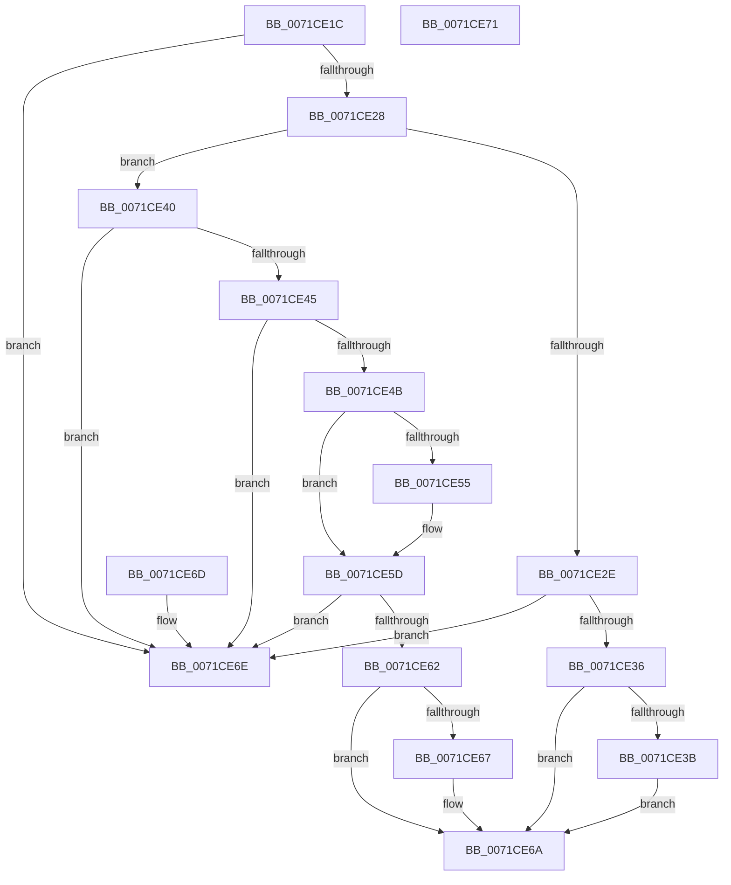

# IopVerifyDiskSignature

- RVA: `0x0071CE1C`–`0x0071CE72` (길이 `86` bytes)
- VA: `0x000000014071CE1C`
- 실행 섹션: `PAGE`
- PDB 이름 있음: `예`; PDB Function 태그: `아니요`
- unwind 정보 RVA: `0x000DB714`
- 디코드: `34`개 명령, `86/86` bytes 표시
- 미해석 바이트: `0` (있으면 어셈블리에 `.byte`로 보존)

> 이 문서는 커널 이미지의 기계어와 PDB 기호를 분석해 생성했습니다. 4번과 5번은 함수 원형과 자료형을 바이너리 사용 방식에서 추정한 C 해석이며 원본 소스 복구 결과는 아닙니다.

## 1. Dependencies

- 직접 호출 지점: **0**; 고유 호출 대상: **0**
- 직접 호출자로 확인된 함수: **2**
- RIP 상대 이미지 참조: **0**

### Outgoing calls
- 직접 디코드된 call 명령이 없습니다.

### Direct callers
- [IopCreateArcName](../A8/IopCreateArcName_function_00A8D580.md) at `0x00A8D9EF`
- [IopGetBootDiskInformation](../../init/C2/IopGetBootDiskInformation_function_00C2DAAC.md) at `0x00C2DDF1`

### Static image references
- 디코드된 RIP-relative 메모리 참조가 없습니다.

## 2. Other-region calls and transfers

- 다른 실행 섹션으로 향하는 call: **0**
- 별도 외부 분기/꼬리 이동을 확인하지 못했습니다.

## 3. Assembly (complete function range)

```asm
0071CE1C  45 33 D2                        xor r10d, r10d
0071CE1F  4C 8B CA                        mov r9, rdx
0071CE22  44 38 52 24                     cmp byte ptr [rdx + 0x24], r10b
0071CE26  74 46                           je 0x14071ce6e
0071CE28  8B 01                           mov eax, dword ptr [rcx]
0071CE2A  85 C0                           test eax, eax
0071CE2C  75 12                           jne 0x14071ce40
0071CE2E  8B 41 08                        mov eax, dword ptr [rcx + 8]
0071CE31  39 42 10                        cmp dword ptr [rdx + 0x10], eax
0071CE34  75 38                           jne 0x14071ce6e
0071CE36  4D 85 C0                        test r8, r8
0071CE39  74 2F                           je 0x14071ce6a
0071CE3B  41 89 00                        mov dword ptr [r8], eax
0071CE3E  EB 2A                           jmp 0x14071ce6a
0071CE40  83 F8 01                        cmp eax, 1
0071CE43  75 29                           jne 0x14071ce6e
0071CE45  44 38 52 26                     cmp byte ptr [rdx + 0x26], r10b
0071CE49  74 23                           je 0x14071ce6e
0071CE4B  48 8B 52 28                     mov rdx, qword ptr [rdx + 0x28]
0071CE4F  48 2B 51 08                     sub rdx, qword ptr [rcx + 8]
0071CE53  75 08                           jne 0x14071ce5d
0071CE55  49 8B 51 30                     mov rdx, qword ptr [r9 + 0x30]
0071CE59  48 2B 51 10                     sub rdx, qword ptr [rcx + 0x10]
0071CE5D  48 85 D2                        test rdx, rdx
0071CE60  75 0C                           jne 0x14071ce6e
0071CE62  4D 85 C0                        test r8, r8
0071CE65  74 03                           je 0x14071ce6a
0071CE67  45 89 10                        mov dword ptr [r8], r10d
0071CE6A  B0 01                           mov al, 1
0071CE6C  C3                              ret
0071CE6D  CC                              int3
0071CE6E  32 C0                           xor al, al
0071CE70  C3                              ret
0071CE71  CC                              int3
```

## 4. C-style interpretation (structured pseudocode)

```c
__int64 __fastcall IopVerifyDiskSignature(__int64 a1, __int64 a2, __int64 a3)
{
    __int64 result;
    __int64 v_r10;

    v_r10 = 0;
    if ((*(unsigned __int8 *)(a2 + 36)) == 0) goto loc_0071CE6E;
    if ((unsigned int)((unsigned int)(*(unsigned int *)(a1))) != 0) goto loc_0071CE40;
    if ((*(unsigned int *)(a2 + 16)) != ((unsigned int)((unsigned int)(*(unsigned int *)(a1 + 8))))) goto loc_0071CE6E;
    if (a3 == 0) goto loc_0071CE6A;
    *(unsigned int *)(a3) = (unsigned int)((unsigned int)(*(unsigned int *)(a1 + 8)));
    goto loc_0071CE6A;
loc_0071CE40:
    if (((unsigned int)((unsigned int)(*(unsigned int *)(a1 + 8)))) != 1) goto loc_0071CE6E;
    if ((*(unsigned __int8 *)(a2 + 38)) == 0) goto loc_0071CE6E;
    a2 = (*(unsigned __int64 *)(a2 + 40)) - (*(unsigned __int64 *)(a1 + 8));
    if (!(condition_is_not_equal)) {
        a2 = *(unsigned __int64 *)(a2 + 48);
        a2 = (a2) - (*(unsigned __int64 *)(a1 + 16));
    }
    if (a2 != 0) goto loc_0071CE6E;
    if (a3 != 0) {
        *(unsigned int *)(a3) = 0;
    }
    return 1;
loc_0071CE6E:
    result = 0;
    return result;
}
```

## 5. (Beta) C Style

```c
int64_t IopVerifyDiskSignature(void *Arg1, void *Arg2, int64_t Arg3)
{
    uint8_t *arg1 = (uint8_t *)Arg1;
    uint8_t *arg2 = (uint8_t *)Arg2;

    int64_t result;
    int64_t local_r10;

    local_r10 = 0;
    if ((*(uint8_t *)(arg2 + 0x24)) == 0) goto loc_0071CE6E;
    if ((uint32_t)((uint32_t)(*(uint32_t *)(arg1))) != 0) goto loc_0071CE40;
    if ((*(uint32_t *)(arg2 + 0x10)) != ((uint32_t)((uint32_t)(*(uint32_t *)(arg1 + 0x8))))) goto loc_0071CE6E;
    if (Arg3 == 0) goto loc_0071CE6A;
    *(uint32_t *)(Arg3) = (uint32_t)((uint32_t)(*(uint32_t *)(arg1 + 0x8)));
    goto loc_0071CE6A;
loc_0071CE40:
    if (((uint32_t)((uint32_t)(*(uint32_t *)(arg1 + 0x8)))) != 1) goto loc_0071CE6E;
    if ((*(uint8_t *)(arg2 + 0x26)) == 0) goto loc_0071CE6E;
    Arg2 = (*(uint64_t *)(arg2 + 0x28)) - (*(uint64_t *)(arg1 + 0x8));
    if (!(condition_is_not_equal)) {
        Arg2 = *(uint64_t *)(arg2 + 0x30);
        Arg2 = (Arg2) - (*(uint64_t *)(arg1 + 0x10));
    }
    if (Arg2 != NULL) goto loc_0071CE6E;
    if (Arg3 != 0) {
        *(uint32_t *)(Arg3) = 0;
    }
    return 1;
loc_0071CE6E:
    result = 0;
    return result;
}
```

### 관측된 메모리 오프셋

구조체 형식이 확인되지 않은 접근은 인자 기준의 오프셋으로만 기록했습니다.

| 기준 인자 | 오프셋 표현 | 폭 (bit) | 접근 |
|---|---:|---:|---|
| `Arg1` | `+ 0x0` | `32` | `R` |
| `Arg1` | `+ 0x8` | `32` | `R` |
| `Arg1` | `+ 0x8` | `64` | `R` |
| `Arg1` | `+ 0x10` | `64` | `R` |
| `Arg2` | `+ 0x10` | `32` | `R` |
| `Arg2` | `+ 0x24` | `8` | `R` |
| `Arg2` | `+ 0x26` | `8` | `R` |
| `Arg2` | `+ 0x28` | `64` | `R` |
| `Arg2` | `+ 0x30` | `64` | `R` |

## 6. Execution-region graph

[열기: 2D/3D 그래프와 함수 탐색 컨트롤 패널](../../../control-panel.html?section=page&rva=0x0071CE1C&view=graph)

- 2D 그래프는 위에서 아래로 흐르고, 3D 그래프는 빈 공간을 드래그해 회전합니다. Shift+드래그는 이동, 휠은 확대·축소, 함수 노드 선택은 대상 보고서 이동입니다.

### Static fallback


