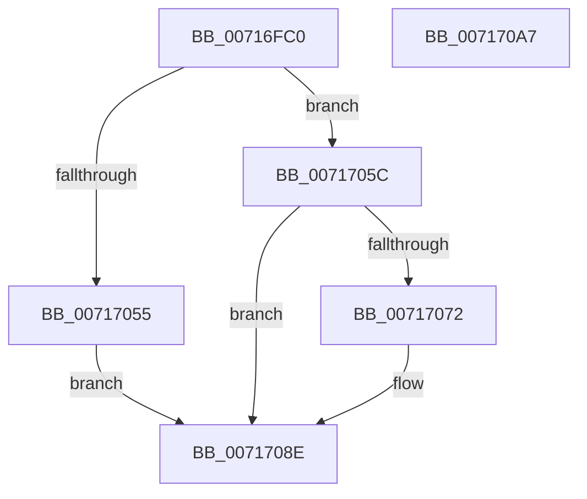

# NT_DISK::Control

- RVA: `0x00716FC0`–`0x007170A8` (길이 `232` bytes)
- VA: `0x0000000140716FC0`
- 실행 섹션: `PAGE`
- PDB 이름 있음: `예`; PDB Function 태그: `아니요`
- unwind 정보 RVA: `0x0007FA5C`
- 디코드: `58`개 명령, `232/232` bytes 표시
- 미해석 바이트: `0` (있으면 어셈블리에 `.byte`로 보존)

> 이 문서는 커널 이미지의 기계어와 PDB 기호를 분석해 생성했습니다. 4번과 5번은 함수 원형과 자료형을 바이너리 사용 방식에서 추정한 C 해석이며 원본 소스 복구 결과는 아닙니다.

## 1. Dependencies

- 직접 호출 지점: **4**; 고유 호출 대상: **4**
- 직접 호출자로 확인된 함수: **0**
- RIP 상대 이미지 참조: **0**

### Outgoing calls
- `0x00717006` → [KeInitializeEvent](../../text/40/KeInitializeEvent_function_0040DD10.md) (function, `0x0040DD10`)
- `0x0071704B` → [IoBuildDeviceIoControlRequest](../../text/20/IoBuildDeviceIoControlRequest_function_00204FD0.md) (function, `0x00204FD0`)
- `0x00717066` → [IofCallDriver](../../text/29/IofCallDriver_function_0029B4B0.md) (function, `0x0029B4B0`)
- `0x00717085` → [KeWaitForSingleObject](../../text/20/KeWaitForSingleObject_function_0020E6B0.md) (function, `0x0020E6B0`)

### Direct callers
- 이 함수 시작 RVA로 연결되는 직접 call은 확인되지 않았습니다. 간접 호출은 완전히 역산할 수 없습니다.

### Static image references
- 디코드된 RIP-relative 메모리 참조가 없습니다.

## 2. Other-region calls and transfers

- 다른 실행 섹션으로 향하는 call: **4**
  - `0x00717006` → [KeInitializeEvent](../../text/40/KeInitializeEvent_function_0040DD10.md) (`PAGE` → `.text`)
  - `0x0071704B` → [IoBuildDeviceIoControlRequest](../../text/20/IoBuildDeviceIoControlRequest_function_00204FD0.md) (`PAGE` → `.text`)
  - `0x00717066` → [IofCallDriver](../../text/29/IofCallDriver_function_0029B4B0.md) (`PAGE` → `.text`)
  - `0x00717085` → [KeWaitForSingleObject](../../text/20/KeWaitForSingleObject_function_0020E6B0.md) (`PAGE` → `.text`)
- 별도 외부 분기/꼬리 이동을 확인하지 못했습니다.

## 3. Assembly (complete function range)

```asm
00716FC0  48 8B C4                        mov rax, rsp
00716FC3  48 89 58 08                     mov qword ptr [rax + 8], rbx
00716FC7  48 89 68 10                     mov qword ptr [rax + 0x10], rbp
00716FCB  48 89 70 18                     mov qword ptr [rax + 0x18], rsi
00716FCF  57                              push rdi
00716FD0  48 81 EC 80 00 00 00            sub rsp, 0x80
00716FD7  C7 40 D8 00 00 00 00            mov dword ptr [rax - 0x28], 0
00716FDE  0F 57 C0                        xorps xmm0, xmm0
00716FE1  33 C0                           xor eax, eax
00716FE3  49 8B F8                        mov rdi, r8
00716FE6  8B F2                           mov esi, edx
00716FE8  89 44 24 74                     mov dword ptr [rsp + 0x74], eax
00716FEC  48 8B E9                        mov rbp, rcx
00716FEF  45 33 C0                        xor r8d, r8d
00716FF2  33 D2                           xor edx, edx
00716FF4  48 8D 4C 24 60                  lea rcx, [rsp + 0x60]
00716FF9  41 8B D9                        mov ebx, r9d
00716FFC  0F 11 44 24 64                  movups xmmword ptr [rsp + 0x64], xmm0
00717001  0F 11 44 24 50                  movups xmmword ptr [rsp + 0x50], xmm0
00717006  E8 05 6D CF FF                  call 0x14040dd10
0071700B  48 8B 95 88 01 00 00            mov rdx, qword ptr [rbp + 0x188]
00717012  48 8D 44 24 50                  lea rax, [rsp + 0x50]
00717017  48 89 44 24 40                  mov qword ptr [rsp + 0x40], rax
0071701C  44 8B CB                        mov r9d, ebx
0071701F  48 8D 44 24 60                  lea rax, [rsp + 0x60]
00717024  4C 8B C7                        mov r8, rdi
00717027  48 89 44 24 38                  mov qword ptr [rsp + 0x38], rax
0071702C  8B CE                           mov ecx, esi
0071702E  8B 84 24 B8 00 00 00            mov eax, dword ptr [rsp + 0xb8]
00717035  C6 44 24 30 00                  mov byte ptr [rsp + 0x30], 0
0071703A  89 44 24 28                     mov dword ptr [rsp + 0x28], eax
0071703E  48 8B 84 24 B0 00 00 00         mov rax, qword ptr [rsp + 0xb0]
00717046  48 89 44 24 20                  mov qword ptr [rsp + 0x20], rax
0071704B  E8 80 DF AE FF                  call 0x140204fd0
00717050  48 85 C0                        test rax, rax
00717053  75 07                           jne 0x14071705c
00717055  B8 9A 00 00 C0                  mov eax, 0xc000009a
0071705A  EB 32                           jmp 0x14071708e
0071705C  48 8B 8D 88 01 00 00            mov rcx, qword ptr [rbp + 0x188]
00717063  48 8B D0                        mov rdx, rax
00717066  E8 45 44 B8 FF                  call 0x14029b4b0
0071706B  3D 03 01 00 00                  cmp eax, 0x103
00717070  75 1C                           jne 0x14071708e
00717072  48 83 64 24 20 00               and qword ptr [rsp + 0x20], 0
00717078  48 8D 4C 24 60                  lea rcx, [rsp + 0x60]
0071707D  45 33 C9                        xor r9d, r9d
00717080  45 33 C0                        xor r8d, r8d
00717083  33 D2                           xor edx, edx
00717085  E8 26 76 AF FF                  call 0x14020e6b0
0071708A  8B 44 24 50                     mov eax, dword ptr [rsp + 0x50]
0071708E  4C 8D 9C 24 80 00 00 00         lea r11, [rsp + 0x80]
00717096  49 8B 5B 10                     mov rbx, qword ptr [r11 + 0x10]
0071709A  49 8B 6B 18                     mov rbp, qword ptr [r11 + 0x18]
0071709E  49 8B 73 20                     mov rsi, qword ptr [r11 + 0x20]
007170A2  49 8B E3                        mov rsp, r11
007170A5  5F                              pop rdi
007170A6  C3                              ret
007170A7  CC                              int3
```

## 4. C-style interpretation (structured pseudocode)

```c
__int64 __fastcall NT_DISK__Control(__int64 a1, int a2, __int64 a3, int a4, __int64 a5, unsigned int a6)
{
    __int64 result;
    __int64 v_rsp;
    unsigned int v_stack_m14;
    unsigned __int64 v_stack_m24;
    unsigned __int64 v_stack_m28;
    unsigned __int64 v_stack_m38;
    unsigned __int64 v_stack_m48;
    unsigned __int64 v_stack_m50;
    unsigned __int8 v_stack_m58;
    unsigned int v_stack_m60;
    unsigned __int64 v_stack_m68;
    unsigned __int64 v_stack_m8;

    *(unsigned __int64 *)(v_rsp + 8) = v_rbx;
    *(unsigned __int64 *)(v_rsp + 16) = v_rbp;
    *(unsigned __int64 *)(v_rsp + 24) = v_rsi;
    v_rsp = (v_rsp) - (128);
    *(unsigned int *)(v_rsp - 40) = 0;
    result = 0;
    v_stack_m14 = 0;
    a3 = 0;
    a2 = 0;
    v_stack_m24 = v_xmm0;
    v_stack_m38 = v_xmm0;
    result = KeInitializeEvent(v_stack_m28, a2, a3, a4);
    v_stack_m48 = v_stack_m38;
    v_stack_m50 = v_stack_m28;
    v_stack_m58 = 0;
    v_stack_m60 = (unsigned int)((unsigned int)(a6));
    v_stack_m68 = a5;
    result = IoBuildDeviceIoControlRequest((unsigned int)((unsigned int)((unsigned int)(a2))), *(unsigned __int64 *)(a1 + 392), 0, (unsigned int)((unsigned int)((unsigned int)(a4))));
    if (result != 0) goto loc_0071705C;
    goto loc_0071708E;
loc_0071705C:
    result = IofCallDriver(*(unsigned __int64 *)(a1 + 392), (unsigned int)(0xC000009AULL), 0, (unsigned int)((unsigned int)((unsigned int)(a4))));
    if (((unsigned int)(result)) == 259) {
        a1 = v_stack_m28;
        a4 = 0;
        a3 = 0;
        a2 = 0;
        result = KeWaitForSingleObject(a1, a2, a3, a4);
        result = v_stack_m38;
    }
    return result;
}
```

## 5. (Beta) C Style

```c
int64_t NT_DISK__Control(void *Arg1, int32_t Arg2, int64_t Arg3, int32_t Arg4, int64_t Arg5, uint32_t Arg6)
{
    uint8_t *arg1 = (uint8_t *)Arg1;

    int64_t result;
    int64_t local_rsp;
    uint32_t v_stack_m14;
    uint64_t v_stack_m24;
    uint64_t v_stack_m28;
    uint64_t v_stack_m38;
    uint64_t v_stack_m48;
    uint64_t v_stack_m50;
    uint8_t v_stack_m58;
    uint32_t v_stack_m60;
    uint64_t v_stack_m68;
    uint64_t v_stack_m8;

    *(uint64_t *)(local_rsp + 0x8) = local_rbx;
    *(uint64_t *)(local_rsp + 0x10) = local_rbp;
    *(uint64_t *)(local_rsp + 0x18) = local_rsi;
    local_rsp = (local_rsp) - (128);
    *(uint32_t *)(local_rsp - 0x28) = 0;
    result = 0;
    v_stack_m14 = 0;
    Arg3 = 0;
    Arg2 = 0;
    v_stack_m24 = v_xmm0;
    v_stack_m38 = v_xmm0;
    result = KeInitializeEvent(v_stack_m28, Arg2, Arg3, Arg4);
    v_stack_m48 = v_stack_m38;
    v_stack_m50 = v_stack_m28;
    v_stack_m58 = 0;
    v_stack_m60 = (uint32_t)((uint32_t)(Arg6));
    v_stack_m68 = Arg5;
    result = IoBuildDeviceIoControlRequest((uint32_t)((uint32_t)((uint32_t)(Arg2))), *(uint64_t *)(arg1 + 0x188), 0, (uint32_t)((uint32_t)((uint32_t)(Arg4))));
    if (result != 0) goto loc_0071705C;
    goto loc_0071708E;
loc_0071705C:
    result = IofCallDriver(*(uint64_t *)(arg1 + 0x188), (uint32_t)(0xC000009AULL), 0, (uint32_t)((uint32_t)((uint32_t)(Arg4))));
    if (((uint32_t)(result)) == 259) {
        Arg1 = v_stack_m28;
        Arg4 = 0;
        Arg3 = 0;
        Arg2 = 0;
        result = KeWaitForSingleObject(Arg1, Arg2, Arg3, Arg4);
        result = v_stack_m38;
    }
    return result;
}
```

### 관측된 메모리 오프셋

구조체 형식이 확인되지 않은 접근은 인자 기준의 오프셋으로만 기록했습니다.

| 기준 인자 | 오프셋 표현 | 폭 (bit) | 접근 |
|---|---:|---:|---|
| `Arg1` | `+ 0x188` | `64` | `R` |

## 6. Execution-region graph

[열기: 2D/3D 그래프와 함수 탐색 컨트롤 패널](../../../control-panel.html?section=page&rva=0x00716FC0&view=graph)

- 2D 그래프는 위에서 아래로 흐르고, 3D 그래프는 빈 공간을 드래그해 회전합니다. Shift+드래그는 이동, 휠은 확대·축소, 함수 노드 선택은 대상 보고서 이동입니다.

### Static fallback


