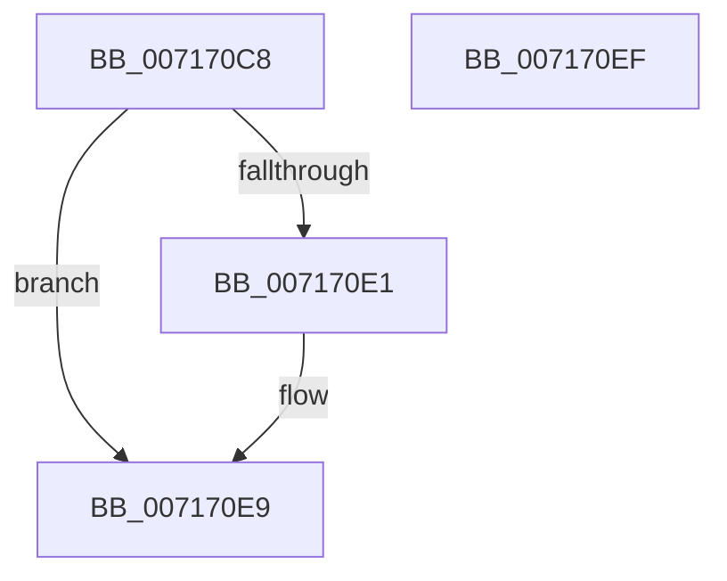

# NT_DISK::Initialize

- RVA: `0x007170C8`–`0x007170F0` (길이 `40` bytes)
- VA: `0x00000001407170C8`
- 실행 섹션: `PAGE`
- PDB 이름 있음: `예`; PDB Function 태그: `아니요`
- unwind 정보 RVA: `0x0005CF00`
- 디코드: `13`개 명령, `40/40` bytes 표시
- 미해석 바이트: `0` (있으면 어셈블리에 `.byte`로 보존)

> 이 문서는 커널 이미지의 기계어와 PDB 기호를 분석해 생성했습니다. 4번과 5번은 함수 원형과 자료형을 바이너리 사용 방식에서 추정한 C 해석이며 원본 소스 복구 결과는 아닙니다.

## 1. Dependencies

- 직접 호출 지점: **2**; 고유 호출 대상: **2**
- 직접 호출자로 확인된 함수: **9**
- RIP 상대 이미지 참조: **0**

### Outgoing calls
- `0x007170D8` → [SC_DISK::Initialize](../../text/6A/SC_DISK_Initialize_function_006A46C0.md) (function, `0x006A46C0`)
- `0x007170E4` → [SC_DISK::InitializePartitionCache](../../text/6A/SC_DISK_InitializePartitionCache_function_006A4844.md) (function, `0x006A4844`)

### Direct callers
- [IoCreateDisk](IoCreateDisk_function_00717250.md) at `0x007172A1`
- [IoReadDiskSignature](IoReadDiskSignature_function_00717300.md) at `0x00717357`
- [IoReadPartitionTable](IoReadPartitionTable_function_00717400.md) at `0x00717467`
- [IoReadPartitionTableEx](IoReadPartitionTableEx_function_007175D0.md) at `0x00717621`
- [IoSetPartitionInformation](IoSetPartitionInformation_function_00717680.md) at `0x007176FA`
- [IoSetPartitionInformationEx](IoSetPartitionInformationEx_function_00717760.md) at `0x007177B0`
- [IoVerifyPartitionTable](IoVerifyPartitionTable_function_00717810.md) at `0x00717861`
- [IoWritePartitionTable](IoWritePartitionTable_function_007178C0.md) at `0x007179B6`
- [IoWritePartitionTableEx](IoWritePartitionTableEx_function_00717A20.md) at `0x00717A71`

### Static image references
- 디코드된 RIP-relative 메모리 참조가 없습니다.

## 2. Other-region calls and transfers

- 다른 실행 섹션으로 향하는 call: **2**
  - `0x007170D8` → [SC_DISK::Initialize](../../text/6A/SC_DISK_Initialize_function_006A46C0.md) (`PAGE` → `.text`)
  - `0x007170E4` → [SC_DISK::InitializePartitionCache](../../text/6A/SC_DISK_InitializePartitionCache_function_006A4844.md) (`PAGE` → `.text`)
- 별도 외부 분기/꼬리 이동을 확인하지 못했습니다.

## 3. Assembly (complete function range)

```asm
007170C8  40 53                           push rbx
007170CA  48 83 EC 20                     sub rsp, 0x20
007170CE  48 8B D9                        mov rbx, rcx
007170D1  48 89 91 88 01 00 00            mov qword ptr [rcx + 0x188], rdx
007170D8  E8 E3 D5 F8 FF                  call 0x1406a46c0
007170DD  85 C0                           test eax, eax
007170DF  78 08                           js 0x1407170e9
007170E1  48 8B CB                        mov rcx, rbx
007170E4  E8 5B D7 F8 FF                  call 0x1406a4844
007170E9  48 83 C4 20                     add rsp, 0x20
007170ED  5B                              pop rbx
007170EE  C3                              ret
007170EF  CC                              int3
```

## 4. C-style interpretation (structured pseudocode)

```c
__int64 __fastcall NT_DISK__Initialize(__int64 a1, __int64 a2)
{
    __int64 result;
    __int64 v_rsp;

    v_rsp = (v_rsp) - (32);
    *(unsigned __int64 *)(a1 + 392) = a2;
    result = SC_DISK__Initialize(a1, a2, a3, a4);
    if (!(sign_flag)) {
        a1 = a1;
        result = SC_DISK__InitializePartitionCache(a1, a2, a3, a4);
    }
    v_rsp = (v_rsp) + (32);
    return result;
}
```

## 5. (Beta) C Style

```c
int64_t NT_DISK__Initialize(void *Arg1, int64_t Arg2)
{
    uint8_t *arg1 = (uint8_t *)Arg1;

    int64_t result;
    int64_t local_rsp;

    local_rsp = (local_rsp) - (32);
    *(uint64_t *)(arg1 + 0x188) = Arg2;
    result = SC_DISK__Initialize(Arg1, Arg2, a3, a4);
    if (!(sign_flag)) {
        Arg1 = Arg1;
        result = SC_DISK__InitializePartitionCache(Arg1, Arg2, a3, a4);
    }
    local_rsp = (local_rsp) + (32);
    return result;
}
```

### 관측된 메모리 오프셋

구조체 형식이 확인되지 않은 접근은 인자 기준의 오프셋으로만 기록했습니다.

| 기준 인자 | 오프셋 표현 | 폭 (bit) | 접근 |
|---|---:|---:|---|
| `Arg1` | `+ 0x188` | `64` | `W` |

## 6. Execution-region graph

[열기: 2D/3D 그래프와 함수 탐색 컨트롤 패널](../../../control-panel.html?section=page&rva=0x007170C8&view=graph)

- 2D 그래프는 위에서 아래로 흐르고, 3D 그래프는 빈 공간을 드래그해 회전합니다. Shift+드래그는 이동, 휠은 확대·축소, 함수 노드 선택은 대상 보고서 이동입니다.

### Static fallback


