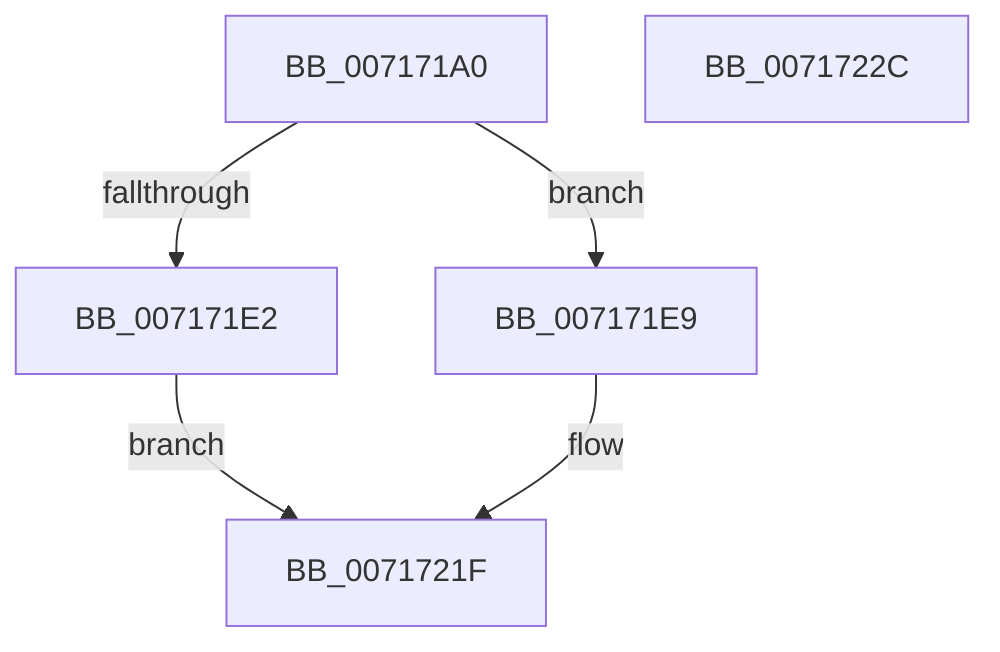

# NT_DISK::Write

- RVA: `0x007171A0`–`0x0071722D` (길이 `141` bytes)
- VA: `0x00000001407171A0`
- 실행 섹션: `PAGE`
- PDB 이름 있음: `예`; PDB Function 태그: `아니요`
- unwind 정보 RVA: `0x000C6370`
- 디코드: `38`개 명령, `141/141` bytes 표시
- 미해석 바이트: `0` (있으면 어셈블리에 `.byte`로 보존)

> 이 문서는 커널 이미지의 기계어와 PDB 기호를 분석해 생성했습니다. 4번과 5번은 함수 원형과 자료형을 바이너리 사용 방식에서 추정한 C 해석이며 원본 소스 복구 결과는 아닙니다.

## 1. Dependencies

- 직접 호출 지점: **5**; 고유 호출 대상: **5**
- 직접 호출자로 확인된 함수: **0**
- RIP 상대 이미지 참조: **0**

### Outgoing calls
- `0x007171D5` → [IoBuildAsynchronousFsdRequest](../../text/29/IoBuildAsynchronousFsdRequest_function_0029DD00.md) (function, `0x0029DD00`)
- `0x007171FE` → [IoSynchronousCallDriver](../../text/48/IoSynchronousCallDriver_function_00484050.md) (function, `0x00484050`)
- `0x00717209` → [MmUnlockPages](../../text/29/MmUnlockPages_function_0029EEE0.md) (function, `0x0029EEE0`)
- `0x00717212` → [IoFreeMdl](../../text/29/IoFreeMdl_function_0029EA80.md) (function, `0x0029EA80`)
- `0x0071721A` → [IoFreeIrp](../../text/24/IoFreeIrp_function_0024DF70.md) (function, `0x0024DF70`)

### Direct callers
- 이 함수 시작 RVA로 연결되는 직접 call은 확인되지 않았습니다. 간접 호출은 완전히 역산할 수 없습니다.

### Static image references
- 디코드된 RIP-relative 메모리 참조가 없습니다.

## 2. Other-region calls and transfers

- 다른 실행 섹션으로 향하는 call: **5**
  - `0x007171D5` → [IoBuildAsynchronousFsdRequest](../../text/29/IoBuildAsynchronousFsdRequest_function_0029DD00.md) (`PAGE` → `.text`)
  - `0x007171FE` → [IoSynchronousCallDriver](../../text/48/IoSynchronousCallDriver_function_00484050.md) (`PAGE` → `.text`)
  - `0x00717209` → [MmUnlockPages](../../text/29/MmUnlockPages_function_0029EEE0.md) (`PAGE` → `.text`)
  - `0x00717212` → [IoFreeMdl](../../text/29/IoFreeMdl_function_0029EA80.md) (`PAGE` → `.text`)
  - `0x0071721A` → [IoFreeIrp](../../text/24/IoFreeIrp_function_0024DF70.md) (`PAGE` → `.text`)
- 별도 외부 분기/꼬리 이동을 확인하지 못했습니다.

## 3. Assembly (complete function range)

```asm
007171A0  4C 8B DC                        mov r11, rsp
007171A3  49 89 5B 08                     mov qword ptr [r11 + 8], rbx
007171A7  49 89 53 10                     mov qword ptr [r11 + 0x10], rdx
007171AB  57                              push rdi
007171AC  48 83 EC 30                     sub rsp, 0x30
007171B0  49 83 63 F0 00                  and qword ptr [r11 - 0x10], 0
007171B5  48 8B F9                        mov rdi, rcx
007171B8  49 8D 4B 10                     lea rcx, [r11 + 0x10]
007171BC  49 8B C1                        mov rax, r9
007171BF  49 89 4B E8                     mov qword ptr [r11 - 0x18], rcx
007171C3  45 8B C8                        mov r9d, r8d
007171C6  4C 8B C0                        mov r8, rax
007171C9  B9 04 00 00 00                  mov ecx, 4
007171CE  48 8B 97 88 01 00 00            mov rdx, qword ptr [rdi + 0x188]
007171D5  E8 26 6B B8 FF                  call 0x14029dd00
007171DA  48 8B D8                        mov rbx, rax
007171DD  48 85 C0                        test rax, rax
007171E0  75 07                           jne 0x1407171e9
007171E2  BF 9A 00 00 C0                  mov edi, 0xc000009a
007171E7  EB 36                           jmp 0x14071721f
007171E9  48 8B 80 B8 00 00 00            mov rax, qword ptr [rax + 0xb8]
007171F0  48 8B D3                        mov rdx, rbx
007171F3  80 48 BA 12                     or byte ptr [rax - 0x46], 0x12
007171F7  48 8B 8F 88 01 00 00            mov rcx, qword ptr [rdi + 0x188]
007171FE  E8 4D CE D6 FF                  call 0x140484050
00717203  8B F8                           mov edi, eax
00717205  48 8B 4B 08                     mov rcx, qword ptr [rbx + 8]
00717209  E8 D2 7C B8 FF                  call 0x14029eee0
0071720E  48 8B 4B 08                     mov rcx, qword ptr [rbx + 8]
00717212  E8 69 78 B8 FF                  call 0x14029ea80
00717217  48 8B CB                        mov rcx, rbx
0071721A  E8 51 6D B3 FF                  call 0x14024df70
0071721F  48 8B 5C 24 40                  mov rbx, qword ptr [rsp + 0x40]
00717224  8B C7                           mov eax, edi
00717226  48 83 C4 30                     add rsp, 0x30
0071722A  5F                              pop rdi
0071722B  C3                              ret
0071722C  CC                              int3
```

## 4. C-style interpretation (structured pseudocode)

```c
__int64 __fastcall NT_DISK__Write(__int64 a1, __int64 a2, int a3, __int64 a4)
{
    __int64 result;
    __int64 v_rsp;
    unsigned __int64 v_stack_p8;

    *(unsigned __int64 *)(v_rsp + 8) = v_rbx;
    *(unsigned __int64 *)(v_rsp + 16) = a2;
    v_rsp = (v_rsp) - (48);
    *(unsigned __int64 *)(v_rsp - 24) = v_rsp + 16;
    result = IoBuildAsynchronousFsdRequest(4, *(unsigned __int64 *)(a1 + 392), a4, (unsigned int)(a3));
    if (result != 0) goto loc_007171E9;
    goto loc_0071721F;
loc_007171E9:
    result = IoSynchronousCallDriver(*(unsigned __int64 *)((unsigned int)(0xC000009AULL) + 392), result, a4, (unsigned int)(a3));
    result = MmUnlockPages(*(unsigned __int64 *)(result + 8), result, a4, (unsigned int)(a3));
    result = IoFreeMdl(*(unsigned __int64 *)(result + 8), result, a4, (unsigned int)(a3));
    result = IoFreeIrp(result, result, a4, (unsigned int)(a3));
loc_0071721F:
    v_rsp = (v_rsp) + (48);
    return (unsigned int)((unsigned int)((unsigned int)((unsigned int)(result))));
}
```

## 5. (Beta) C Style

```c
int64_t NT_DISK__Write(void *Arg1, int64_t Arg2, int32_t Arg3, int64_t Arg4)
{
    uint8_t *arg1 = (uint8_t *)Arg1;

    int64_t result;
    int64_t local_rsp;
    uint64_t v_stack_p8;

    *(uint64_t *)(local_rsp + 0x8) = local_rbx;
    *(uint64_t *)(local_rsp + 0x10) = Arg2;
    local_rsp = (local_rsp) - (48);
    *(uint64_t *)(local_rsp - 0x18) = local_rsp + 16;
    result = IoBuildAsynchronousFsdRequest(4, *(uint64_t *)(arg1 + 0x188), Arg4, (uint32_t)(Arg3));
    if (result != 0) goto loc_007171E9;
    goto loc_0071721F;
loc_007171E9:
    result = IoSynchronousCallDriver(*(uint64_t *)((uint32_t)(0xC000009AULL) + 0x188), result, Arg4, (uint32_t)(Arg3));
    result = MmUnlockPages(*(uint64_t *)(result + 0x8), result, Arg4, (uint32_t)(Arg3));
    result = IoFreeMdl(*(uint64_t *)(result + 0x8), result, Arg4, (uint32_t)(Arg3));
    result = IoFreeIrp(result, result, Arg4, (uint32_t)(Arg3));
loc_0071721F:
    local_rsp = (local_rsp) + (48);
    return (uint32_t)((uint32_t)((uint32_t)((uint32_t)(result))));
}
```

### 관측된 메모리 오프셋

구조체 형식이 확인되지 않은 접근은 인자 기준의 오프셋으로만 기록했습니다.

| 기준 인자 | 오프셋 표현 | 폭 (bit) | 접근 |
|---|---:|---:|---|
| `Arg1` | `+ 0x188` | `64` | `R` |

## 6. Execution-region graph

[열기: 2D/3D 그래프와 함수 탐색 컨트롤 패널](../../../control-panel.html?section=page&rva=0x007171A0&view=graph)

- 2D 그래프는 위에서 아래로 흐르고, 3D 그래프는 빈 공간을 드래그해 회전합니다. Shift+드래그는 이동, 휠은 확대·축소, 함수 노드 선택은 대상 보고서 이동입니다.

### Static fallback


