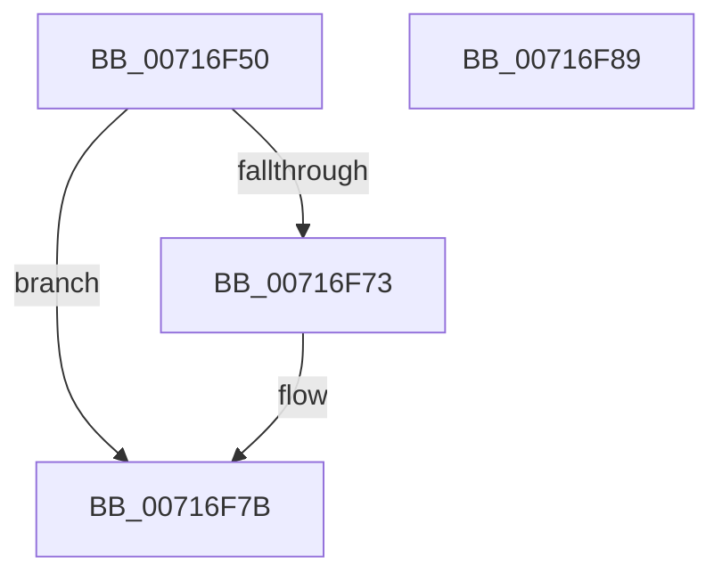

# NT_DISK::`scalar deleting destructor&#x27;

- RVA: `0x00716F50`–`0x00716F8A` (길이 `58` bytes)
- VA: `0x0000000140716F50`
- 실행 섹션: `PAGE`
- PDB 이름 있음: `예`; PDB Function 태그: `아니요`
- unwind 정보 RVA: `0x0005CAAC`
- 디코드: `18`개 명령, `58/58` bytes 표시
- 미해석 바이트: `0` (있으면 어셈블리에 `.byte`로 보존)

> 이 문서는 커널 이미지의 기계어와 PDB 기호를 분석해 생성했습니다. 4번과 5번은 함수 원형과 자료형을 바이너리 사용 방식에서 추정한 C 해석이며 원본 소스 복구 결과는 아닙니다.

## 1. Dependencies

- 직접 호출 지점: **2**; 고유 호출 대상: **2**
- 직접 호출자로 확인된 함수: **0**
- RIP 상대 이미지 참조: **1**

### Outgoing calls
- `0x00716F69` → [SC_DISK::~SC_DISK](../../text/6A/SC_DISK_SC_DISK_function_006A42C4.md) (function, `0x006A42C4`)
- `0x00716F76` → [SC_ENV_ALLOCATOR::operator delete](../../text/6A/SC_ENV_ALLOCATOR_operator_delete_function_006A3F98.md) (function, `0x006A3F98`)

### Direct callers
- 이 함수 시작 RVA로 연결되는 직접 call은 확인되지 않았습니다. 간접 호출은 완전히 역산할 수 없습니다.

### Static image references
- `0x00716F5A` → RVA `0x00007EB8` (`.rdata`; read)

## 2. Other-region calls and transfers

- 다른 실행 섹션으로 향하는 call: **2**
  - `0x00716F69` → [SC_DISK::~SC_DISK](../../text/6A/SC_DISK_SC_DISK_function_006A42C4.md) (`PAGE` → `.text`)
  - `0x00716F76` → [SC_ENV_ALLOCATOR::operator delete](../../text/6A/SC_ENV_ALLOCATOR_operator_delete_function_006A3F98.md) (`PAGE` → `.text`)
- 별도 외부 분기/꼬리 이동을 확인하지 못했습니다.

## 3. Assembly (complete function range)

```asm
00716F50  48 89 5C 24 08                  mov qword ptr [rsp + 8], rbx
00716F55  57                              push rdi
00716F56  48 83 EC 20                     sub rsp, 0x20
00716F5A  48 8D 05 57 0F 8F FF            lea rax, [rip - 0x70f0a9]
00716F61  8B DA                           mov ebx, edx
00716F63  48 89 01                        mov qword ptr [rcx], rax
00716F66  48 8B F9                        mov rdi, rcx
00716F69  E8 56 D3 F8 FF                  call 0x1406a42c4
00716F6E  F6 C3 01                        test bl, 1
00716F71  74 08                           je 0x140716f7b
00716F73  48 8B CF                        mov rcx, rdi
00716F76  E8 1D D0 F8 FF                  call 0x1406a3f98
00716F7B  48 8B 5C 24 30                  mov rbx, qword ptr [rsp + 0x30]
00716F80  48 8B C7                        mov rax, rdi
00716F83  48 83 C4 20                     add rsp, 0x20
00716F87  5F                              pop rdi
00716F88  C3                              ret
00716F89  CC                              int3
```

## 4. C-style interpretation (structured pseudocode)

```c
__int64 __fastcall NT_DISK___scalar_deleting_destructor_(__int64 a1, int a2)
{
    __int64 result;
    __int64 v_rsp;
    unsigned __int64 v_stack_p8;

    v_stack_p8 = v_rbx;
    v_rsp = (v_rsp) - (32);
    *(unsigned __int64 *)(a1) = v_rip - 7401641;
    result = SC_DISK___SC_DISK(a1, a2, a3, a4);
    if ((((unsigned __int8)((unsigned int)(a2))) & (1)) != 0) {
        a1 = a1;
        result = SC_ENV_ALLOCATOR__operator_delete(a1, a2, a3, a4);
    }
    v_rsp = (v_rsp) + (32);
    return a1;
}
```

## 5. (Beta) C Style

```c
void *NT_DISK___scalar_deleting_destructor_(void *Arg1, int32_t Arg2)
{
    uint8_t *arg1 = (uint8_t *)Arg1;

    int64_t result;
    int64_t local_rsp;
    uint64_t v_stack_p8;

    v_stack_p8 = local_rbx;
    local_rsp = (local_rsp) - (32);
    *(uint64_t *)(arg1) = v_rip - 7401641;
    result = SC_DISK___SC_DISK(Arg1, Arg2, a3, a4);
    if ((((uint8_t)((uint32_t)(Arg2))) & (1)) != 0) {
        Arg1 = Arg1;
        result = SC_ENV_ALLOCATOR__operator_delete(Arg1, Arg2, a3, a4);
    }
    local_rsp = (local_rsp) + (32);
    return Arg1;
}
```

### 관측된 메모리 오프셋

구조체 형식이 확인되지 않은 접근은 인자 기준의 오프셋으로만 기록했습니다.

| 기준 인자 | 오프셋 표현 | 폭 (bit) | 접근 |
|---|---:|---:|---|
| `Arg1` | `+ 0x0` | `64` | `W` |

## 6. Execution-region graph

[열기: 2D/3D 그래프와 함수 탐색 컨트롤 패널](../../../control-panel.html?section=page&rva=0x00716F50&view=graph)

- 2D 그래프는 위에서 아래로 흐르고, 3D 그래프는 빈 공간을 드래그해 회전합니다. Shift+드래그는 이동, 휠은 확대·축소, 함수 노드 선택은 대상 보고서 이동입니다.

### Static fallback


