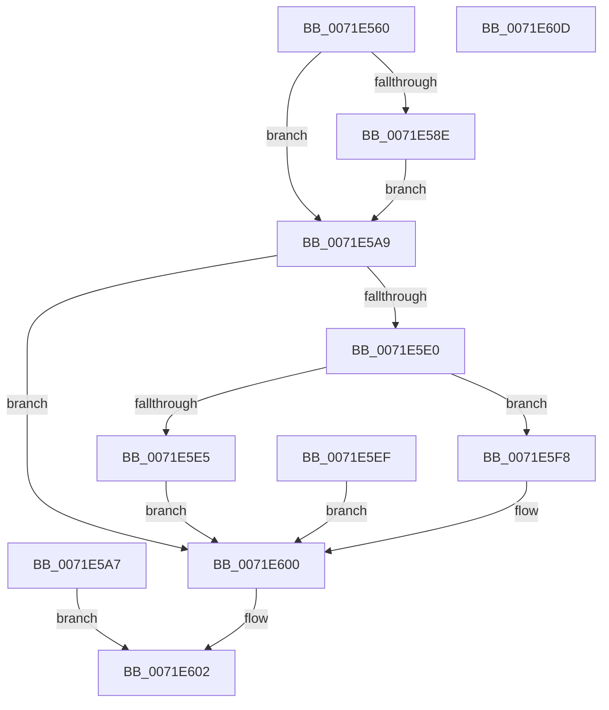

# NtOpenIoCompletion

- RVA: `0x0071E560`–`0x0071E60E` (길이 `174` bytes)
- VA: `0x000000014071E560`
- 실행 섹션: `PAGE`
- PDB 이름 있음: `예`; PDB Function 태그: `아니요`
- unwind 정보 RVA: `0x000C7634`
- 디코드: `46`개 명령, `174/174` bytes 표시
- 미해석 바이트: `0` (있으면 어셈블리에 `.byte`로 보존)

> 이 문서는 커널 이미지의 기계어와 PDB 기호를 분석해 생성했습니다. 4번과 5번은 함수 원형과 자료형을 바이너리 사용 방식에서 추정한 C 해석이며 원본 소스 복구 결과는 아닙니다.

## 1. Dependencies

- 직접 호출 지점: **1**; 고유 호출 대상: **1**
- 직접 호출자로 확인된 함수: **0**
- RIP 상대 이미지 참조: **1**

### Outgoing calls
- `0x0071E5CE` → [ObOpenObjectByName](../89/ObOpenObjectByName_function_00899F50.md) (function, `0x00899F50`)

### Direct callers
- 이 함수 시작 RVA로 연결되는 직접 call은 확인되지 않았습니다. 간접 호출은 완전히 역산할 수 없습니다.

### Static image references
- `0x0071E5C4` → RVA `0x00FC6CC0` (`ALMOSTRO`; read)

## 2. Other-region calls and transfers

- 다른 실행 섹션으로 향하는 call: **0**
- 별도 외부 분기/꼬리 이동을 확인하지 못했습니다.

## 3. Assembly (complete function range)

```asm
0071E560  48 89 5C 24 08                  mov qword ptr [rsp + 8], rbx
0071E565  57                              push rdi
0071E566  48 83 EC 60                     sub rsp, 0x60
0071E56A  4D 8B D0                        mov r10, r8
0071E56D  44 8B C2                        mov r8d, edx
0071E570  48 8B D9                        mov rbx, rcx
0071E573  48 83 64 24 48 00               and qword ptr [rsp + 0x48], 0
0071E579  65 48 8B 04 25 88 01 00 00      mov rax, qword ptr gs:[0x188]
0071E582  40 8A B8 32 02 00 00            mov dil, byte ptr [rax + 0x232]
0071E589  40 84 FF                        test dil, dil
0071E58C  74 1B                           je 0x14071e5a9
0071E58E  48 BA 00 00 FF FF FF 7F 00 00   movabs rdx, 0x7fffffff0000
0071E598  48 3B CA                        cmp rcx, rdx
0071E59B  48 0F 42 D1                     cmovb rdx, rcx
0071E59F  48 8B 02                        mov rax, qword ptr [rdx]
0071E5A2  48 89 02                        mov qword ptr [rdx], rax
0071E5A5  EB 02                           jmp 0x14071e5a9
0071E5A7  EB 59                           jmp 0x14071e602
0071E5A9  48 8D 44 24 48                  lea rax, [rsp + 0x48]
0071E5AE  48 89 44 24 30                  mov qword ptr [rsp + 0x30], rax
0071E5B3  48 83 64 24 28 00               and qword ptr [rsp + 0x28], 0
0071E5B9  44 89 44 24 20                  mov dword ptr [rsp + 0x20], r8d
0071E5BE  45 33 C9                        xor r9d, r9d
0071E5C1  44 8A C7                        mov r8b, dil
0071E5C4  48 8B 15 F5 86 8A 00            mov rdx, qword ptr [rip + 0x8a86f5]
0071E5CB  49 8B CA                        mov rcx, r10
0071E5CE  E8 7D B9 17 00                  call 0x140899f50
0071E5D3  8B D0                           mov edx, eax
0071E5D5  89 84 24 88 00 00 00            mov dword ptr [rsp + 0x88], eax
0071E5DC  85 C0                           test eax, eax
0071E5DE  78 20                           js 0x14071e600
0071E5E0  40 84 FF                        test dil, dil
0071E5E3  74 13                           je 0x14071e5f8
0071E5E5  48 8B 4C 24 48                  mov rcx, qword ptr [rsp + 0x48]
0071E5EA  48 89 0B                        mov qword ptr [rbx], rcx
0071E5ED  EB 11                           jmp 0x14071e600
0071E5EF  8B 94 24 88 00 00 00            mov edx, dword ptr [rsp + 0x88]
0071E5F6  EB 08                           jmp 0x14071e600
0071E5F8  48 8B 44 24 48                  mov rax, qword ptr [rsp + 0x48]
0071E5FD  48 89 03                        mov qword ptr [rbx], rax
0071E600  8B C2                           mov eax, edx
0071E602  48 8B 5C 24 70                  mov rbx, qword ptr [rsp + 0x70]
0071E607  48 83 C4 60                     add rsp, 0x60
0071E60B  5F                              pop rdi
0071E60C  C3                              ret
0071E60D  CC                              int3
```

## 4. C-style interpretation (structured pseudocode)

```c
__int64 __fastcall NtOpenIoCompletion(__int64 a1, int a2, __int64 a3, int a4)
{
    __int64 result;
    __int64 v_rsp;
    unsigned __int64 v_stack_m20;
    unsigned __int64 v_stack_m38;
    unsigned __int64 v_stack_m40;
    unsigned int v_stack_m48;
    unsigned int v_stack_p20;
    unsigned __int64 v_stack_p8;

    v_stack_p8 = v_rbx;
    v_rsp = (v_rsp) - (96);
    if ((unsigned __int8)(*(unsigned __int8 *)(*(unsigned __int64 *)(gs_base + (0 + 392)) + 562)) == 0) goto loc_0071E5A9;
    if (a1 < a2) { a2 = a1; }
    *(unsigned __int64 *)(a2) = *(unsigned __int64 *)(a2);
    goto loc_0071E5A9;
loc_0071E5A9:
    v_stack_m38 = v_stack_m20;
    v_stack_m48 = (unsigned int)((unsigned int)(a2));
    a4 = 0;
    result = ObOpenObjectByName(a3, *(unsigned __int64 *)(v_rip + 9078517), (unsigned __int8)(*(unsigned __int8 *)(*(unsigned __int64 *)(gs_base + (0 + 392)) + 562)), a4);
    v_stack_p20 = (unsigned int)(result);
    if (sign_flag) goto loc_0071E600;
    if ((unsigned __int8)(*(unsigned __int8 *)(*(unsigned __int64 *)(gs_base + (0 + 392)) + 562)) == 0) goto loc_0071E5F8;
    *(unsigned __int64 *)(a1) = v_stack_m20;
    goto loc_0071E600;
loc_0071E5F8:
    *(unsigned __int64 *)(a1) = v_stack_m20;
loc_0071E600:
loc_0071E602:
    v_rsp = (v_rsp) + (96);
    return (unsigned int)((unsigned int)((unsigned int)((unsigned int)(result))));
}
```

## 5. (Beta) C Style

```c
int64_t NtOpenIoCompletion(void *Arg1, int32_t Arg2, int64_t Arg3, int32_t Arg4)
{
    uint8_t *arg1 = (uint8_t *)Arg1;

    int64_t result;
    int64_t local_rsp;
    uint64_t v_stack_m20;
    uint64_t v_stack_m38;
    uint64_t v_stack_m40;
    uint32_t v_stack_m48;
    uint32_t v_stack_p20;
    uint64_t v_stack_p8;

    v_stack_p8 = local_rbx;
    local_rsp = (local_rsp) - (96);
    if ((uint8_t)(*(uint8_t *)(*(uint64_t *)(gs_base + (0 + 0x188)) + 0x232)) == 0) goto loc_0071E5A9;
    if (Arg1 < Arg2) { Arg2 = Arg1; }
    *(uint64_t *)(Arg2) = *(uint64_t *)(Arg2);
    goto loc_0071E5A9;
loc_0071E5A9:
    v_stack_m38 = v_stack_m20;
    v_stack_m48 = (uint32_t)((uint32_t)(Arg2));
    Arg4 = 0;
    result = ObOpenObjectByName(Arg3, *(uint64_t *)(v_rip + 0x8A86F5), (uint8_t)(*(uint8_t *)(*(uint64_t *)(gs_base + (0 + 0x188)) + 0x232)), Arg4);
    v_stack_p20 = (uint32_t)(result);
    if (sign_flag) goto loc_0071E600;
    if ((uint8_t)(*(uint8_t *)(*(uint64_t *)(gs_base + (0 + 0x188)) + 0x232)) == 0) goto loc_0071E5F8;
    *(uint64_t *)(arg1) = v_stack_m20;
    goto loc_0071E600;
loc_0071E5F8:
    *(uint64_t *)(arg1) = v_stack_m20;
loc_0071E600:
loc_0071E602:
    local_rsp = (local_rsp) + (96);
    return (uint32_t)((uint32_t)((uint32_t)((uint32_t)(result))));
}
```

### 관측된 메모리 오프셋

구조체 형식이 확인되지 않은 접근은 인자 기준의 오프셋으로만 기록했습니다.

| 기준 인자 | 오프셋 표현 | 폭 (bit) | 접근 |
|---|---:|---:|---|
| `Arg1` | `+ 0x0` | `64` | `W` |

## 6. Execution-region graph

[열기: 2D/3D 그래프와 함수 탐색 컨트롤 패널](../../../control-panel.html?section=page&rva=0x0071E560&view=graph)

- 2D 그래프는 위에서 아래로 흐르고, 3D 그래프는 빈 공간을 드래그해 회전합니다. Shift+드래그는 이동, 휠은 확대·축소, 함수 노드 선택은 대상 보고서 이동입니다.

### Static fallback


