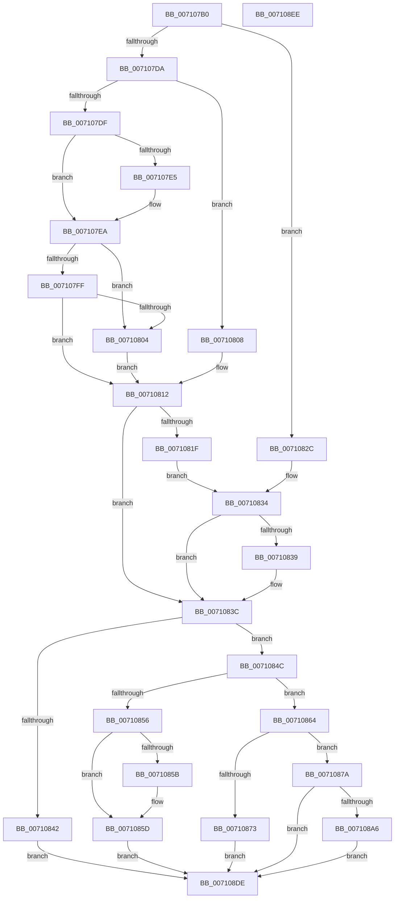

# NtSetInformationDebugObject

- RVA: `0x007107B0`–`0x007108EF` (길이 `319` bytes)
- VA: `0x00000001407107B0`
- 실행 섹션: `PAGE`
- PDB 이름 있음: `예`; PDB Function 태그: `아니요`
- unwind 정보 RVA: `0x000C58FC`
- 디코드: `87`개 명령, `319/319` bytes 표시
- 미해석 바이트: `0` (있으면 어셈블리에 `.byte`로 보존)

> 이 문서는 커널 이미지의 기계어와 PDB 기호를 분석해 생성했습니다. 4번과 5번은 함수 원형과 자료형을 바이너리 사용 방식에서 추정한 C 해석이며 원본 소스 복구 결과는 아닙니다.

## 1. Dependencies

- 직접 호출 지점: **5**; 고유 호출 대상: **5**
- 직접 호출자로 확인된 함수: **0**
- RIP 상대 이미지 참조: **1**

### Outgoing calls
- `0x007107E5` → [ExRaiseDatatypeMisalignment](../89/ExRaiseDatatypeMisalignment_function_00899FD0.md) (function, `0x00899FD0`)
- `0x0071089D` → [ObReferenceObjectByHandle](../86/ObReferenceObjectByHandle_function_00868DB0.md) (function, `0x00868DB0`)
- `0x007108AF` → [ExAcquireFastMutex](../../text/20/ExAcquireFastMutex_function_0020E5A0.md) (function, `0x0020E5A0`)
- `0x007108CD` → [ExReleaseFastMutex](../../text/25/ExReleaseFastMutex_function_002519C0.md) (function, `0x002519C0`)
- `0x007108D5` → [ObfDereferenceObject](../../text/2F/ObfDereferenceObject_function_002F9350.md) (function, `0x002F9350`)

### Direct callers
- 이 함수 시작 RVA로 연결되는 직접 call은 확인되지 않았습니다. 간접 호출은 완전히 역산할 수 없습니다.

### Static image references
- `0x0071087A` → RVA `0x00FC5140` (`ALMOSTRO`; read)

## 2. Other-region calls and transfers

- 다른 실행 섹션으로 향하는 call: **3**
  - `0x007108AF` → [ExAcquireFastMutex](../../text/20/ExAcquireFastMutex_function_0020E5A0.md) (`PAGE` → `.text`)
  - `0x007108CD` → [ExReleaseFastMutex](../../text/25/ExReleaseFastMutex_function_002519C0.md) (`PAGE` → `.text`)
  - `0x007108D5` → [ObfDereferenceObject](../../text/2F/ObfDereferenceObject_function_002F9350.md) (`PAGE` → `.text`)
- 별도 외부 분기/꼬리 이동을 확인하지 못했습니다.

## 3. Assembly (complete function range)

```asm
007107B0  48 89 5C 24 08                  mov qword ptr [rsp + 8], rbx
007107B5  48 89 74 24 10                  mov qword ptr [rsp + 0x10], rsi
007107BA  57                              push rdi
007107BB  48 83 EC 50                     sub rsp, 0x50
007107BF  44 8B D2                        mov r10d, edx
007107C2  48 8B D9                        mov rbx, rcx
007107C5  65 48 8B 04 25 88 01 00 00      mov rax, qword ptr gs:[0x188]
007107CE  44 8A 98 32 02 00 00            mov r11b, byte ptr [rax + 0x232]
007107D5  45 84 DB                        test r11b, r11b
007107D8  74 52                           je 0x14071082c
007107DA  45 85 C9                        test r9d, r9d
007107DD  74 29                           je 0x140710808
007107DF  41 F6 C0 03                     test r8b, 3
007107E3  74 05                           je 0x1407107ea
007107E5  E8 E6 97 18 00                  call 0x140899fd0
007107EA  41 8B C9                        mov ecx, r9d
007107ED  49 03 C8                        add rcx, r8
007107F0  48 BA 00 00 FF FF FF 7F 00 00   movabs rdx, 0x7fffffff0000
007107FA  48 3B CA                        cmp rcx, rdx
007107FD  77 05                           ja 0x140710804
007107FF  49 3B C8                        cmp rcx, r8
00710802  73 0E                           jae 0x140710812
00710804  8A 02                           mov al, byte ptr [rdx]
00710806  EB 0A                           jmp 0x140710812
00710808  48 BA 00 00 FF FF FF 7F 00 00   movabs rdx, 0x7fffffff0000
00710812  48 8B 8C 24 80 00 00 00         mov rcx, qword ptr [rsp + 0x80]
0071081A  48 85 C9                        test rcx, rcx
0071081D  74 1D                           je 0x14071083c
0071081F  48 3B CA                        cmp rcx, rdx
00710822  48 0F 42 D1                     cmovb rdx, rcx
00710826  8B 02                           mov eax, dword ptr [rdx]
00710828  89 02                           mov dword ptr [rdx], eax
0071082A  EB 08                           jmp 0x140710834
0071082C  48 8B 8C 24 80 00 00 00         mov rcx, qword ptr [rsp + 0x80]
00710834  48 85 C9                        test rcx, rcx
00710837  74 03                           je 0x14071083c
00710839  83 21 00                        and dword ptr [rcx], 0
0071083C  41 83 FA 01                     cmp r10d, 1
00710840  74 0A                           je 0x14071084c
00710842  B8 0D 00 00 C0                  mov eax, 0xc000000d
00710847  E9 92 00 00 00                  jmp 0x1407108de
0071084C  BA 04 00 00 00                  mov edx, 4
00710851  44 3B CA                        cmp r9d, edx
00710854  74 0E                           je 0x140710864
00710856  48 85 C9                        test rcx, rcx
00710859  74 02                           je 0x14071085d
0071085B  89 11                           mov dword ptr [rcx], edx
0071085D  B8 04 00 00 C0                  mov eax, 0xc0000004
00710862  EB 7A                           jmp 0x1407108de
00710864  41 8B 30                        mov esi, dword ptr [r8]
00710867  89 74 24 34                     mov dword ptr [rsp + 0x34], esi
0071086B  F7 C6 FE FF FF FF               test esi, 0xfffffffe
00710871  74 07                           je 0x14071087a
00710873  B8 0D 00 00 C0                  mov eax, 0xc000000d
00710878  EB 64                           jmp 0x1407108de
0071087A  4C 8B 05 BF 48 8B 00            mov r8, qword ptr [rip + 0x8b48bf]
00710881  48 83 64 24 38 00               and qword ptr [rsp + 0x38], 0
00710887  48 83 64 24 28 00               and qword ptr [rsp + 0x28], 0
0071088D  48 8D 44 24 38                  lea rax, [rsp + 0x38]
00710892  48 89 44 24 20                  mov qword ptr [rsp + 0x20], rax
00710897  45 8A CB                        mov r9b, r11b
0071089A  48 8B CB                        mov rcx, rbx
0071089D  E8 0E 85 15 00                  call 0x140868db0
007108A2  85 C0                           test eax, eax
007108A4  78 38                           js 0x1407108de
007108A6  48 8B 7C 24 38                  mov rdi, qword ptr [rsp + 0x38]
007108AB  48 8D 4F 18                     lea rcx, [rdi + 0x18]
007108AF  E8 EC DC AF FF                  call 0x14020e5a0
007108B4  8B 57 60                        mov edx, dword ptr [rdi + 0x60]
007108B7  8B C2                           mov eax, edx
007108B9  83 E0 FD                        and eax, 0xfffffffd
007108BC  83 CA 02                        or edx, 2
007108BF  40 F6 C6 01                     test sil, 1
007108C3  0F 44 D0                        cmove edx, eax
007108C6  89 57 60                        mov dword ptr [rdi + 0x60], edx
007108C9  48 8D 4F 18                     lea rcx, [rdi + 0x18]
007108CD  E8 EE 10 B4 FF                  call 0x1402519c0
007108D2  48 8B CF                        mov rcx, rdi
007108D5  E8 76 8A BE FF                  call 0x1402f9350
007108DA  33 C0                           xor eax, eax
007108DC  EB 00                           jmp 0x1407108de
007108DE  48 8B 5C 24 60                  mov rbx, qword ptr [rsp + 0x60]
007108E3  48 8B 74 24 68                  mov rsi, qword ptr [rsp + 0x68]
007108E8  48 83 C4 50                     add rsp, 0x50
007108EC  5F                              pop rdi
007108ED  C3                              ret
007108EE  CC                              int3
```

## 4. C-style interpretation (structured pseudocode)

```c
__int64 __fastcall NtSetInformationDebugObject(__int64 a1, int a2, __int64 a3, int a4, __int64 a5)
{
    __int64 result;
    __int64 v_rsp;
    unsigned __int64 v_stack_m20;
    unsigned int v_stack_m24;
    unsigned __int64 v_stack_m30;
    unsigned __int64 v_stack_m38;
    unsigned __int64 v_stack_p10;
    unsigned __int64 v_stack_p8;

    v_stack_p8 = v_rbx;
    v_stack_p10 = v_rsi;
    v_rsp = (v_rsp) - (80);
    if ((unsigned __int8)(*(unsigned __int8 *)(*(unsigned __int64 *)(gs_base + (0 + 392)) + 562)) == 0) goto loc_0071082C;
    if (a4 == 0) goto loc_00710808;
    result = *(unsigned __int64 *)(gs_base + (0 + 392));
    if ((((unsigned __int8)(a3)) & (3)) != 0) {
        result = ExRaiseDatatypeMisalignment(a1, a2, a3, a4);
    }
    a1 = ((unsigned int)(a4)) + (a3);
    if (a1 > a2) goto loc_00710804;
    if (a1 >= a3) goto loc_00710812;
loc_00710804:
    goto loc_00710812;
loc_00710808:
loc_00710812:
    if (a5 == 0) goto loc_0071083C;
    if (a5 < a2) { a2 = a5; }
    *(unsigned int *)(a2) = (unsigned int)((unsigned int)(*(unsigned int *)(a2)));
    goto loc_00710834;
loc_0071082C:
loc_00710834:
    if (a5 != 0) {
    }
    if (((unsigned int)((unsigned int)(a2))) == 1) goto loc_0071084C;
    goto loc_007108DE;
loc_0071084C:
    if (a4 == 4) goto loc_00710864;
    if (a5 != 0) {
        *(unsigned int *)(a5) = 4;
    }
    goto loc_007108DE;
loc_00710864:
    v_stack_m24 = (unsigned int)((unsigned int)(*(unsigned int *)(a3)));
    if ((((unsigned int)((unsigned int)(*(unsigned int *)(a3)))) & (0xFFFFFFFEULL)) == 0) goto loc_0071087A;
    goto loc_007108DE;
loc_0071087A:
    v_stack_m38 = v_stack_m20;
    result = ObReferenceObjectByHandle(a1, 4, *(unsigned __int64 *)(v_rip + 9128127), (unsigned __int8)(*(unsigned __int8 *)(*(unsigned __int64 *)(gs_base + (0 + 392)) + 562)));
    if (sign_flag) goto loc_007108DE;
    result = ExAcquireFastMutex(v_stack_m20 + 24, 4, *(unsigned __int64 *)(v_rip + 9128127), (unsigned __int8)(*(unsigned __int8 *)(*(unsigned __int64 *)(gs_base + (0 + 392)) + 562)));
    result = (unsigned int)(((unsigned int)((unsigned int)((unsigned int)(*(unsigned int *)(v_stack_m20 + 96))))) & (0xFFFFFFFDULL));
    a2 = (unsigned int)(((unsigned int)(*(unsigned int *)(v_stack_m20 + 96))) | (2));
    if ((((unsigned __int8)((unsigned int)(*(unsigned int *)(a3)))) & (1)) == 0) { a2 = (unsigned int)(result); }
    *(unsigned int *)(v_stack_m20 + 96) = a2;
    result = ExReleaseFastMutex(v_stack_m20 + 24, a2, *(unsigned __int64 *)(v_rip + 9128127), (unsigned __int8)(*(unsigned __int8 *)(*(unsigned __int64 *)(gs_base + (0 + 392)) + 562)));
    result = ObfDereferenceObject(v_stack_m20, a2, *(unsigned __int64 *)(v_rip + 9128127), (unsigned __int8)(*(unsigned __int8 *)(*(unsigned __int64 *)(gs_base + (0 + 392)) + 562)));
    result = 0;
    goto loc_007108DE;
loc_007108DE:
    v_rsp = (v_rsp) + (80);
    return result;
}
```

## 5. (Beta) C Style

```c
int64_t NtSetInformationDebugObject(int64_t Arg1, int32_t Arg2, int64_t Arg3, int32_t Arg4, int64_t Arg5)
{
    int64_t result;
    int64_t local_rsp;
    uint64_t v_stack_m20;
    uint32_t v_stack_m24;
    uint64_t v_stack_m30;
    uint64_t v_stack_m38;
    uint64_t v_stack_p10;
    uint64_t v_stack_p8;

    v_stack_p8 = local_rbx;
    v_stack_p10 = local_rsi;
    local_rsp = (local_rsp) - (80);
    if ((uint8_t)(*(uint8_t *)(*(uint64_t *)(gs_base + (0 + 0x188)) + 0x232)) == 0) goto loc_0071082C;
    if (Arg4 == 0) goto loc_00710808;
    result = *(uint64_t *)(gs_base + (0 + 0x188));
    if ((((uint8_t)(Arg3)) & (3)) != 0) {
        result = ExRaiseDatatypeMisalignment(Arg1, Arg2, Arg3, Arg4);
    }
    Arg1 = ((uint32_t)(Arg4)) + (Arg3);
    if (Arg1 > Arg2) goto loc_00710804;
    if (Arg1 >= Arg3) goto loc_00710812;
loc_00710804:
    goto loc_00710812;
loc_00710808:
loc_00710812:
    if (Arg5 == 0) goto loc_0071083C;
    if (Arg5 < Arg2) { Arg2 = Arg5; }
    *(uint32_t *)(Arg2) = (uint32_t)((uint32_t)(*(uint32_t *)(Arg2)));
    goto loc_00710834;
loc_0071082C:
loc_00710834:
    if (Arg5 != 0) {
    }
    if (((uint32_t)((uint32_t)(Arg2))) == 1) goto loc_0071084C;
    goto loc_007108DE;
loc_0071084C:
    if (Arg4 == 4) goto loc_00710864;
    if (Arg5 != 0) {
        *(uint32_t *)(Arg5) = 4;
    }
    goto loc_007108DE;
loc_00710864:
    v_stack_m24 = (uint32_t)((uint32_t)(*(uint32_t *)(Arg3)));
    if ((((uint32_t)((uint32_t)(*(uint32_t *)(Arg3)))) & (0xFFFFFFFEULL)) == 0) goto loc_0071087A;
    goto loc_007108DE;
loc_0071087A:
    v_stack_m38 = v_stack_m20;
    result = ObReferenceObjectByHandle(Arg1, 4, *(uint64_t *)(v_rip + 0x8B48BF), (uint8_t)(*(uint8_t *)(*(uint64_t *)(gs_base + (0 + 0x188)) + 0x232)));
    if (sign_flag) goto loc_007108DE;
    result = ExAcquireFastMutex(v_stack_m20 + 24, 4, *(uint64_t *)(v_rip + 0x8B48BF), (uint8_t)(*(uint8_t *)(*(uint64_t *)(gs_base + (0 + 0x188)) + 0x232)));
    result = (uint32_t)(((uint32_t)((uint32_t)((uint32_t)(*(uint32_t *)(v_stack_m20 + 0x60))))) & (0xFFFFFFFDULL));
    Arg2 = (uint32_t)(((uint32_t)(*(uint32_t *)(v_stack_m20 + 0x60))) | (2));
    if ((((uint8_t)((uint32_t)(*(uint32_t *)(Arg3)))) & (1)) == 0) { Arg2 = (uint32_t)(result); }
    *(uint32_t *)(v_stack_m20 + 0x60) = Arg2;
    result = ExReleaseFastMutex(v_stack_m20 + 24, Arg2, *(uint64_t *)(v_rip + 0x8B48BF), (uint8_t)(*(uint8_t *)(*(uint64_t *)(gs_base + (0 + 0x188)) + 0x232)));
    result = ObfDereferenceObject(v_stack_m20, Arg2, *(uint64_t *)(v_rip + 0x8B48BF), (uint8_t)(*(uint8_t *)(*(uint64_t *)(gs_base + (0 + 0x188)) + 0x232)));
    result = 0;
    goto loc_007108DE;
loc_007108DE:
    local_rsp = (local_rsp) + (80);
    return result;
}
```

## 6. Execution-region graph

[열기: 2D/3D 그래프와 함수 탐색 컨트롤 패널](../../../control-panel.html?section=page&rva=0x007107B0&view=graph)

- 2D 그래프는 위에서 아래로 흐르고, 3D 그래프는 빈 공간을 드래그해 회전합니다. Shift+드래그는 이동, 휠은 확대·축소, 함수 노드 선택은 대상 보고서 이동입니다.

### Static fallback


