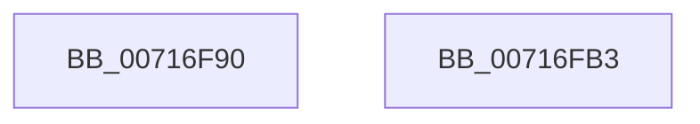

# SC_ENV::Allocate

- RVA: `0x00716F90`–`0x00716FB4` (길이 `36` bytes)
- VA: `0x0000000140716F90`
- 실행 섹션: `PAGE`
- PDB 이름 있음: `예`; PDB Function 태그: `아니요`
- unwind 정보 RVA: `0x0005C788`
- 디코드: `9`개 명령, `36/36` bytes 표시
- 미해석 바이트: `0` (있으면 어셈블리에 `.byte`로 보존)

> 이 문서는 커널 이미지의 기계어와 PDB 기호를 분석해 생성했습니다. 4번과 5번은 함수 원형과 자료형을 바이너리 사용 방식에서 추정한 C 해석이며 원본 소스 복구 결과는 아닙니다.

## 1. Dependencies

- 직접 호출 지점: **1**; 고유 호출 대상: **1**
- 직접 호출자로 확인된 함수: **12**
- RIP 상대 이미지 참조: **0**

### Outgoing calls
- `0x00716FA9` → [ExAllocatePoolWithTag](../../poolcode/B8/ExAllocatePoolWithTag_function_00B82010.md) (function, `0x00B82010`)

### Direct callers
- [SC_GPT::ReadEntries](../../text/6A/SC_GPT_ReadEntries_function_006A32C8.md) at `0x006A330C`
- [SC_GPT::ReadPartitionTable](../../text/6A/SC_GPT_ReadPartitionTable_function_006A34E4.md) at `0x006A3608`
- [SC_GPT::VerifyPartitionTable](../../text/6A/SC_GPT_VerifyPartitionTable_function_006A3804.md) at `0x006A38B4`
- [SC_GPT::WritePartitionTable](../../text/6A/SC_GPT_WritePartitionTable_function_006A3AD4.md) at `0x006A3C32`
- [ScAnsiToUnicodeString](../../text/6A/ScAnsiToUnicodeString_function_006A3FB0.md) at `0x006A3FF6`
- [SC_DISK::GetStoragePropertyPost](../../text/6A/SC_DISK_GetStoragePropertyPost_function_006A4500.md) at `0x006A458B`
- [SC_DISK::InitializePartitionCache](../../text/6A/SC_DISK_InitializePartitionCache_function_006A4844.md) at `0x006A4861`
- [SC_MBR::ReadPartitionTable](../../text/6A/SC_MBR_ReadPartitionTable_function_006A5100.md) at `0x006A5152`
- [SC_MBR::ReadPartitionTable](../../text/6A/SC_MBR_ReadPartitionTable_function_006A5100.md) at `0x006A5321`
- [SC_DEVICE::GetStorageProperty](../../text/6A/SC_DEVICE_GetStorageProperty_function_006A57F8.md) at `0x006A5868`
- [SC_RAW::ReadPartitionTable](../../text/6A/SC_RAW_ReadPartitionTable_function_006A5C54.md) at `0x006A5C8A`
- [IoReadPartitionTable](IoReadPartitionTable_function_00717400.md) at `0x007174B4`
- [IoWritePartitionTable](IoWritePartitionTable_function_007178C0.md) at `0x00717922`

### Static image references
- 디코드된 RIP-relative 메모리 참조가 없습니다.

## 2. Other-region calls and transfers

- 다른 실행 섹션으로 향하는 call: **1**
  - `0x00716FA9` → [ExAllocatePoolWithTag](../../poolcode/B8/ExAllocatePoolWithTag_function_00B82010.md) (`PAGE` → `POOLCODE`)
- 별도 외부 분기/꼬리 이동을 확인하지 못했습니다.

## 3. Assembly (complete function range)

```asm
00716F90  48 83 EC 28                     sub rsp, 0x28
00716F94  41 83 E1 01                     and r9d, 1
00716F98  48 8B D1                        mov rdx, rcx
00716F9B  41 B8 49 6F 50 54               mov r8d, 0x54506f49
00716FA1  42 8D 0C 8D 00 02 00 00         lea ecx, [r9*4 + 0x200]
00716FA9  E8 62 B0 46 00                  call 0x140b82010
00716FAE  48 83 C4 28                     add rsp, 0x28
00716FB2  C3                              ret
00716FB3  CC                              int3
```

## 4. C-style interpretation (structured pseudocode)

```c
__int64 __fastcall SC_ENV__Allocate(__int64 a1, __int64 a2, __int64 a3, int a4)
{
    __int64 result;
    __int64 v_rsp;

    v_rsp = (v_rsp) - (40);
    a4 = (unsigned int)((a4) & (1));
    result = ExAllocatePoolWithTag(a4 * 4 + 512, a1, (unsigned int)(0x54506F49ULL), a4);
    v_rsp = (v_rsp) + (40);
    return result;
}
```

## 5. (Beta) C Style

```c
int64_t SC_ENV__Allocate(int64_t Arg1, int64_t Arg2, int64_t Arg3, int32_t Arg4)
{
    int64_t result;
    int64_t local_rsp;

    local_rsp = (local_rsp) - (40);
    Arg4 = (uint32_t)((Arg4) & (1));
    result = ExAllocatePoolWithTag(Arg4 * 4 + 512, Arg1, (uint32_t)(0x54506F49ULL), Arg4);
    local_rsp = (local_rsp) + (40);
    return result;
}
```

## 6. Execution-region graph

[열기: 2D/3D 그래프와 함수 탐색 컨트롤 패널](../../../control-panel.html?section=page&rva=0x00716F90&view=graph)

- 2D 그래프는 위에서 아래로 흐르고, 3D 그래프는 빈 공간을 드래그해 회전합니다. Shift+드래그는 이동, 휠은 확대·축소, 함수 노드 선택은 대상 보고서 이동입니다.

### Static fallback


