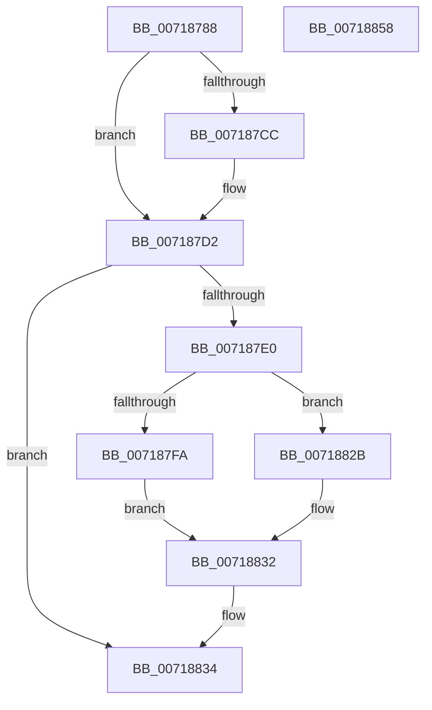

# VslAllocateSecureHibernateResources

- RVA: `0x00718788`–`0x00718859` (길이 `209` bytes)
- VA: `0x0000000140718788`
- 실행 섹션: `PAGE`
- PDB 이름 있음: `예`; PDB Function 태그: `아니요`
- unwind 정보 RVA: `0x000C6B7C`
- 디코드: `55`개 명령, `209/209` bytes 표시
- 미해석 바이트: `0` (있으면 어셈블리에 `.byte`로 보존)

> 이 문서는 커널 이미지의 기계어와 PDB 기호를 분석해 생성했습니다. 4번과 5번은 함수 원형과 자료형을 바이너리 사용 방식에서 추정한 C 해석이며 원본 소스 복구 결과는 아닙니다.

## 1. Dependencies

- 직접 호출 지점: **7**; 고유 호출 대상: **6**
- 직접 호출자로 확인된 함수: **1**
- RIP 상대 이미지 참조: **1**

### Outgoing calls
- `0x007187BE` → [memset](../../text/6C/memset_function_006C6C40.md) (function, `0x006C6C40`)
- `0x007187C3` → [Feature_Servicing_CompressSecureHiberdata__private_IsEnabledDeviceUsageNoInline](../../text/58/Feature_Servicing_CompressSecureHiberdata__private_IsEnabledDeviceUsageNoInline_function_0058DE10.md) (function, `0x0058DE10`)
- `0x007187D7` → [KeAllocateKernelHiberSwapShadowStacks](../../text/5B/KeAllocateKernelHiberSwapShadowStacks_function_005BD658.md) (function, `0x005BD658`)
- `0x007187EF` → [VslpEnterIumSecureMode](../../text/23/VslpEnterIumSecureMode_function_00235E50.md) (function, `0x00235E50`)
- `0x00718814` → [PoSetHiberRange](../../text/47/PoSetHiberRange_function_0047C580.md) (function, `0x0047C580`)
- `0x0071882D` → [KeAllocateKernelHiberSwapShadowStacks](../../text/5B/KeAllocateKernelHiberSwapShadowStacks_function_005BD658.md) (function, `0x005BD658`)
- `0x0071883F` → [_security_check_cookie](../../text/6A/_security_check_cookie_function_006AC640.md) (function, `0x006AC640`)

### Direct callers
- [PopAllocateHiberContext](../AD/PopAllocateHiberContext_function_00ADC05C.md) at `0x00ADC641`

### Static image references
- `0x00718798` → RVA `0x00E0A740` (`.data`; read)

## 2. Other-region calls and transfers

- 다른 실행 섹션으로 향하는 call: **7**
  - `0x007187BE` → [memset](../../text/6C/memset_function_006C6C40.md) (`PAGE` → `.text`)
  - `0x007187C3` → [Feature_Servicing_CompressSecureHiberdata__private_IsEnabledDeviceUsageNoInline](../../text/58/Feature_Servicing_CompressSecureHiberdata__private_IsEnabledDeviceUsageNoInline_function_0058DE10.md) (`PAGE` → `.text`)
  - `0x007187D7` → [KeAllocateKernelHiberSwapShadowStacks](../../text/5B/KeAllocateKernelHiberSwapShadowStacks_function_005BD658.md) (`PAGE` → `.text`)
  - `0x007187EF` → [VslpEnterIumSecureMode](../../text/23/VslpEnterIumSecureMode_function_00235E50.md) (`PAGE` → `.text`)
  - `0x00718814` → [PoSetHiberRange](../../text/47/PoSetHiberRange_function_0047C580.md) (`PAGE` → `.text`)
  - `0x0071882D` → [KeAllocateKernelHiberSwapShadowStacks](../../text/5B/KeAllocateKernelHiberSwapShadowStacks_function_005BD658.md) (`PAGE` → `.text`)
  - `0x0071883F` → [_security_check_cookie](../../text/6A/_security_check_cookie_function_006AC640.md) (`PAGE` → `.text`)
- 별도 외부 분기/꼬리 이동을 확인하지 못했습니다.

## 3. Assembly (complete function range)

```asm
00718788  48 89 5C 24 20                  mov qword ptr [rsp + 0x20], rbx
0071878D  56                              push rsi
0071878E  57                              push rdi
0071878F  41 56                           push r14
00718791  48 81 EC B0 00 00 00            sub rsp, 0xb0
00718798  48 8B 05 A1 1F 6F 00            mov rax, qword ptr [rip + 0x6f1fa1]
0071879F  48 33 C4                        xor rax, rsp
007187A2  48 89 84 24 A0 00 00 00         mov qword ptr [rsp + 0xa0], rax
007187AA  48 8B F2                        mov rsi, rdx
007187AD  4D 8B F0                        mov r14, r8
007187B0  33 D2                           xor edx, edx
007187B2  48 8B F9                        mov rdi, rcx
007187B5  48 8D 4C 24 30                  lea rcx, [rsp + 0x30]
007187BA  44 8D 42 68                     lea r8d, [rdx + 0x68]
007187BE  E8 7D E4 FA FF                  call 0x1406c6c40
007187C3  E8 48 56 E7 FF                  call 0x14058de10
007187C8  85 C0                           test eax, eax
007187CA  74 06                           je 0x1407187d2
007187CC  48 83 4C 24 38 01               or qword ptr [rsp + 0x38], 1
007187D2  B9 01 00 00 00                  mov ecx, 1
007187D7  E8 7C 4E EA FF                  call 0x1405bd658
007187DC  85 C0                           test eax, eax
007187DE  78 54                           js 0x140718834
007187E0  BA 25 00 00 00                  mov edx, 0x25
007187E5  4C 8D 4C 24 30                  lea r9, [rsp + 0x30]
007187EA  45 33 C0                        xor r8d, r8d
007187ED  B1 02                           mov cl, 2
007187EF  E8 5C D6 B1 FF                  call 0x140235e50
007187F4  8B D8                           mov ebx, eax
007187F6  85 C0                           test eax, eax
007187F8  78 31                           js 0x14071882b
007187FA  4C 8B 4C 24 40                  mov r9, qword ptr [rsp + 0x40]
007187FF  BA 00 C0 00 00                  mov edx, 0xc000
00718804  4C 8B 44 24 48                  mov r8, qword ptr [rsp + 0x48]
00718809  48 8B CF                        mov rcx, rdi
0071880C  C7 44 24 20 56 73 6C 52         mov dword ptr [rsp + 0x20], 0x526c7356
00718814  E8 67 3D D6 FF                  call 0x14047c580
00718819  48 8B 4C 24 40                  mov rcx, qword ptr [rsp + 0x40]
0071881E  49 89 0E                        mov qword ptr [r14], rcx
00718821  48 8B 4C 24 48                  mov rcx, qword ptr [rsp + 0x48]
00718826  48 89 0E                        mov qword ptr [rsi], rcx
00718829  EB 07                           jmp 0x140718832
0071882B  33 C9                           xor ecx, ecx
0071882D  E8 26 4E EA FF                  call 0x1405bd658
00718832  8B C3                           mov eax, ebx
00718834  48 8B 8C 24 A0 00 00 00         mov rcx, qword ptr [rsp + 0xa0]
0071883C  48 33 CC                        xor rcx, rsp
0071883F  E8 FC 3D F9 FF                  call 0x1406ac640
00718844  48 8B 9C 24 E8 00 00 00         mov rbx, qword ptr [rsp + 0xe8]
0071884C  48 81 C4 B0 00 00 00            add rsp, 0xb0
00718853  41 5E                           pop r14
00718855  5F                              pop rdi
00718856  5E                              pop rsi
00718857  C3                              ret
00718858  CC                              int3
```

## 4. C-style interpretation (structured pseudocode)

```c
__int64 __fastcall VslAllocateSecureHibernateResources(__int64 a1, __int64 a2, __int64 a3)
{
    __int64 result;
    __int64 v_rsp;
    unsigned __int64 v_stack_m28;
    unsigned __int64 v_stack_m80;
    unsigned __int64 v_stack_m88;
    unsigned __int64 v_stack_m90;
    unsigned __int64 v_stack_m98;
    unsigned int v_stack_mA8;
    unsigned __int64 v_stack_p20;

    v_stack_p20 = v_rbx;
    v_rsp = (v_rsp) - (176);
    result = (*(unsigned __int64 *)(v_rip + 7282593)) ^ (v_rsp);
    v_stack_m28 = result;
    a2 = 0;
    result = memset(v_stack_m98, a2, a2 + 104, a4);
    result = Feature_Servicing_CompressSecureHiberdata__private_IsEnabledDeviceUsageNoInline(v_stack_m98, a2, a2 + 104, a4);
    if ((unsigned int)(result) != 0) {
    }
    result = KeAllocateKernelHiberSwapShadowStacks(1, a2, a2 + 104, a4);
    if (sign_flag) goto loc_00718834;
    a3 = 0;
    result = VslpEnterIumSecureMode(2, 37, a3, v_stack_m98);
    if (sign_flag) goto loc_0071882B;
    v_stack_mA8 = 0x526C7356ULL;
    result = PoSetHiberRange(a1, (unsigned int)(0xC000ULL), v_stack_m80, v_stack_m88);
    *(unsigned __int64 *)(a3) = v_stack_m88;
    *(unsigned __int64 *)(a2) = v_stack_m80;
    goto loc_00718832;
loc_0071882B:
    a1 = 0;
    result = KeAllocateKernelHiberSwapShadowStacks(a1, (unsigned int)(0xC000ULL), v_stack_m80, v_stack_m88);
loc_00718832:
loc_00718834:
    a1 = (v_stack_m28) ^ (v_rsp);
    result = _security_check_cookie(a1, (unsigned int)(0xC000ULL), v_stack_m80, v_stack_m88);
    v_rsp = (v_rsp) + (176);
    return result;
}
```

## 5. (Beta) C Style

```c
int64_t VslAllocateSecureHibernateResources(int64_t Arg1, void *Arg2, void *Arg3)
{
    uint8_t *arg2 = (uint8_t *)Arg2;
    uint8_t *arg3 = (uint8_t *)Arg3;

    int64_t result;
    int64_t local_rsp;
    uint64_t v_stack_m28;
    uint64_t v_stack_m80;
    uint64_t v_stack_m88;
    uint64_t v_stack_m90;
    uint64_t v_stack_m98;
    uint32_t v_stack_mA8;
    uint64_t v_stack_p20;

    v_stack_p20 = local_rbx;
    local_rsp = (local_rsp) - (176);
    result = (*(uint64_t *)(v_rip + 0x6F1FA1)) ^ (local_rsp);
    v_stack_m28 = result;
    Arg2 = 0;
    result = memset(v_stack_m98, Arg2, Arg2 + 104, a4);
    result = Feature_Servicing_CompressSecureHiberdata__private_IsEnabledDeviceUsageNoInline(v_stack_m98, Arg2, Arg2 + 104, a4);
    if ((uint32_t)(result) != 0) {
    }
    result = KeAllocateKernelHiberSwapShadowStacks(1, Arg2, Arg2 + 104, a4);
    if (sign_flag) goto loc_00718834;
    Arg3 = 0;
    result = VslpEnterIumSecureMode(2, 37, Arg3, v_stack_m98);
    if (sign_flag) goto loc_0071882B;
    v_stack_mA8 = 0x526C7356ULL;
    result = PoSetHiberRange(Arg1, (uint32_t)(0xC000ULL), v_stack_m80, v_stack_m88);
    *(uint64_t *)(arg3) = v_stack_m88;
    *(uint64_t *)(arg2) = v_stack_m80;
    goto loc_00718832;
loc_0071882B:
    Arg1 = 0;
    result = KeAllocateKernelHiberSwapShadowStacks(Arg1, (uint32_t)(0xC000ULL), v_stack_m80, v_stack_m88);
loc_00718832:
loc_00718834:
    Arg1 = (v_stack_m28) ^ (local_rsp);
    result = _security_check_cookie(Arg1, (uint32_t)(0xC000ULL), v_stack_m80, v_stack_m88);
    local_rsp = (local_rsp) + (176);
    return result;
}
```

### 관측된 메모리 오프셋

구조체 형식이 확인되지 않은 접근은 인자 기준의 오프셋으로만 기록했습니다.

| 기준 인자 | 오프셋 표현 | 폭 (bit) | 접근 |
|---|---:|---:|---|
| `Arg2` | `+ 0x0` | `64` | `W` |
| `Arg3` | `+ 0x0` | `64` | `W` |

## 6. Execution-region graph

[열기: 2D/3D 그래프와 함수 탐색 컨트롤 패널](../../../control-panel.html?section=page&rva=0x00718788&view=graph)

- 2D 그래프는 위에서 아래로 흐르고, 3D 그래프는 빈 공간을 드래그해 회전합니다. Shift+드래그는 이동, 휠은 확대·축소, 함수 노드 선택은 대상 보고서 이동입니다.

### Static fallback


