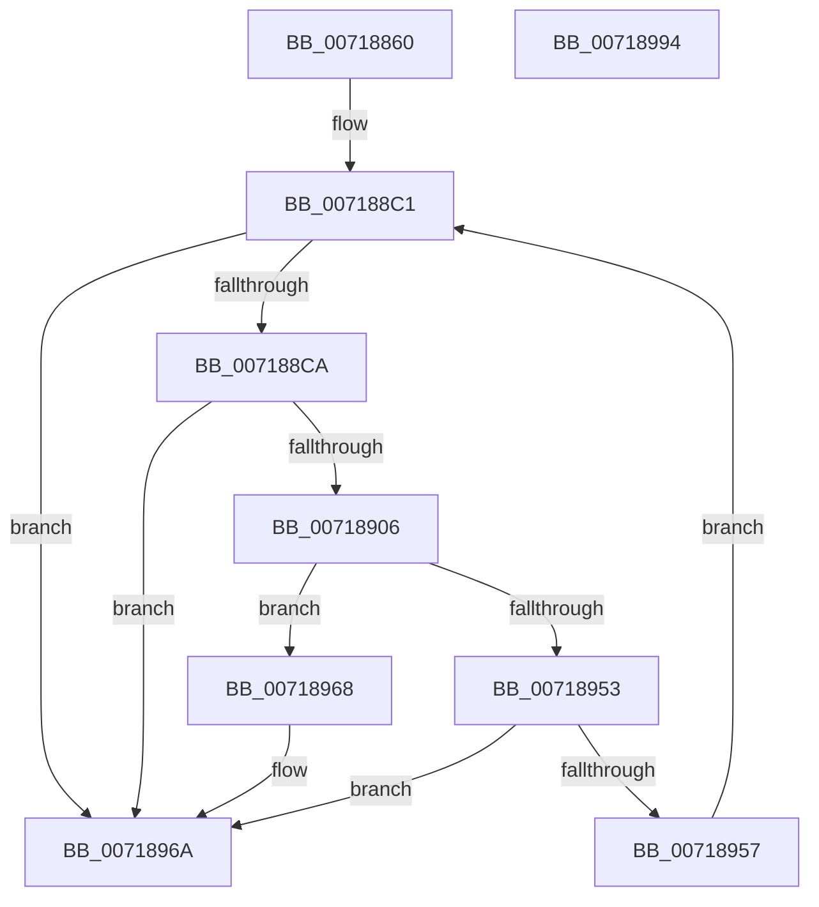

# VslCapturePgoData

- RVA: `0x00718860`–`0x00718995` (길이 `309` bytes)
- VA: `0x0000000140718860`
- 실행 섹션: `PAGE`
- PDB 이름 있음: `예`; PDB Function 태그: `아니요`
- unwind 정보 RVA: `0x000C6AF0`
- 디코드: `80`개 명령, `309/309` bytes 표시
- 미해석 바이트: `0` (있으면 어셈블리에 `.byte`로 보존)

> 이 문서는 커널 이미지의 기계어와 PDB 기호를 분석해 생성했습니다. 4번과 5번은 함수 원형과 자료형을 바이너리 사용 방식에서 추정한 C 해석이며 원본 소스 복구 결과는 아닙니다.

## 1. Dependencies

- 직접 호출 지점: **7**; 고유 호출 대상: **5**
- 직접 호출자로 확인된 함수: **0**
- RIP 상대 이미지 참조: **1**

### Outgoing calls
- `0x0071889B` → [memset](../../text/6C/memset_function_006C6C40.md) (function, `0x006C6C40`)
- `0x007188AB` → [memset](../../text/6C/memset_function_006C6C40.md) (function, `0x006C6C40`)
- `0x007188BC` → [memset](../../text/6C/memset_function_006C6C40.md) (function, `0x006C6C40`)
- `0x007188FB` → [VslpLockPagesForTransfer](../../text/29/VslpLockPagesForTransfer_function_0029E0FC.md) (function, `0x0029E0FC`)
- `0x0071893A` → [VslpEnterIumSecureMode](../../text/23/VslpEnterIumSecureMode_function_00235E50.md) (function, `0x00235E50`)
- `0x00718946` → [VslpUnlockPagesForTransfer](../../text/29/VslpUnlockPagesForTransfer_function_0029EE4C.md) (function, `0x0029EE4C`)
- `0x00718977` → [_security_check_cookie](../../text/6A/_security_check_cookie_function_006AC640.md) (function, `0x006AC640`)

### Direct callers
- 이 함수 시작 RVA로 연결되는 직접 call은 확인되지 않았습니다. 간접 호출은 완전히 역산할 수 없습니다.

### Static image references
- `0x00718875` → RVA `0x00E0A740` (`.data`; read)

## 2. Other-region calls and transfers

- 다른 실행 섹션으로 향하는 call: **7**
  - `0x0071889B` → [memset](../../text/6C/memset_function_006C6C40.md) (`PAGE` → `.text`)
  - `0x007188AB` → [memset](../../text/6C/memset_function_006C6C40.md) (`PAGE` → `.text`)
  - `0x007188BC` → [memset](../../text/6C/memset_function_006C6C40.md) (`PAGE` → `.text`)
  - `0x007188FB` → [VslpLockPagesForTransfer](../../text/29/VslpLockPagesForTransfer_function_0029E0FC.md) (`PAGE` → `.text`)
  - `0x0071893A` → [VslpEnterIumSecureMode](../../text/23/VslpEnterIumSecureMode_function_00235E50.md) (`PAGE` → `.text`)
  - `0x00718946` → [VslpUnlockPagesForTransfer](../../text/29/VslpUnlockPagesForTransfer_function_0029EE4C.md) (`PAGE` → `.text`)
  - `0x00718977` → [_security_check_cookie](../../text/6A/_security_check_cookie_function_006AC640.md) (`PAGE` → `.text`)
- 별도 외부 분기/꼬리 이동을 확인하지 못했습니다.

## 3. Assembly (complete function range)

```asm
00718860  48 89 5C 24 18                  mov qword ptr [rsp + 0x18], rbx
00718865  48 89 6C 24 20                  mov qword ptr [rsp + 0x20], rbp
0071886A  56                              push rsi
0071886B  57                              push rdi
0071886C  41 56                           push r14
0071886E  48 81 EC 00 01 00 00            sub rsp, 0x100
00718875  48 8B 05 C4 1E 6F 00            mov rax, qword ptr [rip + 0x6f1ec4]
0071887C  48 33 C4                        xor rax, rsp
0071887F  48 89 84 24 F0 00 00 00         mov qword ptr [rsp + 0xf0], rax
00718887  48 8B F2                        mov rsi, rdx
0071888A  48 8B F9                        mov rdi, rcx
0071888D  33 D2                           xor edx, edx
0071888F  48 8D 8C 24 80 00 00 00         lea rcx, [rsp + 0x80]
00718897  44 8D 42 68                     lea r8d, [rdx + 0x68]
0071889B  E8 A0 E3 FA FF                  call 0x1406c6c40
007188A0  33 D2                           xor edx, edx
007188A2  48 8D 4C 24 30                  lea rcx, [rsp + 0x30]
007188A7  44 8D 42 48                     lea r8d, [rdx + 0x48]
007188AB  E8 90 E3 FA FF                  call 0x1406c6c40
007188B0  4C 8B C7                        mov r8, rdi
007188B3  33 D2                           xor edx, edx
007188B5  48 8B CE                        mov rcx, rsi
007188B8  33 ED                           xor ebp, ebp
007188BA  33 DB                           xor ebx, ebx
007188BC  E8 7F E3 FA FF                  call 0x1406c6c40
007188C1  48 85 FF                        test rdi, rdi
007188C4  0F 84 A0 00 00 00               je 0x14071896a
007188CA  8B CE                           mov ecx, esi
007188CC  B8 00 A0 1F 00                  mov eax, 0x1fa000
007188D1  81 E1 FF 0F 00 00               and ecx, 0xfff
007188D7  44 8B F7                        mov r14d, edi
007188DA  2B C1                           sub eax, ecx
007188DC  41 B9 01 00 00 00               mov r9d, 1
007188E2  8B C8                           mov ecx, eax
007188E4  48 8B D6                        mov rdx, rsi
007188E7  48 3B CF                        cmp rcx, rdi
007188EA  48 8D 4C 24 30                  lea rcx, [rsp + 0x30]
007188EF  44 0F 42 F0                     cmovb r14d, eax
007188F3  83 64 24 20 00                  and dword ptr [rsp + 0x20], 0
007188F8  45 8B C6                        mov r8d, r14d
007188FB  E8 FC 57 B8 FF                  call 0x14029e0fc
00718900  8B D8                           mov ebx, eax
00718902  85 C0                           test eax, eax
00718904  78 64                           js 0x14071896a
00718906  48 8B 44 24 30                  mov rax, qword ptr [rsp + 0x30]
0071890B  4C 8D 8C 24 80 00 00 00         lea r9, [rsp + 0x80]
00718913  48 89 84 24 90 00 00 00         mov qword ptr [rsp + 0x90], rax
0071891B  BA 50 00 00 00                  mov edx, 0x50
00718920  48 8B 44 24 68                  mov rax, qword ptr [rsp + 0x68]
00718925  45 33 C0                        xor r8d, r8d
00718928  B1 02                           mov cl, 2
0071892A  48 89 84 24 98 00 00 00         mov qword ptr [rsp + 0x98], rax
00718932  48 89 AC 24 88 00 00 00         mov qword ptr [rsp + 0x88], rbp
0071893A  E8 11 D5 B1 FF                  call 0x140235e50
0071893F  48 8D 4C 24 30                  lea rcx, [rsp + 0x30]
00718944  8B D8                           mov ebx, eax
00718946  E8 01 65 B8 FF                  call 0x14029ee4c
0071894B  81 FB 1A 00 00 80               cmp ebx, 0x8000001a
00718951  74 15                           je 0x140718968
00718953  85 DB                           test ebx, ebx
00718955  78 13                           js 0x14071896a
00718957  41 8B C6                        mov eax, r14d
0071895A  48 03 F0                        add rsi, rax
0071895D  48 03 E8                        add rbp, rax
00718960  48 2B F8                        sub rdi, rax
00718963  E9 59 FF FF FF                  jmp 0x1407188c1
00718968  33 DB                           xor ebx, ebx
0071896A  8B C3                           mov eax, ebx
0071896C  48 8B 8C 24 F0 00 00 00         mov rcx, qword ptr [rsp + 0xf0]
00718974  48 33 CC                        xor rcx, rsp
00718977  E8 C4 3C F9 FF                  call 0x1406ac640
0071897C  4C 8D 9C 24 00 01 00 00         lea r11, [rsp + 0x100]
00718984  49 8B 5B 30                     mov rbx, qword ptr [r11 + 0x30]
00718988  49 8B 6B 38                     mov rbp, qword ptr [r11 + 0x38]
0071898C  49 8B E3                        mov rsp, r11
0071898F  41 5E                           pop r14
00718991  5F                              pop rdi
00718992  5E                              pop rsi
00718993  C3                              ret
00718994  CC                              int3
```

## 4. C-style interpretation (structured pseudocode)

```c
__int64 __fastcall VslCapturePgoData(__int64 a1, __int64 a2)
{
    __int64 result;
    __int64 v_r14;
    __int64 v_rbp;
    __int64 v_rbx;
    __int64 v_rdi;
    __int64 v_rsi;
    __int64 v_rsp;
    unsigned __int64 v_stack_m18;
    unsigned __int64 v_stack_m28;
    unsigned __int64 v_stack_m80;
    unsigned __int64 v_stack_m88;
    unsigned __int64 v_stack_m90;
    unsigned __int64 v_stack_m98;
    unsigned __int64 v_stack_mB0;
    unsigned __int64 v_stack_mE8;
    unsigned int v_stack_mF8;
    unsigned __int64 v_stack_p18;
    unsigned __int64 v_stack_p20;

    v_stack_p18 = v_rbx;
    v_stack_p20 = v_rbp;
    v_rsp = (v_rsp) - (256);
    result = (*(unsigned __int64 *)(v_rip + 7282372)) ^ (v_rsp);
    v_stack_m28 = result;
    a2 = 0;
    result = memset(v_stack_m98, a2, a2 + 104, a4);
    a2 = 0;
    result = memset(v_stack_mE8, a2, a2 + 72, a4);
    a2 = 0;
    v_rbp = 0;
    v_rbx = 0;
    result = memset(0, a2, a1, a4);
loc_007188C1:
    if (a1 == 0) goto loc_0071896A;
    a1 = (unsigned int)((0) & (0xFFFULL));
    result = (unsigned int)(((unsigned int)(0x1FA000ULL)) - ((unsigned int)(a1)));
    v_r14 = (unsigned int)((unsigned int)(a1));
    if (((unsigned int)((unsigned int)(result))) < a1) { v_r14 = (unsigned int)(result); }
    result = VslpLockPagesForTransfer(v_stack_mE8, 0, (unsigned int)((unsigned int)(v_r14)), 1);
    if (sign_flag) goto loc_0071896A;
    v_stack_m88 = v_stack_mE8;
    a3 = 0;
    v_stack_m80 = v_stack_mB0;
    v_stack_m90 = 0;
    result = VslpEnterIumSecureMode(2, 80, a3, v_stack_m98);
    result = VslpUnlockPagesForTransfer(v_stack_mE8, 80, a3, v_stack_m98);
    if (((unsigned int)((unsigned int)((unsigned int)(result)))) == 0x8000001AULL) goto loc_00718968;
    if (sign_flag) goto loc_0071896A;
    v_rsi = (a2) + ((unsigned int)((unsigned int)(v_r14)));
    v_rbp = (v_rbp) + ((unsigned int)((unsigned int)(v_r14)));
    v_rdi = (a1) - ((unsigned int)((unsigned int)(v_r14)));
    goto loc_007188C1;
loc_00718968:
    v_rbx = 0;
loc_0071896A:
    a1 = (v_stack_m28) ^ (v_rsp);
    result = _security_check_cookie(a1, 80, a3, v_stack_m98);
    return result;
}
```

## 5. (Beta) C Style

```c
int64_t VslCapturePgoData(int64_t Arg1, int64_t Arg2)
{
    int64_t result;
    int64_t local_r14;
    int64_t local_rbp;
    int64_t local_rbx;
    int64_t local_rdi;
    int64_t local_rsi;
    int64_t local_rsp;
    uint64_t v_stack_m18;
    uint64_t v_stack_m28;
    uint64_t v_stack_m80;
    uint64_t v_stack_m88;
    uint64_t v_stack_m90;
    uint64_t v_stack_m98;
    uint64_t v_stack_mB0;
    uint64_t v_stack_mE8;
    uint32_t v_stack_mF8;
    uint64_t v_stack_p18;
    uint64_t v_stack_p20;

    v_stack_p18 = local_rbx;
    v_stack_p20 = local_rbp;
    local_rsp = (local_rsp) - (256);
    result = (*(uint64_t *)(v_rip + 0x6F1EC4)) ^ (local_rsp);
    v_stack_m28 = result;
    Arg2 = 0;
    result = memset(v_stack_m98, Arg2, Arg2 + 104, a4);
    Arg2 = 0;
    result = memset(v_stack_mE8, Arg2, Arg2 + 72, a4);
    Arg2 = 0;
    local_rbp = 0;
    local_rbx = 0;
    result = memset(0, Arg2, Arg1, a4);
loc_007188C1:
    if (Arg1 == 0) goto loc_0071896A;
    Arg1 = (uint32_t)((0) & (0xFFFULL));
    result = (uint32_t)(((uint32_t)(0x1FA000ULL)) - ((uint32_t)(Arg1)));
    local_r14 = (uint32_t)((uint32_t)(Arg1));
    if (((uint32_t)((uint32_t)(result))) < Arg1) { local_r14 = (uint32_t)(result); }
    result = VslpLockPagesForTransfer(v_stack_mE8, 0, (uint32_t)((uint32_t)(local_r14)), 1);
    if (sign_flag) goto loc_0071896A;
    v_stack_m88 = v_stack_mE8;
    a3 = 0;
    v_stack_m80 = v_stack_mB0;
    v_stack_m90 = 0;
    result = VslpEnterIumSecureMode(2, 80, a3, v_stack_m98);
    result = VslpUnlockPagesForTransfer(v_stack_mE8, 80, a3, v_stack_m98);
    if (((uint32_t)((uint32_t)((uint32_t)(result)))) == 0x8000001AULL) goto loc_00718968;
    if (sign_flag) goto loc_0071896A;
    local_rsi = (Arg2) + ((uint32_t)((uint32_t)(local_r14)));
    local_rbp = (local_rbp) + ((uint32_t)((uint32_t)(local_r14)));
    local_rdi = (Arg1) - ((uint32_t)((uint32_t)(local_r14)));
    goto loc_007188C1;
loc_00718968:
    local_rbx = 0;
loc_0071896A:
    Arg1 = (v_stack_m28) ^ (local_rsp);
    result = _security_check_cookie(Arg1, 80, a3, v_stack_m98);
    return result;
}
```

## 6. Execution-region graph

[열기: 2D/3D 그래프와 함수 탐색 컨트롤 패널](../../../control-panel.html?section=page&rva=0x00718860&view=graph)

- 2D 그래프는 위에서 아래로 흐르고, 3D 그래프는 빈 공간을 드래그해 회전합니다. Shift+드래그는 이동, 휠은 확대·축소, 함수 노드 선택은 대상 보고서 이동입니다.

### Static fallback


