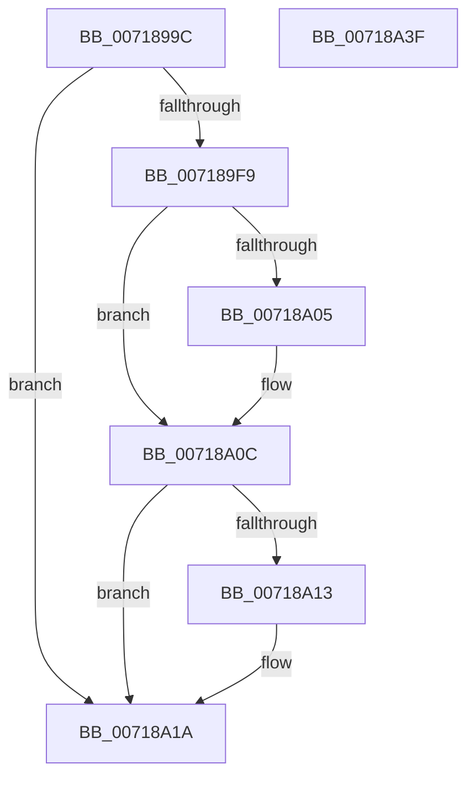

# VslDetermineHotPatchType

- RVA: `0x0071899C`–`0x00718A40` (길이 `164` bytes)
- VA: `0x000000014071899C`
- 실행 섹션: `PAGE`
- PDB 이름 있음: `예`; PDB Function 태그: `아니요`
- unwind 정보 RVA: `0x000AFF04`
- 디코드: `42`개 명령, `164/164` bytes 표시
- 미해석 바이트: `0` (있으면 어셈블리에 `.byte`로 보존)

> 이 문서는 커널 이미지의 기계어와 PDB 기호를 분석해 생성했습니다. 4번과 5번은 함수 원형과 자료형을 바이너리 사용 방식에서 추정한 C 해석이며 원본 소스 복구 결과는 아닙니다.

## 1. Dependencies

- 직접 호출 지점: **3**; 고유 호출 대상: **3**
- 직접 호출자로 확인된 함수: **2**
- RIP 상대 이미지 참조: **3**

### Outgoing calls
- `0x007189D2` → [memset](../../text/6C/memset_function_006C6C40.md) (function, `0x006C6C40`)
- `0x007189F0` → [VslpEnterIumSecureMode](../../text/23/VslpEnterIumSecureMode_function_00235E50.md) (function, `0x00235E50`)
- `0x00718A25` → [_security_check_cookie](../../text/6A/_security_check_cookie_function_006AC640.md) (function, `0x006AC640`)

### Direct callers
- [MiLoadHotPatch](../AB/MiLoadHotPatch_function_00AB521C.md) at `0x00AB53D9`
- [MmRegisterHotPatches](../../init/C6/MmRegisterHotPatches_function_00C678DC.md) at `0x00C67ABD`

### Static image references
- `0x007189AE` → RVA `0x00E0A740` (`.data`; read)
- `0x00718A05` → RVA `0x00F8EC24` (`.data`; read/write)
- `0x00718A13` → RVA `0x00F8EC28` (`.data`; read/write)

## 2. Other-region calls and transfers

- 다른 실행 섹션으로 향하는 call: **3**
  - `0x007189D2` → [memset](../../text/6C/memset_function_006C6C40.md) (`PAGE` → `.text`)
  - `0x007189F0` → [VslpEnterIumSecureMode](../../text/23/VslpEnterIumSecureMode_function_00235E50.md) (`PAGE` → `.text`)
  - `0x00718A25` → [_security_check_cookie](../../text/6A/_security_check_cookie_function_006AC640.md) (`PAGE` → `.text`)
- 별도 외부 분기/꼬리 이동을 확인하지 못했습니다.

## 3. Assembly (complete function range)

```asm
0071899C  48 89 5C 24 08                  mov qword ptr [rsp + 8], rbx
007189A1  48 89 74 24 10                  mov qword ptr [rsp + 0x10], rsi
007189A6  57                              push rdi
007189A7  48 81 EC A0 00 00 00            sub rsp, 0xa0
007189AE  48 8B 05 8B 1D 6F 00            mov rax, qword ptr [rip + 0x6f1d8b]
007189B5  48 33 C4                        xor rax, rsp
007189B8  48 89 84 24 90 00 00 00         mov qword ptr [rsp + 0x90], rax
007189C0  8B FA                           mov edi, edx
007189C2  49 8B F0                        mov rsi, r8
007189C5  33 D2                           xor edx, edx
007189C7  8B D9                           mov ebx, ecx
007189C9  48 8D 4C 24 20                  lea rcx, [rsp + 0x20]
007189CE  44 8D 42 68                     lea r8d, [rdx + 0x68]
007189D2  E8 69 E2 FA FF                  call 0x1406c6c40
007189D7  BA 4A 00 00 00                  mov edx, 0x4a
007189DC  48 89 5C 24 28                  mov qword ptr [rsp + 0x28], rbx
007189E1  4C 8D 4C 24 20                  lea r9, [rsp + 0x20]
007189E6  48 89 7C 24 30                  mov qword ptr [rsp + 0x30], rdi
007189EB  45 33 C0                        xor r8d, r8d
007189EE  B1 02                           mov cl, 2
007189F0  E8 5B D4 B1 FF                  call 0x140235e50
007189F5  85 C0                           test eax, eax
007189F7  78 21                           js 0x140718a1a
007189F9  48 8B 4C 24 30                  mov rcx, qword ptr [rsp + 0x30]
007189FE  89 0E                           mov dword ptr [rsi], ecx
00718A00  F6 C1 01                        test cl, 1
00718A03  74 07                           je 0x140718a0c
00718A05  F0 FF 05 18 62 87 00            lock inc dword ptr [rip + 0x876218]
00718A0C  8B 0E                           mov ecx, dword ptr [rsi]
00718A0E  F6 C1 02                        test cl, 2
00718A11  74 07                           je 0x140718a1a
00718A13  F0 FF 05 0E 62 87 00            lock inc dword ptr [rip + 0x87620e]
00718A1A  48 8B 8C 24 90 00 00 00         mov rcx, qword ptr [rsp + 0x90]
00718A22  48 33 CC                        xor rcx, rsp
00718A25  E8 16 3C F9 FF                  call 0x1406ac640
00718A2A  4C 8D 9C 24 A0 00 00 00         lea r11, [rsp + 0xa0]
00718A32  49 8B 5B 10                     mov rbx, qword ptr [r11 + 0x10]
00718A36  49 8B 73 18                     mov rsi, qword ptr [r11 + 0x18]
00718A3A  49 8B E3                        mov rsp, r11
00718A3D  5F                              pop rdi
00718A3E  C3                              ret
00718A3F  CC                              int3
```

## 4. C-style interpretation (structured pseudocode)

```c
__int64 __fastcall VslDetermineHotPatchType(int a1, int a2, __int64 a3)
{
    __int64 result;
    __int64 v_rsp;
    unsigned __int64 v_stack_m18;
    unsigned __int64 v_stack_m78;
    unsigned __int64 v_stack_m8;
    unsigned __int64 v_stack_m80;
    unsigned __int64 v_stack_m88;
    unsigned __int64 v_stack_p10;
    unsigned __int64 v_stack_p8;

    v_stack_p8 = v_rbx;
    v_stack_p10 = v_rsi;
    v_rsp = (v_rsp) - (160);
    result = (*(unsigned __int64 *)(v_rip + 7282059)) ^ (v_rsp);
    v_stack_m18 = result;
    a2 = 0;
    result = memset(v_stack_m88, a2, a2 + 104, a4);
    v_stack_m80 = (unsigned int)(a1);
    v_stack_m78 = (unsigned int)(a2);
    a3 = 0;
    result = VslpEnterIumSecureMode(2, 74, a3, v_stack_m88);
    if (sign_flag) goto loc_00718A1A;
    *(unsigned int *)(a3) = (unsigned int)(v_stack_m78);
    if ((((unsigned __int8)(v_stack_m78)) & (1)) != 0) {
    }
    if ((((unsigned __int8)((unsigned int)(*(unsigned int *)(a3)))) & (2)) != 0) {
    }
    a1 = (v_stack_m18) ^ (v_rsp);
    result = _security_check_cookie(a1, 74, a3, v_stack_m88);
    return result;
}
```

## 5. (Beta) C Style

```c
int64_t VslDetermineHotPatchType(int32_t Arg1, int32_t Arg2, void *Arg3)
{
    uint8_t *arg3 = (uint8_t *)Arg3;

    int64_t result;
    int64_t local_rsp;
    uint64_t v_stack_m18;
    uint64_t v_stack_m78;
    uint64_t v_stack_m8;
    uint64_t v_stack_m80;
    uint64_t v_stack_m88;
    uint64_t v_stack_p10;
    uint64_t v_stack_p8;

    v_stack_p8 = local_rbx;
    v_stack_p10 = local_rsi;
    local_rsp = (local_rsp) - (160);
    result = (*(uint64_t *)(v_rip + 0x6F1D8B)) ^ (local_rsp);
    v_stack_m18 = result;
    Arg2 = 0;
    result = memset(v_stack_m88, Arg2, Arg2 + 104, a4);
    v_stack_m80 = (uint32_t)(Arg1);
    v_stack_m78 = (uint32_t)(Arg2);
    Arg3 = 0;
    result = VslpEnterIumSecureMode(2, 74, Arg3, v_stack_m88);
    if (sign_flag) goto loc_00718A1A;
    *(uint32_t *)(arg3) = (uint32_t)(v_stack_m78);
    if ((((uint8_t)(v_stack_m78)) & (1)) != 0) {
    }
    if ((((uint8_t)((uint32_t)(*(uint32_t *)(arg3)))) & (2)) != 0) {
    }
    Arg1 = (v_stack_m18) ^ (local_rsp);
    result = _security_check_cookie(Arg1, 74, Arg3, v_stack_m88);
    return result;
}
```

### 관측된 메모리 오프셋

구조체 형식이 확인되지 않은 접근은 인자 기준의 오프셋으로만 기록했습니다.

| 기준 인자 | 오프셋 표현 | 폭 (bit) | 접근 |
|---|---:|---:|---|
| `Arg3` | `+ 0x0` | `32` | `R` |
| `Arg3` | `+ 0x0` | `32` | `W` |

## 6. Execution-region graph

[열기: 2D/3D 그래프와 함수 탐색 컨트롤 패널](../../../control-panel.html?section=page&rva=0x0071899C&view=graph)

- 2D 그래프는 위에서 아래로 흐르고, 3D 그래프는 빈 공간을 드래그해 회전합니다. Shift+드래그는 이동, 휠은 확대·축소, 함수 노드 선택은 대상 보고서 이동입니다.

### Static fallback


