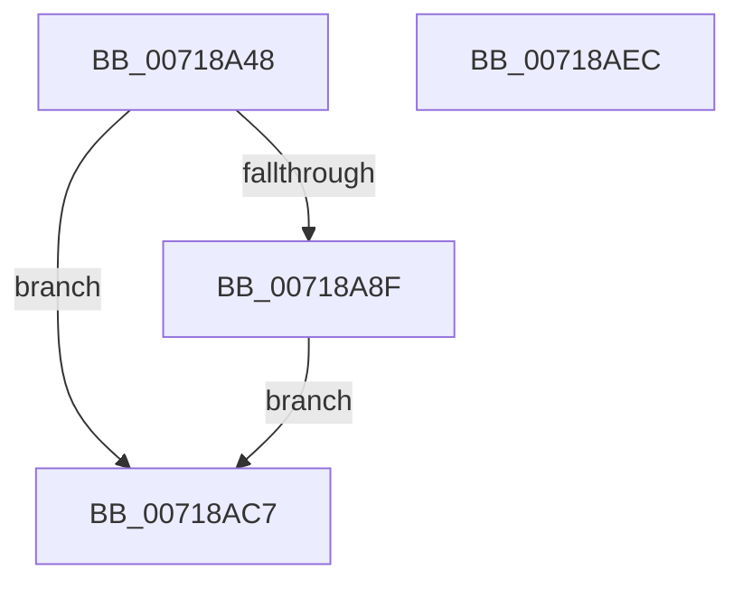

# VslEnableOnDemandDebugWithResponse

- RVA: `0x00718A48`–`0x00718AED` (길이 `165` bytes)
- VA: `0x0000000140718A48`
- 실행 섹션: `PAGE`
- PDB 이름 있음: `예`; PDB Function 태그: `아니요`
- unwind 정보 RVA: `0x000C6B14`
- 디코드: `41`개 명령, `165/165` bytes 표시
- 미해석 바이트: `0` (있으면 어셈블리에 `.byte`로 보존)

> 이 문서는 커널 이미지의 기계어와 PDB 기호를 분석해 생성했습니다. 4번과 5번은 함수 원형과 자료형을 바이너리 사용 방식에서 추정한 C 해석이며 원본 소스 복구 결과는 아닙니다.

## 1. Dependencies

- 직접 호출 지점: **4**; 고유 호출 대상: **4**
- 직접 호출자로 확인된 함수: **1**
- RIP 상대 이미지 참조: **1**

### Outgoing calls
- `0x00718A80` → [memset](../../text/6C/memset_function_006C6C40.md) (function, `0x006C6C40`)
- `0x00718AAB` → [memcpy](../../text/6C/memcpy_function_006C6840.md) (function, `0x006C6840`)
- `0x00718AC0` → [VslpEnterIumSecureMode](../../text/23/VslpEnterIumSecureMode_function_00235E50.md) (function, `0x00235E50`)
- `0x00718AD2` → [_security_check_cookie](../../text/6A/_security_check_cookie_function_006AC640.md) (function, `0x006AC640`)

### Direct callers
- [PsIumEnableOnDemandDebugWithResponse](../78/PsIumEnableOnDemandDebugWithResponse_function_00787C30.md) at `0x00787C97`

### Static image references
- `0x00718A5A` → RVA `0x00E0A740` (`.data`; read)

## 2. Other-region calls and transfers

- 다른 실행 섹션으로 향하는 call: **4**
  - `0x00718A80` → [memset](../../text/6C/memset_function_006C6C40.md) (`PAGE` → `.text`)
  - `0x00718AAB` → [memcpy](../../text/6C/memcpy_function_006C6840.md) (`PAGE` → `.text`)
  - `0x00718AC0` → [VslpEnterIumSecureMode](../../text/23/VslpEnterIumSecureMode_function_00235E50.md) (`PAGE` → `.text`)
  - `0x00718AD2` → [_security_check_cookie](../../text/6A/_security_check_cookie_function_006AC640.md) (`PAGE` → `.text`)
- 별도 외부 분기/꼬리 이동을 확인하지 못했습니다.

## 3. Assembly (complete function range)

```asm
00718A48  48 89 5C 24 08                  mov qword ptr [rsp + 8], rbx
00718A4D  48 89 74 24 20                  mov qword ptr [rsp + 0x20], rsi
00718A52  57                              push rdi
00718A53  48 81 EC A0 00 00 00            sub rsp, 0xa0
00718A5A  48 8B 05 DF 1C 6F 00            mov rax, qword ptr [rip + 0x6f1cdf]
00718A61  48 33 C4                        xor rax, rsp
00718A64  48 89 84 24 90 00 00 00         mov qword ptr [rsp + 0x90], rax
00718A6C  41 8B D8                        mov ebx, r8d
00718A6F  48 8B F2                        mov rsi, rdx
00718A72  48 8B F9                        mov rdi, rcx
00718A75  33 D2                           xor edx, edx
00718A77  44 8D 42 68                     lea r8d, [rdx + 0x68]
00718A7B  48 8D 4C 24 20                  lea rcx, [rsp + 0x20]
00718A80  E8 BB E1 FA FF                  call 0x1406c6c40
00718A85  B8 22 00 00 C0                  mov eax, 0xc0000022
00718A8A  83 FB 50                        cmp ebx, 0x50
00718A8D  77 38                           ja 0x140718ac7
00718A8F  48 8B 87 70 01 00 00            mov rax, qword ptr [rdi + 0x170]
00718A96  48 89 44 24 28                  mov qword ptr [rsp + 0x28], rax
00718A9B  44 8B C3                        mov r8d, ebx
00718A9E  48 89 5C 24 30                  mov qword ptr [rsp + 0x30], rbx
00718AA3  48 8B D6                        mov rdx, rsi
00718AA6  48 8D 4C 24 38                  lea rcx, [rsp + 0x38]
00718AAB  E8 90 DD FA FF                  call 0x1406c6840
00718AB0  90                              nop
00718AB1  BA 13 00 00 00                  mov edx, 0x13
00718AB6  4C 8D 4C 24 20                  lea r9, [rsp + 0x20]
00718ABB  45 33 C0                        xor r8d, r8d
00718ABE  B1 02                           mov cl, 2
00718AC0  E8 8B D3 B1 FF                  call 0x140235e50
00718AC5  EB 00                           jmp 0x140718ac7
00718AC7  48 8B 8C 24 90 00 00 00         mov rcx, qword ptr [rsp + 0x90]
00718ACF  48 33 CC                        xor rcx, rsp
00718AD2  E8 69 3B F9 FF                  call 0x1406ac640
00718AD7  4C 8D 9C 24 A0 00 00 00         lea r11, [rsp + 0xa0]
00718ADF  49 8B 5B 10                     mov rbx, qword ptr [r11 + 0x10]
00718AE3  49 8B 73 28                     mov rsi, qword ptr [r11 + 0x28]
00718AE7  49 8B E3                        mov rsp, r11
00718AEA  5F                              pop rdi
00718AEB  C3                              ret
00718AEC  CC                              int3
```

## 4. C-style interpretation (structured pseudocode)

```c
__int64 __fastcall VslEnableOnDemandDebugWithResponse(__int64 a1, __int64 a2, int a3)
{
    __int64 result;
    __int64 v_rsp;
    unsigned __int64 v_stack_m18;
    unsigned __int64 v_stack_m70;
    unsigned __int64 v_stack_m78;
    unsigned __int64 v_stack_m8;
    unsigned __int64 v_stack_m80;
    unsigned __int64 v_stack_m88;
    unsigned __int64 v_stack_p20;
    unsigned __int64 v_stack_p8;

    v_stack_p8 = v_rbx;
    v_stack_p20 = v_rsi;
    v_rsp = (v_rsp) - (160);
    result = (*(unsigned __int64 *)(v_rip + 7281887)) ^ (v_rsp);
    v_stack_m18 = result;
    a2 = 0;
    result = memset(v_stack_m88, a2, a2 + 104, a4);
    if (((unsigned int)((unsigned int)(a3))) > 80) goto loc_00718AC7;
    v_stack_m80 = *(unsigned __int64 *)(a1 + 368);
    v_stack_m78 = (unsigned int)(a3);
    result = memcpy(v_stack_m70, 0, (unsigned int)((unsigned int)((unsigned int)(a3))), a4);
    a3 = 0;
    result = VslpEnterIumSecureMode(2, 19, a3, v_stack_m88);
    goto loc_00718AC7;
loc_00718AC7:
    a1 = (v_stack_m18) ^ (v_rsp);
    result = _security_check_cookie(a1, 19, a3, v_stack_m88);
    return result;
}
```

## 5. (Beta) C Style

```c
int64_t VslEnableOnDemandDebugWithResponse(void *Arg1, int64_t Arg2, int32_t Arg3)
{
    uint8_t *arg1 = (uint8_t *)Arg1;

    int64_t result;
    int64_t local_rsp;
    uint64_t v_stack_m18;
    uint64_t v_stack_m70;
    uint64_t v_stack_m78;
    uint64_t v_stack_m8;
    uint64_t v_stack_m80;
    uint64_t v_stack_m88;
    uint64_t v_stack_p20;
    uint64_t v_stack_p8;

    v_stack_p8 = local_rbx;
    v_stack_p20 = local_rsi;
    local_rsp = (local_rsp) - (160);
    result = (*(uint64_t *)(v_rip + 0x6F1CDF)) ^ (local_rsp);
    v_stack_m18 = result;
    Arg2 = 0;
    result = memset(v_stack_m88, Arg2, Arg2 + 104, a4);
    if (((uint32_t)((uint32_t)(Arg3))) > 80) goto loc_00718AC7;
    v_stack_m80 = *(uint64_t *)(arg1 + 0x170);
    v_stack_m78 = (uint32_t)(Arg3);
    result = memcpy(v_stack_m70, 0, (uint32_t)((uint32_t)((uint32_t)(Arg3))), a4);
    Arg3 = 0;
    result = VslpEnterIumSecureMode(2, 19, Arg3, v_stack_m88);
    goto loc_00718AC7;
loc_00718AC7:
    Arg1 = (v_stack_m18) ^ (local_rsp);
    result = _security_check_cookie(Arg1, 19, Arg3, v_stack_m88);
    return result;
}
```

### 관측된 메모리 오프셋

구조체 형식이 확인되지 않은 접근은 인자 기준의 오프셋으로만 기록했습니다.

| 기준 인자 | 오프셋 표현 | 폭 (bit) | 접근 |
|---|---:|---:|---|
| `Arg1` | `+ 0x170` | `64` | `R` |

## 6. Execution-region graph

[열기: 2D/3D 그래프와 함수 탐색 컨트롤 패널](../../../control-panel.html?section=page&rva=0x00718A48&view=graph)

- 2D 그래프는 위에서 아래로 흐르고, 3D 그래프는 빈 공간을 드래그해 회전합니다. Shift+드래그는 이동, 휠은 확대·축소, 함수 노드 선택은 대상 보고서 이동입니다.

### Static fallback


