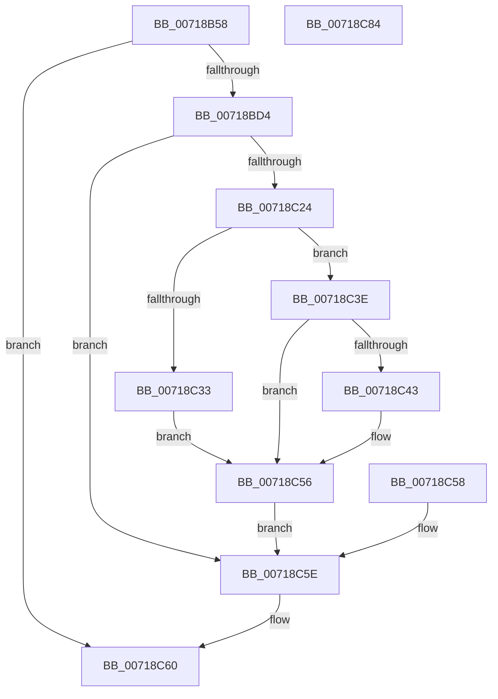

# VslGetOnDemandDebugChallenge

- RVA: `0x00718B58`–`0x00718C85` (길이 `301` bytes)
- VA: `0x0000000140718B58`
- 실행 섹션: `PAGE`
- PDB 이름 있음: `예`; PDB Function 태그: `아니요`
- unwind 정보 RVA: `0x000C6B48`
- 디코드: `71`개 명령, `301/301` bytes 표시
- 미해석 바이트: `0` (있으면 어셈블리에 `.byte`로 보존)

> 이 문서는 커널 이미지의 기계어와 PDB 기호를 분석해 생성했습니다. 4번과 5번은 함수 원형과 자료형을 바이너리 사용 방식에서 추정한 C 해석이며 원본 소스 복구 결과는 아닙니다.

## 1. Dependencies

- 직접 호출 지점: **7**; 고유 호출 대상: **6**
- 직접 호출자로 확인된 함수: **1**
- RIP 상대 이미지 참조: **1**

### Outgoing calls
- `0x00718B94` → [memset](../../text/6C/memset_function_006C6C40.md) (function, `0x006C6C40`)
- `0x00718BA4` → [memset](../../text/6C/memset_function_006C6C40.md) (function, `0x006C6C40`)
- `0x00718BC7` → [VslpLockPagesForTransfer](../../text/29/VslpLockPagesForTransfer_function_0029E0FC.md) (function, `0x0029E0FC`)
- `0x00718C0F` → [VslpEnterIumSecureMode](../../text/23/VslpEnterIumSecureMode_function_00235E50.md) (function, `0x00235E50`)
- `0x00718C1B` → [VslpUnlockPagesForTransfer](../../text/29/VslpUnlockPagesForTransfer_function_0029EE4C.md) (function, `0x0029EE4C`)
- `0x00718C51` → [memcpy](../../text/6C/memcpy_function_006C6840.md) (function, `0x006C6840`)
- `0x00718C6B` → [_security_check_cookie](../../text/6A/_security_check_cookie_function_006AC640.md) (function, `0x006AC640`)

### Direct callers
- [PsIumGetOnDemandDebugChallenge](../AC/PsIumGetOnDemandDebugChallenge_function_00ACA8B4.md) at `0x00ACA925`

### Static image references
- `0x00718B68` → RVA `0x00E0A740` (`.data`; read)

## 2. Other-region calls and transfers

- 다른 실행 섹션으로 향하는 call: **7**
  - `0x00718B94` → [memset](../../text/6C/memset_function_006C6C40.md) (`PAGE` → `.text`)
  - `0x00718BA4` → [memset](../../text/6C/memset_function_006C6C40.md) (`PAGE` → `.text`)
  - `0x00718BC7` → [VslpLockPagesForTransfer](../../text/29/VslpLockPagesForTransfer_function_0029E0FC.md) (`PAGE` → `.text`)
  - `0x00718C0F` → [VslpEnterIumSecureMode](../../text/23/VslpEnterIumSecureMode_function_00235E50.md) (`PAGE` → `.text`)
  - `0x00718C1B` → [VslpUnlockPagesForTransfer](../../text/29/VslpUnlockPagesForTransfer_function_0029EE4C.md) (`PAGE` → `.text`)
  - `0x00718C51` → [memcpy](../../text/6C/memcpy_function_006C6840.md) (`PAGE` → `.text`)
  - `0x00718C6B` → [_security_check_cookie](../../text/6A/_security_check_cookie_function_006AC640.md) (`PAGE` → `.text`)
- 별도 외부 분기/꼬리 이동을 확인하지 못했습니다.

## 3. Assembly (complete function range)

```asm
00718B58  48 89 5C 24 08                  mov qword ptr [rsp + 8], rbx
00718B5D  56                              push rsi
00718B5E  57                              push rdi
00718B5F  41 56                           push r14
00718B61  48 81 EC 10 11 00 00            sub rsp, 0x1110
00718B68  48 8B 05 D1 1B 6F 00            mov rax, qword ptr [rip + 0x6f1bd1]
00718B6F  48 33 C4                        xor rax, rsp
00718B72  48 89 84 24 00 11 00 00         mov qword ptr [rsp + 0x1100], rax
00718B7A  4D 8B F1                        mov r14, r9
00718B7D  41 8B F0                        mov esi, r8d
00718B80  48 8B FA                        mov rdi, rdx
00718B83  48 8B D9                        mov rbx, rcx
00718B86  33 D2                           xor edx, edx
00718B88  44 8D 42 68                     lea r8d, [rdx + 0x68]
00718B8C  48 8D 8C 24 90 00 00 00         lea rcx, [rsp + 0x90]
00718B94  E8 A7 E0 FA FF                  call 0x1406c6c40
00718B99  33 D2                           xor edx, edx
00718B9B  44 8D 42 48                     lea r8d, [rdx + 0x48]
00718B9F  48 8D 4C 24 40                  lea rcx, [rsp + 0x40]
00718BA4  E8 97 E0 FA FF                  call 0x1406c6c40
00718BA9  83 64 24 20 00                  and dword ptr [rsp + 0x20], 0
00718BAE  41 B9 01 00 00 00               mov r9d, 1
00718BB4  41 B8 00 10 00 00               mov r8d, 0x1000
00718BBA  48 8D 94 24 00 01 00 00         lea rdx, [rsp + 0x100]
00718BC2  48 8D 4C 24 40                  lea rcx, [rsp + 0x40]
00718BC7  E8 30 55 B8 FF                  call 0x14029e0fc
00718BCC  85 C0                           test eax, eax
00718BCE  0F 88 8C 00 00 00               js 0x140718c60
00718BD4  48 8B 83 70 01 00 00            mov rax, qword ptr [rbx + 0x170]
00718BDB  48 89 84 24 98 00 00 00         mov qword ptr [rsp + 0x98], rax
00718BE3  48 8B 44 24 40                  mov rax, qword ptr [rsp + 0x40]
00718BE8  48 89 84 24 A0 00 00 00         mov qword ptr [rsp + 0xa0], rax
00718BF0  48 8B 44 24 78                  mov rax, qword ptr [rsp + 0x78]
00718BF5  48 89 84 24 A8 00 00 00         mov qword ptr [rsp + 0xa8], rax
00718BFD  BA 12 00 00 00                  mov edx, 0x12
00718C02  4C 8D 8C 24 90 00 00 00         lea r9, [rsp + 0x90]
00718C0A  45 33 C0                        xor r8d, r8d
00718C0D  B1 02                           mov cl, 2
00718C0F  E8 3C D2 B1 FF                  call 0x140235e50
00718C14  8B D8                           mov ebx, eax
00718C16  48 8D 4C 24 40                  lea rcx, [rsp + 0x40]
00718C1B  E8 2C 62 B8 FF                  call 0x14029ee4c
00718C20  85 DB                           test ebx, ebx
00718C22  78 3A                           js 0x140718c5e
00718C24  48 8B 84 24 A0 00 00 00         mov rax, qword ptr [rsp + 0xa0]
00718C2C  41 89 06                        mov dword ptr [r14], eax
00718C2F  3B C6                           cmp eax, esi
00718C31  76 0B                           jbe 0x140718c3e
00718C33  BB 23 00 00 C0                  mov ebx, 0xc0000023
00718C38  89 5C 24 30                     mov dword ptr [rsp + 0x30], ebx
00718C3C  EB 18                           jmp 0x140718c56
00718C3E  48 85 FF                        test rdi, rdi
00718C41  74 13                           je 0x140718c56
00718C43  44 8B C0                        mov r8d, eax
00718C46  48 8D 94 24 00 01 00 00         lea rdx, [rsp + 0x100]
00718C4E  48 8B CF                        mov rcx, rdi
00718C51  E8 EA DB FA FF                  call 0x1406c6840
00718C56  EB 06                           jmp 0x140718c5e
00718C58  8B D8                           mov ebx, eax
00718C5A  89 44 24 30                     mov dword ptr [rsp + 0x30], eax
00718C5E  8B C3                           mov eax, ebx
00718C60  48 8B 8C 24 00 11 00 00         mov rcx, qword ptr [rsp + 0x1100]
00718C68  48 33 CC                        xor rcx, rsp
00718C6B  E8 D0 39 F9 FF                  call 0x1406ac640
00718C70  48 8B 9C 24 30 11 00 00         mov rbx, qword ptr [rsp + 0x1130]
00718C78  48 81 C4 10 11 00 00            add rsp, 0x1110
00718C7F  41 5E                           pop r14
00718C81  5F                              pop rdi
00718C82  5E                              pop rsi
00718C83  C3                              ret
00718C84  CC                              int3
```

## 4. C-style interpretation (structured pseudocode)

```c
__int64 __fastcall VslGetOnDemandDebugChallenge(__int64 a1, __int64 a2, int a3, __int64 a4)
{
    __int64 result;
    __int64 v_rsp;
    unsigned __int64 v_stack_m1028;
    unsigned __int64 v_stack_m1080;
    unsigned __int64 v_stack_m1088;
    unsigned __int64 v_stack_m1090;
    unsigned __int64 v_stack_m1098;
    unsigned __int64 v_stack_m10B0;
    unsigned __int64 v_stack_m10E8;
    unsigned int v_stack_m10F8;
    unsigned int v_stack_m1108;
    unsigned __int64 v_stack_m28;
    unsigned __int64 v_stack_p8;

    v_stack_p8 = v_rbx;
    v_rsp = (v_rsp) - (0x1110ULL);
    result = (*(unsigned __int64 *)(v_rip + 7281617)) ^ (v_rsp);
    v_stack_m28 = result;
    a2 = 0;
    result = memset(v_stack_m1098, a2, a2 + 104, a4);
    a2 = 0;
    result = memset(v_stack_m10E8, a2, a2 + 72, a4);
    result = VslpLockPagesForTransfer(v_stack_m10E8, v_stack_m1028, (unsigned int)(0x1000ULL), 1);
    if (sign_flag) goto loc_00718C60;
    v_stack_m1090 = *(unsigned __int64 *)(a1 + 368);
    v_stack_m1088 = v_stack_m10E8;
    v_stack_m1080 = v_stack_m10B0;
    a3 = 0;
    result = VslpEnterIumSecureMode(2, 18, a3, v_stack_m1098);
    result = VslpUnlockPagesForTransfer(v_stack_m10E8, 18, a3, v_stack_m1098);
    if (sign_flag) goto loc_00718C5E;
    *(unsigned int *)(a4) = (unsigned int)(v_stack_m1088);
    if (((unsigned int)(v_stack_m1088)) <= ((unsigned int)((unsigned int)(a3)))) goto loc_00718C3E;
    v_stack_m10F8 = (unsigned int)((unsigned int)(0xC0000023ULL));
    goto loc_00718C56;
loc_00718C3E:
    result = v_stack_m1088;
    if (0 != 0) {
        a3 = (unsigned int)(v_stack_m1088);
        a2 = v_stack_m1028;
        a1 = a2;
        result = memcpy(a1, a2, a3, v_stack_m1098);
    }
    goto loc_00718C5E;
loc_00718C5E:
loc_00718C60:
    a1 = (v_stack_m28) ^ (v_rsp);
    result = _security_check_cookie(a1, a2, a3, v_stack_m1098);
    v_rsp = (v_rsp) + (0x1110ULL);
    return result;
}
```

## 5. (Beta) C Style

```c
int64_t VslGetOnDemandDebugChallenge(void *Arg1, int64_t Arg2, int32_t Arg3, void *Arg4)
{
    uint8_t *arg1 = (uint8_t *)Arg1;
    uint8_t *arg4 = (uint8_t *)Arg4;

    int64_t result;
    int64_t local_rsp;
    uint64_t v_stack_m1028;
    uint64_t v_stack_m1080;
    uint64_t v_stack_m1088;
    uint64_t v_stack_m1090;
    uint64_t v_stack_m1098;
    uint64_t v_stack_m10B0;
    uint64_t v_stack_m10E8;
    uint32_t v_stack_m10F8;
    uint32_t v_stack_m1108;
    uint64_t v_stack_m28;
    uint64_t v_stack_p8;

    v_stack_p8 = local_rbx;
    local_rsp = (local_rsp) - (0x1110ULL);
    result = (*(uint64_t *)(v_rip + 0x6F1BD1)) ^ (local_rsp);
    v_stack_m28 = result;
    Arg2 = 0;
    result = memset(v_stack_m1098, Arg2, Arg2 + 104, Arg4);
    Arg2 = 0;
    result = memset(v_stack_m10E8, Arg2, Arg2 + 72, Arg4);
    result = VslpLockPagesForTransfer(v_stack_m10E8, v_stack_m1028, (uint32_t)(0x1000ULL), 1);
    if (sign_flag) goto loc_00718C60;
    v_stack_m1090 = *(uint64_t *)(arg1 + 0x170);
    v_stack_m1088 = v_stack_m10E8;
    v_stack_m1080 = v_stack_m10B0;
    Arg3 = 0;
    result = VslpEnterIumSecureMode(2, 18, Arg3, v_stack_m1098);
    result = VslpUnlockPagesForTransfer(v_stack_m10E8, 18, Arg3, v_stack_m1098);
    if (sign_flag) goto loc_00718C5E;
    *(uint32_t *)(arg4) = (uint32_t)(v_stack_m1088);
    if (((uint32_t)(v_stack_m1088)) <= ((uint32_t)((uint32_t)(Arg3)))) goto loc_00718C3E;
    v_stack_m10F8 = (uint32_t)((uint32_t)(0xC0000023ULL));
    goto loc_00718C56;
loc_00718C3E:
    result = v_stack_m1088;
    if (0 != 0) {
        Arg3 = (uint32_t)(v_stack_m1088);
        Arg2 = v_stack_m1028;
        Arg1 = Arg2;
        result = memcpy(Arg1, Arg2, Arg3, v_stack_m1098);
    }
    goto loc_00718C5E;
loc_00718C5E:
loc_00718C60:
    Arg1 = (v_stack_m28) ^ (local_rsp);
    result = _security_check_cookie(Arg1, Arg2, Arg3, v_stack_m1098);
    local_rsp = (local_rsp) + (0x1110ULL);
    return result;
}
```

### 관측된 메모리 오프셋

구조체 형식이 확인되지 않은 접근은 인자 기준의 오프셋으로만 기록했습니다.

| 기준 인자 | 오프셋 표현 | 폭 (bit) | 접근 |
|---|---:|---:|---|
| `Arg1` | `+ 0x170` | `64` | `R` |
| `Arg4` | `+ 0x0` | `32` | `W` |

## 6. Execution-region graph

[열기: 2D/3D 그래프와 함수 탐색 컨트롤 패널](../../../control-panel.html?section=page&rva=0x00718B58&view=graph)

- 2D 그래프는 위에서 아래로 흐르고, 3D 그래프는 빈 공간을 드래그해 회전합니다. Shift+드래그는 이동, 휠은 확대·축소, 함수 노드 선택은 대상 보고서 이동입니다.

### Static fallback


