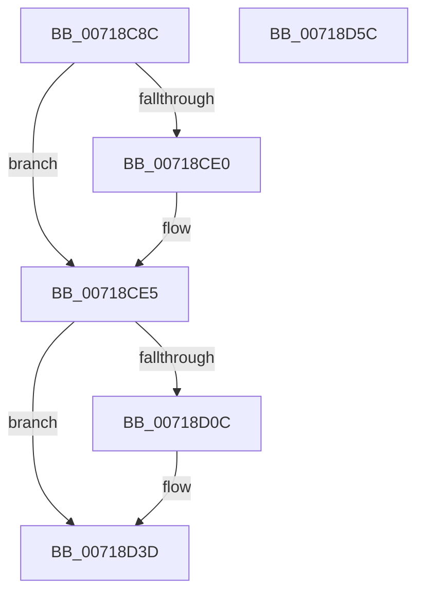

# VslGetSetSecureContext

- RVA: `0x00718C8C`–`0x00718D5D` (길이 `209` bytes)
- VA: `0x0000000140718C8C`
- 실행 섹션: `PAGE`
- PDB 이름 있음: `예`; PDB Function 태그: `아니요`
- unwind 정보 RVA: `0x000C6D78`
- 디코드: `58`개 명령, `209/209` bytes 표시
- 미해석 바이트: `0` (있으면 어셈블리에 `.byte`로 보존)

> 이 문서는 커널 이미지의 기계어와 PDB 기호를 분석해 생성했습니다. 4번과 5번은 함수 원형과 자료형을 바이너리 사용 방식에서 추정한 C 해석이며 원본 소스 복구 결과는 아닙니다.

## 1. Dependencies

- 직접 호출 지점: **6**; 고유 호출 대상: **5**
- 직접 호출자로 확인된 함수: **1**
- RIP 상대 이미지 참조: **1**

### Outgoing calls
- `0x00718CC1` → [memset](../../text/6C/memset_function_006C6C40.md) (function, `0x006C6C40`)
- `0x00718CD1` → [memset](../../text/6C/memset_function_006C6C40.md) (function, `0x006C6C40`)
- `0x00718D03` → [VslpLockPagesForTransfer](../../text/29/VslpLockPagesForTransfer_function_0029E0FC.md) (function, `0x0029E0FC`)
- `0x00718D2A` → [VslpEnterIumSecureMode](../../text/23/VslpEnterIumSecureMode_function_00235E50.md) (function, `0x00235E50`)
- `0x00718D36` → [VslpUnlockPagesForTransfer](../../text/29/VslpUnlockPagesForTransfer_function_0029EE4C.md) (function, `0x0029EE4C`)
- `0x00718D44` → [_security_check_cookie](../../text/6A/_security_check_cookie_function_006AC640.md) (function, `0x006AC640`)

### Direct callers
- [sub_009A6724](../9A/Unknown_function_009A6724.md) at `0x009A67C6`

### Static image references
- `0x00718CA0` → RVA `0x00E0A740` (`.data`; read)

## 2. Other-region calls and transfers

- 다른 실행 섹션으로 향하는 call: **6**
  - `0x00718CC1` → [memset](../../text/6C/memset_function_006C6C40.md) (`PAGE` → `.text`)
  - `0x00718CD1` → [memset](../../text/6C/memset_function_006C6C40.md) (`PAGE` → `.text`)
  - `0x00718D03` → [VslpLockPagesForTransfer](../../text/29/VslpLockPagesForTransfer_function_0029E0FC.md) (`PAGE` → `.text`)
  - `0x00718D2A` → [VslpEnterIumSecureMode](../../text/23/VslpEnterIumSecureMode_function_00235E50.md) (`PAGE` → `.text`)
  - `0x00718D36` → [VslpUnlockPagesForTransfer](../../text/29/VslpUnlockPagesForTransfer_function_0029EE4C.md) (`PAGE` → `.text`)
  - `0x00718D44` → [_security_check_cookie](../../text/6A/_security_check_cookie_function_006AC640.md) (`PAGE` → `.text`)
- 별도 외부 분기/꼬리 이동을 확인하지 못했습니다.

## 3. Assembly (complete function range)

```asm
00718C8C  48 89 5C 24 08                  mov qword ptr [rsp + 8], rbx
00718C91  55                              push rbp
00718C92  56                              push rsi
00718C93  57                              push rdi
00718C94  48 8D 6C 24 B9                  lea rbp, [rsp - 0x47]
00718C99  48 81 EC 00 01 00 00            sub rsp, 0x100
00718CA0  48 8B 05 99 1A 6F 00            mov rax, qword ptr [rip + 0x6f1a99]
00718CA7  48 33 C4                        xor rax, rsp
00718CAA  48 89 45 37                     mov qword ptr [rbp + 0x37], rax
00718CAE  48 8B FA                        mov rdi, rdx
00718CB1  41 8B F0                        mov esi, r8d
00718CB4  33 D2                           xor edx, edx
00718CB6  48 8B D9                        mov rbx, rcx
00718CB9  48 8D 4D C7                     lea rcx, [rbp - 0x39]
00718CBD  44 8D 42 68                     lea r8d, [rdx + 0x68]
00718CC1  E8 7A DF FA FF                  call 0x1406c6c40
00718CC6  33 D2                           xor edx, edx
00718CC8  48 8D 4C 24 30                  lea rcx, [rsp + 0x30]
00718CCD  44 8D 42 48                     lea r8d, [rdx + 0x48]
00718CD1  E8 6A DF FA FF                  call 0x1406c6c40
00718CD6  B8 0F 00 00 00                  mov eax, 0xf
00718CDB  48 85 DB                        test rbx, rbx
00718CDE  75 05                           jne 0x140718ce5
00718CE0  B8 0E 00 00 00                  mov eax, 0xe
00718CE5  45 33 C9                        xor r9d, r9d
00718CE8  66 89 45 C9                     mov word ptr [rbp - 0x37], ax
00718CEC  48 85 DB                        test rbx, rbx
00718CEF  48 8D 4C 24 30                  lea rcx, [rsp + 0x30]
00718CF4  44 8B C6                        mov r8d, esi
00718CF7  48 8B D7                        mov rdx, rdi
00718CFA  41 0F 95 C1                     setne r9b
00718CFE  83 64 24 20 00                  and dword ptr [rsp + 0x20], 0
00718D03  E8 F4 53 B8 FF                  call 0x14029e0fc
00718D08  85 C0                           test eax, eax
00718D0A  78 31                           js 0x140718d3d
00718D0C  48 8B 44 24 30                  mov rax, qword ptr [rsp + 0x30]
00718D11  4C 8D 4D C7                     lea r9, [rbp - 0x39]
00718D15  0F B7 55 C9                     movzx edx, word ptr [rbp - 0x37]
00718D19  45 33 C0                        xor r8d, r8d
00718D1C  48 89 45 CF                     mov qword ptr [rbp - 0x31], rax
00718D20  B1 02                           mov cl, 2
00718D22  48 8B 45 AF                     mov rax, qword ptr [rbp - 0x51]
00718D26  48 89 45 D7                     mov qword ptr [rbp - 0x29], rax
00718D2A  E8 21 D1 B1 FF                  call 0x140235e50
00718D2F  48 8D 4C 24 30                  lea rcx, [rsp + 0x30]
00718D34  8B D8                           mov ebx, eax
00718D36  E8 11 61 B8 FF                  call 0x14029ee4c
00718D3B  8B C3                           mov eax, ebx
00718D3D  48 8B 4D 37                     mov rcx, qword ptr [rbp + 0x37]
00718D41  48 33 CC                        xor rcx, rsp
00718D44  E8 F7 38 F9 FF                  call 0x1406ac640
00718D49  48 8B 9C 24 20 01 00 00         mov rbx, qword ptr [rsp + 0x120]
00718D51  48 81 C4 00 01 00 00            add rsp, 0x100
00718D58  5F                              pop rdi
00718D59  5E                              pop rsi
00718D5A  5D                              pop rbp
00718D5B  C3                              ret
00718D5C  CC                              int3
```

## 4. C-style interpretation (structured pseudocode)

```c
__int64 __fastcall VslGetSetSecureContext(__int64 a1, __int64 a2, int a3, int a4)
{
    __int64 result;
    __int64 v_rbx;
    __int64 v_rsp;
    unsigned __int64 v_stack_m28;
    unsigned __int64 v_stack_m5F;
    unsigned __int64 v_stack_m88;
    unsigned __int64 v_stack_m90;
    unsigned __int16 v_stack_m96;
    unsigned __int64 v_stack_m98;
    unsigned __int64 v_stack_mB0;
    unsigned __int64 v_stack_mE8;
    unsigned int v_stack_mF8;
    unsigned __int64 v_stack_p8;

    v_stack_p8 = v_rbx;
    v_rsp = (v_rsp) - (256);
    result = (*(unsigned __int64 *)(v_rip + 7281305)) ^ (v_rsp);
    v_stack_m28 = result;
    a2 = 0;
    result = memset(v_stack_m98, a2, a2 + 104, a4);
    a2 = 0;
    result = memset(v_stack_mE8, a2, a2 + 72, a4);
    result = 15;
    if (a1 == 0) {
        result = 14;
    }
    a4 = 0;
    v_stack_m96 = (unsigned __int16)(result);
    a4 = (a1 != 0) ? 1 : 0;
    result = VslpLockPagesForTransfer(v_stack_mE8, 0, (unsigned int)((unsigned int)((unsigned int)(a3))), a4);
    v_rbx = a1;
    if (!(sign_flag)) {
        result = v_stack_mE8;
        a4 = v_stack_m98;
        a2 = v_stack_m96;
        a3 = 0;
        v_stack_m90 = result;
        a1 = 2;
        result = v_stack_mB0;
        v_stack_m88 = result;
        result = VslpEnterIumSecureMode(a1, a2, a3, a4);
        a1 = v_stack_mE8;
        v_rbx = (unsigned int)(result);
        result = VslpUnlockPagesForTransfer(a1, a2, a3, a4);
        result = (unsigned int)(v_rbx);
    }
    a1 = (v_stack_m28) ^ (v_rsp);
    result = _security_check_cookie(a1, a2, a3, a4);
    v_rsp = (v_rsp) + (256);
    return result;
}
```

## 5. (Beta) C Style

```c
int64_t VslGetSetSecureContext(int64_t Arg1, int64_t Arg2, int32_t Arg3, int32_t Arg4)
{
    int64_t result;
    int64_t local_rbx;
    int64_t local_rsp;
    uint64_t v_stack_m28;
    uint64_t v_stack_m5F;
    uint64_t v_stack_m88;
    uint64_t v_stack_m90;
    uint16_t v_stack_m96;
    uint64_t v_stack_m98;
    uint64_t v_stack_mB0;
    uint64_t v_stack_mE8;
    uint32_t v_stack_mF8;
    uint64_t v_stack_p8;

    v_stack_p8 = local_rbx;
    local_rsp = (local_rsp) - (256);
    result = (*(uint64_t *)(v_rip + 0x6F1A99)) ^ (local_rsp);
    v_stack_m28 = result;
    Arg2 = 0;
    result = memset(v_stack_m98, Arg2, Arg2 + 104, Arg4);
    Arg2 = 0;
    result = memset(v_stack_mE8, Arg2, Arg2 + 72, Arg4);
    result = 15;
    if (Arg1 == 0) {
        result = 14;
    }
    Arg4 = 0;
    v_stack_m96 = (uint16_t)(result);
    Arg4 = (Arg1 != 0) ? 1 : 0;
    result = VslpLockPagesForTransfer(v_stack_mE8, 0, (uint32_t)((uint32_t)((uint32_t)(Arg3))), Arg4);
    local_rbx = Arg1;
    if (!(sign_flag)) {
        result = v_stack_mE8;
        Arg4 = v_stack_m98;
        Arg2 = v_stack_m96;
        Arg3 = 0;
        v_stack_m90 = result;
        Arg1 = 2;
        result = v_stack_mB0;
        v_stack_m88 = result;
        result = VslpEnterIumSecureMode(Arg1, Arg2, Arg3, Arg4);
        Arg1 = v_stack_mE8;
        local_rbx = (uint32_t)(result);
        result = VslpUnlockPagesForTransfer(Arg1, Arg2, Arg3, Arg4);
        result = (uint32_t)(local_rbx);
    }
    Arg1 = (v_stack_m28) ^ (local_rsp);
    result = _security_check_cookie(Arg1, Arg2, Arg3, Arg4);
    local_rsp = (local_rsp) + (256);
    return result;
}
```

## 6. Execution-region graph

[열기: 2D/3D 그래프와 함수 탐색 컨트롤 패널](../../../control-panel.html?section=page&rva=0x00718C8C&view=graph)

- 2D 그래프는 위에서 아래로 흐르고, 3D 그래프는 빈 공간을 드래그해 회전합니다. Shift+드래그는 이동, 휠은 확대·축소, 함수 노드 선택은 대상 보고서 이동입니다.

### Static fallback


