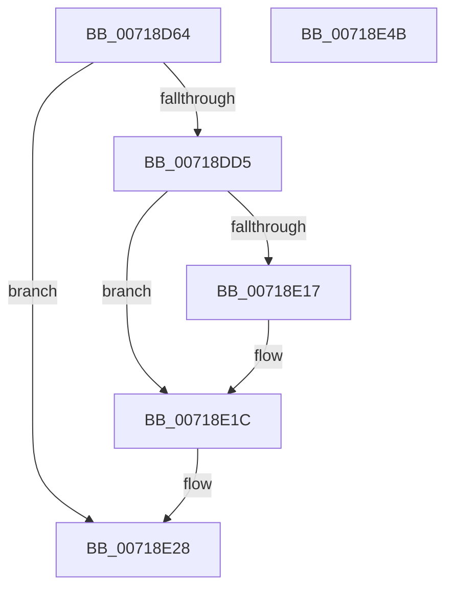

# VslInitializeEnclave

- RVA: `0x00718D64`–`0x00718E4C` (길이 `232` bytes)
- VA: `0x0000000140718D64`
- 실행 섹션: `PAGE`
- PDB 이름 있음: `예`; PDB Function 태그: `아니요`
- unwind 정보 RVA: `0x000C6D54`
- 디코드: `67`개 명령, `232/232` bytes 표시
- 미해석 바이트: `0` (있으면 어셈블리에 `.byte`로 보존)

> 이 문서는 커널 이미지의 기계어와 PDB 기호를 분석해 생성했습니다. 4번과 5번은 함수 원형과 자료형을 바이너리 사용 방식에서 추정한 C 해석이며 원본 소스 복구 결과는 아닙니다.

## 1. Dependencies

- 직접 호출 지점: **6**; 고유 호출 대상: **5**
- 직접 호출자로 확인된 함수: **1**
- RIP 상대 이미지 참조: **1**

### Outgoing calls
- `0x00718DA4` → [memset](../../text/6C/memset_function_006C6C40.md) (function, `0x006C6C40`)
- `0x00718DB4` → [memset](../../text/6C/memset_function_006C6C40.md) (function, `0x006C6C40`)
- `0x00718DCC` → [VslpLockPagesForTransfer](../../text/29/VslpLockPagesForTransfer_function_0029E0FC.md) (function, `0x0029E0FC`)
- `0x00718E0C` → [VslpEnterIumSecureMode](../../text/23/VslpEnterIumSecureMode_function_00235E50.md) (function, `0x00235E50`)
- `0x00718E21` → [VslpUnlockPagesForTransfer](../../text/29/VslpUnlockPagesForTransfer_function_0029EE4C.md) (function, `0x0029EE4C`)
- `0x00718E2F` → [_security_check_cookie](../../text/6A/_security_check_cookie_function_006AC640.md) (function, `0x006AC640`)

### Direct callers
- [PsInitializeVsmEnclave](../78/PsInitializeVsmEnclave_function_0078875C.md) at `0x00788875`

### Static image references
- `0x00718D7C` → RVA `0x00E0A740` (`.data`; read)

## 2. Other-region calls and transfers

- 다른 실행 섹션으로 향하는 call: **6**
  - `0x00718DA4` → [memset](../../text/6C/memset_function_006C6C40.md) (`PAGE` → `.text`)
  - `0x00718DB4` → [memset](../../text/6C/memset_function_006C6C40.md) (`PAGE` → `.text`)
  - `0x00718DCC` → [VslpLockPagesForTransfer](../../text/29/VslpLockPagesForTransfer_function_0029E0FC.md) (`PAGE` → `.text`)
  - `0x00718E0C` → [VslpEnterIumSecureMode](../../text/23/VslpEnterIumSecureMode_function_00235E50.md) (`PAGE` → `.text`)
  - `0x00718E21` → [VslpUnlockPagesForTransfer](../../text/29/VslpUnlockPagesForTransfer_function_0029EE4C.md) (`PAGE` → `.text`)
  - `0x00718E2F` → [_security_check_cookie](../../text/6A/_security_check_cookie_function_006AC640.md) (`PAGE` → `.text`)
- 별도 외부 분기/꼬리 이동을 확인하지 못했습니다.

## 3. Assembly (complete function range)

```asm
00718D64  48 89 5C 24 08                  mov qword ptr [rsp + 8], rbx
00718D69  55                              push rbp
00718D6A  56                              push rsi
00718D6B  57                              push rdi
00718D6C  41 56                           push r14
00718D6E  41 57                           push r15
00718D70  48 8D 6C 24 E1                  lea rbp, [rsp - 0x1f]
00718D75  48 81 EC 00 01 00 00            sub rsp, 0x100
00718D7C  48 8B 05 BD 19 6F 00            mov rax, qword ptr [rip + 0x6f19bd]
00718D83  48 33 C4                        xor rax, rsp
00718D86  48 89 45 0F                     mov qword ptr [rbp + 0xf], rax
00718D8A  48 8B 75 7F                     mov rsi, qword ptr [rbp + 0x7f]
00718D8E  4C 8B F2                        mov r14, rdx
00718D91  33 D2                           xor edx, edx
00718D93  49 8B D8                        mov rbx, r8
00718D96  4C 8B F9                        mov r15, rcx
00718D99  41 8B F9                        mov edi, r9d
00718D9C  48 8D 4D 9F                     lea rcx, [rbp - 0x61]
00718DA0  44 8D 42 68                     lea r8d, [rdx + 0x68]
00718DA4  E8 97 DE FA FF                  call 0x1406c6c40
00718DA9  33 D2                           xor edx, edx
00718DAB  48 8D 4C 24 30                  lea rcx, [rsp + 0x30]
00718DB0  44 8D 42 48                     lea r8d, [rdx + 0x48]
00718DB4  E8 87 DE FA FF                  call 0x1406c6c40
00718DB9  83 64 24 20 00                  and dword ptr [rsp + 0x20], 0
00718DBE  48 8D 4C 24 30                  lea rcx, [rsp + 0x30]
00718DC3  45 33 C9                        xor r9d, r9d
00718DC6  44 8B C7                        mov r8d, edi
00718DC9  48 8B D3                        mov rdx, rbx
00718DCC  E8 2B 53 B8 FF                  call 0x14029e0fc
00718DD1  85 C0                           test eax, eax
00718DD3  78 53                           js 0x140718e28
00718DD5  48 8B 44 24 30                  mov rax, qword ptr [rsp + 0x30]
00718DDA  4C 8D 4D 9F                     lea r9, [rbp - 0x61]
00718DDE  48 89 45 B7                     mov qword ptr [rbp - 0x49], rax
00718DE2  BA 32 00 00 00                  mov edx, 0x32
00718DE7  48 8B 45 87                     mov rax, qword ptr [rbp - 0x79]
00718DEB  45 33 C0                        xor r8d, r8d
00718DEE  48 89 45 BF                     mov qword ptr [rbp - 0x41], rax
00718DF2  B1 02                           mov cl, 2
00718DF4  48 8B 45 6F                     mov rax, qword ptr [rbp + 0x6f]
00718DF8  48 89 45 C7                     mov qword ptr [rbp - 0x39], rax
00718DFC  48 8B 45 77                     mov rax, qword ptr [rbp + 0x77]
00718E00  48 89 45 CF                     mov qword ptr [rbp - 0x31], rax
00718E04  4C 89 7D A7                     mov qword ptr [rbp - 0x59], r15
00718E08  4C 89 75 AF                     mov qword ptr [rbp - 0x51], r14
00718E0C  E8 3F D0 B1 FF                  call 0x140235e50
00718E11  8B D8                           mov ebx, eax
00718E13  85 C0                           test eax, eax
00718E15  78 05                           js 0x140718e1c
00718E17  8B 4D AF                        mov ecx, dword ptr [rbp - 0x51]
00718E1A  89 0E                           mov dword ptr [rsi], ecx
00718E1C  48 8D 4C 24 30                  lea rcx, [rsp + 0x30]
00718E21  E8 26 60 B8 FF                  call 0x14029ee4c
00718E26  8B C3                           mov eax, ebx
00718E28  48 8B 4D 0F                     mov rcx, qword ptr [rbp + 0xf]
00718E2C  48 33 CC                        xor rcx, rsp
00718E2F  E8 0C 38 F9 FF                  call 0x1406ac640
00718E34  48 8B 9C 24 30 01 00 00         mov rbx, qword ptr [rsp + 0x130]
00718E3C  48 81 C4 00 01 00 00            add rsp, 0x100
00718E43  41 5F                           pop r15
00718E45  41 5E                           pop r14
00718E47  5F                              pop rdi
00718E48  5E                              pop rsi
00718E49  5D                              pop rbp
00718E4A  C3                              ret
00718E4B  CC                              int3
```

## 4. C-style interpretation (structured pseudocode)

```c
__int64 __fastcall VslInitializeEnclave(__int64 a1, __int64 a2, __int64 a3, int a4, __int64 a5, __int64 a6, __int64 a7)
{
    __int64 result;
    __int64 v_rsp;
    unsigned int v_stack_m108;
    unsigned __int64 v_stack_m38;
    unsigned __int64 v_stack_m47;
    unsigned __int64 v_stack_m78;
    unsigned __int64 v_stack_m80;
    unsigned __int64 v_stack_m88;
    unsigned __int64 v_stack_m90;
    unsigned __int64 v_stack_m98;
    unsigned __int64 v_stack_mA0;
    unsigned __int64 v_stack_mA8;
    unsigned __int64 v_stack_mC0;
    unsigned __int64 v_stack_mF8;
    unsigned __int64 v_stack_p8;

    v_stack_p8 = v_rbx;
    v_rsp = (v_rsp) - (256);
    result = (*(unsigned __int64 *)(v_rip + 7281085)) ^ (v_rsp);
    v_stack_m38 = result;
    a2 = 0;
    result = memset(v_stack_mA8, a2, a2 + 104, a4);
    a2 = 0;
    result = memset(v_stack_mF8, a2, a2 + 72, a4);
    a4 = 0;
    result = VslpLockPagesForTransfer(v_stack_mF8, a3, (unsigned int)((unsigned int)((unsigned int)(a4))), a4);
    if (sign_flag) goto loc_00718E28;
    v_stack_m90 = v_stack_mF8;
    a3 = 0;
    v_stack_m88 = v_stack_mC0;
    v_stack_m80 = a5;
    v_stack_m78 = a6;
    v_stack_mA0 = a1;
    v_stack_m98 = 0;
    result = VslpEnterIumSecureMode(2, 50, a3, v_stack_mA8);
    if (!(sign_flag)) {
        a1 = v_stack_m98;
        *(unsigned int *)(a7) = (unsigned int)(a1);
    }
    result = VslpUnlockPagesForTransfer(v_stack_mF8, 50, a3, v_stack_mA8);
loc_00718E28:
    a1 = (v_stack_m38) ^ (v_rsp);
    result = _security_check_cookie(a1, 50, a3, v_stack_mA8);
    v_rsp = (v_rsp) + (256);
    return result;
}
```

## 5. (Beta) C Style

```c
int64_t VslInitializeEnclave(int64_t Arg1, int64_t Arg2, int64_t Arg3, int32_t Arg4, int64_t Arg5, int64_t Arg6, void *Arg7)
{
    uint8_t *arg7 = (uint8_t *)Arg7;

    int64_t result;
    int64_t local_rsp;
    uint32_t v_stack_m108;
    uint64_t v_stack_m38;
    uint64_t v_stack_m47;
    uint64_t v_stack_m78;
    uint64_t v_stack_m80;
    uint64_t v_stack_m88;
    uint64_t v_stack_m90;
    uint64_t v_stack_m98;
    uint64_t v_stack_mA0;
    uint64_t v_stack_mA8;
    uint64_t v_stack_mC0;
    uint64_t v_stack_mF8;
    uint64_t v_stack_p8;

    v_stack_p8 = local_rbx;
    local_rsp = (local_rsp) - (256);
    result = (*(uint64_t *)(v_rip + 0x6F19BD)) ^ (local_rsp);
    v_stack_m38 = result;
    Arg2 = 0;
    result = memset(v_stack_mA8, Arg2, Arg2 + 104, Arg4);
    Arg2 = 0;
    result = memset(v_stack_mF8, Arg2, Arg2 + 72, Arg4);
    Arg4 = 0;
    result = VslpLockPagesForTransfer(v_stack_mF8, Arg3, (uint32_t)((uint32_t)((uint32_t)(Arg4))), Arg4);
    if (sign_flag) goto loc_00718E28;
    v_stack_m90 = v_stack_mF8;
    Arg3 = 0;
    v_stack_m88 = v_stack_mC0;
    v_stack_m80 = Arg5;
    v_stack_m78 = Arg6;
    v_stack_mA0 = Arg1;
    v_stack_m98 = 0;
    result = VslpEnterIumSecureMode(2, 50, Arg3, v_stack_mA8);
    if (!(sign_flag)) {
        Arg1 = v_stack_m98;
        *(uint32_t *)(arg7) = (uint32_t)(Arg1);
    }
    result = VslpUnlockPagesForTransfer(v_stack_mF8, 50, Arg3, v_stack_mA8);
loc_00718E28:
    Arg1 = (v_stack_m38) ^ (local_rsp);
    result = _security_check_cookie(Arg1, 50, Arg3, v_stack_mA8);
    local_rsp = (local_rsp) + (256);
    return result;
}
```

### 관측된 메모리 오프셋

구조체 형식이 확인되지 않은 접근은 인자 기준의 오프셋으로만 기록했습니다.

| 기준 인자 | 오프셋 표현 | 폭 (bit) | 접근 |
|---|---:|---:|---|
| `Arg7` | `+ 0x0` | `32` | `W` |

## 6. Execution-region graph

[열기: 2D/3D 그래프와 함수 탐색 컨트롤 패널](../../../control-panel.html?section=page&rva=0x00718D64&view=graph)

- 2D 그래프는 위에서 아래로 흐르고, 3D 그래프는 빈 공간을 드래그해 회전합니다. Shift+드래그는 이동, 휠은 확대·축소, 함수 노드 선택은 대상 보고서 이동입니다.

### Static fallback


