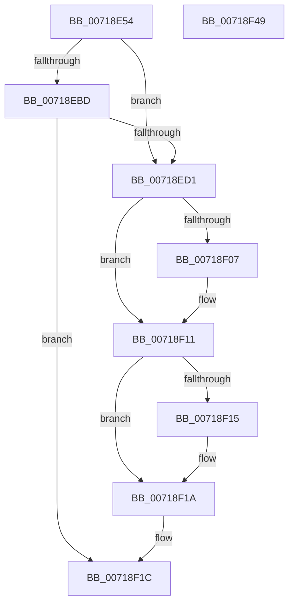

# VslLoadEnclaveData

- RVA: `0x00718E54`–`0x00718F4A` (길이 `246` bytes)
- VA: `0x0000000140718E54`
- 실행 섹션: `PAGE`
- PDB 이름 있음: `예`; PDB Function 태그: `아니요`
- unwind 정보 RVA: `0x000BE7A4`
- 디코드: `71`개 명령, `246/246` bytes 표시
- 미해석 바이트: `0` (있으면 어셈블리에 `.byte`로 보존)

> 이 문서는 커널 이미지의 기계어와 PDB 기호를 분석해 생성했습니다. 4번과 5번은 함수 원형과 자료형을 바이너리 사용 방식에서 추정한 C 해석이며 원본 소스 복구 결과는 아닙니다.

## 1. Dependencies

- 직접 호출 지점: **6**; 고유 호출 대상: **5**
- 직접 호출자로 확인된 함수: **1**
- RIP 상대 이미지 참조: **1**

### Outgoing calls
- `0x00718EA3` → [memset](../../text/6C/memset_function_006C6C40.md) (function, `0x006C6C40`)
- `0x00718EB3` → [memset](../../text/6C/memset_function_006C6C40.md) (function, `0x006C6C40`)
- `0x00718EC8` → [VslpLockMdlForTransfer](../../text/29/VslpLockMdlForTransfer_function_0029E3FC.md) (function, `0x0029E3FC`)
- `0x00718EFB` → [VslpEnterIumSecureMode](../../text/23/VslpEnterIumSecureMode_function_00235E50.md) (function, `0x00235E50`)
- `0x00718F0C` → [VslpUnlockPagesForTransfer](../../text/29/VslpUnlockPagesForTransfer_function_0029EE4C.md) (function, `0x0029EE4C`)
- `0x00718F23` → [_security_check_cookie](../../text/6A/_security_check_cookie_function_006AC640.md) (function, `0x006AC640`)

### Direct callers
- [PsLoadVsmEnclaveData](../../text/5E/PsLoadVsmEnclaveData_function_005E4D5C.md) at `0x005E4DDB`

### Static image references
- `0x00718E77` → RVA `0x00E0A740` (`.data`; read)

## 2. Other-region calls and transfers

- 다른 실행 섹션으로 향하는 call: **6**
  - `0x00718EA3` → [memset](../../text/6C/memset_function_006C6C40.md) (`PAGE` → `.text`)
  - `0x00718EB3` → [memset](../../text/6C/memset_function_006C6C40.md) (`PAGE` → `.text`)
  - `0x00718EC8` → [VslpLockMdlForTransfer](../../text/29/VslpLockMdlForTransfer_function_0029E3FC.md) (`PAGE` → `.text`)
  - `0x00718EFB` → [VslpEnterIumSecureMode](../../text/23/VslpEnterIumSecureMode_function_00235E50.md) (`PAGE` → `.text`)
  - `0x00718F0C` → [VslpUnlockPagesForTransfer](../../text/29/VslpUnlockPagesForTransfer_function_0029EE4C.md) (`PAGE` → `.text`)
  - `0x00718F23` → [_security_check_cookie](../../text/6A/_security_check_cookie_function_006AC640.md) (`PAGE` → `.text`)
- 별도 외부 분기/꼬리 이동을 확인하지 못했습니다.

## 3. Assembly (complete function range)

```asm
00718E54  48 8B C4                        mov rax, rsp
00718E57  48 89 58 08                     mov qword ptr [rax + 8], rbx
00718E5B  48 89 70 10                     mov qword ptr [rax + 0x10], rsi
00718E5F  48 89 78 18                     mov qword ptr [rax + 0x18], rdi
00718E63  4C 89 60 20                     mov qword ptr [rax + 0x20], r12
00718E67  55                              push rbp
00718E68  41 56                           push r14
00718E6A  41 57                           push r15
00718E6C  48 8D 68 B1                     lea rbp, [rax - 0x4f]
00718E70  48 81 EC F0 00 00 00            sub rsp, 0xf0
00718E77  48 8B 05 C2 18 6F 00            mov rax, qword ptr [rip + 0x6f18c2]
00718E7E  48 33 C4                        xor rax, rsp
00718E81  48 89 45 27                     mov qword ptr [rbp + 0x27], rax
00718E85  48 8B 7D 77                     mov rdi, qword ptr [rbp + 0x77]
00718E89  4C 8B FA                        mov r15, rdx
00718E8C  48 8B 75 7F                     mov rsi, qword ptr [rbp + 0x7f]
00718E90  33 D2                           xor edx, edx
00718E92  45 8B F0                        mov r14d, r8d
00718E95  4C 8B E1                        mov r12, rcx
00718E98  48 8D 4D B7                     lea rcx, [rbp - 0x49]
00718E9C  41 8B D9                        mov ebx, r9d
00718E9F  44 8D 42 68                     lea r8d, [rdx + 0x68]
00718EA3  E8 98 DD FA FF                  call 0x1406c6c40
00718EA8  33 D2                           xor edx, edx
00718EAA  48 8D 4C 24 20                  lea rcx, [rsp + 0x20]
00718EAF  44 8D 42 48                     lea r8d, [rdx + 0x48]
00718EB3  E8 88 DD FA FF                  call 0x1406c6c40
00718EB8  48 85 FF                        test rdi, rdi
00718EBB  74 14                           je 0x140718ed1
00718EBD  45 33 C0                        xor r8d, r8d
00718EC0  48 8D 4C 24 20                  lea rcx, [rsp + 0x20]
00718EC5  48 8B D7                        mov rdx, rdi
00718EC8  E8 2F 55 B8 FF                  call 0x14029e3fc
00718ECD  85 C0                           test eax, eax
00718ECF  78 4B                           js 0x140718f1c
00718ED1  48 8B 45 9F                     mov rax, qword ptr [rbp - 0x61]
00718ED5  4C 8D 4D B7                     lea r9, [rbp - 0x49]
00718ED9  BA 30 00 00 00                  mov edx, 0x30
00718EDE  48 89 45 E7                     mov qword ptr [rbp - 0x19], rax
00718EE2  45 33 C0                        xor r8d, r8d
00718EE5  4C 89 65 BF                     mov qword ptr [rbp - 0x41], r12
00718EE9  B1 02                           mov cl, 2
00718EEB  4C 89 7D C7                     mov qword ptr [rbp - 0x39], r15
00718EEF  4C 89 75 CF                     mov qword ptr [rbp - 0x31], r14
00718EF3  48 89 5D D7                     mov qword ptr [rbp - 0x29], rbx
00718EF7  48 89 7D DF                     mov qword ptr [rbp - 0x21], rdi
00718EFB  E8 50 CF B1 FF                  call 0x140235e50
00718F00  8B D8                           mov ebx, eax
00718F02  48 85 FF                        test rdi, rdi
00718F05  74 0A                           je 0x140718f11
00718F07  48 8D 4C 24 20                  lea rcx, [rsp + 0x20]
00718F0C  E8 3B 5F B8 FF                  call 0x14029ee4c
00718F11  85 DB                           test ebx, ebx
00718F13  78 05                           js 0x140718f1a
00718F15  8B 4D C7                        mov ecx, dword ptr [rbp - 0x39]
00718F18  89 0E                           mov dword ptr [rsi], ecx
00718F1A  8B C3                           mov eax, ebx
00718F1C  48 8B 4D 27                     mov rcx, qword ptr [rbp + 0x27]
00718F20  48 33 CC                        xor rcx, rsp
00718F23  E8 18 37 F9 FF                  call 0x1406ac640
00718F28  4C 8D 9C 24 F0 00 00 00         lea r11, [rsp + 0xf0]
00718F30  49 8B 5B 20                     mov rbx, qword ptr [r11 + 0x20]
00718F34  49 8B 73 28                     mov rsi, qword ptr [r11 + 0x28]
00718F38  49 8B 7B 30                     mov rdi, qword ptr [r11 + 0x30]
00718F3C  4D 8B 63 38                     mov r12, qword ptr [r11 + 0x38]
00718F40  49 8B E3                        mov rsp, r11
00718F43  41 5F                           pop r15
00718F45  41 5E                           pop r14
00718F47  5D                              pop rbp
00718F48  C3                              ret
00718F49  CC                              int3
```

## 4. C-style interpretation (structured pseudocode)

```c
__int64 __fastcall VslLoadEnclaveData(__int64 a1, __int64 a2, int a3, int a4)
{
    __int64 result;
    __int64 v_rsp;
    unsigned __int64 v_stack_m18;
    unsigned __int64 v_stack_mE8;

    *(unsigned __int64 *)(v_rsp + 8) = v_rbx;
    *(unsigned __int64 *)(v_rsp + 16) = v_rsi;
    *(unsigned __int64 *)(v_rsp + 24) = v_rdi;
    *(unsigned __int64 *)(v_rsp + 32) = v_r12;
    v_rsp = (v_rsp) - (240);
    result = (*(unsigned __int64 *)(v_rip + 7280834)) ^ (v_rsp);
    *(unsigned __int64 *)(v_rsp - 79 + 39) = result;
    a2 = 0;
    result = memset(v_rsp - 79 - 73, a2, a2 + 104, a4);
    a2 = 0;
    result = memset(v_stack_mE8, a2, a2 + 72, a4);
    if (*(unsigned __int64 *)(v_rsp - 79 + 119) == 0) goto loc_00718ED1;
    a3 = 0;
    result = VslpLockMdlForTransfer(v_stack_mE8, *(unsigned __int64 *)(v_rsp - 79 + 119), a3, a4);
    if (sign_flag) goto loc_00718F1C;
loc_00718ED1:
    *(unsigned __int64 *)(v_rsp - 79 - 25) = *(unsigned __int64 *)(v_rsp - 79 - 97);
    a3 = 0;
    *(unsigned __int64 *)(v_rsp - 79 - 65) = a1;
    *(unsigned __int64 *)(v_rsp - 79 - 57) = 0;
    *(unsigned __int64 *)(v_rsp - 79 - 49) = (unsigned int)(a3);
    *(unsigned __int64 *)(v_rsp - 79 - 41) = (unsigned int)(a4);
    *(unsigned __int64 *)(v_rsp - 79 - 33) = *(unsigned __int64 *)(v_rsp - 79 + 119);
    result = VslpEnterIumSecureMode(2, 48, a3, v_rsp - 79 - 73);
    if (*(unsigned __int64 *)(v_rsp - 79 + 119) != 0) {
        a1 = v_stack_mE8;
        result = VslpUnlockPagesForTransfer(a1, 48, a3, v_rsp - 79 - 73);
    }
    if (!(sign_flag)) {
        a1 = *(unsigned int *)(v_rsp - 79 - 57);
        *(unsigned int *)(*(unsigned __int64 *)(v_rsp - 79 + 127)) = (unsigned int)(a1);
    }
loc_00718F1C:
    a1 = (*(unsigned __int64 *)(v_rsp - 79 + 39)) ^ (v_rsp);
    result = _security_check_cookie(a1, 48, a3, v_rsp - 79 - 73);
    return result;
}
```

## 5. (Beta) C Style

```c
int64_t VslLoadEnclaveData(int64_t Arg1, int64_t Arg2, int32_t Arg3, int32_t Arg4)
{
    int64_t result;
    int64_t local_rsp;
    uint64_t v_stack_m18;
    uint64_t v_stack_mE8;

    *(uint64_t *)(local_rsp + 0x8) = local_rbx;
    *(uint64_t *)(local_rsp + 0x10) = local_rsi;
    *(uint64_t *)(local_rsp + 0x18) = local_rdi;
    *(uint64_t *)(local_rsp + 0x20) = local_r12;
    local_rsp = (local_rsp) - (240);
    result = (*(uint64_t *)(v_rip + 0x6F18C2)) ^ (local_rsp);
    *(uint64_t *)(local_rsp - 0x4F + 0x27) = result;
    Arg2 = 0;
    result = memset(local_rsp - 79 - 73, Arg2, Arg2 + 104, Arg4);
    Arg2 = 0;
    result = memset(v_stack_mE8, Arg2, Arg2 + 72, Arg4);
    if (*(uint64_t *)(local_rsp - 0x4F + 0x77) == 0) goto loc_00718ED1;
    Arg3 = 0;
    result = VslpLockMdlForTransfer(v_stack_mE8, *(uint64_t *)(local_rsp - 0x4F + 0x77), Arg3, Arg4);
    if (sign_flag) goto loc_00718F1C;
loc_00718ED1:
    *(uint64_t *)(local_rsp - 0x4F - 0x19) = *(uint64_t *)(local_rsp - 0x4F - 0x61);
    Arg3 = 0;
    *(uint64_t *)(local_rsp - 0x4F - 0x41) = Arg1;
    *(uint64_t *)(local_rsp - 0x4F - 0x39) = 0;
    *(uint64_t *)(local_rsp - 0x4F - 0x31) = (uint32_t)(Arg3);
    *(uint64_t *)(local_rsp - 0x4F - 0x29) = (uint32_t)(Arg4);
    *(uint64_t *)(local_rsp - 0x4F - 0x21) = *(uint64_t *)(local_rsp - 0x4F + 0x77);
    result = VslpEnterIumSecureMode(2, 48, Arg3, local_rsp - 79 - 73);
    if (*(uint64_t *)(local_rsp - 0x4F + 0x77) != 0) {
        Arg1 = v_stack_mE8;
        result = VslpUnlockPagesForTransfer(Arg1, 48, Arg3, local_rsp - 79 - 73);
    }
    if (!(sign_flag)) {
        Arg1 = *(uint32_t *)(local_rsp - 0x4F - 0x39);
        *(uint32_t *)(*(uint64_t *)(local_rsp - 0x4F + 0x7F)) = (uint32_t)(Arg1);
    }
loc_00718F1C:
    Arg1 = (*(uint64_t *)(local_rsp - 0x4F + 0x27)) ^ (local_rsp);
    result = _security_check_cookie(Arg1, 48, Arg3, local_rsp - 79 - 73);
    return result;
}
```

## 6. Execution-region graph

[열기: 2D/3D 그래프와 함수 탐색 컨트롤 패널](../../../control-panel.html?section=page&rva=0x00718E54&view=graph)

- 2D 그래프는 위에서 아래로 흐르고, 3D 그래프는 빈 공간을 드래그해 회전합니다. Shift+드래그는 이동, 휠은 확대·축소, 함수 노드 선택은 대상 보고서 이동입니다.

### Static fallback


