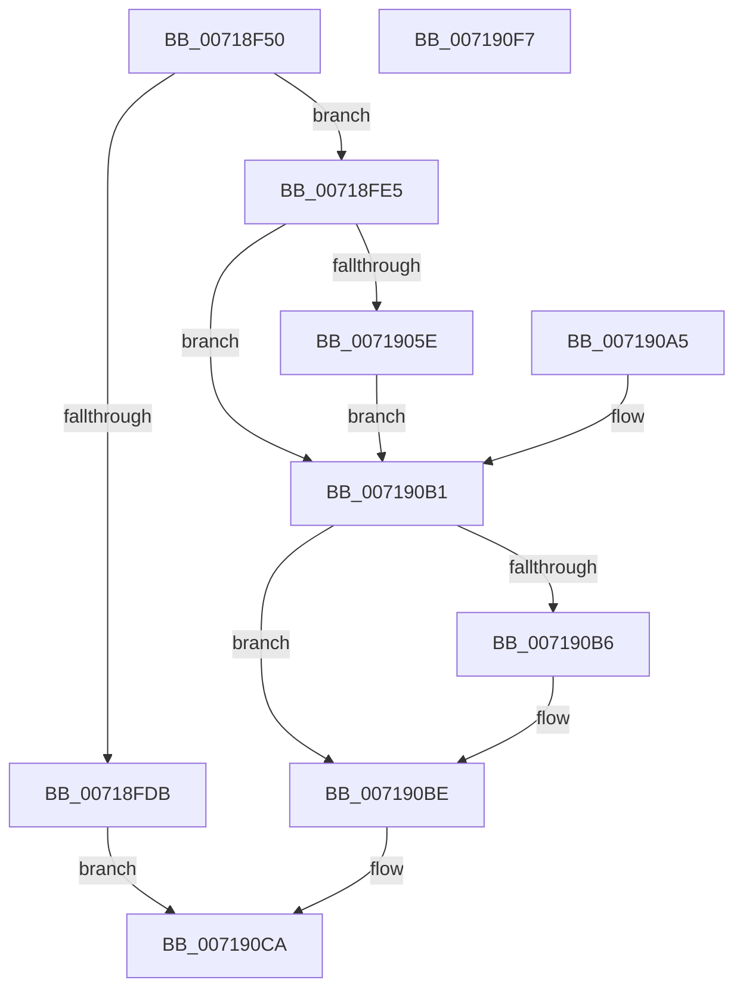

# VslObtainHotPatchUndoTable

- RVA: `0x00718F50`–`0x007190F8` (길이 `424` bytes)
- VA: `0x0000000140718F50`
- 실행 섹션: `PAGE`
- PDB 이름 있음: `예`; PDB Function 태그: `아니요`
- unwind 정보 RVA: `0x000C6CA8`
- 디코드: `111`개 명령, `424/424` bytes 표시
- 미해석 바이트: `0` (있으면 어셈블리에 `.byte`로 보존)

> 이 문서는 커널 이미지의 기계어와 PDB 기호를 분석해 생성했습니다. 4번과 5번은 함수 원형과 자료형을 바이너리 사용 방식에서 추정한 C 해석이며 원본 소스 복구 결과는 아닙니다.

## 1. Dependencies

- 직접 호출 지점: **11**; 고유 호출 대상: **10**
- 직접 호출자로 확인된 함수: **1**
- RIP 상대 이미지 참조: **1**

### Outgoing calls
- `0x00718F93` → [memset](../../text/6C/memset_function_006C6C40.md) (function, `0x006C6C40`)
- `0x00718FA3` → [memset](../../text/6C/memset_function_006C6C40.md) (function, `0x006C6C40`)
- `0x00718FB1` → [MmSizeOfMdl](../../text/46/MmSizeOfMdl_function_00460A10.md) (function, `0x00460A10`)
- `0x00718FC6` → [ExAllocatePool2](../../poolcode/B8/ExAllocatePool2_function_00B820F0.md) (function, `0x00B820F0`)
- `0x0071903A` → [MmProbeAndLockPages](../../text/23/MmProbeAndLockPages_function_0023B990.md) (function, `0x0023B990`)
- `0x00719053` → [VslpLockPagesForTransfer](../../text/29/VslpLockPagesForTransfer_function_0029E0FC.md) (function, `0x0029E0FC`)
- `0x00719092` → [VslpEnterIumSecureMode](../../text/23/VslpEnterIumSecureMode_function_00235E50.md) (function, `0x00235E50`)
- `0x0071909E` → [VslpUnlockPagesForTransfer](../../text/29/VslpUnlockPagesForTransfer_function_0029EE4C.md) (function, `0x0029EE4C`)
- `0x007190B9` → [MmUnlockPages](../../text/29/MmUnlockPages_function_0029EEE0.md) (function, `0x0029EEE0`)
- `0x007190C3` → [ExFreePoolWithTag](../../poolcode/B8/ExFreePoolWithTag_function_00B82870.md) (function, `0x00B82870`)
- `0x007190D5` → [_security_check_cookie](../../text/6A/_security_check_cookie_function_006AC640.md) (function, `0x006AC640`)

### Direct callers
- [MiApplyDriverHotPatch](../80/MiApplyDriverHotPatch_function_008018EC.md) at `0x00801AA1`

### Static image references
- `0x00718F6A` → RVA `0x00E0A740` (`.data`; read)

## 2. Other-region calls and transfers

- 다른 실행 섹션으로 향하는 call: **11**
  - `0x00718F93` → [memset](../../text/6C/memset_function_006C6C40.md) (`PAGE` → `.text`)
  - `0x00718FA3` → [memset](../../text/6C/memset_function_006C6C40.md) (`PAGE` → `.text`)
  - `0x00718FB1` → [MmSizeOfMdl](../../text/46/MmSizeOfMdl_function_00460A10.md) (`PAGE` → `.text`)
  - `0x00718FC6` → [ExAllocatePool2](../../poolcode/B8/ExAllocatePool2_function_00B820F0.md) (`PAGE` → `POOLCODE`)
  - `0x0071903A` → [MmProbeAndLockPages](../../text/23/MmProbeAndLockPages_function_0023B990.md) (`PAGE` → `.text`)
  - `0x00719053` → [VslpLockPagesForTransfer](../../text/29/VslpLockPagesForTransfer_function_0029E0FC.md) (`PAGE` → `.text`)
  - `0x00719092` → [VslpEnterIumSecureMode](../../text/23/VslpEnterIumSecureMode_function_00235E50.md) (`PAGE` → `.text`)
  - `0x0071909E` → [VslpUnlockPagesForTransfer](../../text/29/VslpUnlockPagesForTransfer_function_0029EE4C.md) (`PAGE` → `.text`)
  - `0x007190B9` → [MmUnlockPages](../../text/29/MmUnlockPages_function_0029EEE0.md) (`PAGE` → `.text`)
  - `0x007190C3` → [ExFreePoolWithTag](../../poolcode/B8/ExFreePoolWithTag_function_00B82870.md) (`PAGE` → `POOLCODE`)
  - `0x007190D5` → [_security_check_cookie](../../text/6A/_security_check_cookie_function_006AC640.md) (`PAGE` → `.text`)
- 별도 외부 분기/꼬리 이동을 확인하지 못했습니다.

## 3. Assembly (complete function range)

```asm
00718F50  48 89 5C 24 10                  mov qword ptr [rsp + 0x10], rbx
00718F55  48 89 74 24 20                  mov qword ptr [rsp + 0x20], rsi
00718F5A  57                              push rdi
00718F5B  41 54                           push r12
00718F5D  41 55                           push r13
00718F5F  41 56                           push r14
00718F61  41 57                           push r15
00718F63  48 81 EC 10 01 00 00            sub rsp, 0x110
00718F6A  48 8B 05 CF 17 6F 00            mov rax, qword ptr [rip + 0x6f17cf]
00718F71  48 33 C4                        xor rax, rsp
00718F74  48 89 84 24 00 01 00 00         mov qword ptr [rsp + 0x100], rax
00718F7C  45 8B F0                        mov r14d, r8d
00718F7F  48 8B FA                        mov rdi, rdx
00718F82  4C 8B E1                        mov r12, rcx
00718F85  33 D2                           xor edx, edx
00718F87  44 8D 42 68                     lea r8d, [rdx + 0x68]
00718F8B  48 8D 8C 24 90 00 00 00         lea rcx, [rsp + 0x90]
00718F93  E8 A8 DC FA FF                  call 0x1406c6c40
00718F98  33 D2                           xor edx, edx
00718F9A  44 8D 42 48                     lea r8d, [rdx + 0x48]
00718F9E  48 8D 4C 24 40                  lea rcx, [rsp + 0x40]
00718FA3  E8 98 DC FA FF                  call 0x1406c6c40
00718FA8  41 8B F6                        mov esi, r14d
00718FAB  41 8B D6                        mov edx, r14d
00718FAE  49 8B CC                        mov rcx, r12
00718FB1  E8 5A 7A D4 FF                  call 0x140460a10
00718FB6  4C 8B F8                        mov r15, rax
00718FB9  8B D0                           mov edx, eax
00718FBB  B9 40 00 00 00                  mov ecx, 0x40
00718FC0  41 B8 56 6D 73 54               mov r8d, 0x54736d56
00718FC6  E8 25 91 46 00                  call 0x140b820f0
00718FCB  48 8B D8                        mov rbx, rax
00718FCE  48 89 44 24 30                  mov qword ptr [rsp + 0x30], rax
00718FD3  45 33 ED                        xor r13d, r13d
00718FD6  48 85 C0                        test rax, rax
00718FD9  75 0A                           jne 0x140718fe5
00718FDB  B8 9A 00 00 C0                  mov eax, 0xc000009a
00718FE0  E9 E5 00 00 00                  jmp 0x1407190ca
00718FE5  4C 89 28                        mov qword ptr [rax], r13
00718FE8  8B D7                           mov edx, edi
00718FEA  8B CA                           mov ecx, edx
00718FEC  41 B8 FF 0F 00 00               mov r8d, 0xfff
00718FF2  49 23 C8                        and rcx, r8
00718FF5  49 03 F0                        add rsi, r8
00718FF8  48 03 CE                        add rcx, rsi
00718FFB  48 C1 E9 0C                     shr rcx, 0xc
00718FFF  66 83 C1 06                     add cx, 6
00719003  66 C1 E1 03                     shl cx, 3
00719007  66 89 48 08                     mov word ptr [rax + 8], cx
0071900B  48 8D 70 0A                     lea rsi, [rax + 0xa]
0071900F  48 89 74 24 38                  mov qword ptr [rsp + 0x38], rsi
00719014  66 44 89 2E                     mov word ptr [rsi], r13w
00719018  48 81 E7 00 F0 FF FF            and rdi, 0xfffffffffffff000
0071901F  48 89 78 20                     mov qword ptr [rax + 0x20], rdi
00719023  41 23 D0                        and edx, r8d
00719026  89 50 2C                        mov dword ptr [rax + 0x2c], edx
00719029  44 89 70 28                     mov dword ptr [rax + 0x28], r14d
0071902D  BF 01 00 00 00                  mov edi, 1
00719032  44 8B C7                        mov r8d, edi
00719035  33 D2                           xor edx, edx
00719037  48 8B CB                        mov rcx, rbx
0071903A  E8 51 29 B2 FF                  call 0x14023b990
0071903F  90                              nop
00719040  44 89 6C 24 20                  mov dword ptr [rsp + 0x20], r13d
00719045  44 8B CF                        mov r9d, edi
00719048  45 8B C7                        mov r8d, r15d
0071904B  48 8B D3                        mov rdx, rbx
0071904E  48 8D 4C 24 40                  lea rcx, [rsp + 0x40]
00719053  E8 A4 50 B8 FF                  call 0x14029e0fc
00719058  8B F8                           mov edi, eax
0071905A  85 C0                           test eax, eax
0071905C  78 53                           js 0x1407190b1
0071905E  4C 89 A4 24 98 00 00 00         mov qword ptr [rsp + 0x98], r12
00719066  48 8B 44 24 40                  mov rax, qword ptr [rsp + 0x40]
0071906B  48 89 84 24 A0 00 00 00         mov qword ptr [rsp + 0xa0], rax
00719073  48 8B 44 24 78                  mov rax, qword ptr [rsp + 0x78]
00719078  48 89 84 24 A8 00 00 00         mov qword ptr [rsp + 0xa8], rax
00719080  BA 4C 00 00 00                  mov edx, 0x4c
00719085  4C 8D 8C 24 90 00 00 00         lea r9, [rsp + 0x90]
0071908D  45 33 C0                        xor r8d, r8d
00719090  B1 02                           mov cl, 2
00719092  E8 B9 CD B1 FF                  call 0x140235e50
00719097  8B F8                           mov edi, eax
00719099  48 8D 4C 24 40                  lea rcx, [rsp + 0x40]
0071909E  E8 A9 5D B8 FF                  call 0x14029ee4c
007190A3  EB 0C                           jmp 0x1407190b1
007190A5  8B F8                           mov edi, eax
007190A7  48 8B 5C 24 30                  mov rbx, qword ptr [rsp + 0x30]
007190AC  48 8B 74 24 38                  mov rsi, qword ptr [rsp + 0x38]
007190B1  F6 06 02                        test byte ptr [rsi], 2
007190B4  74 08                           je 0x1407190be
007190B6  48 8B CB                        mov rcx, rbx
007190B9  E8 22 5E B8 FF                  call 0x14029eee0
007190BE  33 D2                           xor edx, edx
007190C0  48 8B CB                        mov rcx, rbx
007190C3  E8 A8 97 46 00                  call 0x140b82870
007190C8  8B C7                           mov eax, edi
007190CA  48 8B 8C 24 00 01 00 00         mov rcx, qword ptr [rsp + 0x100]
007190D2  48 33 CC                        xor rcx, rsp
007190D5  E8 66 35 F9 FF                  call 0x1406ac640
007190DA  4C 8D 9C 24 10 01 00 00         lea r11, [rsp + 0x110]
007190E2  49 8B 5B 38                     mov rbx, qword ptr [r11 + 0x38]
007190E6  49 8B 73 48                     mov rsi, qword ptr [r11 + 0x48]
007190EA  49 8B E3                        mov rsp, r11
007190ED  41 5F                           pop r15
007190EF  41 5E                           pop r14
007190F1  41 5D                           pop r13
007190F3  41 5C                           pop r12
007190F5  5F                              pop rdi
007190F6  C3                              ret
007190F7  CC                              int3
```

## 4. C-style interpretation (structured pseudocode)

```c
__int64 __fastcall VslObtainHotPatchUndoTable(__int64 a1, __int64 a2, int a3)
{
    __int64 result;
    __int64 v_r13;
    __int64 v_rdi;
    __int64 v_rsi;
    __int64 v_rsp;
    unsigned __int64 v_stack_m100;
    unsigned __int64 v_stack_m108;
    unsigned int v_stack_m118;
    unsigned __int64 v_stack_m28;
    unsigned __int64 v_stack_m38;
    unsigned __int64 v_stack_m90;
    unsigned __int64 v_stack_m98;
    unsigned __int64 v_stack_mA0;
    unsigned __int64 v_stack_mA8;
    unsigned __int64 v_stack_mC0;
    unsigned __int64 v_stack_mF8;
    unsigned __int64 v_stack_p10;
    unsigned __int64 v_stack_p20;

    v_stack_p10 = v_rbx;
    v_stack_p20 = v_rsi;
    v_rsp = (v_rsp) - (272);
    result = (*(unsigned __int64 *)(v_rip + 7280591)) ^ (v_rsp);
    v_stack_m38 = result;
    a2 = 0;
    result = memset(v_stack_mA8, a2, a2 + 104, a4);
    a2 = 0;
    result = memset(v_stack_mF8, a2, a2 + 72, a4);
    result = MmSizeOfMdl(a1, (unsigned int)((unsigned int)((unsigned int)(a3))), a2 + 72, a4);
    result = ExAllocatePool2(64, (unsigned int)((unsigned int)(result)), (unsigned int)(0x54736D56ULL), a4);
    v_stack_m108 = result;
    v_r13 = 0;
    if (result != 0) goto loc_00718FE5;
    goto loc_007190CA;
loc_00718FE5:
    *(unsigned __int64 *)((unsigned int)(0xC000009AULL)) = 0;
    a1 = (0) & ((unsigned int)(0xFFFULL));
    v_rsi = ((unsigned int)((unsigned int)((unsigned int)(a3)))) + ((unsigned int)(0xFFFULL));
    a1 = (a1) + (v_rsi);
    a1 = (a1) >> (12);
    a1 = (unsigned __int16)((a1) + (6));
    a1 = (unsigned __int16)((a1) << (3));
    *(unsigned __int16 *)((unsigned int)(0xC000009AULL) + 8) = (unsigned __int16)(a1);
    v_stack_m100 = (unsigned int)(0xC000009AULL) + 10;
    *(unsigned __int16 *)((unsigned int)(0xC000009AULL) + 10) = 0;
    v_rdi = (a2) & (0xFFFFFFFFFFFFF000ULL);
    *(unsigned __int64 *)((unsigned int)(0xC000009AULL) + 32) = v_rdi;
    a2 = (unsigned int)((0) & ((unsigned int)((unsigned int)(0xFFFULL))));
    *(unsigned int *)((unsigned int)(0xC000009AULL) + 44) = (unsigned int)(a2);
    *(unsigned int *)((unsigned int)(0xC000009AULL) + 40) = (unsigned int)((unsigned int)(a3));
    a2 = 0;
    result = MmProbeAndLockPages(result, a2, 1, a4);
    v_stack_m118 = 0;
    result = VslpLockPagesForTransfer(v_stack_mF8, result, (unsigned int)((unsigned int)(result)), 1);
    if (sign_flag) goto loc_007190B1;
    v_stack_mA0 = a1;
    v_stack_m98 = v_stack_mF8;
    v_stack_m90 = v_stack_mC0;
    a3 = 0;
    result = VslpEnterIumSecureMode(2, 76, a3, v_stack_mA8);
    result = VslpUnlockPagesForTransfer(v_stack_mF8, 76, a3, v_stack_mA8);
    goto loc_007190B1;
loc_007190B1:
    if (((*(unsigned __int8 *)((unsigned int)(0xC000009AULL) + 10)) & (2)) != 0) {
        a1 = result;
        result = MmUnlockPages(a1, 76, a3, v_stack_mA8);
    }
    a2 = 0;
    result = ExFreePoolWithTag(result, a2, a3, v_stack_mA8);
loc_007190CA:
    a1 = (v_stack_m38) ^ (v_rsp);
    result = _security_check_cookie(a1, a2, a3, v_stack_mA8);
    return result;
}
```

## 5. (Beta) C Style

```c
int64_t VslObtainHotPatchUndoTable(int64_t Arg1, int64_t Arg2, int32_t Arg3)
{
    int64_t result;
    int64_t local_r13;
    int64_t local_rdi;
    int64_t local_rsi;
    int64_t local_rsp;
    uint64_t v_stack_m100;
    uint64_t v_stack_m108;
    uint32_t v_stack_m118;
    uint64_t v_stack_m28;
    uint64_t v_stack_m38;
    uint64_t v_stack_m90;
    uint64_t v_stack_m98;
    uint64_t v_stack_mA0;
    uint64_t v_stack_mA8;
    uint64_t v_stack_mC0;
    uint64_t v_stack_mF8;
    uint64_t v_stack_p10;
    uint64_t v_stack_p20;

    v_stack_p10 = local_rbx;
    v_stack_p20 = local_rsi;
    local_rsp = (local_rsp) - (272);
    result = (*(uint64_t *)(v_rip + 0x6F17CF)) ^ (local_rsp);
    v_stack_m38 = result;
    Arg2 = 0;
    result = memset(v_stack_mA8, Arg2, Arg2 + 104, a4);
    Arg2 = 0;
    result = memset(v_stack_mF8, Arg2, Arg2 + 72, a4);
    result = MmSizeOfMdl(Arg1, (uint32_t)((uint32_t)((uint32_t)(Arg3))), Arg2 + 72, a4);
    result = ExAllocatePool2(64, (uint32_t)((uint32_t)(result)), (uint32_t)(0x54736D56ULL), a4);
    v_stack_m108 = result;
    local_r13 = 0;
    if (result != 0) goto loc_00718FE5;
    goto loc_007190CA;
loc_00718FE5:
    *(uint64_t *)((uint32_t)(0xC000009AULL)) = 0;
    Arg1 = (0) & ((uint32_t)(0xFFFULL));
    local_rsi = ((uint32_t)((uint32_t)((uint32_t)(Arg3)))) + ((uint32_t)(0xFFFULL));
    Arg1 = (Arg1) + (local_rsi);
    Arg1 = (Arg1) >> (12);
    Arg1 = (uint16_t)((Arg1) + (6));
    Arg1 = (uint16_t)((Arg1) << (3));
    *(uint16_t *)((uint32_t)(0xC000009AULL) + 0x8) = (uint16_t)(Arg1);
    v_stack_m100 = (uint32_t)(0xC000009AULL) + 10;
    *(uint16_t *)((uint32_t)(0xC000009AULL) + 0xA) = 0;
    local_rdi = (Arg2) & (0xFFFFFFFFFFFFF000ULL);
    *(uint64_t *)((uint32_t)(0xC000009AULL) + 0x20) = local_rdi;
    Arg2 = (uint32_t)((0) & ((uint32_t)((uint32_t)(0xFFFULL))));
    *(uint32_t *)((uint32_t)(0xC000009AULL) + 0x2C) = (uint32_t)(Arg2);
    *(uint32_t *)((uint32_t)(0xC000009AULL) + 0x28) = (uint32_t)((uint32_t)(Arg3));
    Arg2 = 0;
    result = MmProbeAndLockPages(result, Arg2, 1, a4);
    v_stack_m118 = 0;
    result = VslpLockPagesForTransfer(v_stack_mF8, result, (uint32_t)((uint32_t)(result)), 1);
    if (sign_flag) goto loc_007190B1;
    v_stack_mA0 = Arg1;
    v_stack_m98 = v_stack_mF8;
    v_stack_m90 = v_stack_mC0;
    Arg3 = 0;
    result = VslpEnterIumSecureMode(2, 76, Arg3, v_stack_mA8);
    result = VslpUnlockPagesForTransfer(v_stack_mF8, 76, Arg3, v_stack_mA8);
    goto loc_007190B1;
loc_007190B1:
    if (((*(uint8_t *)((uint32_t)(0xC000009AULL) + 0xA)) & (2)) != 0) {
        Arg1 = result;
        result = MmUnlockPages(Arg1, 76, Arg3, v_stack_mA8);
    }
    Arg2 = 0;
    result = ExFreePoolWithTag(result, Arg2, Arg3, v_stack_mA8);
loc_007190CA:
    Arg1 = (v_stack_m38) ^ (local_rsp);
    result = _security_check_cookie(Arg1, Arg2, Arg3, v_stack_mA8);
    return result;
}
```

## 6. Execution-region graph

[열기: 2D/3D 그래프와 함수 탐색 컨트롤 패널](../../../control-panel.html?section=page&rva=0x00718F50&view=graph)

- 2D 그래프는 위에서 아래로 흐르고, 3D 그래프는 빈 공간을 드래그해 회전합니다. Shift+드래그는 이동, 휠은 확대·축소, 함수 노드 선택은 대상 보고서 이동입니다.

### Static fallback


