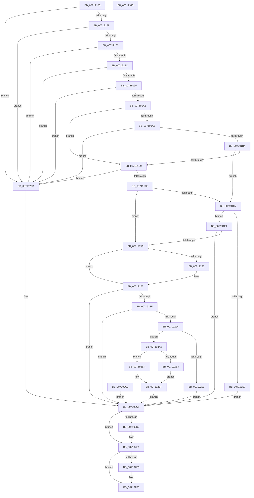

# VslQueryRuntimeAttestationReport

- RVA: `0x00719100`–`0x00719316` (길이 `534` bytes)
- VA: `0x0000000140719100`
- 실행 섹션: `PAGE`
- PDB 이름 있음: `예`; PDB Function 태그: `아니요`
- unwind 정보 RVA: `0x000C6A74`
- 디코드: `134`개 명령, `534/534` bytes 표시
- 미해석 바이트: `0` (있으면 어셈블리에 `.byte`로 보존)

> 이 문서는 커널 이미지의 기계어와 PDB 기호를 분석해 생성했습니다. 4번과 5번은 함수 원형과 자료형을 바이너리 사용 방식에서 추정한 C 해석이며 원본 소스 복구 결과는 아닙니다.

## 1. Dependencies

- 직접 호출 지점: **10**; 고유 호출 대상: **9**
- 직접 호출자로 확인된 함수: **1**
- RIP 상대 이미지 참조: **1**

### Outgoing calls
- `0x0071914F` → [memset](../../text/6C/memset_function_006C6C40.md) (function, `0x006C6C40`)
- `0x00719166` → [memset](../../text/6C/memset_function_006C6C40.md) (function, `0x006C6C40`)
- `0x007191D5` → [ExAllocatePool2](../../poolcode/B8/ExAllocatePool2_function_00B820F0.md) (function, `0x00B820F0`)
- `0x0071920A` → [VslpLockPagesForTransfer](../../text/29/VslpLockPagesForTransfer_function_0029E0FC.md) (function, `0x0029E0FC`)
- `0x00719279` → [VslpEnterIumSecureMode](../../text/23/VslpEnterIumSecureMode_function_00235E50.md) (function, `0x00235E50`)
- `0x007192B3` → [RtlCopyToUser](../70/RtlCopyToUser_function_00705D68.md) (function, `0x00705D68`)
- `0x007192BA` → [RtlCopyVolatileMemory](../../text/6B/RtlCopyVolatileMemory_function_006BC9D0.md) (function, `0x006BC9D0`)
- `0x007192DC` → [VslpUnlockPagesForTransfer](../../text/29/VslpUnlockPagesForTransfer_function_0029EE4C.md) (function, `0x0029EE4C`)
- `0x007192EB` → [ExFreePoolWithTag](../../poolcode/B8/ExFreePoolWithTag_function_00B82870.md) (function, `0x00B82870`)
- `0x007192FD` → [_security_check_cookie](../../text/6A/_security_check_cookie_function_006AC640.md) (function, `0x006AC640`)

### Direct callers
- [ExpQueryRuntimeAttestationReport](../7C/ExpQueryRuntimeAttestationReport_function_007C4EE0.md) at `0x007C4F7F`

### Static image references
- `0x00719117` → RVA `0x00E0A740` (`.data`; read)

## 2. Other-region calls and transfers

- 다른 실행 섹션으로 향하는 call: **9**
  - `0x0071914F` → [memset](../../text/6C/memset_function_006C6C40.md) (`PAGE` → `.text`)
  - `0x00719166` → [memset](../../text/6C/memset_function_006C6C40.md) (`PAGE` → `.text`)
  - `0x007191D5` → [ExAllocatePool2](../../poolcode/B8/ExAllocatePool2_function_00B820F0.md) (`PAGE` → `POOLCODE`)
  - `0x0071920A` → [VslpLockPagesForTransfer](../../text/29/VslpLockPagesForTransfer_function_0029E0FC.md) (`PAGE` → `.text`)
  - `0x00719279` → [VslpEnterIumSecureMode](../../text/23/VslpEnterIumSecureMode_function_00235E50.md) (`PAGE` → `.text`)
  - `0x007192BA` → [RtlCopyVolatileMemory](../../text/6B/RtlCopyVolatileMemory_function_006BC9D0.md) (`PAGE` → `.text`)
  - `0x007192DC` → [VslpUnlockPagesForTransfer](../../text/29/VslpUnlockPagesForTransfer_function_0029EE4C.md) (`PAGE` → `.text`)
  - `0x007192EB` → [ExFreePoolWithTag](../../poolcode/B8/ExFreePoolWithTag_function_00B82870.md) (`PAGE` → `POOLCODE`)
  - `0x007192FD` → [_security_check_cookie](../../text/6A/_security_check_cookie_function_006AC640.md) (`PAGE` → `.text`)
- 별도 외부 분기/꼬리 이동을 확인하지 못했습니다.

## 3. Assembly (complete function range)

```asm
00719100  44 88 4C 24 20                  mov byte ptr [rsp + 0x20], r9b
00719105  53                              push rbx
00719106  56                              push rsi
00719107  57                              push rdi
00719108  41 54                           push r12
0071910A  41 55                           push r13
0071910C  41 56                           push r14
0071910E  41 57                           push r15
00719110  48 81 EC 10 01 00 00            sub rsp, 0x110
00719117  48 8B 05 22 16 6F 00            mov rax, qword ptr [rip + 0x6f1622]
0071911E  48 33 C4                        xor rax, rsp
00719121  48 89 84 24 00 01 00 00         mov qword ptr [rsp + 0x100], rax
00719129  4D 8B E0                        mov r12, r8
0071912C  48 8B F2                        mov rsi, rdx
0071912F  4C 8B E9                        mov r13, rcx
00719132  33 FF                           xor edi, edi
00719134  48 89 7C 24 38                  mov qword ptr [rsp + 0x38], rdi
00719139  44 0F B7 71 02                  movzx r14d, word ptr [rcx + 2]
0071913E  66 44 89 74 24 30               mov word ptr [rsp + 0x30], r14w
00719144  33 D2                           xor edx, edx
00719146  44 8D 47 48                     lea r8d, [rdi + 0x48]
0071914A  48 8D 4C 24 40                  lea rcx, [rsp + 0x40]
0071914F  E8 EC DA FA FF                  call 0x1406c6c40
00719154  4D 8B 7D 08                     mov r15, qword ptr [r13 + 8]
00719158  33 D2                           xor edx, edx
0071915A  44 8D 47 68                     lea r8d, [rdi + 0x68]
0071915E  48 8D 8C 24 90 00 00 00         lea rcx, [rsp + 0x90]
00719166  E8 D5 DA FA FF                  call 0x1406c6c40
0071916B  8D 47 01                        lea eax, [rdi + 1]
0071916E  66 41 39 45 00                  cmp word ptr [r13], ax
00719173  0F 85 51 01 00 00               jne 0x1407192ca
00719179  66 44 3B F0                     cmp r14w, ax
0071917D  0F 85 47 01 00 00               jne 0x1407192ca
00719183  4D 85 E4                        test r12, r12
00719186  0F 84 3E 01 00 00               je 0x1407192ca
0071918C  4D 85 FF                        test r15, r15
0071918F  0F 84 35 01 00 00               je 0x1407192ca
00719195  49 F7 C7 FE FF FF FF            test r15, -2
0071919C  0F 85 28 01 00 00               jne 0x1407192ca
007191A2  45 8B 34 24                     mov r14d, dword ptr [r12]
007191A6  48 85 F6                        test rsi, rsi
007191A9  74 0E                           je 0x1407191b9
007191AB  45 85 F6                        test r14d, r14d
007191AE  0F 84 16 01 00 00               je 0x1407192ca
007191B4  48 85 F6                        test rsi, rsi
007191B7  75 0E                           jne 0x1407191c7
007191B9  45 85 F6                        test r14d, r14d
007191BC  0F 85 08 01 00 00               jne 0x1407192ca
007191C2  48 85 F6                        test rsi, rsi
007191C5  74 52                           je 0x140719219
007191C7  49 8B D6                        mov rdx, r14
007191CA  B9 40 00 00 00                  mov ecx, 0x40
007191CF  41 B8 56 6D 73 54               mov r8d, 0x54736d56
007191D5  E8 16 8F 46 00                  call 0x140b820f0
007191DA  48 8B F8                        mov rdi, rax
007191DD  48 89 44 24 38                  mov qword ptr [rsp + 0x38], rax
007191E2  48 85 C0                        test rax, rax
007191E5  75 0A                           jne 0x1407191f1
007191E7  BB 9A 00 00 C0                  mov ebx, 0xc000009a
007191EC  E9 DE 00 00 00                  jmp 0x1407192cf
007191F1  C7 44 24 20 02 00 00 00         mov dword ptr [rsp + 0x20], 2
007191F9  41 B9 01 00 00 00               mov r9d, 1
007191FF  45 8B C6                        mov r8d, r14d
00719202  48 8B D0                        mov rdx, rax
00719205  48 8D 4C 24 40                  lea rcx, [rsp + 0x40]
0071920A  E8 ED 4E B8 FF                  call 0x14029e0fc
0071920F  8B D8                           mov ebx, eax
00719211  85 C0                           test eax, eax
00719213  0F 88 B6 00 00 00               js 0x1407192cf
00719219  0F B7 44 24 30                  movzx eax, word ptr [rsp + 0x30]
0071921E  66 89 84 24 98 00 00 00         mov word ptr [rsp + 0x98], ax
00719226  4C 89 BC 24 A0 00 00 00         mov qword ptr [rsp + 0xa0], r15
0071922E  48 85 F6                        test rsi, rsi
00719231  74 34                           je 0x140719267
00719233  41 0F 10 45 10                  movups xmm0, xmmword ptr [r13 + 0x10]
00719238  0F 11 84 24 A8 00 00 00         movups xmmword ptr [rsp + 0xa8], xmm0
00719240  41 0F 10 4D 20                  movups xmm1, xmmword ptr [r13 + 0x20]
00719245  0F 11 8C 24 B8 00 00 00         movups xmmword ptr [rsp + 0xb8], xmm1
0071924D  48 8B 44 24 40                  mov rax, qword ptr [rsp + 0x40]
00719252  48 89 84 24 C8 00 00 00         mov qword ptr [rsp + 0xc8], rax
0071925A  48 8B 44 24 78                  mov rax, qword ptr [rsp + 0x78]
0071925F  48 89 84 24 D0 00 00 00         mov qword ptr [rsp + 0xd0], rax
00719267  BA 17 01 00 00                  mov edx, 0x117
0071926C  4C 8D 8C 24 90 00 00 00         lea r9, [rsp + 0x90]
00719274  45 33 C0                        xor r8d, r8d
00719277  B1 02                           mov cl, 2
00719279  E8 D2 CB B1 FF                  call 0x140235e50
0071927E  8B D8                           mov ebx, eax
00719280  8B 84 24 D8 00 00 00            mov eax, dword ptr [rsp + 0xd8]
00719287  41 89 04 24                     mov dword ptr [r12], eax
0071928B  85 DB                           test ebx, ebx
0071928D  78 40                           js 0x1407192cf
0071928F  48 85 F6                        test rsi, rsi
00719292  74 3B                           je 0x1407192cf
00719294  41 3B C6                        cmp eax, r14d
00719297  76 07                           jbe 0x1407192a0
00719299  BB E5 00 00 C0                  mov ebx, 0xc00000e5
0071929E  EB 2F                           jmp 0x1407192cf
007192A0  4C 8B C0                        mov r8, rax
007192A3  48 8B D7                        mov rdx, rdi
007192A6  48 8B CE                        mov rcx, rsi
007192A9  80 BC 24 68 01 00 00 00         cmp byte ptr [rsp + 0x168], 0
007192B1  74 07                           je 0x1407192ba
007192B3  E8 B0 CA FE FF                  call 0x140705d68
007192B8  EB 05                           jmp 0x1407192bf
007192BA  E8 11 37 FA FF                  call 0x1406bc9d0
007192BF  EB 0E                           jmp 0x1407192cf
007192C1  8B D8                           mov ebx, eax
007192C3  48 8B 7C 24 38                  mov rdi, qword ptr [rsp + 0x38]
007192C8  EB 05                           jmp 0x1407192cf
007192CA  BB 0D 00 00 C0                  mov ebx, 0xc000000d
007192CF  48 83 7C 24 40 00               cmp qword ptr [rsp + 0x40], 0
007192D5  74 0A                           je 0x1407192e1
007192D7  48 8D 4C 24 40                  lea rcx, [rsp + 0x40]
007192DC  E8 6B 5B B8 FF                  call 0x14029ee4c
007192E1  48 85 FF                        test rdi, rdi
007192E4  74 0A                           je 0x1407192f0
007192E6  33 D2                           xor edx, edx
007192E8  48 8B CF                        mov rcx, rdi
007192EB  E8 80 95 46 00                  call 0x140b82870
007192F0  8B C3                           mov eax, ebx
007192F2  48 8B 8C 24 00 01 00 00         mov rcx, qword ptr [rsp + 0x100]
007192FA  48 33 CC                        xor rcx, rsp
007192FD  E8 3E 33 F9 FF                  call 0x1406ac640
00719302  48 81 C4 10 01 00 00            add rsp, 0x110
00719309  41 5F                           pop r15
0071930B  41 5E                           pop r14
0071930D  41 5D                           pop r13
0071930F  41 5C                           pop r12
00719311  5F                              pop rdi
00719312  5E                              pop rsi
00719313  5B                              pop rbx
00719314  C3                              ret
00719315  CC                              int3
```

## 4. C-style interpretation (structured pseudocode)

```c
__int64 __fastcall VslQueryRuntimeAttestationReport(__int64 a1, __int64 a2, __int64 a3, unsigned __int8 a4)
{
    __int64 result;
    __int64 v_rdi;
    __int64 v_rsp;
    unsigned __int64 v_stack_m108;
    unsigned __int64 v_stack_m110;
    unsigned __int16 v_stack_m118;
    unsigned int v_stack_m128;
    unsigned __int64 v_stack_m48;
    unsigned int v_stack_m70;
    unsigned __int64 v_stack_m78;
    unsigned __int64 v_stack_m80;
    unsigned __int64 v_stack_m90;
    unsigned __int64 v_stack_mA0;
    unsigned __int64 v_stack_mA8;
    unsigned __int16 v_stack_mB0;
    unsigned __int64 v_stack_mB8;
    unsigned __int64 v_stack_mD0;
    unsigned __int8 v_stack_p20;

    v_stack_p20 = a4;
    v_rsp = (v_rsp) - (272);
    result = (*(unsigned __int64 *)(v_rip + 7280162)) ^ (v_rsp);
    v_stack_m48 = result;
    v_rdi = 0;
    v_stack_m110 = 0;
    v_stack_m118 = (unsigned __int16)(*(unsigned __int16 *)(a1 + 2));
    a2 = 0;
    result = memset(v_stack_m108, a2, v_rdi + 72, a4);
    a2 = 0;
    result = memset(v_stack_mB8, a2, v_rdi + 104, a4);
    if ((*(unsigned __int16 *)(a1)) != ((unsigned __int16)(v_rdi + 1))) goto loc_007192CA;
    if (((unsigned __int16)(*(unsigned __int16 *)(a1 + 2))) != ((unsigned __int16)(v_rdi + 1))) goto loc_007192CA;
    if (a3 == 0) goto loc_007192CA;
    if (*(unsigned __int64 *)(a1 + 8) == 0) goto loc_007192CA;
    if (((*(unsigned __int64 *)(a1 + 8)) & (-2)) != 0) goto loc_007192CA;
    if (0 == 0) goto loc_007191B9;
    if ((unsigned int)((unsigned int)(*(unsigned int *)(a3))) == 0) goto loc_007192CA;
    if (0 != 0) goto loc_007191C7;
loc_007191B9:
    if ((unsigned int)((unsigned int)(*(unsigned int *)(a3))) != 0) goto loc_007192CA;
    if (0 == 0) goto loc_00719219;
loc_007191C7:
    result = ExAllocatePool2(64, (unsigned int)(*(unsigned int *)(a3)), (unsigned int)(0x54736D56ULL), a4);
    v_stack_m110 = result;
    if (result != 0) goto loc_007191F1;
    goto loc_007192CF;
loc_007191F1:
    v_stack_m128 = 2;
    result = VslpLockPagesForTransfer(v_stack_m108, result, (unsigned int)((unsigned int)((unsigned int)(*(unsigned int *)(a3)))), 1);
    if (sign_flag) goto loc_007192CF;
loc_00719219:
    v_stack_mB0 = (unsigned __int16)(v_stack_m118);
    v_stack_mA8 = *(unsigned __int64 *)(a1 + 8);
    result = v_stack_m118;
    if (0 != 0) {
        v_stack_mA0 = v_xmm0;
        v_stack_m90 = v_xmm1;
        result = v_stack_m108;
        v_stack_m80 = result;
        result = v_stack_mD0;
        v_stack_m78 = result;
    }
    a3 = 0;
    result = VslpEnterIumSecureMode(2, 279, a3, v_stack_mB8);
    *(unsigned int *)(a3) = (unsigned int)((unsigned int)(v_stack_m70));
    if (sign_flag) goto loc_007192CF;
    if (0 == 0) goto loc_007192CF;
    if (((unsigned int)((unsigned int)(v_stack_m70))) <= ((unsigned int)((unsigned int)(*(unsigned int *)(a3))))) goto loc_007192A0;
    goto loc_007192CF;
loc_007192A0:
    if (v_stack_p20 == 0) goto loc_007192BA;
    result = RtlCopyToUser(0, result, (unsigned int)(v_stack_m70), v_stack_mB8);
    goto loc_007192BF;
loc_007192BA:
    result = RtlCopyVolatileMemory(0, result, (unsigned int)(v_stack_m70), v_stack_mB8);
loc_007192BF:
    goto loc_007192CF;
loc_007192CA:
loc_007192CF:
    if (v_stack_m108 != 0) {
        a1 = v_stack_m108;
        result = VslpUnlockPagesForTransfer(a1, result, (unsigned int)(v_stack_m70), v_stack_mB8);
    }
    if (result != 0) {
        a2 = 0;
        a1 = result;
        result = ExFreePoolWithTag(a1, a2, (unsigned int)(v_stack_m70), v_stack_mB8);
    }
    a1 = (v_stack_m48) ^ (v_rsp);
    result = _security_check_cookie(a1, a2, (unsigned int)(v_stack_m70), v_stack_mB8);
    v_rsp = (v_rsp) + (272);
    return result;
}
```

## 5. (Beta) C Style

```c
int64_t VslQueryRuntimeAttestationReport(void *Arg1, int64_t Arg2, int64_t Arg3, uint8_t Arg4)
{
    uint8_t *arg1 = (uint8_t *)Arg1;

    int64_t result;
    int64_t local_rdi;
    int64_t local_rsp;
    uint64_t v_stack_m108;
    uint64_t v_stack_m110;
    uint16_t v_stack_m118;
    uint32_t v_stack_m128;
    uint64_t v_stack_m48;
    uint32_t v_stack_m70;
    uint64_t v_stack_m78;
    uint64_t v_stack_m80;
    uint64_t v_stack_m90;
    uint64_t v_stack_mA0;
    uint64_t v_stack_mA8;
    uint16_t v_stack_mB0;
    uint64_t v_stack_mB8;
    uint64_t v_stack_mD0;
    uint8_t v_stack_p20;

    v_stack_p20 = Arg4;
    local_rsp = (local_rsp) - (272);
    result = (*(uint64_t *)(v_rip + 0x6F1622)) ^ (local_rsp);
    v_stack_m48 = result;
    local_rdi = 0;
    v_stack_m110 = 0;
    v_stack_m118 = (uint16_t)(*(uint16_t *)(arg1 + 0x2));
    Arg2 = 0;
    result = memset(v_stack_m108, Arg2, local_rdi + 72, Arg4);
    Arg2 = 0;
    result = memset(v_stack_mB8, Arg2, local_rdi + 104, Arg4);
    if ((*(uint16_t *)(arg1)) != ((uint16_t)(local_rdi + 1))) goto loc_007192CA;
    if (((uint16_t)(*(uint16_t *)(arg1 + 0x2))) != ((uint16_t)(local_rdi + 1))) goto loc_007192CA;
    if (Arg3 == 0) goto loc_007192CA;
    if (*(uint64_t *)(arg1 + 0x8) == 0) goto loc_007192CA;
    if (((*(uint64_t *)(arg1 + 0x8)) & (-2)) != 0) goto loc_007192CA;
    if (0 == 0) goto loc_007191B9;
    if ((uint32_t)((uint32_t)(*(uint32_t *)(Arg3))) == 0) goto loc_007192CA;
    if (0 != 0) goto loc_007191C7;
loc_007191B9:
    if ((uint32_t)((uint32_t)(*(uint32_t *)(Arg3))) != 0) goto loc_007192CA;
    if (0 == 0) goto loc_00719219;
loc_007191C7:
    result = ExAllocatePool2(64, (uint32_t)(*(uint32_t *)(Arg3)), (uint32_t)(0x54736D56ULL), Arg4);
    v_stack_m110 = result;
    if (result != 0) goto loc_007191F1;
    goto loc_007192CF;
loc_007191F1:
    v_stack_m128 = 2;
    result = VslpLockPagesForTransfer(v_stack_m108, result, (uint32_t)((uint32_t)((uint32_t)(*(uint32_t *)(Arg3)))), 1);
    if (sign_flag) goto loc_007192CF;
loc_00719219:
    v_stack_mB0 = (uint16_t)(v_stack_m118);
    v_stack_mA8 = *(uint64_t *)(arg1 + 0x8);
    result = v_stack_m118;
    if (0 != 0) {
        v_stack_mA0 = v_xmm0;
        v_stack_m90 = v_xmm1;
        result = v_stack_m108;
        v_stack_m80 = result;
        result = v_stack_mD0;
        v_stack_m78 = result;
    }
    Arg3 = 0;
    result = VslpEnterIumSecureMode(2, 279, Arg3, v_stack_mB8);
    *(uint32_t *)(Arg3) = (uint32_t)((uint32_t)(v_stack_m70));
    if (sign_flag) goto loc_007192CF;
    if (0 == 0) goto loc_007192CF;
    if (((uint32_t)((uint32_t)(v_stack_m70))) <= ((uint32_t)((uint32_t)(*(uint32_t *)(Arg3))))) goto loc_007192A0;
    goto loc_007192CF;
loc_007192A0:
    if (v_stack_p20 == 0) goto loc_007192BA;
    result = RtlCopyToUser(0, result, (uint32_t)(v_stack_m70), v_stack_mB8);
    goto loc_007192BF;
loc_007192BA:
    result = RtlCopyVolatileMemory(0, result, (uint32_t)(v_stack_m70), v_stack_mB8);
loc_007192BF:
    goto loc_007192CF;
loc_007192CA:
loc_007192CF:
    if (v_stack_m108 != 0) {
        Arg1 = v_stack_m108;
        result = VslpUnlockPagesForTransfer(Arg1, result, (uint32_t)(v_stack_m70), v_stack_mB8);
    }
    if (result != 0) {
        Arg2 = 0;
        Arg1 = result;
        result = ExFreePoolWithTag(Arg1, Arg2, (uint32_t)(v_stack_m70), v_stack_mB8);
    }
    Arg1 = (v_stack_m48) ^ (local_rsp);
    result = _security_check_cookie(Arg1, Arg2, (uint32_t)(v_stack_m70), v_stack_mB8);
    local_rsp = (local_rsp) + (272);
    return result;
}
```

### 관측된 메모리 오프셋

구조체 형식이 확인되지 않은 접근은 인자 기준의 오프셋으로만 기록했습니다.

| 기준 인자 | 오프셋 표현 | 폭 (bit) | 접근 |
|---|---:|---:|---|
| `Arg1` | `+ 0x0` | `16` | `R` |
| `Arg1` | `+ 0x2` | `16` | `R` |
| `Arg1` | `+ 0x8` | `64` | `R` |
| `Arg1` | `+ 0x10` | `128` | `R` |
| `Arg1` | `+ 0x20` | `128` | `R` |

## 6. Execution-region graph

[열기: 2D/3D 그래프와 함수 탐색 컨트롤 패널](../../../control-panel.html?section=page&rva=0x00719100&view=graph)

- 2D 그래프는 위에서 아래로 흐르고, 3D 그래프는 빈 공간을 드래그해 회전합니다. Shift+드래그는 이동, 휠은 확대·축소, 함수 노드 선택은 대상 보고서 이동입니다.

### Static fallback


