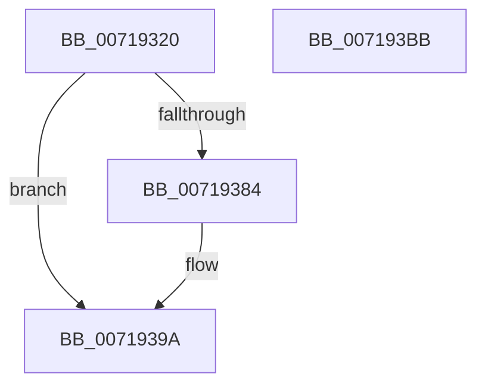

# VslQuerySecureDevice

- RVA: `0x00719320`–`0x007193BC` (길이 `156` bytes)
- VA: `0x0000000140719320`
- 실행 섹션: `PAGE`
- PDB 이름 있음: `예`; PDB Function 태그: `아니요`
- unwind 정보 RVA: `0x000B3900`
- 디코드: `39`개 명령, `156/156` bytes 표시
- 미해석 바이트: `0` (있으면 어셈블리에 `.byte`로 보존)

> 이 문서는 커널 이미지의 기계어와 PDB 기호를 분석해 생성했습니다. 4번과 5번은 함수 원형과 자료형을 바이너리 사용 방식에서 추정한 C 해석이며 원본 소스 복구 결과는 아닙니다.

## 1. Dependencies

- 직접 호출 지점: **3**; 고유 호출 대상: **3**
- 직접 호출자로 확인된 함수: **0**
- RIP 상대 이미지 참조: **1**

### Outgoing calls
- `0x00719350` → [memset](../../text/6C/memset_function_006C6C40.md) (function, `0x006C6C40`)
- `0x0071937B` → [VslpEnterIumSecureMode](../../text/23/VslpEnterIumSecureMode_function_00235E50.md) (function, `0x00235E50`)
- `0x007193A5` → [_security_check_cookie](../../text/6A/_security_check_cookie_function_006AC640.md) (function, `0x006AC640`)

### Direct callers
- 이 함수 시작 RVA로 연결되는 직접 call은 확인되지 않았습니다. 간접 호출은 완전히 역산할 수 없습니다.

### Static image references
- `0x0071932D` → RVA `0x00E0A740` (`.data`; read)

## 2. Other-region calls and transfers

- 다른 실행 섹션으로 향하는 call: **3**
  - `0x00719350` → [memset](../../text/6C/memset_function_006C6C40.md) (`PAGE` → `.text`)
  - `0x0071937B` → [VslpEnterIumSecureMode](../../text/23/VslpEnterIumSecureMode_function_00235E50.md) (`PAGE` → `.text`)
  - `0x007193A5` → [_security_check_cookie](../../text/6A/_security_check_cookie_function_006AC640.md) (`PAGE` → `.text`)
- 별도 외부 분기/꼬리 이동을 확인하지 못했습니다.

## 3. Assembly (complete function range)

```asm
00719320  48 89 5C 24 18                  mov qword ptr [rsp + 0x18], rbx
00719325  57                              push rdi
00719326  48 81 EC A0 00 00 00            sub rsp, 0xa0
0071932D  48 8B 05 0C 14 6F 00            mov rax, qword ptr [rip + 0x6f140c]
00719334  48 33 C4                        xor rax, rsp
00719337  48 89 84 24 90 00 00 00         mov qword ptr [rsp + 0x90], rax
0071933F  48 8B FA                        mov rdi, rdx
00719342  48 8B D9                        mov rbx, rcx
00719345  33 D2                           xor edx, edx
00719347  48 8D 4C 24 20                  lea rcx, [rsp + 0x20]
0071934C  44 8D 42 68                     lea r8d, [rdx + 0x68]
00719350  E8 EB D8 FA FF                  call 0x1406c6c40
00719355  0F 57 C0                        xorps xmm0, xmm0
00719358  4C 8D 4C 24 20                  lea r9, [rsp + 0x20]
0071935D  0F 11 07                        movups xmmword ptr [rdi], xmm0
00719360  BA 46 00 00 00                  mov edx, 0x46
00719365  8B 43 08                        mov eax, dword ptr [rbx + 8]
00719368  F2 0F 10 03                     movsd xmm0, qword ptr [rbx]
0071936C  45 33 C0                        xor r8d, r8d
0071936F  B1 02                           mov cl, 2
00719371  F2 0F 11 44 24 28               movsd qword ptr [rsp + 0x28], xmm0
00719377  89 44 24 30                     mov dword ptr [rsp + 0x30], eax
0071937B  E8 D0 CA B1 FF                  call 0x140235e50
00719380  85 C0                           test eax, eax
00719382  78 16                           js 0x14071939a
00719384  8A 4C 24 34                     mov cl, byte ptr [rsp + 0x34]
00719388  88 0F                           mov byte ptr [rdi], cl
0071938A  8A 4C 24 35                     mov cl, byte ptr [rsp + 0x35]
0071938E  88 4F 01                        mov byte ptr [rdi + 1], cl
00719391  48 8B 4C 24 38                  mov rcx, qword ptr [rsp + 0x38]
00719396  48 89 4F 08                     mov qword ptr [rdi + 8], rcx
0071939A  48 8B 8C 24 90 00 00 00         mov rcx, qword ptr [rsp + 0x90]
007193A2  48 33 CC                        xor rcx, rsp
007193A5  E8 96 32 F9 FF                  call 0x1406ac640
007193AA  48 8B 9C 24 C0 00 00 00         mov rbx, qword ptr [rsp + 0xc0]
007193B2  48 81 C4 A0 00 00 00            add rsp, 0xa0
007193B9  5F                              pop rdi
007193BA  C3                              ret
007193BB  CC                              int3
```

## 4. C-style interpretation (structured pseudocode)

```c
__int64 __fastcall VslQuerySecureDevice(__int64 a1, __int64 a2)
{
    __int64 result;
    __int64 v_rsp;
    unsigned __int64 v_stack_m18;
    unsigned __int64 v_stack_m70;
    unsigned __int8 v_stack_m73;
    unsigned __int8 v_stack_m74;
    unsigned int v_stack_m78;
    unsigned __int64 v_stack_m80;
    unsigned __int64 v_stack_m88;
    unsigned __int64 v_stack_p18;

    v_stack_p18 = v_rbx;
    v_rsp = (v_rsp) - (160);
    result = (*(unsigned __int64 *)(v_rip + 7279628)) ^ (v_rsp);
    v_stack_m18 = result;
    a2 = 0;
    result = memset(v_stack_m88, a2, a2 + 104, a4);
    *(unsigned __int64 *)(a2) = v_xmm0;
    a3 = 0;
    v_stack_m80 = v_xmm0;
    v_stack_m78 = (unsigned int)((unsigned int)(*(unsigned int *)(a1 + 8)));
    result = VslpEnterIumSecureMode(2, 70, a3, v_stack_m88);
    if (!(sign_flag)) {
        a1 = v_stack_m74;
        *(unsigned __int8 *)(a2) = (unsigned __int8)(a1);
        a1 = v_stack_m73;
        *(unsigned __int8 *)(a2 + 1) = (unsigned __int8)(a1);
        a1 = v_stack_m70;
        *(unsigned __int64 *)(a2 + 8) = a1;
    }
    a1 = (v_stack_m18) ^ (v_rsp);
    result = _security_check_cookie(a1, 70, a3, v_stack_m88);
    v_rsp = (v_rsp) + (160);
    return result;
}
```

## 5. (Beta) C Style

```c
int64_t VslQuerySecureDevice(void *Arg1, void *Arg2)
{
    uint8_t *arg1 = (uint8_t *)Arg1;
    uint8_t *arg2 = (uint8_t *)Arg2;

    int64_t result;
    int64_t local_rsp;
    uint64_t v_stack_m18;
    uint64_t v_stack_m70;
    uint8_t v_stack_m73;
    uint8_t v_stack_m74;
    uint32_t v_stack_m78;
    uint64_t v_stack_m80;
    uint64_t v_stack_m88;
    uint64_t v_stack_p18;

    v_stack_p18 = local_rbx;
    local_rsp = (local_rsp) - (160);
    result = (*(uint64_t *)(v_rip + 0x6F140C)) ^ (local_rsp);
    v_stack_m18 = result;
    Arg2 = 0;
    result = memset(v_stack_m88, Arg2, Arg2 + 104, a4);
    *(uint64_t *)(arg2) = v_xmm0;
    a3 = 0;
    v_stack_m80 = v_xmm0;
    v_stack_m78 = (uint32_t)((uint32_t)(*(uint32_t *)(arg1 + 0x8)));
    result = VslpEnterIumSecureMode(2, 70, a3, v_stack_m88);
    if (!(sign_flag)) {
        Arg1 = v_stack_m74;
        *(uint8_t *)(arg2) = (uint8_t)(Arg1);
        Arg1 = v_stack_m73;
        *(uint8_t *)(arg2 + 0x1) = (uint8_t)(Arg1);
        Arg1 = v_stack_m70;
        *(void **)(arg2 + 0x8) = Arg1;
    }
    Arg1 = (v_stack_m18) ^ (local_rsp);
    result = _security_check_cookie(Arg1, 70, a3, v_stack_m88);
    local_rsp = (local_rsp) + (160);
    return result;
}
```

### 관측된 메모리 오프셋

구조체 형식이 확인되지 않은 접근은 인자 기준의 오프셋으로만 기록했습니다.

| 기준 인자 | 오프셋 표현 | 폭 (bit) | 접근 |
|---|---:|---:|---|
| `Arg1` | `+ 0x0` | `64` | `R` |
| `Arg1` | `+ 0x8` | `32` | `R` |
| `Arg2` | `+ 0x0` | `8` | `W` |
| `Arg2` | `+ 0x0` | `128` | `R` |
| `Arg2` | `+ 0x1` | `8` | `W` |
| `Arg2` | `+ 0x8` | `64` | `W` |

## 6. Execution-region graph

[열기: 2D/3D 그래프와 함수 탐색 컨트롤 패널](../../../control-panel.html?section=page&rva=0x00719320&view=graph)

- 2D 그래프는 위에서 아래로 흐르고, 3D 그래프는 빈 공간을 드래그해 회전합니다. Shift+드래그는 이동, 휠은 확대·축소, 함수 노드 선택은 대상 보고서 이동입니다.

### Static fallback


