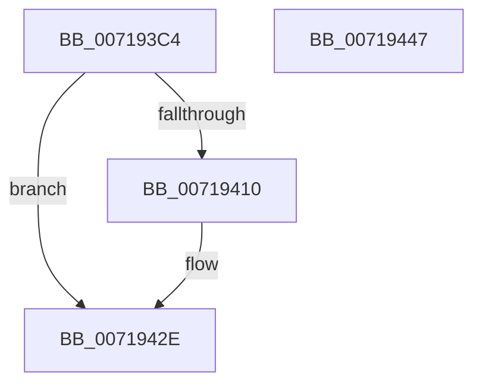

# VslQueryTrustedAppRuntimeInformation

- RVA: `0x007193C4`–`0x00719448` (길이 `132` bytes)
- VA: `0x00000001407193C4`
- 실행 섹션: `PAGE`
- PDB 이름 있음: `예`; PDB Function 태그: `아니요`
- unwind 정보 RVA: `0x000AF554`
- 디코드: `34`개 명령, `132/132` bytes 표시
- 미해석 바이트: `0` (있으면 어셈블리에 `.byte`로 보존)

> 이 문서는 커널 이미지의 기계어와 PDB 기호를 분석해 생성했습니다. 4번과 5번은 함수 원형과 자료형을 바이너리 사용 방식에서 추정한 C 해석이며 원본 소스 복구 결과는 아닙니다.

## 1. Dependencies

- 직접 호출 지점: **3**; 고유 호출 대상: **3**
- 직접 호출자로 확인된 함수: **1**
- RIP 상대 이미지 참조: **1**

### Outgoing calls
- `0x007193ED` → [memset](../../text/6C/memset_function_006C6C40.md) (function, `0x006C6C40`)
- `0x00719407` → [VslpEnterIumSecureMode](../../text/23/VslpEnterIumSecureMode_function_00235E50.md) (function, `0x00235E50`)
- `0x00719439` → [_security_check_cookie](../../text/6A/_security_check_cookie_function_006AC640.md) (function, `0x006AC640`)

### Direct callers
- [ExpQuerySystemInformation](../A5/ExpQuerySystemInformation_function_00A57858.md) at `0x00A5B611`

### Static image references
- `0x007193CD` → RVA `0x00E0A740` (`.data`; read)

## 2. Other-region calls and transfers

- 다른 실행 섹션으로 향하는 call: **3**
  - `0x007193ED` → [memset](../../text/6C/memset_function_006C6C40.md) (`PAGE` → `.text`)
  - `0x00719407` → [VslpEnterIumSecureMode](../../text/23/VslpEnterIumSecureMode_function_00235E50.md) (`PAGE` → `.text`)
  - `0x00719439` → [_security_check_cookie](../../text/6A/_security_check_cookie_function_006AC640.md) (`PAGE` → `.text`)
- 별도 외부 분기/꼬리 이동을 확인하지 못했습니다.

## 3. Assembly (complete function range)

```asm
007193C4  40 53                           push rbx
007193C6  48 81 EC A0 00 00 00            sub rsp, 0xa0
007193CD  48 8B 05 6C 13 6F 00            mov rax, qword ptr [rip + 0x6f136c]
007193D4  48 33 C4                        xor rax, rsp
007193D7  48 89 84 24 90 00 00 00         mov qword ptr [rsp + 0x90], rax
007193DF  33 D2                           xor edx, edx
007193E1  48 8B D9                        mov rbx, rcx
007193E4  48 8D 4C 24 20                  lea rcx, [rsp + 0x20]
007193E9  44 8D 42 68                     lea r8d, [rdx + 0x68]
007193ED  E8 4E D8 FA FF                  call 0x1406c6c40
007193F2  0F 57 C0                        xorps xmm0, xmm0
007193F5  4C 8D 4C 24 20                  lea r9, [rsp + 0x20]
007193FA  BA 35 00 00 00                  mov edx, 0x35
007193FF  45 33 C0                        xor r8d, r8d
00719402  B1 02                           mov cl, 2
00719404  0F 11 03                        movups xmmword ptr [rbx], xmm0
00719407  E8 44 CA B1 FF                  call 0x140235e50
0071940C  85 C0                           test eax, eax
0071940E  78 1E                           js 0x14071942e
00719410  48 8B 4C 24 30                  mov rcx, qword ptr [rsp + 0x30]
00719415  48 8B 13                        mov rdx, qword ptr [rbx]
00719418  83 E1 01                        and ecx, 1
0071941B  48 83 E2 FE                     and rdx, 0xfffffffffffffffe
0071941F  48 0B D1                        or rdx, rcx
00719422  48 8B 4C 24 38                  mov rcx, qword ptr [rsp + 0x38]
00719427  48 89 4B 08                     mov qword ptr [rbx + 8], rcx
0071942B  48 89 13                        mov qword ptr [rbx], rdx
0071942E  48 8B 8C 24 90 00 00 00         mov rcx, qword ptr [rsp + 0x90]
00719436  48 33 CC                        xor rcx, rsp
00719439  E8 02 32 F9 FF                  call 0x1406ac640
0071943E  48 81 C4 A0 00 00 00            add rsp, 0xa0
00719445  5B                              pop rbx
00719446  C3                              ret
00719447  CC                              int3
```

## 4. C-style interpretation (structured pseudocode)

```c
__int64 __fastcall VslQueryTrustedAppRuntimeInformation(__int64 a1, int a2)
{
    __int64 result;
    __int64 v_rsp;
    unsigned __int64 v_stack_m18;
    unsigned __int64 v_stack_m70;
    unsigned __int64 v_stack_m78;
    unsigned __int64 v_stack_m88;

    v_rsp = (v_rsp) - (160);
    result = (*(unsigned __int64 *)(v_rip + 7279468)) ^ (v_rsp);
    v_stack_m18 = result;
    a2 = 0;
    result = memset(v_stack_m88, a2, a2 + 104, a4);
    a3 = 0;
    *(unsigned __int64 *)(a1) = v_xmm0;
    result = VslpEnterIumSecureMode(2, 53, a3, v_stack_m88);
    if (!(sign_flag)) {
        a1 = v_stack_m78;
        a2 = *(unsigned __int64 *)(a1);
        a1 = (unsigned int)((a1) & (1));
        a2 = (a2) & (-2);
        a2 = (a2) | (a1);
        a1 = v_stack_m70;
        *(unsigned __int64 *)(a1 + 8) = a1;
        *(unsigned __int64 *)(a1) = a2;
    }
    a1 = (v_stack_m18) ^ (v_rsp);
    result = _security_check_cookie(a1, a2, a3, v_stack_m88);
    v_rsp = (v_rsp) + (160);
    return result;
}
```

## 5. (Beta) C Style

```c
int64_t VslQueryTrustedAppRuntimeInformation(void *Arg1, int32_t Arg2)
{
    uint8_t *arg1 = (uint8_t *)Arg1;

    int64_t result;
    int64_t local_rsp;
    uint64_t v_stack_m18;
    uint64_t v_stack_m70;
    uint64_t v_stack_m78;
    uint64_t v_stack_m88;

    local_rsp = (local_rsp) - (160);
    result = (*(uint64_t *)(v_rip + 0x6F136C)) ^ (local_rsp);
    v_stack_m18 = result;
    Arg2 = 0;
    result = memset(v_stack_m88, Arg2, Arg2 + 104, a4);
    a3 = 0;
    *(uint64_t *)(arg1) = v_xmm0;
    result = VslpEnterIumSecureMode(2, 53, a3, v_stack_m88);
    if (!(sign_flag)) {
        Arg1 = v_stack_m78;
        Arg2 = *(uint64_t *)(arg1);
        Arg1 = (uint32_t)((Arg1) & (1));
        Arg2 = (Arg2) & (-2);
        Arg2 = (Arg2) | (Arg1);
        Arg1 = v_stack_m70;
        *(void **)(arg1 + 0x8) = Arg1;
        *(uint64_t *)(arg1) = Arg2;
    }
    Arg1 = (v_stack_m18) ^ (local_rsp);
    result = _security_check_cookie(Arg1, Arg2, a3, v_stack_m88);
    local_rsp = (local_rsp) + (160);
    return result;
}
```

### 관측된 메모리 오프셋

구조체 형식이 확인되지 않은 접근은 인자 기준의 오프셋으로만 기록했습니다.

| 기준 인자 | 오프셋 표현 | 폭 (bit) | 접근 |
|---|---:|---:|---|
| `Arg1` | `+ 0x0` | `64` | `R` |
| `Arg1` | `+ 0x0` | `64` | `W` |
| `Arg1` | `+ 0x0` | `128` | `R` |
| `Arg1` | `+ 0x8` | `64` | `W` |

## 6. Execution-region graph

[열기: 2D/3D 그래프와 함수 탐색 컨트롤 패널](../../../control-panel.html?section=page&rva=0x007193C4&view=graph)

- 2D 그래프는 위에서 아래로 흐르고, 3D 그래프는 빈 공간을 드래그해 회전합니다. Shift+드래그는 이동, 휠은 확대·축소, 함수 노드 선택은 대상 보고서 이동입니다.

### Static fallback


