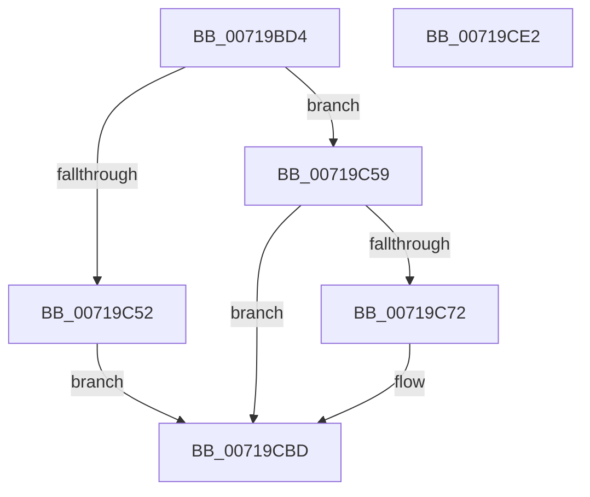

# VslReapplyImportOptimizationForDriverVerifier

- RVA: `0x00719BD4`–`0x00719CE3` (길이 `271` bytes)
- VA: `0x0000000140719BD4`
- 실행 섹션: `PAGE`
- PDB 이름 있음: `예`; PDB Function 태그: `아니요`
- unwind 정보 RVA: `0x000BD0D0`
- 디코드: `62`개 명령, `271/271` bytes 표시
- 미해석 바이트: `0` (있으면 어셈블리에 `.byte`로 보존)

> 이 문서는 커널 이미지의 기계어와 PDB 기호를 분석해 생성했습니다. 4번과 5번은 함수 원형과 자료형을 바이너리 사용 방식에서 추정한 C 해석이며 원본 소스 복구 결과는 아닙니다.

## 1. Dependencies

- 직접 호출 지점: **6**; 고유 호출 대상: **5**
- 직접 호출자로 확인된 함수: **1**
- RIP 상대 이미지 참조: **1**

### Outgoing calls
- `0x00719C0F` → [memset](../../text/6C/memset_function_006C6C40.md) (function, `0x006C6C40`)
- `0x00719C1F` → [memset](../../text/6C/memset_function_006C6C40.md) (function, `0x006C6C40`)
- `0x00719C69` → [VslpLockPagesForTransfer](../../text/29/VslpLockPagesForTransfer_function_0029E0FC.md) (function, `0x0029E0FC`)
- `0x00719CAA` → [VslpEnterIumSecureMode](../../text/23/VslpEnterIumSecureMode_function_00235E50.md) (function, `0x00235E50`)
- `0x00719CB6` → [VslpUnlockPagesForTransfer](../../text/29/VslpUnlockPagesForTransfer_function_0029EE4C.md) (function, `0x0029EE4C`)
- `0x00719CC8` → [_security_check_cookie](../../text/6A/_security_check_cookie_function_006AC640.md) (function, `0x006AC640`)

### Direct callers
- [MiReapplyImportOptimizationForDriverVerifier](../../text/68/MiReapplyImportOptimizationForDriverVerifier_function_00682268.md) at `0x00682401`

### Static image references
- `0x00719BE6` → RVA `0x00E0A740` (`.data`; read)

## 2. Other-region calls and transfers

- 다른 실행 섹션으로 향하는 call: **6**
  - `0x00719C0F` → [memset](../../text/6C/memset_function_006C6C40.md) (`PAGE` → `.text`)
  - `0x00719C1F` → [memset](../../text/6C/memset_function_006C6C40.md) (`PAGE` → `.text`)
  - `0x00719C69` → [VslpLockPagesForTransfer](../../text/29/VslpLockPagesForTransfer_function_0029E0FC.md) (`PAGE` → `.text`)
  - `0x00719CAA` → [VslpEnterIumSecureMode](../../text/23/VslpEnterIumSecureMode_function_00235E50.md) (`PAGE` → `.text`)
  - `0x00719CB6` → [VslpUnlockPagesForTransfer](../../text/29/VslpUnlockPagesForTransfer_function_0029EE4C.md) (`PAGE` → `.text`)
  - `0x00719CC8` → [_security_check_cookie](../../text/6A/_security_check_cookie_function_006AC640.md) (`PAGE` → `.text`)
- 별도 외부 분기/꼬리 이동을 확인하지 못했습니다.

## 3. Assembly (complete function range)

```asm
00719BD4  48 89 5C 24 08                  mov qword ptr [rsp + 8], rbx
00719BD9  48 89 74 24 20                  mov qword ptr [rsp + 0x20], rsi
00719BDE  57                              push rdi
00719BDF  48 81 EC 00 01 00 00            sub rsp, 0x100
00719BE6  48 8B 05 53 0B 6F 00            mov rax, qword ptr [rip + 0x6f0b53]
00719BED  48 33 C4                        xor rax, rsp
00719BF0  48 89 84 24 F0 00 00 00         mov qword ptr [rsp + 0xf0], rax
00719BF8  48 8B FA                        mov rdi, rdx
00719BFB  41 8B D8                        mov ebx, r8d
00719BFE  33 D2                           xor edx, edx
00719C00  48 8B F1                        mov rsi, rcx
00719C03  48 8D 8C 24 80 00 00 00         lea rcx, [rsp + 0x80]
00719C0B  44 8D 42 68                     lea r8d, [rdx + 0x68]
00719C0F  E8 2C D0 FA FF                  call 0x1406c6c40
00719C14  33 D2                           xor edx, edx
00719C16  48 8D 4C 24 30                  lea rcx, [rsp + 0x30]
00719C1B  44 8D 42 48                     lea r8d, [rdx + 0x48]
00719C1F  E8 1C D0 FA FF                  call 0x1406c6c40
00719C24  48 8B CF                        mov rcx, rdi
00719C27  44 8D 04 5B                     lea r8d, [rbx + rbx*2]
00719C2B  81 E1 FF 0F 00 00               and ecx, 0xfff
00719C31  41 C1 E0 03                     shl r8d, 3
00719C35  48 81 C1 FF 0F 00 00            add rcx, 0xfff
00719C3C  41 8B C0                        mov eax, r8d
00719C3F  48 03 C8                        add rcx, rax
00719C42  48 81 E1 00 F0 FF FF            and rcx, 0xfffffffffffff000
00719C49  48 81 F9 00 A0 1F 00            cmp rcx, 0x1fa000
00719C50  76 07                           jbe 0x140719c59
00719C52  B8 0D 00 00 C0                  mov eax, 0xc000000d
00719C57  EB 64                           jmp 0x140719cbd
00719C59  83 64 24 20 00                  and dword ptr [rsp + 0x20], 0
00719C5E  48 8D 4C 24 30                  lea rcx, [rsp + 0x30]
00719C63  45 33 C9                        xor r9d, r9d
00719C66  48 8B D7                        mov rdx, rdi
00719C69  E8 8E 44 B8 FF                  call 0x14029e0fc
00719C6E  85 C0                           test eax, eax
00719C70  78 4B                           js 0x140719cbd
00719C72  48 8B 46 30                     mov rax, qword ptr [rsi + 0x30]
00719C76  4C 8D 8C 24 80 00 00 00         lea r9, [rsp + 0x80]
00719C7E  48 89 84 24 88 00 00 00         mov qword ptr [rsp + 0x88], rax
00719C86  BA E2 00 00 00                  mov edx, 0xe2
00719C8B  48 8B 44 24 30                  mov rax, qword ptr [rsp + 0x30]
00719C90  45 33 C0                        xor r8d, r8d
00719C93  48 89 84 24 90 00 00 00         mov qword ptr [rsp + 0x90], rax
00719C9B  B1 02                           mov cl, 2
00719C9D  48 8B 44 24 68                  mov rax, qword ptr [rsp + 0x68]
00719CA2  48 89 84 24 98 00 00 00         mov qword ptr [rsp + 0x98], rax
00719CAA  E8 A1 C1 B1 FF                  call 0x140235e50
00719CAF  48 8D 4C 24 30                  lea rcx, [rsp + 0x30]
00719CB4  8B D8                           mov ebx, eax
00719CB6  E8 91 51 B8 FF                  call 0x14029ee4c
00719CBB  8B C3                           mov eax, ebx
00719CBD  48 8B 8C 24 F0 00 00 00         mov rcx, qword ptr [rsp + 0xf0]
00719CC5  48 33 CC                        xor rcx, rsp
00719CC8  E8 73 29 F9 FF                  call 0x1406ac640
00719CCD  4C 8D 9C 24 00 01 00 00         lea r11, [rsp + 0x100]
00719CD5  49 8B 5B 10                     mov rbx, qword ptr [r11 + 0x10]
00719CD9  49 8B 73 28                     mov rsi, qword ptr [r11 + 0x28]
00719CDD  49 8B E3                        mov rsp, r11
00719CE0  5F                              pop rdi
00719CE1  C3                              ret
00719CE2  CC                              int3
```

## 4. C-style interpretation (structured pseudocode)

```c
__int64 __fastcall VslReapplyImportOptimizationForDriverVerifier(__int64 a1, __int64 a2, int a3, int a4)
{
    __int64 result;
    __int64 v_rbx;
    __int64 v_rsp;
    unsigned __int64 v_stack_m18;
    unsigned __int64 v_stack_m70;
    unsigned __int64 v_stack_m78;
    unsigned __int64 v_stack_m8;
    unsigned __int64 v_stack_m80;
    unsigned __int64 v_stack_m88;
    unsigned __int64 v_stack_mA0;
    unsigned __int64 v_stack_mD8;
    unsigned int v_stack_mE8;
    unsigned __int64 v_stack_p20;
    unsigned __int64 v_stack_p8;

    v_stack_p8 = v_rbx;
    v_stack_p20 = v_rsi;
    v_rsp = (v_rsp) - (256);
    result = (*(unsigned __int64 *)(v_rip + 7277395)) ^ (v_rsp);
    v_stack_m18 = result;
    a2 = 0;
    result = memset(v_stack_m88, a2, a2 + 104, a4);
    a2 = 0;
    result = memset(v_stack_mD8, a2, a2 + 72, a4);
    a1 = (unsigned int)((0) & (0xFFFULL));
    a3 = (unsigned int)(((unsigned int)(a3) + (unsigned int)(a3) * 2) << (3));
    a1 = (a1) + (0xFFFULL);
    a1 = (a1) + ((unsigned int)(a3));
    a1 = (a1) & (0xFFFFFFFFFFFFF000ULL);
    if (a1 <= 0x1FA000ULL) goto loc_00719C59;
    goto loc_00719CBD;
loc_00719C59:
    a4 = 0;
    result = VslpLockPagesForTransfer(v_stack_mD8, 0, a3, a4);
    v_rbx = (unsigned int)(a3);
    if (!(sign_flag)) {
        result = *(unsigned __int64 *)(a1 + 48);
        a4 = v_stack_m88;
        v_stack_m80 = result;
        a2 = 226;
        result = v_stack_mD8;
        a3 = 0;
        v_stack_m78 = result;
        a1 = 2;
        result = v_stack_mA0;
        v_stack_m70 = result;
        result = VslpEnterIumSecureMode(a1, a2, a3, a4);
        a1 = v_stack_mD8;
        v_rbx = (unsigned int)(result);
        result = VslpUnlockPagesForTransfer(a1, a2, a3, a4);
        result = (unsigned int)(v_rbx);
    }
    a1 = (v_stack_m18) ^ (v_rsp);
    result = _security_check_cookie(a1, a2, a3, a4);
    return result;
}
```

## 5. (Beta) C Style

```c
int64_t VslReapplyImportOptimizationForDriverVerifier(void *Arg1, int64_t Arg2, void *Arg3, int32_t Arg4)
{
    uint8_t *arg1 = (uint8_t *)Arg1;
    uint8_t *arg3 = (uint8_t *)Arg3;

    int64_t result;
    int64_t local_rbx;
    int64_t local_rsp;
    uint64_t v_stack_m18;
    uint64_t v_stack_m70;
    uint64_t v_stack_m78;
    uint64_t v_stack_m8;
    uint64_t v_stack_m80;
    uint64_t v_stack_m88;
    uint64_t v_stack_mA0;
    uint64_t v_stack_mD8;
    uint32_t v_stack_mE8;
    uint64_t v_stack_p20;
    uint64_t v_stack_p8;

    v_stack_p8 = local_rbx;
    v_stack_p20 = local_rsi;
    local_rsp = (local_rsp) - (256);
    result = (*(uint64_t *)(v_rip + 0x6F0B53)) ^ (local_rsp);
    v_stack_m18 = result;
    Arg2 = 0;
    result = memset(v_stack_m88, Arg2, Arg2 + 104, Arg4);
    Arg2 = 0;
    result = memset(v_stack_mD8, Arg2, Arg2 + 72, Arg4);
    Arg1 = (uint32_t)((0) & (0xFFFULL));
    Arg3 = (uint32_t)(((uint32_t)(Arg3) + (uint32_t)(Arg3) * 2) << (3));
    Arg1 = (Arg1) + (0xFFFULL);
    Arg1 = (Arg1) + ((uint32_t)(Arg3));
    Arg1 = (Arg1) & (0xFFFFFFFFFFFFF000ULL);
    if (Arg1 <= 0x1FA000ULL) goto loc_00719C59;
    goto loc_00719CBD;
loc_00719C59:
    Arg4 = 0;
    result = VslpLockPagesForTransfer(v_stack_mD8, 0, Arg3, Arg4);
    local_rbx = (uint32_t)(Arg3);
    if (!(sign_flag)) {
        result = *(uint64_t *)(arg1 + 0x30);
        Arg4 = v_stack_m88;
        v_stack_m80 = result;
        Arg2 = 226;
        result = v_stack_mD8;
        Arg3 = 0;
        v_stack_m78 = result;
        Arg1 = 2;
        result = v_stack_mA0;
        v_stack_m70 = result;
        result = VslpEnterIumSecureMode(Arg1, Arg2, Arg3, Arg4);
        Arg1 = v_stack_mD8;
        local_rbx = (uint32_t)(result);
        result = VslpUnlockPagesForTransfer(Arg1, Arg2, Arg3, Arg4);
        result = (uint32_t)(local_rbx);
    }
    Arg1 = (v_stack_m18) ^ (local_rsp);
    result = _security_check_cookie(Arg1, Arg2, Arg3, Arg4);
    return result;
}
```

### 관측된 메모리 오프셋

구조체 형식이 확인되지 않은 접근은 인자 기준의 오프셋으로만 기록했습니다.

| 기준 인자 | 오프셋 표현 | 폭 (bit) | 접근 |
|---|---:|---:|---|
| `Arg1` | `+ 0x30` | `64` | `R` |
| `Arg3` | `+ 0x0 + rbx*2` | `32` | `R` |

## 6. Execution-region graph

[열기: 2D/3D 그래프와 함수 탐색 컨트롤 패널](../../../control-panel.html?section=page&rva=0x00719BD4&view=graph)

- 2D 그래프는 위에서 아래로 흐르고, 3D 그래프는 빈 공간을 드래그해 회전합니다. Shift+드래그는 이동, 휠은 확대·축소, 함수 노드 선택은 대상 보고서 이동입니다.

### Static fallback


